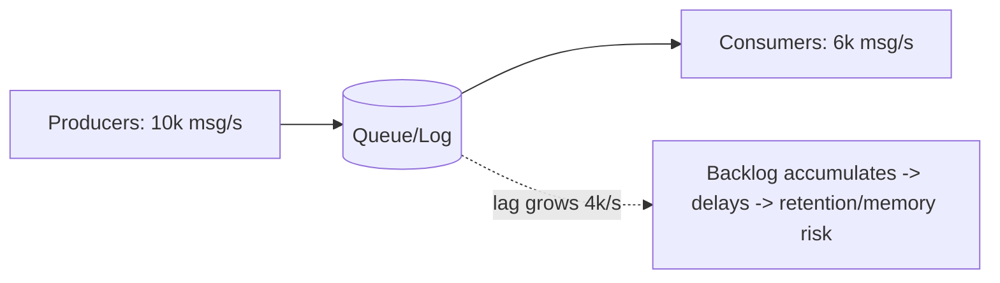

# Backpressure and Consumer Lag

> Prerequisites: [queues-vs-pub-sub-vs-event-streams](./queues-vs-pub-sub-vs-event-streams.md), [kafka-internals-and-partitioning](./kafka-internals-and-partitioning.md)
> Related: [autoscaling-and-capacity-planning](../02-compute-and-architecture/autoscaling-and-capacity-planning.md) · [queue-capacity-and-consumer-throughput](../11-estimation-and-bottleneck-analysis/queue-capacity-and-consumer-throughput.md)

"What happens when consumers are slower than producers?" is a classic async follow-up. The answer involves consumer lag (the symptom), backpressure (the control mechanism), and a safe backlog-recovery plan.

---

## A. Problem and motivation

In async systems, producers and consumers run independently. If producers persistently outpace consumers, the queue/log grows without bound — **consumer lag** builds up, processing falls behind (notifications delayed by minutes, then hours), and eventually the queue hits storage/memory limits or data falls off the retention window (lost). You need to detect lag, control the imbalance (backpressure), and recover from a backlog without making things worse.

---

## B. Consumer lag — the symptom

**Consumer lag** = how far behind consumers are. In Kafka, it's the difference between the latest offset (produced) and the committed offset (consumed) per partition. Rising lag means consumers can't keep up.

Lag is the single most important async health metric — alert on it. A small, stable lag is fine; growing lag is an incident.

---

## C. Backpressure — the control mechanism

**Backpressure** is a signal that lets a slow consumer tell producers (or the system) to slow down, preventing unbounded buildup. Mechanisms vary by system:
- **Pull-based (Kafka):** consumers pull at their own rate — natural backpressure (producers aren't forced on consumers), but the *log still grows* if producers outpace, until retention. So pull-based backpressure protects the consumer, not the storage.
- **Bounded queues:** when the queue is full, producers block or are rejected (fail fast) — explicit backpressure. RabbitMQ prefetch limits unacked messages per consumer.
- **Rate limiting / load shedding** at the producer/ingress: cap intake, shed low-priority work. See [rate-limiting](../01-networking-and-api-design/rate-limiting.md).
- **Reactive flow control** (Reactive Streams): consumers signal demand upstream.

Without backpressure, a fast producer overwhelms a slow consumer and the system fails (OOM, retention loss). With it, the system degrades gracefully (rejects/queues/sheds) instead of collapsing.

---

## D. Recovering from a backlog (do this carefully)

Once a large backlog exists, recovery is itself risky:
- **Scale out consumers** — but only up to the partition count in Kafka (parallelism = partitions; see [kafka-internals](./kafka-internals-and-partitioning.md)). You may need to add partitions.
- **Make consumers idempotent first** — so you can safely parallelize and reprocess without duplicate side effects. See [idempotency-and-deduplication](./idempotency-and-deduplication.md).
- **Prioritize / shed** — process high-priority messages first; defer or drop low-priority ones if acceptable.
- **Protect downstream** — faster consumers now hammer the DB/external APIs harder; add a concurrency limiter so recovery doesn't cause a *second* outage downstream (the autoscale-into-DB trap from [autoscaling](../02-compute-and-architecture/autoscaling-and-capacity-planning.md)).
- **Don't just blindly max out** — recovering too aggressively can topple the DB or a third-party API; ramp up with monitoring.

---

## E. Example — notification service backlog

A product launch causes a notification spike: producers push 50K/s, consumers handle 20K/s → lag grows 30K/s. Detection: the consumer-lag alarm fires. Short-term: autoscale notification workers up to the partition count; if still behind, add partitions; shed/deprioritize low-priority notifications (marketing) to protect transactional ones (password resets). Protect downstream: a concurrency limiter on the email provider so the recovery surge doesn't trip its rate limits or overload it. Because consumers are idempotent (dedupe on notification_id), parallelizing is safe. Long-term: capacity-plan for peak and apply ingress rate limiting. See [notification-service](../12-system-design-problems/notification-service.md).

---

## F. Trade-offs

| Mechanism | Advantages | Disadvantages | Best use | Warning signs |
|---|---|---|---|---|
| Pull-based (Kafka) | Natural consumer protection, replay | Log still grows → retention loss risk | Streaming, replay | Ignoring growing lag |
| Bounded queue + block/reject | Prevents unbounded buildup; fast failure | Producers blocked/rejected (must handle) | Protecting memory/consumers | Unbounded queues |
| Load shedding / priority | Protects critical work under overload | Drops/defers low-priority work | Overload events | Shedding critical work |
| Scale consumers | Clears backlog | Capped by partitions; can overload downstream | Transient spikes | Scaling into a downstream bottleneck |

---

## G. Failure scenarios

1. **Unbounded backlog → retention loss.** Trigger: producers persistently outpace consumers; log exceeds retention. Users: messages dropped (never processed). Detect: lag approaching retention window. Fix: backpressure/shedding + scale consumers; alert early. 
2. **Recovery overloads downstream.** Trigger: scaling consumers to clear a backlog floods the DB/external API. Users: a *second* outage. Fix: concurrency limiter on downstream during recovery; ramp gradually.
3. **Scaling past partition count does nothing.** Trigger: adding consumers beyond partitions in Kafka. Effect: extras idle, lag persists. Fix: add partitions, optimize per-message processing.
4. **No lag monitoring.** Trigger: lag builds silently until retention loss. Fix: alert on consumer lag — the key async metric.

---

## H. Scaling implications

Backpressure and lag are the throughput-dimension scaling concerns of async systems (distinct from scaling users/data). The async decoupling that lets a queue absorb spikes only works if consumers eventually catch up; if producers *persistently* outpace, no buffer saves you — you must add consumer capacity (bounded by partitions), shed load, or slow producers. Recovery must respect downstream capacity to avoid cascading. This connects to [autoscaling workers on queue depth](../02-compute-and-architecture/autoscaling-and-capacity-planning.md) (the right pattern) and [estimation of consumer throughput](../11-estimation-and-bottleneck-analysis/queue-capacity-and-consumer-throughput.md).

---

## I. Interview preparation

**Basic**
- Q: What is consumer lag? → *A: How far behind consumers are (produced minus consumed offset); growing lag means consumers can't keep up — the key async health metric.*
- Q: What is backpressure? → *A: A mechanism for a slow consumer/system to signal producers to slow down (block/reject/shed), preventing unbounded buildup.*

**Intermediate**
- Q: What happens when producers outpace consumers in Kafka? → *A: The log grows (pull-based backpressure protects consumers, not storage); lag rises and, if it exceeds retention, messages are lost. Fix with more consumers/partitions, shedding, or slowing producers.*
- Q: How do you recover from a big backlog safely? → *A: Ensure idempotent consumers, scale out up to the partition count (add partitions if needed), prioritize/shed, and throttle downstream with a concurrency limiter so recovery doesn't cause a second outage.*

**SDE-2 / scenario**
- Q: "Your notification backlog is growing during a launch. Walk through it." → *A: Alert on lag; autoscale workers to partition count, add partitions if still behind; shed/deprioritize marketing to protect transactional notifications; limit concurrency to the email provider so the recovery surge doesn't overload it; idempotent consumers make parallelizing safe. Long-term: capacity-plan peak + ingress rate limiting.*
- Q: "Why did clearing the backlog cause a database outage?" → *A: Faster consumers hammered the DB during recovery (the autoscale-into-bottleneck trap). I'd add a concurrency limiter on DB access and ramp recovery gradually.*

**Common wrong answers:** no lag monitoring; adding consumers beyond partition count; blindly maxing recovery and toppling downstream; unbounded queues.

---

## J. Hands-on exercise

Producers emit 30K msg/s; each consumer handles 5K/s; the topic has 8 partitions; retention is 6 hours. Compute: how many consumers can actually work, the steady-state lag growth if you run 8 consumers, how long until retention loss, and a recovery plan that protects a downstream DB limited to 10K writes/s.

---

## K. Revision summary

**Key takeaways**
- Consumer lag = how far behind consumers are; the key async health metric — alert on it.
- Backpressure controls producer/consumer imbalance (block/reject/shed); pull-based (Kafka) protects consumers but the log still grows → retention-loss risk.
- Recover from a backlog carefully: idempotent consumers, scale to partition count (add partitions), prioritize/shed, and throttle downstream so recovery doesn't cause a second outage.
- Persistent producer > consumer imbalance can't be buffered away — add capacity or slow producers.

**Must explain without notes:** lag vs backpressure; what happens when producers outpace consumers; safe backlog recovery.

**Rapid-fire**
1. Key async health metric? → Consumer lag.
2. What does backpressure prevent? → Unbounded queue buildup.
3. Does pull-based backpressure stop the log growing? → No (protects consumers, not storage).
4. Consumer-scaling limit in Kafka? → Partition count.
5. Risk when clearing a backlog fast? → Overloading downstream (second outage).

**Section complete.** Next section: [06-distributed-systems](../06-distributed-systems/why-distributed-systems.md)
