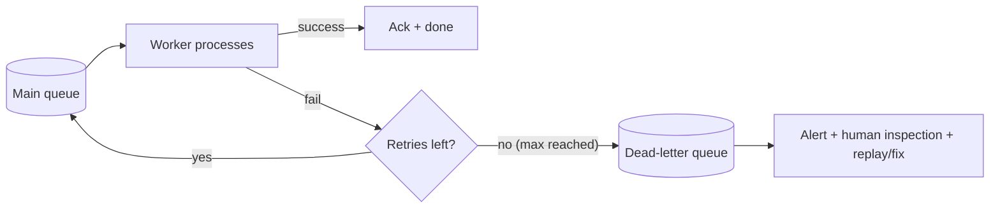

# Dead-Letter Queues and Poison Messages

> Prerequisites: [retries-backoff-and-jitter](./retries-backoff-and-jitter.md)
> Related: [idempotency-and-deduplication](./idempotency-and-deduplication.md) · [backpressure-and-consumer-lag](./backpressure-and-consumer-lag.md)

A DLQ is where messages go when they can't be processed after retries. It's the mechanism that stops one broken message from blocking the whole pipeline. Short topic, but a frequent follow-up.

---

## A. Problem and motivation

Some messages can never succeed: a malformed payload, a reference to a deleted entity, a bug in processing. With at-least-once + retries, such a **poison message** gets redelivered forever — retried, failed, retried — blocking the queue (especially with ordering) and burning resources. The dead-letter queue breaks this loop: after N failed attempts, move the message aside so the pipeline keeps flowing, and alert a human to inspect it.

---

## B. How a DLQ works

- The message carries a retry/delivery count. After it exceeds the limit (or a TTL), the broker/consumer routes it to the DLQ instead of the main queue.
- The DLQ holds failed messages (often with failure metadata: error, attempt count, timestamp).
- Humans/tools inspect the DLQ, fix the root cause (bad data, deploy a fix), and **replay** the messages back to the main queue, or discard them.

RabbitMQ does this via a Dead-Letter Exchange; SQS has native DLQ redrive; Kafka patterns route to a dead-letter topic.

---

## C. Poison messages

A **poison message** always fails processing (bad schema, impossible reference, triggers a bug). Without a DLQ it poisons the pipeline:
- In an **ordered** partition/queue, a poison message at the head blocks every message behind it (head-of-line blocking) — the whole partition stalls.
- Even unordered, it wastes retry capacity and generates error noise.

The DLQ is the escape hatch: cap retries, then dead-letter it so the rest proceed.

---

## D. Example — notification service

The email worker fails to send a notification because the payload references a deleted user (will never succeed). With exponential backoff it retries a few times, then — on exhausting the retry budget — routes the message to the `notifications-dlq` with the error and attempt count, and emits an alert. The main queue keeps flowing (other users' emails unaffected). An on-call engineer inspects the DLQ, sees the deleted-user cause, fixes the upstream bug, and either replays the fixed messages or discards the invalid ones. See [notification-service](../12-system-design-problems/notification-service.md).

---

## E. Operating a DLQ (what interviewers probe)

- **Alerting:** a growing DLQ means something is broken — alert on DLQ depth/rate. A silent DLQ that fills unnoticed is a common failure.
- **Replay/redrive:** you need tooling to move messages back to the main queue after a fix (and idempotent consumers so replay is safe).
- **Retention:** DLQ messages need retention long enough to investigate, with their own retention/archival policy.
- **Don't dead-letter transient failures too eagerly:** set the retry budget so genuine transient issues (dependency briefly down) are retried enough before dead-lettering; otherwise you DLQ messages that would have succeeded.

---

## F. Trade-offs

| Aspect | Advantages | Disadvantages | Best use | Warning signs |
|---|---|---|---|---|
| DLQ | Unblocks pipeline, isolates poison messages, enables inspection/replay | Needs alerting + replay tooling; messages can rot if ignored | Any at-least-once pipeline | No DLQ (poison blocks everything) or no alerting on it |
| Low retry budget → DLQ fast | Fails fast on true poison | May DLQ transient failures | Clearly-permanent errors | Dead-lettering recoverable messages |
| High retry budget | Rides out transient issues | Delays dead-lettering real poison | Flaky dependencies | Poison message retried for hours |

---

## G. Failure scenarios

1. **No DLQ → pipeline stall.** Trigger: a poison message in an ordered queue retried forever. Users: everything behind it stuck. Fix: add a DLQ with a retry limit. 
2. **Silent DLQ fills.** Trigger: DLQ exists but nobody alerts on it; messages accumulate and are lost/forgotten. Users: silently dropped work. Fix: alert on DLQ depth/rate; dashboards. 
3. **Unsafe replay.** Trigger: replaying DLQ messages to non-idempotent consumers. Users: duplicate effects. Fix: idempotent consumers (dedupe) before replaying.
4. **Dead-lettering transient failures.** Trigger: retry budget too low; a brief dependency outage dead-letters recoverable messages. Fix: tune the retry budget to the expected transient-failure duration.

---

## H. Scaling implications

A DLQ is essential at scale because poison messages are inevitable with high volume and at-least-once delivery — without it, one bad message can stall a partition and cascade into consumer lag ([backpressure-and-consumer-lag](./backpressure-and-consumer-lag.md)). The DLQ decouples "keep the pipeline flowing" from "handle the hard cases out of band." Operationally it must be monitored and have replay tooling, and replay demands idempotent consumers. It's a small component with outsized importance for pipeline resilience.

---

## I. Interview preparation

**Basic**
- Q: What's a DLQ? → *A: A queue where messages go after failing processing N times, so one bad message doesn't block the pipeline; humans inspect/replay/discard them.*
- Q: What's a poison message? → *A: One that always fails (bad data, bug), which without a DLQ gets retried forever and can block the queue.*

**Intermediate**
- Q: What happens to a poison message in an ordered partition without a DLQ? → *A: Head-of-line blocking — it stalls every message behind it in that partition. A DLQ (after a retry limit) unblocks the pipeline.*
- Q: What must you monitor about a DLQ? → *A: Its depth/growth rate — a filling DLQ signals a real problem; a silent, unmonitored DLQ loses work.*

**SDE-2 / scenario**
- Q: "A malformed message keeps failing and blocking your consumer." → *A: Cap retries (with backoff), then dead-letter it so the pipeline flows; alert on the DLQ, inspect the cause, fix upstream, and replay the corrected messages to idempotent consumers.*
- Q: "How do you replay DLQ messages safely?" → *A: Ensure consumers are idempotent (dedupe), then redrive from the DLQ to the main queue; a replay must not duplicate effects.*

**Common wrong answers:** no DLQ (poison blocks pipeline); DLQ without alerting; replaying to non-idempotent consumers; retry budget so low that transient failures get dead-lettered.

---

## J. Hands-on exercise

Design the DLQ strategy for the DMS job pipeline (OCR/scan/thumbnail jobs): retry budget before dead-lettering, what metadata you attach, how you alert, how you replay after a fix, and how you prevent duplicate processing on replay.

---

## K. Revision summary

**Key takeaways**
- DLQ: after N failed retries, route a message aside so the pipeline keeps flowing.
- Poison messages always fail; without a DLQ they're retried forever and block ordered queues (head-of-line).
- Operate the DLQ: alert on depth, provide replay/redrive tooling, set retention, tune the retry budget (not too low).
- Replay requires idempotent consumers.

**Rapid-fire**
1. Where do messages go after exhausting retries? → DLQ.
2. Poison message in an ordered queue without a DLQ? → Blocks everything behind it.
3. What must you alert on? → DLQ depth/growth.
4. Prereq for safe replay? → Idempotent consumers.
5. Risk of too-low retry budget? → Dead-lettering transient (recoverable) failures.

**Next:** [idempotency-and-deduplication](./idempotency-and-deduplication.md)
