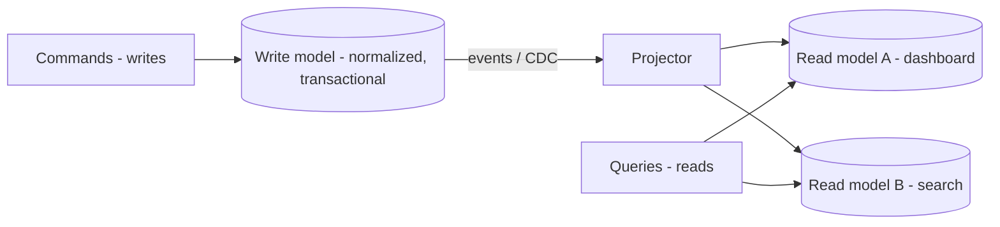
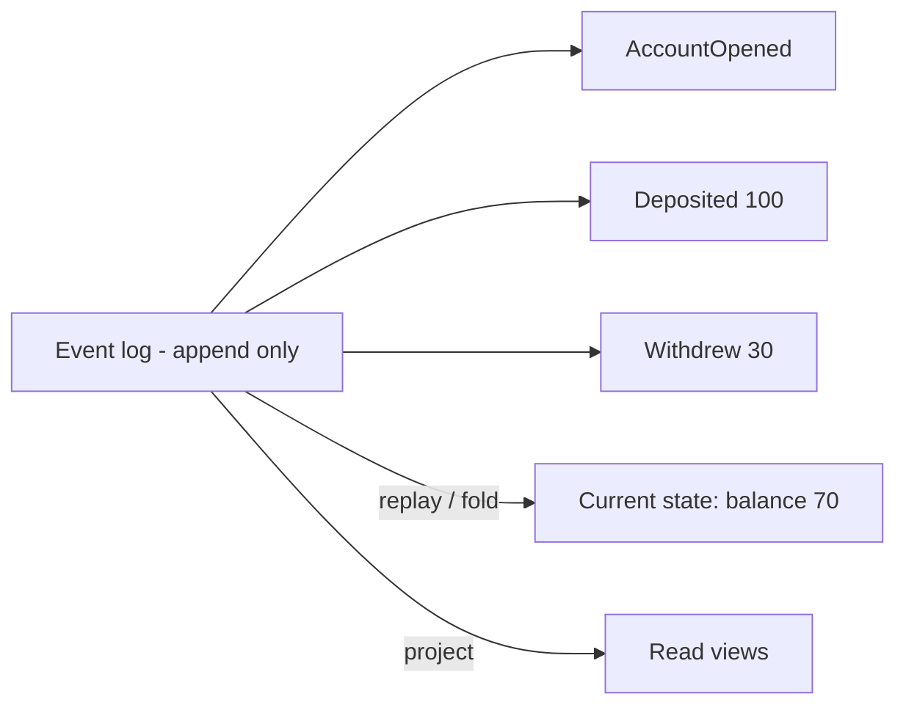

# Event Sourcing and CQRS

> Prerequisites: [transactional-outbox-and-cdc](./transactional-outbox-and-cdc.md), [03-databases/normalization-and-denormalization](../03-databases-and-data-modeling/normalization-and-denormalization.md)
> Related: [saga-pattern](./saga-pattern.md) · [03-databases/consistency-models](../03-databases-and-data-modeling/consistency-models.md)

Two advanced patterns that often get name-dropped. Know what problem each solves, their costs, and — importantly — **when NOT to use them** (they're frequently over-applied). Track B depth.

---

## A. Problem and motivation

- **CQRS (Command Query Responsibility Segregation):** read and write workloads often have very different shapes — writes need normalized, transactional models; reads need denormalized, query-optimized views. Forcing one model to serve both is a compromise. CQRS separates them.
- **Event sourcing:** instead of storing current state, store the full sequence of **events** that produced it. The state is derived by replaying events. This gives a complete audit trail and the ability to reconstruct any past state — but adds significant complexity.

Both are powerful and both are over-applied; the SDE-2 skill is knowing when the problem actually justifies them.

---

## B. CQRS

Separate the **command** side (writes, which change state) from the **query** side (reads). Writes go to a normalized, transactional store; reads come from one or more **read models** (denormalized projections) optimized per query, updated asynchronously from the write side (via events/CDC/outbox).

- **Pros:** read and write scale and are modeled independently; read models are tailored to queries (fast); fits read-heavy systems and complex read requirements.
- **Cons:** eventual consistency between write and read models (reads lag); more moving parts (projectors, multiple stores); complexity.
- This is the denormalized-read-model idea from [normalization-and-denormalization](../03-databases-and-data-modeling/normalization-and-denormalization.md), formalized: the write store is the source of truth; read models are projections kept in sync asynchronously.

**You don't need full event sourcing to do CQRS** — a normalized write DB + denormalized read views (updated via CDC/outbox) is lightweight CQRS and often enough.

---

## C. Event sourcing

Store state as an append-only log of **events** ("AccountOpened," "Deposited $100," "Withdrew $30"). Current state = fold/replay of events. To read current state efficiently, maintain **snapshots** and/or projections (which is where CQRS naturally pairs in).

- **Pros:** complete audit trail (every change recorded — great for finance/compliance); can reconstruct any historical state; natural fit for event-driven systems; temporal queries ("what was the balance on date X").
- **Cons (significant):** querying current state requires replay/projection (not a simple SELECT); **event schema evolution** is hard (old events must stay readable forever); eventual consistency; conceptually complex; big operational/mental overhead. Deleting data (GDPR) is tricky in an append-only log (crypto-shredding).

---

## D. When NOT to use them (the key message)

Both are over-applied. **Avoid unless the problem demands it:**
- Don't event-source a simple CRUD app — storing current state in a normal DB is far simpler and sufficient. Event sourcing's audit/temporal benefits must be a real requirement (finance, compliance, systems where "how we got here" matters).
- Don't add CQRS until read and write models genuinely diverge or read scaling demands separate, denormalized views. Premature CQRS adds eventual consistency and projectors for no benefit.

**Interview-ready:** "I'd use lightweight CQRS (denormalized read models via CDC) when read requirements diverge from the write model or reads dominate. I'd reserve event sourcing for domains that truly need a complete audit trail or temporal reconstruction, like a financial ledger — otherwise it's needless complexity."

---

## E. Example — where each fits

- **DMS dashboard (read-heavy, multi-join):** lightweight CQRS — a denormalized "document summary" read model built from the normalized write DB via CDC (from [normalization-and-denormalization](../03-databases-and-data-modeling/normalization-and-denormalization.md)). No event sourcing needed.
- **Payment ledger / accounting:** event sourcing fits — every debit/credit is an immutable event, giving a perfect audit trail and the ability to reconstruct balances at any time (regulatory requirement). Paired with CQRS read models (current balances, statements) via projection. See [payment-system](../12-system-design-problems/payment-system.md).
- **Simple user-profile CRUD:** neither — a normal table is correct; event sourcing would be over-engineering.

---

## F. Trade-offs

| Pattern | Advantages | Disadvantages | Best use | Warning signs |
|---|---|---|---|---|
| CQRS (lightweight) | Independent read/write scaling + tailored read models | Eventual consistency, projectors | Read-heavy, divergent read needs | Simple CRUD (over-engineering) |
| Event sourcing | Full audit trail, temporal reconstruction, event-native | Replay/projection to read, schema evolution pain, complexity, deletion hard | Finance/compliance/audit-critical domains | CRUD apps, no audit requirement |

---

## G. Failure scenarios

1. **Over-applied event sourcing.** Trigger: event-sourcing a basic app. Result: huge complexity, slow reads (replay), schema-evolution pain, no benefit. Fix: use a normal state store; reserve event sourcing for audit/temporal needs.
2. **Event schema evolution.** Trigger: changing an event's shape; old events in the log must still replay. Fix: version events, upcasters (transform old → new on read), never break old event readability. 
3. **Read-model lag/consistency.** Trigger: projector slow/down; read models stale. Users: see old data. Fix: monitor projector lag; surface eventual consistency; rebuild projections from the event log/CDC if corrupted.
4. **Deletion/GDPR in an append-only log.** Trigger: must delete personal data from immutable events. Fix: crypto-shredding (encrypt per-subject, delete the key) or careful redaction — a known hard problem.

---

## H. Scaling implications

CQRS is a genuine scaling tool for read-heavy systems: read models are denormalized, independently scaled, and tailored per query (fast), while the write model stays normalized and correct — fed by CDC/outbox. It's the formalization of "precompute read models" and underlies many high-scale feeds/dashboards. Event sourcing scales writes (append-only is write-friendly) and gives replay/rebuild superpowers, but its complexity and schema-evolution/deletion costs mean it's justified mainly by audit/temporal requirements. The recurring theme: adopt these when a measured need (read/write divergence, audit) justifies the complexity — not by default.

---

## I. Interview preparation

**Basic**
- Q: What's CQRS? → *A: Separating the write model (normalized, transactional) from read models (denormalized projections optimized per query), updated asynchronously from writes.*
- Q: What's event sourcing? → *A: Storing state as an append-only log of events; current state is derived by replaying them, giving a full audit trail.*

**Intermediate**
- Q: When would you NOT use event sourcing? → *A: For simple CRUD without audit/temporal requirements — it adds major complexity (replay, schema evolution, deletion difficulty) for no benefit.*
- Q: Do you need event sourcing to do CQRS? → *A: No — lightweight CQRS is a normalized write DB plus denormalized read models updated via CDC/outbox.*

**SDE-2 / scenario**
- Q: "Your dashboard needs complex, fast reads over data that's written in a normalized form." → *A: Lightweight CQRS — keep the normalized write DB as source of truth, build a denormalized read model via CDC for the dashboard, accept brief eventual consistency.*
- Q: "Would you event-source a user-settings feature?" → *A: No — a normal table is simpler and sufficient. I'd reserve event sourcing for domains needing a full audit trail or temporal reconstruction, like a financial ledger.*

**Common wrong answers:** event-sourcing everything; CQRS for simple CRUD; ignoring event-schema evolution and deletion problems; conflating CQRS with event sourcing.

---

## J. Hands-on exercise

For a banking system, decide: event sourcing for the ledger? CQRS for account statements and balances? Justify why the ledger benefits from event sourcing (audit/temporal) and how CQRS read models (current balance, monthly statement) are projected from the event log. Then name one data-deletion challenge event sourcing creates.

---

## K. Revision summary

**Key takeaways**
- CQRS: separate write (normalized, transactional) and read (denormalized projections) models; eventual consistency between them; great for read-heavy/divergent reads. Lightweight CQRS = write DB + CDC-fed read models.
- Event sourcing: append-only event log, state via replay; full audit trail + temporal reconstruction; heavy complexity (replay, schema evolution, deletion).
- Both are over-applied — adopt only when read/write divergence or audit/temporal needs justify it.

**Must explain without notes:** CQRS write/read split; event sourcing + replay; when NOT to use each.

**Rapid-fire**
1. CQRS separates what? → Command (write) and query (read) models.
2. Event sourcing stores? → Events (append-only), not current state.
3. Need event sourcing for CQRS? → No.
4. Best fit for event sourcing? → Audit/temporal domains (e.g., ledger).
5. Event sourcing's hard problem for GDPR? → Deleting data from an immutable log (crypto-shredding).

**Next:** [backpressure-and-consumer-lag](./backpressure-and-consumer-lag.md)
