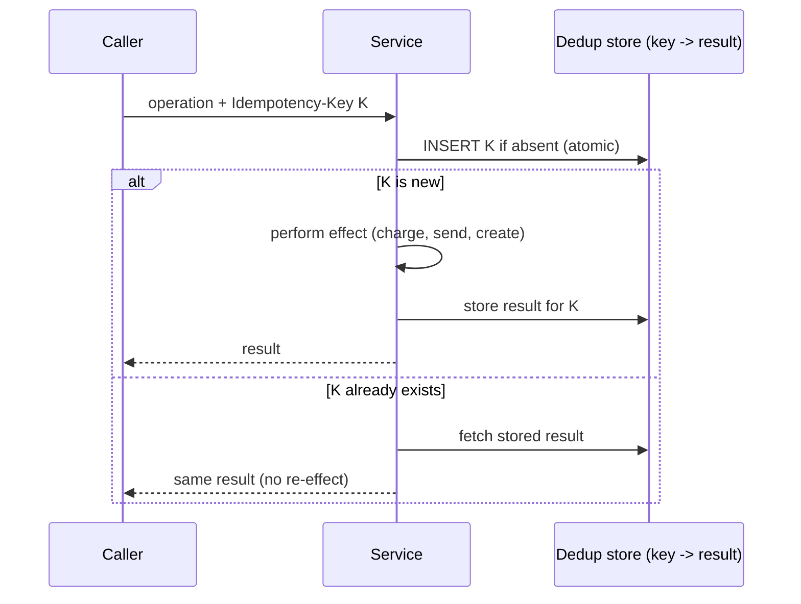

# Idempotency and Deduplication

> Prerequisites: [message-delivery-semantics](./message-delivery-semantics.md)
> Related: [retries-backoff-and-jitter](./retries-backoff-and-jitter.md) · [06-distributed-systems/exactly-once-processing](../06-distributed-systems/exactly-once-processing.md) · [rest-and-api-design](../01-networking-and-api-design/rest-and-api-design.md)

Idempotency is the linchpin of correct async and distributed systems. Because delivery is at-least-once and retries happen, duplicate processing is inevitable — idempotency is what makes it safe. This is one of the highest-value topics for SDE-2.

---

## A. Problem and motivation

From [message-delivery-semantics](./message-delivery-semantics.md): at-least-once delivery means duplicates are inevitable (crash before ack → redelivery). From [retries](./retries-backoff-and-jitter.md): retries after timeouts can duplicate a request whose original actually succeeded. If processing a message twice causes two emails, two charges, or two orders, you have a correctness bug. **Idempotency** makes "process this twice" produce the same result as "process it once," so duplicates are harmless.

---

## B. What idempotency means

An operation is **idempotent** if applying it multiple times has the same effect as applying it once.

- Naturally idempotent: `SET balance = 100` (setting to an absolute value); `DELETE WHERE id = x`; `PUT` of a full resource.
- **Not** idempotent: `balance = balance + 10` (increment); "send an email"; "create an order"; `INSERT` a new row. Each repeat adds another effect.

The job is to make the non-idempotent operations *behave* idempotently.

---

## C. The idempotency key pattern (the core technique)

Attach a unique **idempotency key** to each logical operation. Before performing the effect, record the key; a repeat with the same key returns the stored result instead of re-doing the effect.

The key insight: the **check-and-record of the key must be atomic** (a unique constraint insert, or an atomic KV set-if-absent), or two concurrent duplicates both see "new" and both act. A `UNIQUE` constraint on the key column does this at the DB level — the second insert fails, signaling a duplicate.

**Where the key comes from:** the client generates it (e.g., a UUID per logical request) for API idempotency (`Idempotency-Key` header, see [rest-and-api-design](../01-networking-and-api-design/rest-and-api-design.md)); for messages, use a stable message/business id (`notification_id`, `order_id`).

---

## D. Deduplication strategies

| Strategy | How | Pros | Cons |
|---|---|---|---|
| **Idempotency key store** | Record processed keys; skip/return on repeat | General, explicit | Needs a store + TTL management |
| **Unique DB constraint** | A natural unique key makes the duplicate insert fail | Simple, atomic, free consistency | Only works where a natural key exists |
| **Conditional/atomic update** | `UPDATE ... WHERE version = n` / `WHERE not already done` | No separate store | Only for state transitions |
| **Natural idempotency** | Design the op to be set-based, not additive | No dedup needed | Not always possible (counters, sends) |

**Dedup store retention:** you can't keep keys forever. Keep them long enough to cover the retry/redelivery window (e.g., 24h–7d), then expire. A key seen after expiry would be reprocessed — acceptable if the window exceeds all realistic retry delays.

---

## E. Example — notification service and payments

**Notification:** each `send-email` task has a `notification_id`. The worker, before sending, atomically inserts `notification_id` into a `sent_notifications` table (unique constraint). If the insert succeeds, it sends; if it fails (duplicate), it skips. A crash-before-ack redelivery hits the duplicate path → the user gets exactly one email. **Effectively-once** via at-least-once + idempotency. See [notification-service](../12-system-design-problems/notification-service.md).

**Payment (the canonical example):** charging a card is not idempotent. The client sends an `Idempotency-Key`; the payment service records it with the charge result. A timeout+retry with the same key returns the original charge instead of charging again — preventing the double-charge. See [payment-system](../12-system-design-problems/payment-system.md) and [06-distributed-systems/retries-and-duplicate-execution](../06-distributed-systems/retries-and-duplicate-execution.md).

---

## F. Trade-offs

| Approach | Advantages | Disadvantages | Best use | Warning signs |
|---|---|---|---|---|
| Idempotency key store | Works for any op (sends, charges, creates) | Store + atomic check + TTL | External side effects, APIs | Non-atomic check (race) |
| Unique constraint | Simple, atomic, no extra store | Needs a natural unique key | Inserts with a natural key | No natural key |
| Natural idempotency (set-based) | No dedup machinery | Not always possible | State you can set absolutely | Additive ops (counters) |

---

## G. Failure scenarios

1. **Non-atomic idempotency check (race).** Trigger: two concurrent duplicates both read "not processed," both act. Users: double effect despite the key. Fix: make the check-and-record atomic (unique insert / set-if-absent). 
2. **Dedup store expiry too short.** Trigger: a retry arrives after the key expired → reprocessed. Fix: retention ≥ max retry/redelivery window.
3. **Partial idempotency.** Trigger: the effect spans multiple steps and only some are idempotent; a replay repeats a non-idempotent step. Fix: make the whole operation idempotent, or wrap it so the key gates the entire effect (ideally in one transaction with the key insert).
4. **Idempotency on the wrong boundary.** Trigger: deduping message delivery but not the external effect (e.g., Kafka EOS but a non-idempotent card charge). Users: still double-charge. Fix: idempotency at the side-effect boundary.

---

## H. Scaling implications

At scale, duplicates are routine, so idempotency is mandatory, not optional — it's what lets you safely use at-least-once delivery, retries, and parallel consumers. The dedup store becomes a real component: it's read/written on every processed operation, so size it (keys × retention) and make it fast (often Redis or a DB unique index) — and account for it being on the critical path (see [redis-design-and-failure-modes](../04-caching/redis-design-and-failure-modes.md) for its failure handling). Idempotency is the thread connecting delivery semantics, retries, DLQs, sagas, and exactly-once — master it and much of the async story falls into place.

---

## I. Interview preparation

**Basic**
- Q: What does idempotent mean? → *A: Doing the operation multiple times has the same effect as doing it once, so duplicates/retries are safe.*
- Q: Give an idempotent and a non-idempotent operation. → *A: Idempotent: `SET x = 5`, `DELETE id`, `PUT`. Non-idempotent: `x += 1`, send email, create order, INSERT.*

**Intermediate**
- Q: How does an idempotency key work? → *A: Attach a unique key per logical op; atomically record it before the effect; a repeat with the same key returns the stored result instead of re-acting. The check-and-record must be atomic (unique constraint / set-if-absent).*
- Q: Why is at-least-once + idempotency the standard? → *A: Delivery can't be exactly-once, so you accept duplicates and make processing idempotent → effectively-once outcome.*

**SDE-2 / scenario**
- Q: "A worker crashes after sending but before acking, causing duplicate emails. Fix?" → *A: Idempotent processing: before sending, atomically record notification_id (unique constraint); the redelivery hits the duplicate path and skips. At-least-once + idempotency = exactly one email.*
- Q: "How do you prevent a double charge on a retried payment?" → *A: Client sends an Idempotency-Key; the payment service records key+result atomically; a retry with the same key returns the original charge rather than charging again.*
- Q: "Two concurrent duplicates arrive at once — does your key still work?" → *A: Only if the check-and-record is atomic (a unique insert / set-if-absent); otherwise both see 'new' and both act. The atomicity is the crux.*

**Common wrong answers:** relying on "exactly-once delivery"; non-atomic check-then-act; idempotency on delivery but not the side effect; no key retention plan.

---

## J. Hands-on exercise

Design idempotent processing for "create order" from an at-least-once order-events queue. Specify: the idempotency key, the atomic check-and-record mechanism, what a duplicate returns, the dedup-store retention, and the race you must prevent. Then explain why Kafka's exactly-once wouldn't remove the need for this.

---

## K. Revision summary

**Key takeaways**
- Idempotent = repeat has the same effect as once; makes at-least-once/retries/parallel consumers safe.
- Idempotency key pattern: atomically record a unique key before the effect; repeats return the stored result.
- The check-and-record MUST be atomic (unique constraint / set-if-absent) or concurrent duplicates both act.
- Apply idempotency at the side-effect boundary; broker "exactly-once" doesn't cover external effects. Retention ≥ retry window.

**Must explain without notes:** the idempotency key flow + atomicity requirement; idempotent vs non-idempotent ops; "at-least-once + idempotency = effectively-once."

**Rapid-fire**
1. Is `balance += 10` idempotent? → No. `SET balance = 110`? → Yes.
2. What makes the key check safe under concurrency? → Atomic record (unique insert / set-if-absent).
3. Prevent double charge on retry? → Idempotency key returning the original result.
4. Where must idempotency live? → At the side-effect boundary.
5. At-least-once + idempotency = ? → Effectively-once.

**Next:** [transactional-outbox-and-cdc](./transactional-outbox-and-cdc.md)
