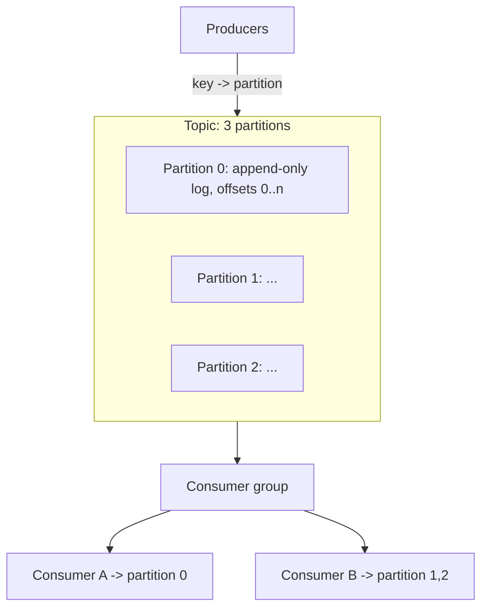

# Kafka Internals and Partitioning

> Prerequisites: [queues-vs-pub-sub-vs-event-streams](./queues-vs-pub-sub-vs-event-streams.md)
> Related: [ordering-and-consumer-groups](./ordering-and-consumer-groups.md) · [backpressure-and-consumer-lag](./backpressure-and-consumer-lag.md)

Kafka is the dominant event-streaming system in interviews. You need the mental model — topics, partitions, offsets, consumer groups, replication — to reason about ordering, throughput, and failure. (Core for Track B; useful anywhere Kafka appears.)

---

## A. Problem and motivation

Kafka solves "a durable, replayable, high-throughput, ordered event log that many consumers can read independently." Its design (partitioned append-only logs) is *why* it scales to millions of messages/sec while keeping per-partition ordering and enabling replay. Understanding partitions explains ordering guarantees, parallelism limits, and the hot-partition failure mode.

---

## B. The core concepts

- **Topic:** a named stream of events.
- **Partition:** a topic is split into partitions, each an **ordered, append-only log**. Ordering is guaranteed **only within a partition**, not across the topic.
- **Offset:** each message's position in its partition. Consumers track the offset they've read (committed offset).
- **Producer + key:** a producer sends with an optional **key**; `partition = hash(key) % numPartitions`. All messages with the same key land in the same partition → **ordered per key**.
- **Consumer group:** consumers in a group share the partitions — each partition is read by **exactly one** consumer in the group. So **max parallelism = number of partitions**. Different groups read the same topic independently (each has its own offsets).
- **Broker:** a Kafka server; a cluster has many. Partitions are distributed across brokers.
- **Replication:** each partition has a **leader** + follower replicas on other brokers; producers/consumers talk to the leader; followers take over on failure (durability + availability). The **ISR** (in-sync replicas) set must acknowledge for durability.

---

## C. Why partitions are the key to everything

- **Throughput/parallelism:** more partitions = more consumers can work in parallel (one per partition per group). To scale consumption, add partitions (and consumers).
- **Ordering:** guaranteed only within a partition. If you need all events for an entity in order, key by that entity so they share a partition (e.g., key by `conversation_id` or `user_id`).
- **The trade-off:** global ordering across a topic requires a single partition (no parallelism). You almost never want global ordering; you want **per-key ordering with parallelism** → partition by key.

**Interview-ready:** "Kafka orders within a partition only. I key messages by the entity that needs ordering (e.g., account_id) so its events stay ordered, while different entities spread across partitions for parallelism. Max consumer parallelism equals the partition count."

---

## D. Delivery and durability knobs

- **Producer acks:** `acks=0` (fire-and-forget, may lose), `acks=1` (leader only, lose if leader dies before replication), `acks=all` (all in-sync replicas — durable, slower). Choose by durability need.
- **Consumer offset commit:** commit after processing (at-least-once, may reprocess on crash) vs before (at-most-once, may lose). At-least-once is the norm → consumers must be **idempotent**. See [message-delivery-semantics](./message-delivery-semantics.md).
- Kafka also offers transactions / exactly-once *within Kafka*, but end-to-end business exactly-once still needs idempotency (see [exactly-once-processing](../06-distributed-systems/exactly-once-processing.md)).

---

## E. Example — notification service on Kafka

Topic `notifications` with, say, 12 partitions, keyed by `user_id` so a given user's notifications stay ordered. Three consumer groups: `email-senders`, `push-senders`, `analytics` — each reads all events independently via its own offsets. To send faster, increase partitions and add consumers (up to 12 per group). `acks=all` ensures a produced notification event is durable. Consumers commit offsets after sending → at-least-once → the sender dedupes on `notification_id` (idempotent). Retention of 7 days lets us add a new `digest` consumer group that replays the week. See [notification-service](../12-system-design-problems/notification-service.md).

---

## F. Trade-offs

| Decision | Advantages | Disadvantages | Best use | Warning signs |
|---|---|---|---|---|
| More partitions | More parallelism/throughput | More overhead, more open files, rebalance cost; too many hurts | High-throughput topics | Thousands of tiny partitions |
| Key by entity | Per-entity ordering | Hot partition if one key dominates | Ordered-per-entity events | A celebrity/one key = hot partition |
| acks=all | Durable | Higher latency | Can't-lose events | Latency-critical, loss-tolerant |
| Single partition | Global ordering | No parallelism | Rarely needed | Expecting throughput |

---

## G. Failure scenarios

1. **Hot partition.** Trigger: keying by a value where one key dominates (a huge tenant/celebrity) → one partition overloaded while others idle. Users: lag on that key's events. Detect: per-partition lag/throughput skew. Fix: better key, composite key, or split the hot key. (Same shape as [DB hot shards](../03-databases-and-data-modeling/partitioning-and-sharding.md).)
2. **Consumer lag grows.** Trigger: consumers slower than producers. Users: delayed processing. Detect: consumer-group lag metric. Fix: add partitions+consumers, optimize consumers, backpressure. See [backpressure-and-consumer-lag](./backpressure-and-consumer-lag.md).
3. **Rebalancing storms.** Trigger: consumers joining/leaving/crashing frequently → partitions reassigned, pausing consumption. Fix: stable consumers, tuned session timeouts, cooperative rebalancing.
4. **Data loss with acks=1.** Trigger: leader dies before followers replicate. Fix: `acks=all` + sufficient replication/ISR for critical data.

---

## H. Scaling implications

Kafka scales throughput by partitions and brokers, retains data for replay, and keeps per-partition ordering — the combination that makes it the backbone of event-driven architectures at scale. The hard limits: parallelism is capped by partition count (can't exceed with one group), ordering is per-partition only (design keys accordingly), and hot keys create hot partitions. Repartitioning later is disruptive (changes key→partition mapping), so choose partition count/key with growth in mind. Retention trades storage for replay-ability. Everything about scaling Kafka comes back to partitions.

---

## I. Interview preparation

**Basic**
- Q: What's a partition? → *A: An ordered, append-only log that is a slice of a topic; ordering is guaranteed within a partition only.*
- Q: What's a consumer group? → *A: A set of consumers sharing a topic's partitions — each partition read by one consumer in the group; different groups read independently.*

**Intermediate**
- Q: How does Kafka guarantee ordering? → *A: Only within a partition. Key messages by the entity needing ordering so they share a partition; different entities spread across partitions for parallelism.*
- Q: What limits consumer parallelism? → *A: The partition count — at most one consumer per partition per group.*

**SDE-2 / scenario**
- Q: "One tenant's events are lagging while others are fine." → *A: Hot partition — that tenant's key hashes to one overloaded partition. I'd use a composite key or split the hot key across partitions, and verify with per-partition lag metrics.*
- Q: "How do you ensure a produced event isn't lost?" → *A: `acks=all` with adequate replication so an in-sync replica set acknowledges before the producer considers it committed; consumers process then commit offsets (at-least-once) and dedupe.*

**Common wrong answers:** expecting global ordering across a topic; parallelism beyond partition count; acks=1 for can't-lose data; keying such that one key dominates.

---

## J. Hands-on exercise

Design the Kafka topic for a chat system's messages: pick the partition key, explain the ordering guarantee it gives, estimate partitions for ~70K peak msg/sec (from the [estimation chapter](../00-foundations/back-of-the-envelope-estimation.md)) assuming a consumer handles ~X/sec, and name the hot-partition risk and mitigation.

---

## K. Revision summary

**Key takeaways**
- Topic → partitions (ordered append-only logs); offsets track consumer position; consumer groups share partitions (one consumer per partition per group); other groups read independently.
- Ordering is per-partition only; key by the entity needing order; parallelism capped by partition count.
- Durability via replication + `acks=all` + ISR; at-least-once by default → idempotent consumers.
- Hot keys → hot partitions; retention enables replay; repartitioning is disruptive.

**Must explain without notes:** partitions/offsets/consumer groups; per-partition ordering + keying; parallelism = partition count; acks levels.

**Rapid-fire**
1. Ordering scope in Kafka? → Per partition.
2. Max consumers per group that do work? → One per partition.
3. Durable produce setting? → acks=all.
4. Default delivery semantic? → At-least-once (dedupe needed).
5. One key dominates → ? → Hot partition.

**Next:** [rabbitmq-internals-and-routing](./rabbitmq-internals-and-routing.md)
