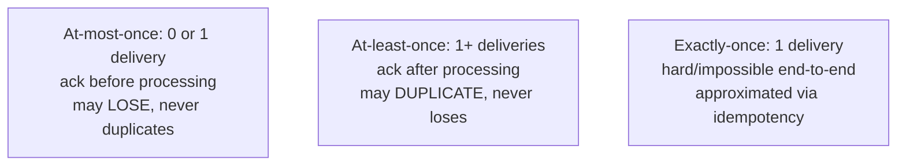
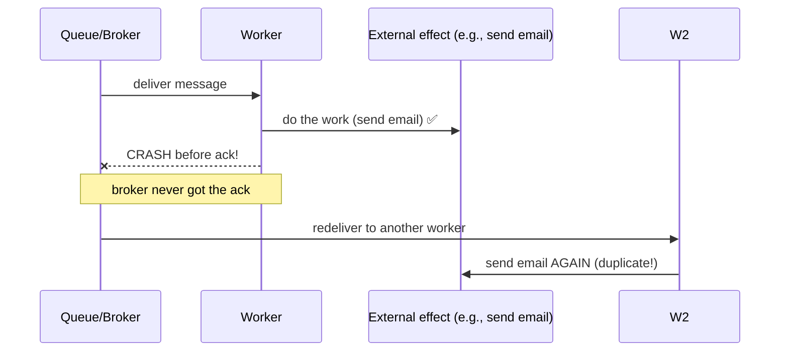

# Message Delivery Semantics

> Prerequisites: [queues-vs-pub-sub-vs-event-streams](./queues-vs-pub-sub-vs-event-streams.md)
> Related: [idempotency-and-deduplication](./idempotency-and-deduplication.md) · [06-distributed-systems/exactly-once-processing](../06-distributed-systems/exactly-once-processing.md)

Delivery semantics — at-most-once, at-least-once, exactly-once — are a core SDE-2 topic and the setup for the single most important messaging insight: **"exactly-once delivery" is a myth, but exactly-once *effect* is achievable via idempotency.**

---

## A. Problem and motivation

Networks fail, consumers crash, acks get lost. A message system must decide what to guarantee when things go wrong: can a message be lost? delivered twice? The choice determines whether your consumers can be simple or must be idempotent, and whether a crash causes a lost notification or a duplicate charge. Getting this wrong causes double-charges, missing emails, or data loss.

---

## B. The three semantics

| Semantic | Guarantee | Risk | How | Use |
|---|---|---|---|---|
| **At-most-once** | 0 or 1 | May lose messages | Ack/commit *before* processing | Loss-tolerant (metrics, logs) |
| **At-least-once** | 1 or more | May duplicate | Ack/commit *after* processing | **Default** for business systems |
| **Exactly-once** | Exactly 1 | — | Not truly achievable end-to-end | Approximate with idempotency |

**At-least-once is the practical default.** You'd rather process twice (and dedupe) than lose a message. The cost: duplicates, which consumers must handle.

---

## C. Why at-least-once produces duplicates (the crash window)

With at-least-once, you commit the offset/ack **after** processing. The duplicate arises from this window:

The worker did the side effect but crashed before acking → the broker redelivers → the effect happens twice. This is unavoidable with at-least-once; the fix is **idempotency** (next chapter), not a stronger delivery guarantee.

---

## D. The "exactly-once delivery is a myth" insight (critical)

You cannot guarantee exactly-once *delivery* over an unreliable network: either you risk losing the message (ack early = at-most-once) or risk duplicating it (ack late = at-least-once). There's no third option at the delivery layer. What you *can* achieve is **exactly-once effect / processing**: accept that the message may be delivered more than once, and make the **processing idempotent** so duplicate deliveries produce the same single effect.

> **At-least-once delivery + idempotent processing = effectively-once outcome.**

This is the single most important messaging sentence for interviews. "Exactly-once" systems (Kafka transactions, etc.) achieve it *within their boundary* but **don't** make your external side effects (sending an email, charging a card) idempotent — you still need idempotency keys for those. See [exactly-once-processing](../06-distributed-systems/exactly-once-processing.md).

---

## E. Example — notification service

The notification worker consumes `send-email` tasks (at-least-once). If it crashes after sending but before acking, the task is redelivered and the email would be sent twice. The fix: before sending, check a dedup store for `notification_id`; if already sent, skip. So even though delivery is at-least-once, the user gets exactly one email — **effectively-once**. We would **not** choose at-most-once (losing a password-reset email is worse than a rare duplicate). See [notification-service](../12-system-design-problems/notification-service.md).

---

## F. Trade-offs

| Semantic | Advantages | Disadvantages | Best use | Warning signs |
|---|---|---|---|---|
| At-most-once | Simple, fast, no dup handling | Loses messages | Metrics, logs, loss-tolerant | Using it for payments/notifications |
| At-least-once | Never loses; simple broker side | Duplicates → needs idempotency | **Default** for business events | No idempotency on consumers |
| Exactly-once (effect) | Correct outcome | Requires dedup store/idempotency keys | Payments, notifications, inventory | Believing the broker alone guarantees it |

---

## G. Failure scenarios

1. **Duplicate side effect (crash before ack).** Trigger: worker crashes post-effect, pre-ack. Users: double email/charge. Fix: idempotent processing (dedup on a stable id). 
2. **Lost message (at-most-once misuse).** Trigger: committing before processing on important data; crash loses it. Users: missing notification/record. Fix: at-least-once (ack after processing).
3. **False confidence in broker "exactly-once."** Trigger: assuming Kafka EOS makes external effects once. Users: still double-charge the external payment API. Fix: idempotency keys on external side effects regardless of broker guarantees.

---

## H. Scaling implications

At scale, crashes/retries/duplicates are routine (not rare) — so at-least-once + idempotency isn't optional, it's the baseline. The dedup store (idempotency keys) becomes a component you size and scale (see [idempotency-and-deduplication](./idempotency-and-deduplication.md)). At-most-once is reserved for high-volume loss-tolerant streams (metrics) where the dedup cost isn't worth it and occasional loss is fine. The semantics choice is per-stream, driven by the cost of a lost vs duplicated message.

---

## I. Interview preparation

**Basic**
- Q: The three delivery semantics? → *A: At-most-once (may lose, never duplicates), at-least-once (never loses, may duplicate), exactly-once (ideal, not truly achievable at the delivery layer).*
- Q: Which is the default and why? → *A: At-least-once — losing a business message is worse than reprocessing; you handle duplicates with idempotency.*

**Intermediate**
- Q: Why do you get duplicates with at-least-once? → *A: The ack happens after processing; if the worker does the effect then crashes before acking, the message is redelivered and the effect repeats.*
- Q: Is exactly-once delivery achievable? → *A: Not reliably end-to-end over an unreliable network. You achieve exactly-once *effect* via at-least-once delivery + idempotent processing.*

**SDE-2 / scenario**
- Q: "A worker crashed after sending an email but before acking — the user got two emails. Fix?" → *A: That's inherent to at-least-once. Make processing idempotent: dedupe on a stable notification_id in a store before sending, so a redelivery is a no-op. The fix is idempotency, not a stronger delivery guarantee.*
- Q: "Kafka says exactly-once — do I still need idempotency for charging a card?" → *A: Yes — Kafka's exactly-once applies within Kafka, not to your external side effect. The card charge needs an idempotency key so a replay doesn't double-charge.*

**Common wrong answers:** claiming exactly-once delivery is achievable; at-most-once for business data; relying on the broker's EOS for external effects.

---

## J. Hands-on exercise

For each, pick a delivery semantic and state what you'd add to make the *effect* correct: (a) ingesting app metrics, (b) sending an order-confirmation email, (c) debiting a bank account, (d) updating a search index. Identify which absolutely require idempotency and why.

---

## K. Revision summary

**Key takeaways**
- At-most-once (may lose), at-least-once (may duplicate, the default), exactly-once (not real at the delivery layer).
- At-least-once duplicates come from the crash-before-ack window.
- **Exactly-once delivery is a myth; exactly-once *effect* = at-least-once + idempotent processing.**
- Broker "exactly-once" doesn't make external side effects idempotent — you still need idempotency keys.

**Must explain without notes:** the three semantics; the duplicate crash window; "at-least-once + idempotency = effectively-once."

**Rapid-fire**
1. Default delivery semantic? → At-least-once.
2. Why duplicates with at-least-once? → Crash after effect, before ack → redelivery.
3. Is exactly-once delivery achievable? → No; exactly-once *effect* is (via idempotency).
4. Semantic for loss-tolerant metrics? → At-most-once.
5. Does Kafka EOS make a card charge once? → No — need an idempotency key for the external effect.

**Next:** [ordering-and-consumer-groups](./ordering-and-consumer-groups.md)
