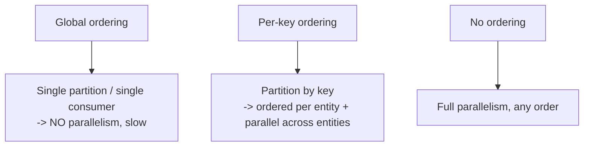

# Ordering and Consumer Groups

> Prerequisites: [kafka-internals-and-partitioning](./kafka-internals-and-partitioning.md), [message-delivery-semantics](./message-delivery-semantics.md)
> Related: [idempotency-and-deduplication](./idempotency-and-deduplication.md) · [backpressure-and-consumer-lag](./backpressure-and-consumer-lag.md)

Ordering guarantees and parallelism are in tension: strict global ordering means no parallelism. The SDE-2 skill is knowing you almost always want **per-key ordering with parallelism**, achieved by partitioning on the ordering key.

---

## A. Problem and motivation

Some events must be processed in order: "account created" before "account updated," a message before its edit, a deposit before a withdrawal. But ordering constrains parallelism — if everything must be strictly ordered, only one consumer can process at a time. Mishandling this causes either out-of-order bugs (processing an update before the create) or a throughput bottleneck (forcing global order). The resolution: order only what must be ordered, via partition keys.

---

## B. The ordering/parallelism tension

- **Global ordering:** all events processed in strict total order → one partition, one consumer → zero parallelism. Rarely needed; a throughput killer.
- **Per-key (per-partition) ordering:** events for the *same key* are ordered; different keys processed in parallel. This is what you almost always want — e.g., all events for account A are ordered, but accounts A, B, C process concurrently.
- **No ordering:** maximum parallelism, any order — fine for independent events (metrics).

**The mechanism (Kafka):** partition by the ordering key. All of key K's events land in one partition (ordered); different keys spread across partitions (parallel). See [kafka-internals-and-partitioning](./kafka-internals-and-partitioning.md).

---

## C. Consumer groups and how parallelism works

A **consumer group** shares a topic's partitions: each partition is consumed by exactly one consumer in the group, so **parallelism = partition count**. Within a partition, one consumer processes messages in offset order. This is how you get ordered-per-key *and* parallel-across-keys simultaneously.

- Adding consumers beyond the partition count does nothing (extras idle).
- Different consumer groups read the same topic independently (each has its own offsets) — that's fan-out to multiple independent consumers.
- **Rebalancing:** when a consumer joins/leaves/crashes, partitions are reassigned within the group (consumption briefly pauses). Frequent rebalances hurt — keep consumers stable.

---

## D. The subtle duplicate+ordering interaction

Even with per-partition ordering, at-least-once redelivery can reorder *effects* across a crash, and duplicates can arrive. So consumers often need to be both **idempotent** and tolerant of occasional reprocessing. For strict correctness, design the processing to be commutative/idempotent per key, or track the last-processed offset/version per key so a replay doesn't re-apply an older event. This ties ordering to [idempotency](./idempotency-and-deduplication.md).

---

## E. Example — notification service & chat

- **Notifications keyed by `user_id`:** a user's notifications stay ordered (so "message received" doesn't arrive before "you were added to the chat"), while different users process in parallel across partitions. Max parallelism = partition count.
- **Chat messages keyed by `conversation_id`:** messages within a conversation are ordered; different conversations parallelize. This is why chat systems partition by conversation. See [chat-messaging-system](../12-system-design-problems/chat-messaging-system.md).
- **Metrics ingestion:** no ordering key needed → full parallelism.

The pattern: identify the entity whose events must be ordered, make it the partition key.

---

## F. Trade-offs

| Ordering approach | Advantages | Disadvantages | Best use | Warning signs |
|---|---|---|---|---|
| Global ordering | Simple reasoning | No parallelism → bottleneck | Truly must-be-total-order (rare) | Expecting throughput |
| Per-key ordering | Ordered where needed + parallel | Hot key = hot partition | Entity event streams (accounts, chats) | One key dominating |
| No ordering | Max parallelism | Out-of-order effects | Independent events (metrics) | Events with causal dependencies |

---

## G. Failure scenarios

1. **Out-of-order processing from wrong/no key.** Trigger: not partitioning by the ordering entity; an "update" processed before its "create." Users: errors/inconsistent state. Fix: partition by the entity key so its events are ordered.
2. **Hot partition from the ordering key.** Trigger: one key (big account, celebrity) dominates its partition. Users: lag on that key. Fix: this is the ordering/throughput tension — can't fully parallelize one key's ordered stream; mitigate with sub-keys where order allows, or accept the limit for that key.
3. **Rebalance pauses.** Trigger: consumers flapping → frequent partition reassignment → consumption stalls + possible reprocessing. Fix: stable consumers, tuned timeouts, cooperative rebalancing; idempotent consumers to tolerate reprocessing.
4. **Reorder across a crash.** Trigger: at-least-once redelivery after a crash re-applies an older event. Fix: track last-applied version/offset per key; make processing idempotent.

---

## H. Scaling implications

Ordering is the main constraint on messaging parallelism. You scale throughput by increasing partitions (and consumers), but each ordering key is confined to one partition — so a single hot key can't be parallelized without giving up its ordering. This is the exact analog of [DB hot shards](../03-databases-and-data-modeling/partitioning-and-sharding.md). Choose the ordering key to be the *narrowest* entity that needs order (per-user, per-conversation) so parallelism is high and hot keys are rare. Global ordering is a scaling dead-end; avoid requiring it.

---

## I. Interview preparation

**Basic**
- Q: How do you get ordering + parallelism together? → *A: Partition by the ordering key — same key is ordered within one partition; different keys process in parallel across partitions.*
- Q: What's a consumer group? → *A: Consumers sharing a topic's partitions (one per partition each); other groups read independently.*

**Intermediate**
- Q: What limits consumer parallelism and why? → *A: The partition count — each partition is read by one consumer per group, so extra consumers idle. More parallelism needs more partitions.*
- Q: Why avoid global ordering? → *A: It forces a single partition/consumer → zero parallelism → throughput bottleneck. Use per-key ordering instead.*

**SDE-2 / scenario**
- Q: "Chat messages sometimes appear out of order across servers." → *A: Partition the message topic by conversation_id so a conversation's messages share a partition (ordered); different conversations parallelize. Also make consumers idempotent/version-aware to tolerate at-least-once replays.*
- Q: "A huge account's events lag behind." → *A: Hot partition from the ordering key. Its ordered stream can't be parallelized without losing order; I'd mitigate with sub-partitioning where ordering constraints allow, or dedicate capacity, accepting the ordering/throughput trade-off.*

**Common wrong answers:** expecting ordering without a partition key; demanding global ordering; adding consumers beyond partition count.

---

## J. Hands-on exercise

For a banking ledger event stream (deposits/withdrawals per account), choose the partition key, explain the ordering guarantee it gives and why it matters for correctness, estimate the parallelism available, and describe how a replay after a crash could misapply an older event and your fix.

---

## K. Revision summary

**Key takeaways**
- Ordering vs parallelism are in tension; global ordering = no parallelism.
- Per-key ordering (partition by the ordering entity) gives ordered-per-key + parallel-across-keys — the usual goal.
- Consumer groups: one consumer per partition; parallelism = partition count; other groups read independently.
- Hot keys from the ordering key create hot partitions; at-least-once can reorder across crashes → make consumers idempotent/version-aware.

**Must explain without notes:** per-key ordering via partition key; parallelism = partition count; why global ordering is a dead-end.

**Rapid-fire**
1. How to order a user's events but parallelize users? → Partition by user_id.
2. Parallelism limit in a consumer group? → Partition count.
3. Cost of global ordering? → No parallelism (bottleneck).
4. Chat ordering key? → conversation_id.
5. Hot ordering key → ? → Hot partition (ordering/throughput trade-off).

**Next:** [retries-backoff-and-jitter](./retries-backoff-and-jitter.md)
