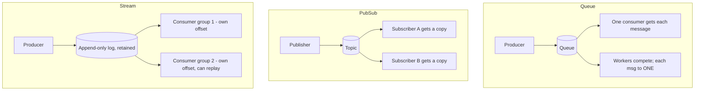

# Queues vs Pub/Sub vs Event Streams

> Prerequisites: [02-compute-and-architecture/synchronous-vs-asynchronous-processing](../02-compute-and-architecture/synchronous-vs-asynchronous-processing.md)
> Related: [kafka-internals-and-partitioning](./kafka-internals-and-partitioning.md) · [rabbitmq-internals-and-routing](./rabbitmq-internals-and-routing.md) · [message-delivery-semantics](./message-delivery-semantics.md)

Messaging systems come in three shapes with different semantics. Confusing them (calling Kafka "a queue") is a common slip. This section's running example is a **notification service**, per the master prompt.

---

## A. Problem and motivation

Async processing (previous section) needs a channel between producers and consumers. The channel's shape determines who receives a message, whether it's consumed once or by many, and whether you can replay history. Picking the wrong model gives you duplicated work, lost events, or an inability to add new consumers. The three models — queue, pub/sub, event stream — answer different needs.

---

## B. The three models

| | Queue (point-to-point) | Pub/Sub | Event stream (log) |
|---|---|---|---|
| Delivery | Each message to **one** consumer (competing workers) | Each message to **all** subscribers (a copy each) | Each **consumer group** reads independently via offsets |
| After consumption | Message removed (ack'd) | Delivered to current subscribers; then gone | **Retained** for a period; replayable |
| Replay / new consumer | No (it's gone) | No (missed if not subscribed) | **Yes** — new group reads from the start/offset |
| Ordering | Per-queue-ish | Per-topic-ish | **Per-partition** ordered |
| Examples | SQS, RabbitMQ (work queue) | SNS, RabbitMQ fanout, Redis pub/sub | **Kafka**, Kinesis, Pulsar |

---

## C. The defining differences

- **Queue:** a message is work to be done once. Multiple workers compete; each message goes to exactly one. Removed after ack. Great for **task distribution** (send this email, process this upload). Scaling = add workers.
- **Pub/Sub:** a message is an announcement to many interested parties. Each subscriber gets its own copy. Great for **fan-out notifications** (one event → email service + audit service + analytics). Typically no replay/retention — if you weren't subscribed, you missed it.
- **Event stream (log):** messages are an ordered, **retained** log. Each consumer group tracks its own position (offset) and reads independently; you can add a new consumer that replays all history, and reprocess after a bug. Great for **event-driven architectures, event sourcing, and multiple independent consumers** of the same events. Scaling = partitions. See [kafka-internals-and-partitioning](./kafka-internals-and-partitioning.md).

**The key stream superpower:** retention + per-consumer offsets → **replay** and **adding new consumers after the fact**. A queue/pub-sub message is gone once consumed; a stream event lives for its retention window.

---

## D. Example — notification service (running example)

A user action triggers a notification that may go to email, SMS, and push, plus analytics and audit:

- **Pub/Sub (or stream) for fan-out:** publish one `notification.requested` event; email, SMS, push, analytics, and audit each consume it independently. One produce, many consumers.
- **Queue per channel for the work:** the email consumer puts "send this email" tasks on a work queue drained by competing email-sender workers (each task sent once).
- **Stream (Kafka) if we need replay/new consumers:** retaining the event log lets us add a new consumer (e.g., a new "digest" feature) that replays past events, and reprocess if a bug sent wrong notifications.

So a real system often **combines** them: a stream/topic for fan-out of events, work queues for distributing the per-channel sending tasks. See [notification-service](../12-system-design-problems/notification-service.md).

---

## E. Trade-offs

| Model | Advantages | Disadvantages | Best use | Warning signs |
|---|---|---|---|---|
| Queue | Simple task distribution, scale with workers, backpressure natural | One consumer per message; no replay | Work/task distribution | Needing multiple independent consumers |
| Pub/Sub | Decoupled fan-out to many | No replay/retention (usually); miss if offline | Event notifications to multiple systems | Needing to replay or add consumers later |
| Event stream | Retention, replay, independent consumer groups, ordering | More to operate; consumers track offsets; retention cost | Event-driven arch, event sourcing, multiple consumers | Simple one-off task (overkill) |

---

## F. Failure scenarios

1. **Chose pub/sub, later need replay.** Trigger: a bug corrupted downstream state; you want to reprocess but pub/sub didn't retain. Fix: use an event stream (retained log) when replay/new-consumer needs are plausible. Prevent: anticipate consumers/replay.
2. **Chose a queue, need multiple independent consumers.** Trigger: one message consumed by worker A means B never sees it. Fix: fan-out (pub/sub or stream) to give each consumer its own copy/offset.
3. **Stream retention overflow.** Trigger: retention set too short; a slow/offline consumer's offset falls off the log → data loss for it. Fix: size retention to the slowest consumer's tolerance; alert on consumer lag approaching retention.

---

## G. Scaling implications

- **Queues** scale by adding competing workers (bounded by downstream throughput); the queue absorbs spikes (backpressure buffer).
- **Pub/Sub** scales fan-out but each subscriber must keep up independently.
- **Streams** scale via **partitions** — throughput and parallelism grow with partition count, with ordering guaranteed only within a partition (see [ordering-and-consumer-groups](./ordering-and-consumer-groups.md)). Retention lets slow/new consumers catch up but costs storage.

The models aren't mutually exclusive — large systems layer them. Choosing is about: one-consumer vs many? replay needed? ordering needed? Those three questions pick the model.

---

## H. Interview preparation

**Basic**
- Q: Queue vs pub/sub? → *A: Queue delivers each message to one consumer (competing workers); pub/sub delivers a copy to every subscriber (fan-out).*
- Q: What's special about an event stream (Kafka)? → *A: It retains an ordered log; consumer groups read independently via offsets, so you can replay and add new consumers later.*

**Intermediate**
- Q: When Kafka over SQS/RabbitMQ? → *A: When I need retention/replay, multiple independent consumer groups of the same events, high-throughput ordered partitions, or event sourcing. For simple task distribution, a work queue is simpler.*
- Q: How do you fan out one event to many systems? → *A: Pub/sub or a stream topic — each subscriber/consumer group gets its own copy/offset.*

**SDE-2 / scenario**
- Q: "Design the messaging for a notification service." → *A: Publish one `notification.requested` event to a stream/topic; email, SMS, push, analytics, audit consume independently (fan-out). Per channel, use a work queue of send-tasks drained by competing sender workers. A stream gives replay for a future digest feature and reprocessing after bugs.*
- Q: "You later need to add an analytics consumer that reprocesses last month's events." → *A: Only possible if the events were on a retained stream (Kafka) — a new consumer group reads from the desired offset. A queue/pub-sub would have discarded them.*

**Common wrong answers:** calling Kafka "a queue"; using a queue when multiple independent consumers are needed; pub/sub when replay is required; Kafka for a trivial one-off task.

---

## I. Hands-on exercise

For an e-commerce "order placed" event that must trigger inventory update, email confirmation, analytics, and a fraud check (which may be added later), choose the messaging model(s). Justify why replay/new-consumer support matters, and show where a work queue vs a stream fits.

---

## J. Revision summary

**Key takeaways**
- Queue: one consumer per message (competing workers), no replay — task distribution.
- Pub/Sub: a copy to every subscriber (fan-out), usually no replay.
- Event stream (Kafka): retained ordered log, per-group offsets → replay + add consumers later → event-driven architectures.
- Pick via: one-vs-many consumers? replay needed? ordering needed? Systems often combine all three.

**Must explain without notes:** the three models and their delivery semantics; the stream replay superpower; the notification-service combination.

**Rapid-fire**
1. Each message to exactly one consumer? → Queue.
2. A copy to every subscriber? → Pub/Sub.
3. Replay + add consumers later? → Event stream (Kafka).
4. How do streams scale throughput? → Partitions.
5. Is Kafka a queue? → No — it's a retained, replayable log.

**Next:** [kafka-internals-and-partitioning](./kafka-internals-and-partitioning.md)
