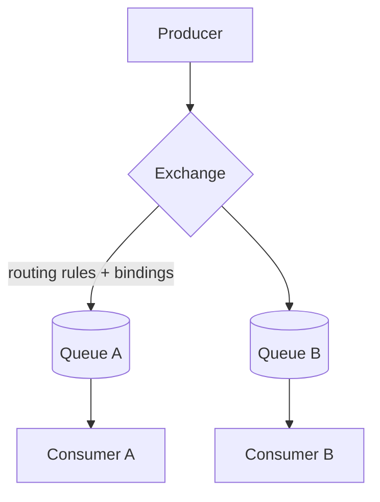

# RabbitMQ Internals and Routing

> Prerequisites: [queues-vs-pub-sub-vs-event-streams](./queues-vs-pub-sub-vs-event-streams.md)
> Related: [kafka-internals-and-partitioning](./kafka-internals-and-partitioning.md) · [dead-letter-queues](./dead-letter-queues.md)

RabbitMQ is a traditional message broker — a "smart broker, dumb consumer" contrast to Kafka's "dumb broker, smart consumer" log. Know its exchange/routing model and when it beats Kafka, so you can pick the right tool.

---

## A. Problem and motivation

Not every async need is an event log. Sometimes you want flexible routing of tasks to the right queue, per-message acknowledgment, priorities, and complex topologies — the classic message-broker use case. RabbitMQ is built for this. Knowing it (vs Kafka) lets you justify a tool choice from requirements rather than defaulting to Kafka for everything.

---

## B. The RabbitMQ model: exchanges, bindings, queues

Producers publish to an **exchange** (not directly to a queue); the exchange **routes** messages to queues based on **bindings** and a **routing key**. Consumers read from queues.

**Exchange types (the routing power):**
- **Direct:** route by exact routing-key match (e.g., key `email` → email queue).
- **Topic:** route by wildcard pattern (e.g., `notify.email.*` → email queues).
- **Fanout:** broadcast to all bound queues (pub/sub style).
- **Headers:** route by message header attributes.

This flexible routing is RabbitMQ's signature strength — you can build complex topologies declaratively.

---

## C. Delivery model: smart broker, per-message ack

Unlike Kafka's log+offsets, RabbitMQ **tracks each message's state** and removes it when the consumer **acks**. Features:
- **Per-message acknowledgment:** consumer acks each message; unacked messages (consumer crash) are **requeued** and redelivered → at-least-once.
- **Prefetch (QoS):** limits unacked messages per consumer → built-in backpressure/fair dispatch.
- **Priorities:** higher-priority messages jump the queue.
- **TTL + Dead-Letter Exchange (DLX):** messages that expire or are rejected N times route to a dead-letter queue. See [dead-letter-queues](./dead-letter-queues.md).

The broker does the work (routing, tracking, retry); consumers are simple. Contrast Kafka: the broker is a dumb log and consumers manage offsets/replay.

---

## D. RabbitMQ vs Kafka (the decision)

| | RabbitMQ (broker) | Kafka (log) |
|---|---|---|
| Model | Smart broker routes to queues; per-message ack | Dumb broker; append-only log; consumer offsets |
| Routing | Rich (direct/topic/fanout/headers) | By partition key only |
| Retention/replay | Message gone after ack (no replay) | Retained; replayable |
| Ordering | Per-queue | Per-partition |
| Throughput | High, but lower than Kafka's extreme | Very high (millions/sec) |
| Best for | Task/work distribution, complex routing, priorities, RPC | Event streaming, replay, many consumers, high throughput |
| Backpressure | Built-in via prefetch | Via consumer pull + lag |

**Interview-ready:** "RabbitMQ for flexible task routing, priorities, and per-message acks when I don't need replay — e.g., distributing jobs to workers. Kafka when I need a retained, replayable, high-throughput ordered log that multiple consumer groups read independently."

---

## E. Example — DMS / notification service

- **DMS processing jobs** (route uploads to the right worker type — OCR vs virus-scan vs thumbnail — with priorities and per-job ack): **RabbitMQ** fits well (topic exchange routes by job type, prefetch gives fair dispatch, DLX handles poison jobs). No replay needed.
- **Notification events needing replay + multiple independent consumers + a future digest feature:** **Kafka** fits better.

A system can use both: RabbitMQ for internal task routing, Kafka for the event backbone. Choose by requirements.

---

## F. Trade-offs

| Aspect | Advantages | Disadvantages | Best use | Warning signs |
|---|---|---|---|---|
| Rich routing (exchanges) | Flexible topologies, declarative | More concepts to learn | Complex task routing | Simple point-to-point (overkill) |
| Per-message ack + prefetch | Fine-grained reliability + backpressure | Broker tracks per-message state (overhead at extreme scale) | Work queues, priorities | Millions/sec, replay needs (use Kafka) |
| No replay | Simpler semantics | Can't reprocess history | Transient tasks | Needing event replay |

---

## G. Failure scenarios

1. **Consumer crash → redelivery.** Trigger: consumer dies before ack. Broker requeues the message → another consumer processes it (at-least-once) → consumers must be idempotent. See [idempotency-and-deduplication](./idempotency-and-deduplication.md).
2. **Poison message loops.** Trigger: a message always fails and keeps getting requeued, blocking progress. Fix: a retry limit + Dead-Letter Exchange routing it to a DLQ. See [dead-letter-queues](./dead-letter-queues.md).
3. **Queue buildup / memory pressure.** Trigger: producers outpace consumers; queues grow in broker memory. Users: broker slows, may hit limits. Fix: prefetch/backpressure, scale consumers, lazy queues (disk-backed), alert on depth. See [backpressure-and-consumer-lag](./backpressure-and-consumer-lag.md).
4. **Lost messages without durability.** Trigger: non-durable queue/messages + broker restart. Fix: durable queues + persistent messages + publisher confirms for can't-lose data.

---

## H. Scaling implications

RabbitMQ scales well for task distribution (add consumers; prefetch gives fair dispatch and backpressure) but the smart-broker model (tracking every message's state) makes it less suited to Kafka's extreme throughput + retention + replay use cases. For very high-volume event streaming with multiple independent consumers and replay, Kafka's log model scales further. The practical guidance: don't force one tool to do the other's job — RabbitMQ for routed work queues, Kafka for the event log. Both are at-least-once by default, so idempotent consumers and DLQs are required either way.

---

## I. Interview preparation

**Basic**
- Q: How does RabbitMQ route messages? → *A: Producers publish to an exchange, which routes to queues by bindings/routing key; exchange types are direct, topic, fanout, headers.*

**Intermediate**
- Q: RabbitMQ vs Kafka? → *A: RabbitMQ is a smart broker with rich routing and per-message acks but no replay — great for task distribution/priorities; Kafka is a retained, replayable, partitioned log for high-throughput event streaming with multiple independent consumer groups.*
- Q: What gives RabbitMQ backpressure? → *A: Prefetch (QoS) limits unacked messages per consumer, so slow consumers naturally throttle delivery.*

**SDE-2 / scenario**
- Q: "Route upload jobs to OCR/scan/thumbnail workers with priorities." → *A: RabbitMQ with a topic/direct exchange routing by job type, consumer prefetch for fair dispatch, priorities for urgent jobs, and a DLX for poison jobs. No replay needed, so Kafka would be heavier than necessary.*
- Q: "When would you pick Kafka over RabbitMQ here?" → *A: If I needed to retain and replay the event log, support multiple independent consumer groups of the same events, or handle extreme throughput — RabbitMQ's broker-tracked, no-replay model doesn't fit those.*

**Common wrong answers:** Kafka for everything; expecting replay from RabbitMQ; non-durable queues for can't-lose data; no DLQ for poison messages.

---

## J. Hands-on exercise

Design the DMS job-routing with RabbitMQ: choose the exchange type, routing keys for OCR/scan/thumbnail, prefetch value rationale, and the DLX setup for poison jobs. Then state one requirement that would make you switch this topic to Kafka.

---

## K. Revision summary

**Key takeaways**
- RabbitMQ = smart broker: exchanges route to queues (direct/topic/fanout/headers), per-message ack, prefetch backpressure, priorities, DLX — no replay.
- Kafka = dumb broker/log: retained, replayable, partitioned, consumer offsets — high throughput, many consumers.
- RabbitMQ for routed task/work distribution; Kafka for event streaming + replay. Both at-least-once → idempotent consumers + DLQ.
- Pick by requirements; systems may use both.

**Rapid-fire**
1. Where do RabbitMQ producers publish? → To an exchange (not a queue directly).
2. Exchange type for broadcast? → Fanout.
3. RabbitMQ backpressure mechanism? → Prefetch (QoS).
4. Does RabbitMQ support replay? → No (gone after ack).
5. Poison-message handling? → Retry limit + Dead-Letter Exchange → DLQ.

**Next:** [message-delivery-semantics](./message-delivery-semantics.md)
