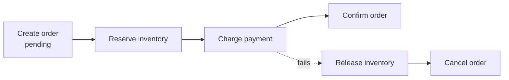
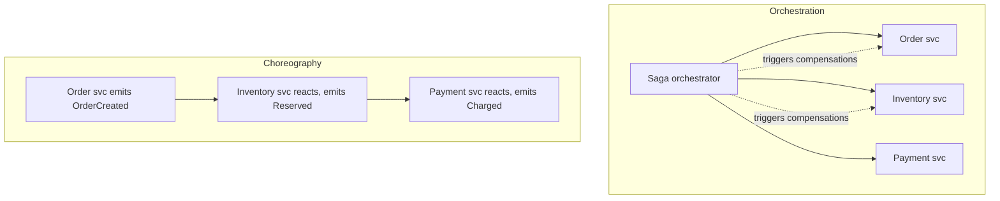

# The Saga Pattern

> Prerequisites: [distributed-transactions](../03-databases-and-data-modeling/distributed-transactions.md), [idempotency-and-deduplication](./idempotency-and-deduplication.md)
> Related: [transactional-outbox-and-cdc](./transactional-outbox-and-cdc.md) · [event-sourcing-and-cqrs](./event-sourcing-and-cqrs.md)

Sagas are how you keep a multi-service business operation consistent without a distributed transaction. Introduced in [distributed-transactions](../03-databases-and-data-modeling/distributed-transactions.md); here we go deeper on orchestration vs choreography and compensation design. (Track B depth.)

---

## A. Problem and motivation

A business operation like "place order" spans services (order, inventory, payment, shipping), each with its own database. There's no single transaction across them (see [distributed-transactions](../03-databases-and-data-modeling/distributed-transactions.md)), and 2PC is too blocking/unavailable for scaled services. The saga pattern provides consistency via a sequence of **local** transactions, each with a **compensating action** to undo it if a later step fails — accepting eventual consistency instead of atomicity.

---

## B. The saga model

A saga is a sequence of steps; each step is a local transaction in one service. If any step fails, the saga runs **compensating transactions** for the already-completed steps, in reverse, to semantically undo them.

- **Forward path:** T1 → T2 → T3 → T4, each committing locally and emitting an event/command for the next.
- **Compensation path:** if T3 fails, run C2 (release inventory), C1 (cancel order) — undoing in reverse.

Compensations are *semantic* undos, not rollbacks: you can't un-charge atomically, but you can issue a refund; you can't un-send an email, but you can send a correction.

---

## C. Orchestration vs choreography

| | Orchestration | Choreography |
|---|---|---|
| Control | Central orchestrator directs each step + compensations | Services react to each other's events; no central brain |
| Visibility | Clear, centralized flow (easy to follow/debug) | Flow is implicit across services (harder to trace) |
| Coupling | Services coupled to the orchestrator | Services decoupled, but coupled via event contracts |
| Risk | Orchestrator is a component to run (but not a 2PC-style blocker) | "Event spaghetti" at many steps; hard to reason about |
| Best for | Complex flows needing clear control/observability | Simple flows, high decoupling |

**Interview-ready:** "For a non-trivial multi-step flow I prefer orchestration — a saga orchestrator makes the sequence and compensations explicit and observable. Choreography is fine for simple flows but becomes hard to follow and debug as steps grow."

---

## D. Designing compensations (the hard part)

- **Order steps so irreversible ones are last.** Sending an email or calling an external non-refundable API is hard to compensate — do these at the end, after reversible steps succeed, so you rarely need to undo them.
- **Make steps and compensations idempotent** — sagas run on at-least-once messaging; a step/compensation may be retried. See [idempotency-and-deduplication](./idempotency-and-deduplication.md).
- **Handle "pivot" steps** — some steps, once done, can't be undone (the pivot). Design so the pivot is the point after which the saga always goes forward.
- **Surface eventual consistency** to users (e.g., "order pending" → "confirmed") since the saga isn't instant.
- **Compensation can fail too** — retries + alerting + manual intervention for stuck sagas; persist saga state so you can resume/recover.

---

## E. Example — e-commerce checkout (orchestrated saga)

Orchestrator: Create order (pending) → Reserve inventory → Charge payment → Confirm order & notify. On payment failure: compensate by releasing inventory and canceling the order; the user sees "payment failed." The notification (irreversible) is last, after confirmation. Each service's step and compensation is idempotent (keyed by order id), and the orchestrator persists saga state so a crash resumes correctly. The user experiences brief eventual consistency (pending → confirmed). See [e-commerce-platform](../12-system-design-problems/e-commerce-platform.md) and [payment-system](../12-system-design-problems/payment-system.md).

---

## F. Trade-offs

| Aspect | Advantages | Disadvantages | Best use | Warning signs |
|---|---|---|---|---|
| Saga vs 2PC | Available, loosely coupled, scalable | Eventual consistency; must design compensations | Cross-service workflows | Needing instant global atomicity |
| Orchestration | Clear control + observability | Orchestrator to build/run | Complex flows | Over-centralizing trivial flows |
| Choreography | Max decoupling | Hard to trace, event spaghetti | Simple flows | Many steps / debugging pain |

---

## G. Failure scenarios

1. **Compensation can't fully undo.** Trigger: an irreversible step (email, external commit) must be compensated. Users: imperfect undo. Mitigate: order irreversible steps last; use semantic compensation (refund, correction). Prevent: design for compensability.
2. **Stuck saga.** Trigger: a step or compensation keeps failing. Users: order limbo. Fix: persist saga state, retry with backoff, alert, allow manual resolution; DLQ for the stuck message.
3. **Duplicate step execution.** Trigger: at-least-once redelivery re-runs a step. Users: double reserve/charge. Fix: idempotent steps keyed by saga/order id.
4. **Choreography loop/ambiguity.** Trigger: events trigger events in hard-to-follow ways. Fix: switch to orchestration for clarity, or carefully bound event contracts.

---

## H. Scaling implications

Sagas enable consistent multi-service workflows at scale where 2PC can't (no blocking locks, services stay available). They're the standard answer once you've decomposed into services or sharded across transactional boundaries (see [partitioning-and-sharding](../03-databases-and-data-modeling/partitioning-and-sharding.md)). The costs — eventual consistency, compensation design, saga-state persistence, idempotency — are real and are themselves a strong argument for keeping transactionally-coupled data together (modular monolith / same shard) so you don't need a saga at all. When you do need one, orchestration scales better operationally because the flow is observable.

---

## I. Interview preparation

**Basic**
- Q: What's a saga? → *A: A sequence of local transactions across services, each with a compensating action to undo it if a later step fails — replacing a distributed transaction with eventual consistency.*

**Intermediate**
- Q: Orchestration vs choreography? → *A: Orchestration uses a central coordinator directing steps and compensations (clear, observable); choreography has services react to each other's events (decoupled but harder to trace). Prefer orchestration for complex flows.*
- Q: Why is compensation hard? → *A: It's a semantic undo, not a rollback; irreversible steps (emails, external commits) can't be truly undone, so you order them last and use refunds/corrections, and design idempotent, resumable sagas.*

**SDE-2 / scenario**
- Q: "Checkout spans order, inventory, payment across services. Keep it consistent." → *A: An orchestrated saga: create order (pending) → reserve inventory → charge → confirm & notify; on failure compensate (release inventory, cancel order). Steps idempotent (keyed by order id), saga state persisted, irreversible notification last, user sees pending→confirmed. 2PC avoided for availability.*
- Q: "A saga step keeps failing — what happens to the order?" → *A: The orchestrator retries with backoff, and if it can't proceed, compensates completed steps and marks the order failed, or parks it for manual resolution (DLQ + alert). Saga state is persisted so nothing is lost.*

**Common wrong answers:** 2PC across services; choreography for a complex flow (unobservable); non-idempotent steps; assuming compensations are perfect rollbacks.

---

## J. Hands-on exercise

Design an orchestrated saga for a travel booking that reserves a flight, a hotel, and a car (all external, partially refundable). List the steps, their compensations, the ordering (which irreversible step goes last), how you make steps idempotent, and what you do if the car reservation fails after the flight+hotel are booked.

---

## K. Revision summary

**Key takeaways**
- Saga = sequence of local transactions + compensating actions; replaces distributed transactions with eventual consistency.
- Orchestration (central coordinator, observable) vs choreography (event-reactive, decoupled but hard to trace) — prefer orchestration for complex flows.
- Compensations are semantic undos; order irreversible steps last; make steps/compensations idempotent and sagas resumable.
- Sagas are the scaled answer where 2PC fails; still prefer co-locating coupled data to avoid needing one.

**Must explain without notes:** saga + compensation; orchestration vs choreography; why compensations are hard + ordering.

**Rapid-fire**
1. Saga vs 2PC consistency? → Saga = eventual; 2PC = atomic.
2. Undo a saga step = ? → Compensating transaction (semantic undo).
3. Central coordinator approach? → Orchestration.
4. Where do irreversible steps go? → Last.
5. Saga steps must be? → Idempotent.

**Next:** [event-sourcing-and-cqrs](./event-sourcing-and-cqrs.md)
