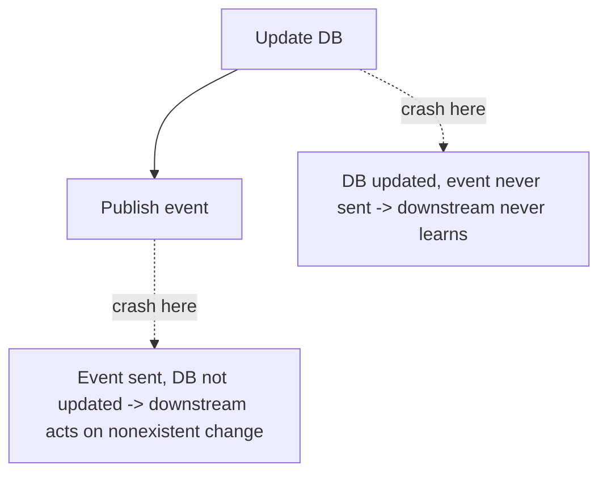

# Transactional Outbox and Change Data Capture (CDC)

> Prerequisites: [idempotency-and-deduplication](./idempotency-and-deduplication.md), [03-databases/database-internals-for-system-design](../03-databases-and-data-modeling/database-internals-for-system-design.md)
> Related: [distributed-transactions](../03-databases-and-data-modeling/distributed-transactions.md) · [saga-pattern](./saga-pattern.md)

The transactional outbox solves the **dual-write problem** — the subtle bug of "update the DB *and* publish an event" that trips up most event-driven designs. It's a top-tier SDE-2 pattern.

---

## A. Problem and motivation — the dual-write problem

You often need to do two things on a change: update the database **and** publish an event (to Kafka, a queue, or to update a cache/search index). These are two separate systems with no shared transaction. Whatever order you choose, a crash in between leaves them inconsistent:



- DB first, then publish: if you crash after the DB commit but before publishing, the event is lost — downstream (search index, other services) never hears about the change.
- Publish first, then DB: if the DB write fails, you've announced a change that didn't happen.

You can't wrap both in one transaction (different systems). This is the dual-write problem, and it's everywhere in event-driven systems.

---

## B. The transactional outbox pattern

Write the event to an **outbox table in the same database, in the same local transaction** as the business change. Now the business change and the "intent to publish" commit atomically (one DB transaction — single-node ACID). A separate **relay** process reads the outbox and publishes to the message broker, marking rows as sent.

```mermaid
sequenceDiagram
    participant App
    participant DB as Database (business table + outbox table)
    participant Relay
    participant Broker as Kafka/Queue
    App->>DB: BEGIN; update business row; INSERT outbox row; COMMIT (atomic)
    Note over DB: both or neither - no dual write
    Relay->>DB: poll outbox for unsent rows
    Relay->>Broker: publish event
    Broker-->>Relay: ack
    Relay->>DB: mark outbox row as sent
```

Now there's **no dual write**: the event's existence is guaranteed by the same transaction as the business change. If the relay crashes, unsent rows remain and are published on restart (at-least-once → downstream must be idempotent). This converts an unsolvable cross-system atomicity problem into a solvable single-DB-transaction problem.

---

## C. Change Data Capture (CDC) — the relay via the WAL

Instead of polling the outbox table, CDC taps the database's [WAL / change log](../03-databases-and-data-modeling/database-internals-for-system-design.md) directly and streams every committed change to the broker (e.g., Debezium → Kafka). CDC can:
- Act as the outbox relay (stream outbox-table inserts).
- Or stream *all* table changes directly (no outbox table needed) — downstream consumers react to raw DB changes.

CDC is reliable (it reads committed changes from the WAL, so it catches everything, in order) and decoupled (no app code to publish). It's the robust way to feed search indexes, caches, and other services from a source-of-truth DB — the mechanism behind reliable cache invalidation and search-index sync (see [cache-invalidation-and-consistency](../04-caching/cache-invalidation-and-consistency.md), [time-series-and-search-databases](../03-databases-and-data-modeling/time-series-and-search-databases.md)).

---

## D. Outbox vs CDC

| | Outbox (poll table) | CDC (tap WAL) |
|---|---|---|
| Mechanism | App writes outbox rows; relay polls/publishes | Reads committed changes from the DB log |
| App changes | Must insert outbox rows | None (streams existing changes) |
| Granularity | Explicit events you choose | All table changes (or filtered) |
| Latency | Poll interval | Near-real-time |
| Complexity | Simple relay | CDC infra (connectors) |
| Catches every write? | Only outbox-written ones | **Yes, every committed change** |

Often combined: write a semantically-meaningful outbox event, and use CDC to stream the outbox table (near-real-time, reliable). CDC-directly-on-tables is great for sync/invalidation; the outbox is better when you want curated domain events rather than raw row changes.

---

## E. Example — DMS

When a document is updated, the DMS, in one transaction, updates the `documents` row **and** inserts a `document.updated` outbox row. A relay (or Debezium CDC on the outbox) publishes `document.updated` to Kafka. Consumers react: the search indexer reindexes, the cache invalidator deletes the metadata key, the notification service alerts collaborators. No dual write — if the DMS crashed right after commit, the outbox row survives and is published on recovery. Downstream consumers are idempotent (keyed by document id + version) because publication is at-least-once. This is how the DMS keeps search and cache consistent with the source-of-truth DB.

---

## F. Trade-offs

| Approach | Advantages | Disadvantages | Best use | Warning signs |
|---|---|---|---|---|
| Naive dual write | Simple-looking | Inconsistent on crash (the bug) | Never for important events | DB updated but event lost |
| Transactional outbox | Atomic with business change; no dual write | Outbox table + relay; at-least-once (idempotent consumers) | Reliable event publishing | Forgetting idempotency downstream |
| CDC | Catches every change, near-real-time, no app publish code | CDC infra; raw changes (not domain events) | Cache/search sync, replication | Treating raw row changes as domain events |

---

## G. Failure scenarios

1. **Dual-write inconsistency (no outbox).** Trigger: crash between DB commit and publish. Users: downstream (search/cache/services) diverges from the DB. Fix: transactional outbox (atomic) or CDC. 
2. **Duplicate publishes (at-least-once relay).** Trigger: relay publishes, crashes before marking sent → republishes on restart. Users: duplicate events. Fix: idempotent consumers (dedupe on event id). 
3. **Relay lag / outbox buildup.** Trigger: relay slow/down; outbox grows. Users: delayed downstream updates (stale search/cache). Detect: outbox depth/relay lag metric. Mitigate: scale/monitor the relay; alert on lag.
4. **CDC schema drift.** Trigger: a schema change breaks the CDC connector. Users: change stream stops. Fix: coordinate migrations with CDC (see [schema-migrations-and-data-evolution](../03-databases-and-data-modeling/schema-migrations-and-data-evolution.md)); monitor connector health.

---

## H. Scaling implications

The outbox/CDC pattern is foundational to reliable event-driven systems at scale: it's how you fan out source-of-truth changes to many derived stores (search, cache, read models, other services) *without* dual-write inconsistency. It converts the hard cross-system atomicity problem into a local transaction + an at-least-once relay (handled by idempotent consumers). CDC scales to high change volumes by streaming the WAL (the same mechanism as replication). The relay/CDC pipeline becomes a monitored component (lag, health). This pattern underpins CQRS read models, cache invalidation, and search sync throughout the repo.

---

## I. Interview preparation

**Basic**
- Q: What's the dual-write problem? → *A: Updating the DB and publishing an event are two systems with no shared transaction; a crash in between leaves them inconsistent (lost event or phantom event).*

**Intermediate**
- Q: How does the transactional outbox solve it? → *A: Write the event to an outbox table in the same local transaction as the business change (atomic); a relay then publishes outbox rows. No dual write — the event's existence is guaranteed with the change.*
- Q: Outbox vs CDC? → *A: Outbox: app writes explicit events, a relay polls/publishes. CDC: tap the DB's WAL to stream every committed change near-real-time, no app publish code. Often combined (CDC streams the outbox).*

**SDE-2 / scenario**
- Q: "You update the DB then publish to Kafka, but sometimes the event is missing." → *A: Classic dual-write bug — a crash after commit, before publish. I'd use a transactional outbox: insert the event in the same transaction as the change, and a relay/CDC publishes it reliably (at-least-once, so consumers dedupe).*
- Q: "How do you keep a search index and cache consistent with the DB?" → *A: CDC from the DB WAL (or outbox) → stream changes to the indexer and cache invalidator; eventual consistency, reliable because it reads committed changes; consumers idempotent.*

**Common wrong answers:** naive dual write; publishing before the DB commit; forgetting downstream idempotency; treating raw CDC row changes as curated domain events.

---

## J. Hands-on exercise

Design reliable event publishing for "order placed" that must update the orders DB and notify inventory + email + analytics. Use the outbox pattern: show the single transaction, the relay, what downstream consumers must do about duplicates, and how you'd monitor relay lag. Then say when you'd use CDC instead.

---

## K. Revision summary

**Key takeaways**
- Dual-write problem: DB update + event publish aren't atomic → crash causes inconsistency.
- Transactional outbox: write the event to an outbox table in the same local transaction (atomic); a relay publishes it → no dual write.
- CDC: stream the DB WAL to capture every committed change near-real-time; great for cache/search sync and as an outbox relay.
- Publication is at-least-once → downstream consumers must be idempotent; monitor relay/CDC lag.

**Must explain without notes:** the dual-write problem; the outbox transaction; CDC vs outbox.

**Rapid-fire**
1. The problem the outbox solves? → Dual write (DB + publish not atomic).
2. What makes the outbox atomic? → Event row written in the same local transaction as the business change.
3. CDC reads from? → The DB WAL / change log.
4. Publication guarantee? → At-least-once → idempotent consumers.
5. Keep search/cache in sync with the DB? → CDC/outbox stream.

**Next:** [saga-pattern](./saga-pattern.md)
