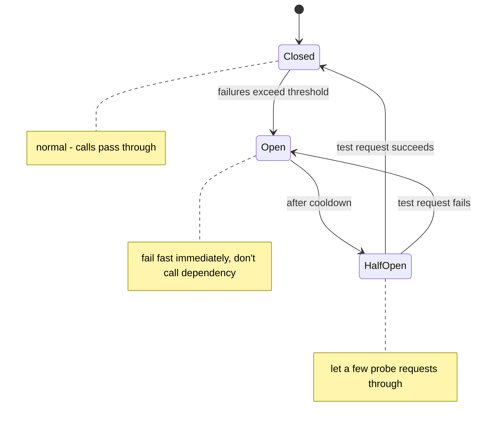
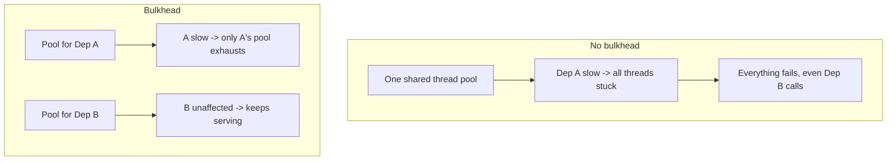

# Circuit Breakers and Bulkheads

> Prerequisites: [partial-failures-and-timeouts](./partial-failures-and-timeouts.md)
> Related: [graceful-degradation](./graceful-degradation.md) · [07-reliability-and-resilience/circuit-breaker-pattern](../07-reliability-and-resilience/circuit-breaker-pattern.md) · [retries-backoff-and-jitter](../05-messaging-and-event-driven-systems/retries-backoff-and-jitter.md)

Two resilience patterns that stop a failing dependency from taking down the whole system. Circuit breakers stop hammering a dead dependency; bulkheads isolate resources so one failure can't exhaust everything. Both are blast-radius containment.

---

## A. Problem and motivation

From [partial-failures-and-timeouts](./partial-failures-and-timeouts.md): a slow/failing dependency causes callers' resources (threads, connections) to pile up, cascading into a system-wide outage. Timeouts help one request, but if the dependency stays down, you keep sending doomed requests (wasting resources, worsening the dependency's overload, piling up slow calls). Circuit breakers and bulkheads are the structural defenses: stop calling a dead dependency (breaker) and cap how much of your resources any one dependency can consume (bulkhead).

---

## B. Circuit breaker

Like an electrical breaker: after too many failures, it "trips open" and **fails fast** instead of calling the dead dependency, then periodically tests if it recovered.

- **Closed:** normal; calls pass through; count failures.
- **Open:** too many failures → trip; **fail fast** (return error/fallback immediately *without* calling the dependency) for a cooldown period. This frees resources and stops piling load on the struggling dependency.
- **Half-open:** after cooldown, allow a few probe requests; if they succeed, close (recovered); if they fail, re-open.

**Why it matters:** when a dependency is down, continuing to call it wastes threads (each call hangs to its timeout) and worsens the dependency's overload. The breaker stops the bleeding — fail fast, free resources, give the dependency room to recover, and serve a fallback. Pairs with retries+backoff ([retries-backoff-and-jitter](../05-messaging-and-event-driven-systems/retries-backoff-and-jitter.md)): backoff for transient blips, breaker for sustained failure.

---

## C. Bulkhead

Named after ship compartments that stop one flooded section from sinking the ship. **Isolate resources per dependency** so one failing dependency can't consume *all* your threads/connections.

Without bulkheads, all calls share one thread/connection pool; if Dependency A hangs, it consumes the entire pool, so even requests that only need Dependency B fail. With bulkheads, each dependency gets its own bounded pool: A's failure exhausts only A's pool, and B keeps working. This is **failure isolation** — containing the blast radius.

---

## D. How they combine (the resilience trio)

Timeouts + circuit breaker + bulkhead work together:
1. **Timeout** bounds any single call (so it can't hang forever).
2. **Bulkhead** caps how many concurrent calls to one dependency (so it can't eat all resources).
3. **Circuit breaker** stops calling a sustained-failing dependency entirely (fail fast + recovery probing).

Plus a **fallback** (graceful degradation — see [graceful-degradation](./graceful-degradation.md)) for what to return when the breaker is open. Libraries like Resilience4j (Java) provide all of these as composable decorators.

---

## E. Example — DMS calling the notification service

The DMS wraps notification-service calls with: a 200ms timeout, a bulkhead (a dedicated small thread pool for notification calls), and a circuit breaker. If the notification service goes down:
- Timeouts fire at 200ms (no hanging).
- The bulkhead ensures only the notification pool is affected — upload/download/search (critical paths) keep working because they use different pools.
- After repeated failures the breaker trips open → notification calls fail fast (no 200ms wait each) → DMS instantly falls back to "queue the notification for later" (degraded, not failed).
- Half-open probes detect recovery and close the breaker.

Net: a notification-service outage causes *delayed notifications*, not a DMS outage. Contrast the no-protection case from [partial-failures-and-timeouts](./partial-failures-and-timeouts.md), where it would cascade.

---

## F. Trade-offs

| Pattern | Advantages | Disadvantages | Best use | Warning signs |
|---|---|---|---|---|
| Circuit breaker | Fails fast, frees resources, lets dependency recover | Tuning thresholds; false trips if too sensitive | Flaky/slow dependencies | No breaker → hammering a dead dependency |
| Bulkhead | Isolates failure, protects critical paths | More pools to size; some resource overhead | Multiple dependencies of differing criticality | Shared pool → one dep exhausts all |
| Both + timeout + fallback | Full blast-radius containment | Complexity, tuning | Any critical service with dependencies | Any missing (cascade risk) |

---

## G. Failure scenarios

1. **Cascading failure (no breaker).** Trigger: dependency down; caller keeps sending doomed requests, each hanging to timeout. Effect: resources exhausted, caller fails. Fix: circuit breaker fails fast after a threshold. 
2. **One dependency exhausts the shared pool (no bulkhead).** Trigger: Dep A hangs, consumes all threads. Effect: even Dep B calls fail. Fix: bulkheads (per-dependency pools).
3. **Breaker too sensitive (false trips).** Trigger: threshold too low; transient blips open the breaker. Users: unnecessary fallbacks. Fix: tune thresholds and windows; distinguish transient from sustained.
4. **No fallback when open.** Trigger: breaker opens but there's no degraded behavior → hard errors. Fix: define a fallback (cached/stale data, queue-for-later, default). See [graceful-degradation](./graceful-degradation.md).

---

## H. Scaling implications

As the number of services and dependencies grows, so does the chance that at least one is failing at any moment — making cascade prevention essential. Circuit breakers and bulkheads are the standard structural defenses in a mature microservices architecture; without them, one unhealthy service can topple the fleet. They embody blast-radius thinking: contain each dependency's failure to its own resources and fail fast when it's down. Combined with timeouts, deadline propagation, retries+backoff, and fallbacks, they turn partial failures from outages into degradations — the core of resilient design at scale.

---

## I. Interview preparation

**Basic**
- Q: What does a circuit breaker do? → *A: After too many failures to a dependency, it trips open and fails fast (without calling the dependency) for a cooldown, then probes (half-open) for recovery — freeing resources and letting the dependency recover.*
- Q: What's a bulkhead? → *A: Isolating resources (e.g., per-dependency thread pools) so one failing dependency can't exhaust all resources and take down unrelated calls.*

**Intermediate**
- Q: Circuit breaker states? → *A: Closed (normal), Open (fail fast after threshold), Half-open (probe for recovery, then close or re-open).*
- Q: How do timeouts, breakers, and bulkheads combine? → *A: Timeout bounds each call; bulkhead caps concurrent calls per dependency; breaker stops calling a sustained-failing dependency; a fallback handles the open state. Together they contain blast radius.*

**SDE-2 / scenario**
- Q: "A failing recommendation service took down checkout. Why and fix?" → *A: Checkout shared resources with the recommendation call; when it hung, the pool exhausted and checkout failed. Fix: bulkhead (separate pool for recommendations), a circuit breaker to fail fast when it's down, a timeout, and a fallback (hide recommendations) so checkout keeps working.*
- Q: "When does backoff vs a circuit breaker apply?" → *A: Backoff+jitter for transient blips (retry a bit later); circuit breaker for sustained failure (stop calling entirely, fail fast, probe for recovery). Use both.*

**Common wrong answers:** retrying a down dependency forever (no breaker); one shared pool for all dependencies (no bulkhead); opening the breaker with no fallback; over-sensitive thresholds.

---

## J. Hands-on exercise

Design resilience for a checkout service that calls payment (critical), inventory (critical), and recommendations (optional). For each dependency, specify timeout, bulkhead pool sizing, circuit-breaker behavior, and the fallback when it fails. Explain how this prevents a recommendations outage from affecting checkout.

---

## K. Revision summary

**Key takeaways**
- Circuit breaker: trip open after failures → fail fast (don't call the dead dependency) → half-open probe → recover. Frees resources, lets dependency heal.
- Bulkhead: isolate resources per dependency so one failure can't exhaust all → protects critical paths.
- Combine timeout + bulkhead + breaker + fallback for full blast-radius containment.
- Backoff for transient; breaker for sustained; always have a fallback when open.

**Must explain without notes:** circuit-breaker states; bulkhead isolation; how they + timeouts prevent cascades.

**Rapid-fire**
1. Circuit-breaker states? → Closed, Open, Half-open.
2. What does "open" do? → Fail fast without calling the dependency.
3. Bulkhead prevents? → One dependency exhausting all shared resources.
4. Backoff vs breaker? → Transient blips vs sustained failure.
5. When the breaker is open, you need a? → Fallback (graceful degradation).

**Next:** [graceful-degradation](./graceful-degradation.md)
