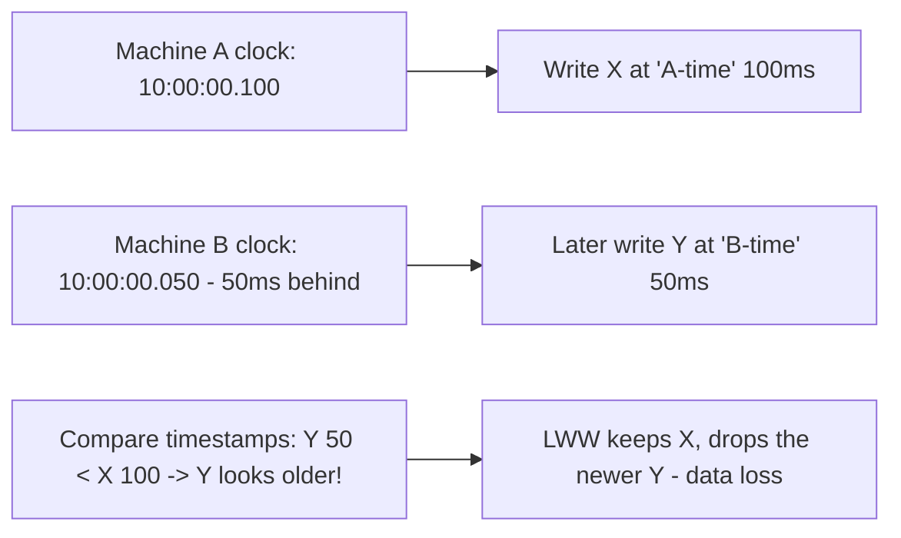
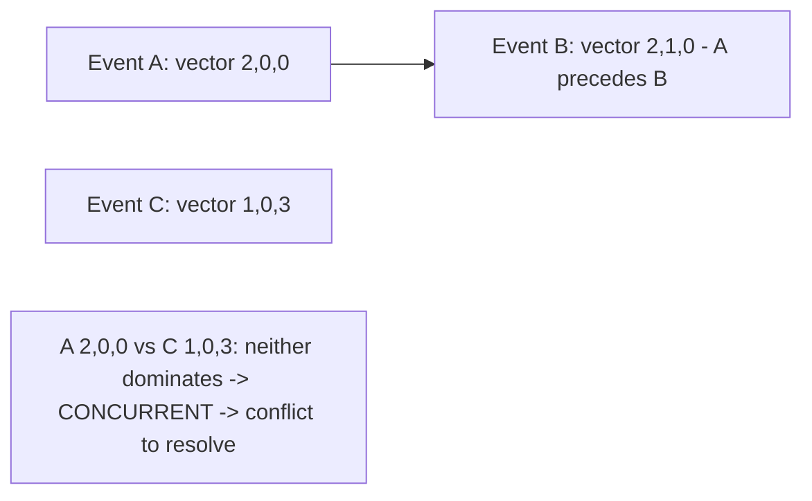

# Clock Skew and Logical Clocks

> Prerequisites: [why-distributed-systems](./why-distributed-systems.md)
> Related: [quorum-reads-and-writes](./quorum-reads-and-writes.md) · [distributed-locks](./distributed-locks.md) · [id-generation-and-sequences](./id-generation-and-sequences.md)

Physical clocks on different machines disagree, so you cannot trust timestamps to order events across machines. Logical clocks solve ordering without synchronized time. (Track B depth; appears in ID generation, LWW conflict resolution, and ordering.)

---

## A. Problem and motivation

Each machine has its own clock, and they drift apart (**clock skew**) despite NTP synchronization — by milliseconds normally, occasionally much more. So two events on different machines can't be reliably ordered by comparing their wall-clock timestamps: a later event might carry an *earlier* timestamp. Any correctness logic that uses "whichever timestamp is bigger wins" (last-write-wins) can silently drop the actually-newer write. You need a way to order events that doesn't trust physical time.

---

## B. Why you can't trust wall clocks across machines

- NTP keeps clocks *roughly* aligned but not exactly; skew of milliseconds is normal, and clocks can jump (adjustments, VM pauses).
- **Last-write-wins (LWW) by wall clock is unsafe:** a write that happened later but on a slightly-behind clock gets a smaller timestamp and is discarded — silent data loss (seen in [quorum-reads-and-writes](./quorum-reads-and-writes.md)).
- You cannot reliably say "event A happened before event B" across machines from timestamps alone.

---

## C. Logical clocks — ordering without physical time

**Lamport clocks:** each node keeps a counter; it increments on each event and includes the counter in messages; on receiving a message, a node sets its counter to `max(local, received) + 1`. This produces a consistent ordering of *causally related* events (if A caused B, A's timestamp < B's). Limitation: it can't tell whether two events are concurrent or just unordered — it gives a total order but not a true "happened-before vs concurrent" distinction.

**Vector clocks:** each node tracks a vector of per-node counters. Comparing vectors tells you whether one event *causally precedes* another or they're **concurrent** (conflicting). This is what lets AP stores *detect* conflicts (concurrent writes) and resolve them (merge/CRDT) instead of blindly picking by timestamp.

**Hybrid Logical Clocks (HLC) / TrueTime-style:** combine physical time (for human-meaningful timestamps) with logical counters (for correct ordering). Spanner's TrueTime uses tightly-bounded clocks (atomic/GPS) + waiting out the uncertainty to offer external consistency — expensive infrastructure most systems don't have.

---

## D. Practical guidance for SDE-2

You usually don't implement vector clocks by hand, but you must know:
- **Don't use wall-clock LWW for correctness** — it loses data under skew. Use version numbers (optimistic locking), logical clocks, or CRDTs.
- **Monotonic sequence > timestamp** for ordering/IDs — a database sequence or a Snowflake-style ID (which embeds time but is monotonic within a node) orders reliably where raw wall clocks don't. See [id-generation-and-sequences](./id-generation-and-sequences.md).
- **Fencing tokens are logical, not physical** — leader/lock fencing uses monotonic counters precisely because clocks are untrustworthy. See [distributed-locks](./distributed-locks.md).
- **Treat timestamps as approximate** — fine for display and rough bucketing, not for correctness-critical ordering across machines.

---

## E. Example — DMS and conflict resolution

- **Concurrent document edits across replicas (AP scenario):** if the DMS ever used eventual-consistency replication and resolved conflicts by wall-clock LWW, a slightly-behind node's *newer* edit could be dropped. Instead, the DMS uses optimistic locking with a **version number** (monotonic per document) — the conflict is detected by version mismatch (`409`), not resolved by comparing timestamps. See [transactions-and-isolation](../03-databases-and-data-modeling/transactions-and-isolation.md).
- **Ordering events for audit:** the DMS orders by a DB sequence or Snowflake ID, not by the clock of whichever server emitted the event.

The theme: correctness ordering uses **logical** mechanisms (versions, sequences, fencing tokens), not physical clocks.

---

## F. Trade-offs

| Mechanism | Advantages | Disadvantages | Best use | Warning signs |
|---|---|---|---|---|
| Wall-clock timestamps | Human-meaningful, cheap | Unsafe for cross-machine ordering (skew) | Display, rough bucketing | Using for LWW/correctness |
| Lamport clocks | Consistent causal order, cheap | Can't distinguish concurrent from ordered | Causal ordering | Needing conflict detection |
| Vector clocks | Detects concurrency/conflicts | Size grows with nodes | AP conflict detection | Many nodes (vector bloat) |
| HLC / TrueTime | Physical-meaningful + correct order | TrueTime needs special hardware | Spanner-like strong consistency | Assuming you have TrueTime |

---

## G. Failure scenarios

1. **LWW data loss from skew.** Trigger: resolving concurrent writes by wall-clock timestamp; a behind clock makes the newer write "older." Users: silent loss of an update. Fix: version numbers / vector clocks / CRDTs instead of wall-clock LWW.
2. **Mis-ordered events for correctness.** Trigger: ordering state transitions by server timestamps across machines. Effect: an "update" processed before its "create." Fix: logical ordering (sequences, causal keys).
3. **Clock jump breaks timing logic.** Trigger: an NTP correction or VM pause jumps the clock backward. Effect: expiry/lock-timeout logic misfires. Fix: use monotonic clocks for durations, logical counters for ordering.

---

## H. Scaling implications

Across more machines and regions, clock skew is a certainty and its correctness impact grows — any system doing cross-machine ordering or LWW conflict resolution must use logical mechanisms. This underpins several earlier topics: quorum conflict resolution (version vectors not LWW), lock/leader fencing (monotonic tokens), and ID generation (monotonic sequences / Snowflake). Strong external consistency across regions (Spanner) requires expensive tightly-synchronized clocks; most systems instead avoid cross-machine timestamp ordering entirely. The practical rule scales well: treat physical time as approximate, use logical ordering for correctness.

---

## I. Interview preparation

**Basic**
- Q: Why can't you order events across machines by timestamp? → *A: Clocks drift (skew) despite NTP, so a later event can carry an earlier timestamp; wall-clock ordering is unreliable across machines.*

**Intermediate**
- Q: Why is wall-clock last-write-wins dangerous? → *A: A write on a slightly-behind clock gets a smaller timestamp and is discarded even though it happened later → silent data loss. Use version numbers/vector clocks/CRDTs instead.*
- Q: Lamport vs vector clocks? → *A: Lamport gives a consistent causal order but can't tell concurrent from ordered; vector clocks compare per-node counters to detect concurrency/conflicts.*

**SDE-2 / scenario**
- Q: "You use last-write-wins and occasionally lose edits." → *A: Clock skew — the 'winning' larger timestamp isn't actually the later write. Switch to monotonic version numbers (optimistic locking) or vector clocks/CRDTs so conflicts are detected and merged, not silently resolved by clock.*
- Q: "How do you order events reliably across servers?" → *A: Don't trust wall clocks — use a monotonic sequence (DB sequence or Snowflake IDs) or logical/causal ordering; reserve timestamps for display.*

**Common wrong answers:** trusting synchronized clocks; wall-clock LWW for correctness; ordering critical events by server timestamps.

---

## J. Hands-on exercise

A multi-datacenter key-value store resolves concurrent writes with last-write-wins by timestamp and is losing updates. Explain the clock-skew mechanism causing it, then propose two correct alternatives (version vectors/CRDT vs a single-writer-per-key design) with their trade-offs.

---

## K. Revision summary

**Key takeaways**
- Clocks drift (skew); you can't order cross-machine events or do LWW safely by wall-clock timestamp.
- Logical clocks order without physical time: Lamport (causal order), vector clocks (detect concurrency/conflicts).
- For correctness use logical mechanisms: version numbers, monotonic sequences/Snowflake IDs, fencing tokens — not clocks.
- Treat physical timestamps as approximate (display/bucketing), not correctness-critical ordering.

**Rapid-fire**
1. Why not order by timestamp across machines? → Clock skew (later event, earlier timestamp).
2. Danger of wall-clock LWW? → Silent data loss.
3. Which clock detects concurrent writes? → Vector clocks.
4. Reliable cross-server ordering? → Monotonic sequence / Snowflake IDs / logical order.
5. Base fencing/ordering on clocks? → No — monotonic counters.

**Next:** [id-generation-and-sequences](./id-generation-and-sequences.md)
