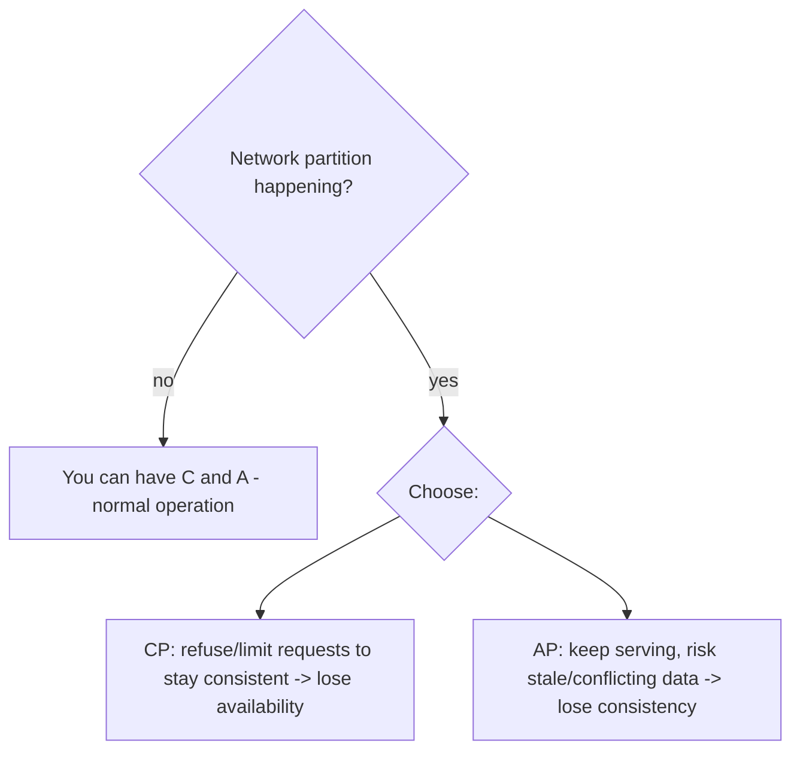

# Consistency and the CAP Theorem

> Prerequisites: [03-databases/consistency-models](../03-databases-and-data-modeling/consistency-models.md), [replication-and-read-replicas](../03-databases-and-data-modeling/replication-and-read-replicas.md)
> Related: [quorum-reads-and-writes](./quorum-reads-and-writes.md) · [multi-region-architecture](./multi-region-architecture.md)

CAP is the most-cited and most-*misused* distributed-systems theorem. The SDE-2 goal: state it correctly, know its real-world nuances (PACELC), and apply it as "pick C or A *during a partition*," not as a crude label on a database.

---

## A. Problem and motivation

In a replicated system, nodes can become unable to communicate (a **network partition**). When that happens, you face a forced choice: keep serving requests but risk returning inconsistent data (available), or refuse requests to avoid inconsistency (consistent). CAP formalizes that you can't have both during a partition. Misunderstanding CAP leads to wrong choices (demanding strong consistency where availability matters, or vice versa) and to meaningless statements like "MongoDB is CP."

---

## B. CAP stated correctly

CAP: in the presence of a network **P**artition, a distributed system must choose between **C**onsistency and **A**vailability.

- **Consistency (CAP sense = linearizable):** every read sees the latest write (one logical copy).
- **Availability:** every request gets a (non-error) response.
- **Partition tolerance:** the system keeps working despite dropped messages between nodes.

**The crucial nuance:** partitions *will* happen (networks fail), so P is not optional — you don't "choose" P. The real choice, **only when a partition occurs**, is C or A:

So CAP is really: **during a partition, do you sacrifice consistency (AP) or availability (CP)?** Outside a partition, you can have both.

---

## C. CP vs AP in practice

- **CP (consistency over availability):** during a partition, reject writes/reads on the minority side rather than serve stale/conflicting data. Example: a system requiring a quorum won't accept writes it can't replicate to a majority. Fits money, inventory, uniqueness. Cost: unavailable during partitions.
- **AP (availability over consistency):** keep serving on both sides, reconcile later (eventual consistency, conflict resolution). Fits shopping carts, likes, feeds, DNS. Cost: temporary inconsistency/stale reads.

**It's per-operation, not per-database.** The same system can be CP for the balance and AP for the like-count. Labeling a whole database "CP" or "AP" is the common misuse — real systems are tunable and make the choice per data path (see [consistency-models](../03-databases-and-data-modeling/consistency-models.md)).

---

## D. PACELC — the part people miss

CAP only covers the partition case. **PACELC** completes it: *if Partition (P), choose A or C; Else (E, normal operation), choose Latency (L) or Consistency (C).* Even with no partition, strong consistency costs latency (coordination/quorum), so you trade latency vs consistency in normal operation too. This explains why "eventually consistent" systems are also *faster* in normal operation — they skip coordination. PACELC is a strong signal to cite: it shows you know CAP isn't the whole story.

---

## E. Example — applying CAP/PACELC

- **Payment ledger:** CP — during a partition, refuse writes you can't make consistent (don't risk double-spend); accept unavailability. PACELC-C: even normally, pay the latency for strong consistency.
- **Shopping cart:** AP — stay available during a partition (users keep shopping); reconcile carts later (merge). PACELC-L: prefer low latency normally.
- **Social feed / likes:** AP + PACELC-L — availability and speed over strict consistency; a stale like-count is fine.
- **DMS "did my upload succeed?":** lean CP for that read (read from primary) so the user sees their write; most other DMS reads are AP-ish (replicas/cache, eventual).

The skill: name the choice per operation, grounded in what a stale/unavailable result would cost.

---

## F. Trade-offs

| Choice | Advantages | Disadvantages | Best use | Warning signs |
|---|---|---|---|---|
| CP (during partition) | No stale/conflicting data | Unavailable during partitions | Money, inventory, uniqueness, locks | Using it for carts/feeds (needless outages) |
| AP (during partition) | Stays up | Stale/conflicting data; needs reconciliation | Carts, feeds, likes, DNS | Using it for money/inventory |

---

## G. Failure scenarios

1. **AP where CP was needed.** Trigger: serving a balance from a partitioned/stale replica (AP). Users: double-spend/oversell. Fix: CP for that invariant (quorum/primary reads; refuse on the minority side).
2. **CP where AP was fine.** Trigger: refusing cart/feed operations during a partition. Users: needless outages for non-critical features. Fix: AP for those; reconcile later.
3. **CAP misapplied as a database label.** Trigger: "we're using an AP database, so everything is eventually consistent." Effect: critical paths wrongly made eventual. Fix: choose per operation; use the store's tunable consistency (quorum) for critical paths.

---

## H. Scaling implications

CAP/PACELC frame the central scaling trade-off: the replication, caching, and multi-region techniques that give you availability and low latency generally push you toward AP / eventual consistency, while the few paths needing strong consistency (CP) cost availability-during-partitions and latency. As you scale (more replicas, more regions), partitions become more likely and the C-vs-A choice more consequential — especially multi-region, where cross-region strong consistency is very expensive (see [multi-region-architecture](./multi-region-architecture.md)). The quorum mechanism ([quorum-reads-and-writes](./quorum-reads-and-writes.md)) is how tunable stores let you dial C vs A per operation.

---

## I. Interview preparation

**Basic**
- Q: State CAP correctly. → *A: During a network partition, a distributed system must choose consistency or availability; partition tolerance isn't optional because partitions happen.*

**Intermediate**
- Q: Why is "pick 2 of 3" misleading? → *A: Partitions are inevitable, so P isn't a free choice; the real decision is C vs A *only during a partition*. Outside partitions you can have both.*
- Q: What does PACELC add? → *A: Else (no partition), you still trade Latency vs Consistency — strong consistency costs latency even in normal operation.*

**SDE-2 / scenario**
- Q: "Is your system CP or AP?" → *A: It's per-operation. The payment balance is CP (refuse rather than risk double-spend during a partition, and pay latency for consistency normally); the shopping cart and feed are AP + low-latency (stay available, reconcile later). I choose per data path based on the cost of staleness vs unavailability.*
- Q: "During a network partition, what happens to writes in your CP path?" → *A: The minority side refuses writes it can't replicate to a quorum, so it stays consistent at the cost of availability there; the majority side can still serve.*

**Common wrong answers:** "pick 2 of 3"; labeling a database CP/AP wholesale; demanding strong consistency everywhere; ignoring PACELC's normal-operation trade-off.

---

## J. Hands-on exercise

For a ride-hailing app during a network partition between regions, decide CP vs AP for: assigning a driver to a rider (must not double-assign), showing surge pricing, and recording the final trip payment. Justify each and state what a wrong choice would cost. Then apply PACELC to the surge-pricing read in normal operation.

---

## K. Revision summary

**Key takeaways**
- CAP: during a partition, choose consistency or availability; P is inevitable, so the real choice is C vs A *during a partition*.
- Choose per operation, not per database: CP for money/inventory/uniqueness, AP for carts/feeds/likes.
- PACELC: even without a partition, strong consistency costs latency (L vs C normally).
- Scaling (replicas/regions) pushes toward AP/eventual; reserve CP for true invariants and pay its cost.

**Must explain without notes:** CAP stated correctly (C-vs-A during partition); per-operation application; PACELC.

**Rapid-fire**
1. Can you "choose" partition tolerance? → No — partitions happen; you choose C or A during one.
2. CP during a partition does what? → Refuses requests to stay consistent (loses availability).
3. PACELC's "else" trade-off? → Latency vs Consistency in normal operation.
4. Is a database wholly CP or AP? → No — choose per operation (tunable).
5. Cart during a partition — CP or AP? → AP (stay available, reconcile later).

**Next:** [quorum-reads-and-writes](./quorum-reads-and-writes.md)
