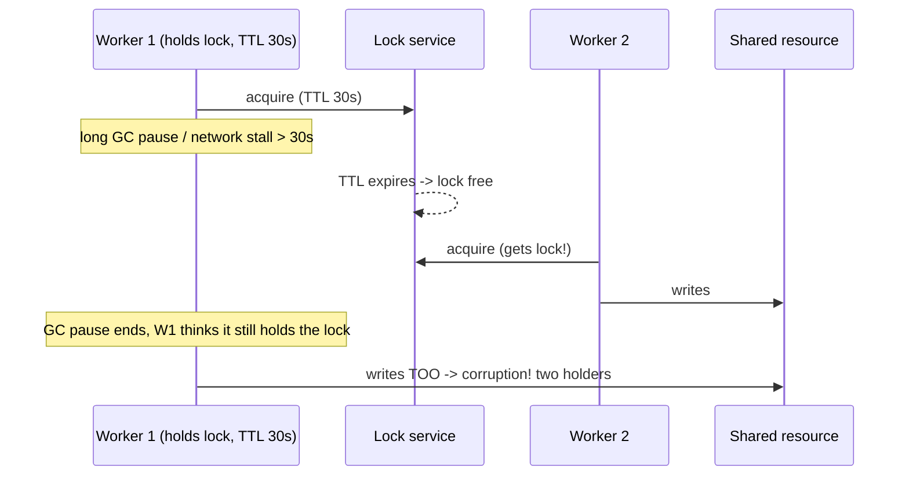
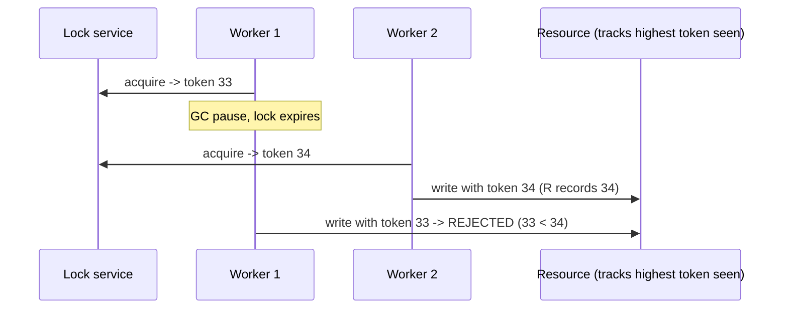

# Distributed Locks, Leases, and Fencing Tokens

> Prerequisites: [leader-election-and-split-brain](./leader-election-and-split-brain.md), [04-caching/redis-design-and-failure-modes](../04-caching/redis-design-and-failure-modes.md)
> Related: [retries-and-duplicate-execution](./retries-and-duplicate-execution.md) · [exactly-once-processing](./exactly-once-processing.md)

A distributed lock coordinates exclusive access across machines (only one worker processes a job, only one node mutates a resource). The crucial SDE-2 insight: **a distributed lock alone does NOT guarantee correctness** — you need fencing tokens, and ideally you design to avoid needing locks at all.

---

## A. Problem and motivation

You often want mutual exclusion across machines: only one worker should process a given job, only one node should run a cron, only one request should mutate a shared resource. On one machine, a mutex suffices. Across machines, you need a *distributed* lock (Redis `SET NX`, ZooKeeper, etcd). But distributed locks are deceptively dangerous: due to partial failure, timeouts, and clock issues, two nodes can both believe they hold the lock — and if you rely on the lock alone for correctness, you get double-processing or corruption.

---

## B. The naive distributed lock and why it's unsafe

A common pattern: `SET lock_key worker_id NX PX 30000` (acquire with a 30s TTL), do the work, then release. The TTL prevents a crashed holder from locking forever. But:

The killer scenario: Worker 1 holds the lock, then suffers a long **GC pause** (or network stall) exceeding the TTL. The lock expires; Worker 2 acquires it legitimately. Worker 1 resumes, *still believing it holds the lock*, and writes — now **two workers write concurrently**. The TTL that protects against crashes *creates* this two-holder window. No distributed lock can fully prevent this, because you can't bound a GC pause.

---

## C. Fencing tokens — the fix

Make the **shared resource reject stale lock holders** using a monotonically increasing **fencing token** issued with each lock grant:

The resource remembers the highest token it has accepted and **rejects any write with a lower token**. When the stale Worker 1 (token 33) tries to write after Worker 2 (token 34) already did, the resource rejects it. The lock service must issue monotonic tokens (consensus services like ZooKeeper/etcd provide these; a plain Redis lock does not inherently). This is the only way a lock gives *correctness* under GC pauses/stalls.

**Interview-ready:** "A distributed lock alone doesn't guarantee correctness — a GC pause can leave two holders. I use fencing tokens: each lock grant gets a monotonically increasing token, and the protected resource rejects writes with a stale token."

---

## D. Leases vs locks

A **lease** is a lock with a TTL that must be renewed (heartbeated) to retain it. If the holder stops renewing (crash/partition), the lease expires and another node can take over. Leases avoid locks held forever by dead holders, but reintroduce the same stale-holder problem (a holder can be partitioned, lose the lease, but not know it) — so leases *also* need fencing for correctness. Leader election ([leader-election-and-split-brain](./leader-election-and-split-brain.md)) is essentially a lease on leadership, which is why it uses the same term/epoch fencing.

---

## E. The better move: avoid needing a lock

Often the strongest answer is to **not need a distributed lock** for correctness:
- **Idempotency instead of exclusion:** if processing a job twice is harmless (idempotent), you don't need a lock to guarantee single processing — occasional double-processing is fine. See [idempotency-and-deduplication](../05-messaging-and-event-driven-systems/idempotency-and-deduplication.md).
- **Database atomicity:** use a conditional/atomic DB operation (optimistic locking, `UPDATE ... WHERE version = n`, unique constraint) to serialize access, letting the DB be the single source of truth instead of an external lock. See [transactions-and-isolation](../03-databases-and-data-modeling/transactions-and-isolation.md).
- **Partitioning:** assign each key to exactly one owner (e.g., Kafka partition → one consumer) so no two nodes touch the same key — exclusivity by design, no lock. See [ordering-and-consumer-groups](../05-messaging-and-event-driven-systems/ordering-and-consumer-groups.md).

Locks are a last resort for coordination; prefer idempotency, DB atomicity, or partitioning.

---

## F. Example — DMS job processing

The DMS wants each uploaded document's OCR job processed once. Options:
- **Lock (fragile):** a Redis lock per document — but a GC pause could double-process. If used, add fencing tokens.
- **Better (idempotency):** make OCR idempotent (keyed by document+revision), so even if two workers grab it, the second is a no-op (dedup on the result write). No lock needed for correctness. This is the DMS's choice.
- **Better (partitioning):** key the job queue by document_id so one consumer handles a document's jobs. Exclusivity by design.

The DMS leans on idempotency + partitioning rather than distributed locks for correctness, using locks only for soft coordination (e.g., avoiding redundant work), where occasional double-work is tolerable.

---

## G. Trade-offs

| Approach | Advantages | Disadvantages | Best use | Warning signs |
|---|---|---|---|---|
| Naive lock (TTL) | Simple | Two-holder window (GC pause); not correctness-safe | Soft coordination (dedupe work) | Relying on it for correctness |
| Lock + fencing tokens | Correctness-safe | Resource must check tokens; needs monotonic token source | When exclusion is truly required | Fencing not enforced at the resource |
| Idempotency | No lock; tolerates double-execution | Must make the op idempotent | Most "process once" needs | Op has non-idempotent side effects |
| DB atomicity / partitioning | No external lock; DB/partition is source of truth | Fits specific shapes | Serializing on a key | Needing cross-key exclusion |

---

## H. Failure scenarios

1. **Two holders (GC pause/stall).** Trigger: holder stalls past TTL; another acquires; holder resumes and acts. Effect: concurrent mutation/corruption. Fix: fencing tokens; or don't rely on the lock for correctness (idempotency).
2. **Lock service down.** Trigger: Redis/ZK outage. Effect: can't acquire/release → work stalls or (if fail-open) double-processing. Fix: decide fail-open/closed; prefer idempotency so a lock-service blip is non-catastrophic. See [redis-design-and-failure-modes](../04-caching/redis-design-and-failure-modes.md).
3. **Lock held forever (crashed holder, no TTL).** Trigger: holder crashes without releasing. Effect: deadlock. Fix: TTL/lease (but then handle the stale-holder window with fencing).
4. **Clock-based lock safety.** Trigger: relying on synchronized clocks for lock validity. Effect: skew breaks safety. Fix: fencing tokens (monotonic counter), not clocks. See [clock-skew-and-logical-clocks](./clock-skew-and-logical-clocks.md).

---

## I. Scaling implications

Distributed locks are a coordination tool, and coordination is a scaling bottleneck (every locked operation serializes and depends on the lock service's availability). At scale, you minimize locking: use idempotency so double-execution is harmless, DB atomicity to serialize on a key, or partitioning to assign single owners — all of which avoid a central lock. When a lock is genuinely required for correctness, fencing tokens are mandatory, and the token source should be a consensus service (etcd/ZK), not a plain Redis lock. The meta-lesson (echoing the whole section): coordination is fallible, so design to need as little of it as possible.

---

## J. Interview preparation

**Basic**
- Q: Why isn't a Redis lock with a TTL safe for correctness? → *A: A GC pause/network stall can exceed the TTL; the lock expires, another node acquires it, and the paused holder resumes thinking it still holds the lock → two holders.*

**Intermediate**
- Q: What are fencing tokens? → *A: Monotonically increasing numbers issued with each lock grant; the protected resource records the highest token seen and rejects writes with a lower token, so a stale holder's write is rejected.*
- Q: Lock vs lease? → *A: A lease is a lock with a TTL that must be renewed (heartbeated); it avoids locks held forever by dead holders but still has the stale-holder window → also needs fencing.*

**SDE-2 / scenario**
- Q: "You used a distributed lock so a job runs once, but it ran twice. How?" → *A: The holder likely stalled (GC/pause) past the lock TTL; another worker acquired it and both ran. A lock alone can't prevent this. I'd add fencing tokens so the resource rejects the stale holder, or better, make the job idempotent so double-execution is harmless.*
- Q: "How would you avoid needing a distributed lock at all?" → *A: Make the operation idempotent (double-execution is a no-op), use DB atomicity (optimistic lock/unique constraint) to serialize on the key, or partition so one owner handles each key — exclusivity by design.*

**Common wrong answers:** trusting a Redis TTL lock for correctness; no fencing; relying on clocks; reaching for a lock when idempotency/partitioning would avoid it.

---

## K. Hands-on exercise

You must ensure a daily report is generated once across many servers. Compare three designs: (a) Redis lock + TTL, (b) lock + fencing tokens from etcd, (c) make generation idempotent. For each, state the correctness guarantee, the failure window, and the operational cost. Which would you choose and why?

---

## L. Revision summary

**Key takeaways**
- A distributed lock alone does NOT guarantee correctness — a GC pause/stall past the TTL creates a two-holder window.
- Fencing tokens (monotonic, issued per grant; resource rejects stale tokens) make locking correctness-safe.
- Leases = renewable locks; still need fencing. Leader election is a lease on leadership with term fencing.
- Prefer avoiding locks: idempotency (tolerate double-execution), DB atomicity, or partitioning (single owner per key).

**Must explain without notes:** why a TTL lock is unsafe (GC pause); fencing tokens; how to avoid needing a lock.

**Rapid-fire**
1. Does a Redis TTL lock guarantee correctness? → No (two-holder window).
2. The fix for lock correctness? → Fencing tokens (monotonic; resource rejects stale).
3. Lease vs lock? → Lease is a renewable (heartbeated) lock; still needs fencing.
4. Best way to avoid a lock for "process once"? → Idempotency.
5. Base fencing on clocks or a counter? → A monotonic counter (not clocks).

**Next:** [clock-skew-and-logical-clocks](./clock-skew-and-logical-clocks.md)
