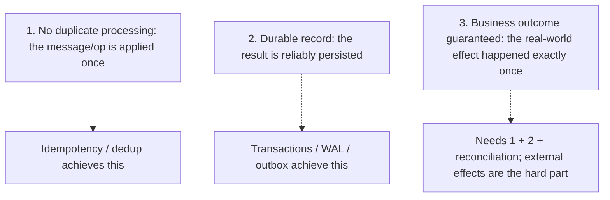

# Exactly-Once Processing and Its Limits

> Prerequisites: [05-messaging/message-delivery-semantics](../05-messaging-and-event-driven-systems/message-delivery-semantics.md), [retries-and-duplicate-execution](./retries-and-duplicate-execution.md)
> Related: [idempotency-and-deduplication](../05-messaging-and-event-driven-systems/idempotency-and-deduplication.md) · [idempotent-recovery-and-reconciliation](../07-reliability-and-resilience/idempotent-recovery-and-reconciliation.md)

This chapter sharpens the distinction the master prompt insists on: **preventing duplicate processing ≠ ensuring a durable record ≠ guaranteeing a business outcome.** It's the capstone of the delivery-semantics + idempotency story.

---

## A. Problem and motivation

"Can you guarantee exactly-once?" is a trap question. The naive answer ("yes, Kafka exactly-once") is wrong. The strong answer separates three distinct guarantees people conflate, explains that end-to-end exactly-once *delivery* is impossible, and shows how to achieve exactly-once *effect* via idempotency — while being honest about the residual limits that force reconciliation.

---

## B. The three distinct guarantees (don't conflate them)

1. **Preventing duplicate processing:** the operation is applied once despite redeliveries — solved by **idempotency/dedup** ([idempotency-and-deduplication](../05-messaging-and-event-driven-systems/idempotency-and-deduplication.md)).
2. **Ensuring a durable record:** once you decide something happened, it's reliably stored — solved by **transactions / WAL / transactional outbox** ([transactional-outbox-and-cdc](../05-messaging-and-event-driven-systems/transactional-outbox-and-cdc.md)).
3. **Guaranteeing the business outcome:** the real-world effect (money moved, email sent, package shipped) happened exactly once — needs 1 + 2 **plus** handling of **external side effects** you don't fully control.

A system can prevent duplicate processing yet still have a wrong business outcome (e.g., it deduped the message but the external payment API was called twice across a crash). These are *different* problems.

---

## C. Why end-to-end exactly-once is impossible (the honest truth)

From [message-delivery-semantics](../05-messaging-and-event-driven-systems/message-delivery-semantics.md): over an unreliable network you must choose at-most-once (may lose) or at-least-once (may duplicate) — there's no exactly-once *delivery*. And from [retries-and-duplicate-execution](./retries-and-duplicate-execution.md): a timeout can't tell you if an external effect succeeded, so you may re-invoke it. Therefore:

> You cannot guarantee an external side effect happens exactly once purely with messaging. You achieve **exactly-once *effect*** by (a) at-least-once delivery, (b) idempotent processing, and (c) for external effects, idempotency *at the external system* plus reconciliation to catch what slips through.

"Kafka exactly-once" (EOS) is real but scoped: it makes *Kafka-internal* read-process-write atomic. It does **not** make your call to an external API (charge card, send email) exactly-once. Claiming otherwise is the classic mistake.

---

## D. How to get as close as possible

Layered defenses:
1. **At-least-once delivery** (never lose the message).
2. **Idempotent processing** keyed by a stable id → duplicate deliveries are no-ops (prevents duplicate processing). The check-and-record must be atomic.
3. **Transactional durability** → combine the dedup record and the result in one DB transaction (or use the outbox) so you never record "done" without the effect, or vice versa.
4. **Idempotency at external systems** → pass an idempotency key to the payment provider / email API so *they* dedupe your retries.
5. **Reconciliation** → a background job compares your records with external systems (and across services) to detect and fix residual drift — the backstop for the gaps 1–4 can't fully close. See [idempotent-recovery-and-reconciliation](../07-reliability-and-resilience/idempotent-recovery-and-reconciliation.md).

Together these give **effectively-once** business outcomes — the best achievable.

---

## E. Example — charging a customer exactly once

Walking the three guarantees:
- **No duplicate processing:** idempotency key on the charge request; the second delivery of the same charge message is a no-op (dedup store). ✅
- **Durable record:** record the charge result in the same transaction as the idempotency key (so you never think "charged" without the record). ✅
- **Business outcome:** the actual money movement is at the payment provider — you pass the idempotency key *to the provider* so your retry doesn't double-charge, and run a **reconciliation** job comparing provider transactions with your ledger to catch any case where the provider charged but you didn't record it (or vice versa). This is "effectively-once," not a hard guarantee. See [payment-system](../12-system-design-problems/payment-system.md).

If asked "can you guarantee exactly-once charging?": *"Not as an absolute guarantee — I make it effectively-once with idempotency keys (also at the provider) + durable records + reconciliation, and I'm explicit that the residual gap is closed by reconciliation, not magic."*

---

## F. Trade-offs

| Approach | Guarantee achieved | Gap remaining |
|---|---|---|
| At-least-once only | Never lose; duplicates possible | Duplicate effects |
| + Idempotent processing | No duplicate processing | External effect may still double if not keyed at the external system |
| + External idempotency key | External effect deduped by provider | Edge cases (provider charged, local record failed) |
| + Reconciliation | Effectively-once business outcome | Rare, detected-and-fixed drift (not instant) |

---

## G. Failure scenarios

1. **Believing the broker gives exactly-once.** Trigger: relying on Kafka EOS for a card charge. Effect: double charge (external effect not covered). Fix: idempotency key at the external system + reconciliation.
2. **Deduped processing but inconsistent record.** Trigger: dedup record and result written separately; crash between them. Effect: "processed" flag set but result missing (or vice versa). Fix: write them in one transaction / outbox.
3. **No reconciliation.** Trigger: trusting idempotency alone for money. Effect: rare undetected drift accumulates. Fix: reconciliation job comparing systems. 
4. **Non-atomic dedup check.** Trigger: concurrent duplicates both pass the check. Effect: double processing. Fix: atomic unique-key insert.

---

## H. Scaling implications

At scale, every assumption that "this won't be delivered twice" is false — so exactly-once *effect* (at-least-once + idempotency + durable records + external idempotency + reconciliation) is the standard for correctness-critical flows (payments, inventory, notifications). The dedup store and reconciliation jobs are real, sized, monitored components. The key SDE-2 maturity signal is refusing to claim a false guarantee: you articulate the three distinct guarantees, acknowledge exactly-once delivery is impossible, and describe the layered path to effectively-once with reconciliation as the honest backstop.

---

## I. Interview preparation

**Basic**
- Q: Can you guarantee exactly-once? → *A: Not exactly-once *delivery* (impossible over an unreliable network). You achieve exactly-once *effect* via at-least-once delivery + idempotent processing (+ external idempotency + reconciliation for side effects).*

**Intermediate**
- Q: Distinguish the three guarantees people conflate. → *A: (1) no duplicate processing (idempotency/dedup), (2) durable record (transactions/outbox), (3) business outcome exactly once (needs 1+2 plus external-system idempotency + reconciliation). They're different problems.*
- Q: Does Kafka's exactly-once cover a card charge? → *A: No — EOS is Kafka-internal (read-process-write atomicity); the external charge needs its own idempotency key and reconciliation.*

**SDE-2 / scenario**
- Q: "Guarantee a customer is charged exactly once." → *A: I can't give an absolute guarantee. I make it effectively-once: idempotency key on the charge (atomic dedup), result recorded in the same transaction, the same key passed to the payment provider so it dedupes retries, and a reconciliation job comparing provider vs ledger to catch residual drift. I'm explicit that reconciliation closes the final gap.*
- Q: "You deduped the message but still double-charged — how?" → *A: The dedup covered message processing, but the external payment call wasn't idempotent at the provider across a crash/retry. Fix: idempotency key at the provider + reconciliation.*

**Common wrong answers:** "Kafka gives exactly-once so we're fine"; conflating dedup with business-outcome guarantees; no reconciliation; non-atomic dedup.

---

## J. Hands-on exercise

For "send a user exactly one welcome email," list the three guarantees and how you'd satisfy each: dedup processing (idempotency key), durable record (store sent status transactionally), and the business outcome (email provider idempotency + reconciliation for the case where the provider sent but your status write failed). State the residual gap and how reconciliation closes it.

---

## K. Revision summary

**Key takeaways**
- Three distinct guarantees: (1) no duplicate processing (idempotency), (2) durable record (transactions/outbox), (3) business outcome exactly once (1+2 + external idempotency + reconciliation).
- Exactly-once *delivery* is impossible; exactly-once *effect* is achievable (effectively-once).
- Broker "exactly-once" (Kafka EOS) is internal only — doesn't cover external side effects.
- Reconciliation is the honest backstop for residual drift; claiming a hard guarantee is a red flag.

**Must explain without notes:** the three guarantees; why exactly-once delivery is impossible; the layered path to effectively-once + reconciliation.

**Rapid-fire**
1. Exactly-once *delivery* — achievable? → No.
2. Exactly-once *effect* — how? → At-least-once + idempotency (+ external key + reconciliation).
3. Does Kafka EOS cover an external charge? → No.
4. The three conflated guarantees? → Dedup processing / durable record / business outcome.
5. The honest backstop for money? → Reconciliation.

**Next:** [circuit-breakers-and-bulkheads](./circuit-breakers-and-bulkheads.md)
