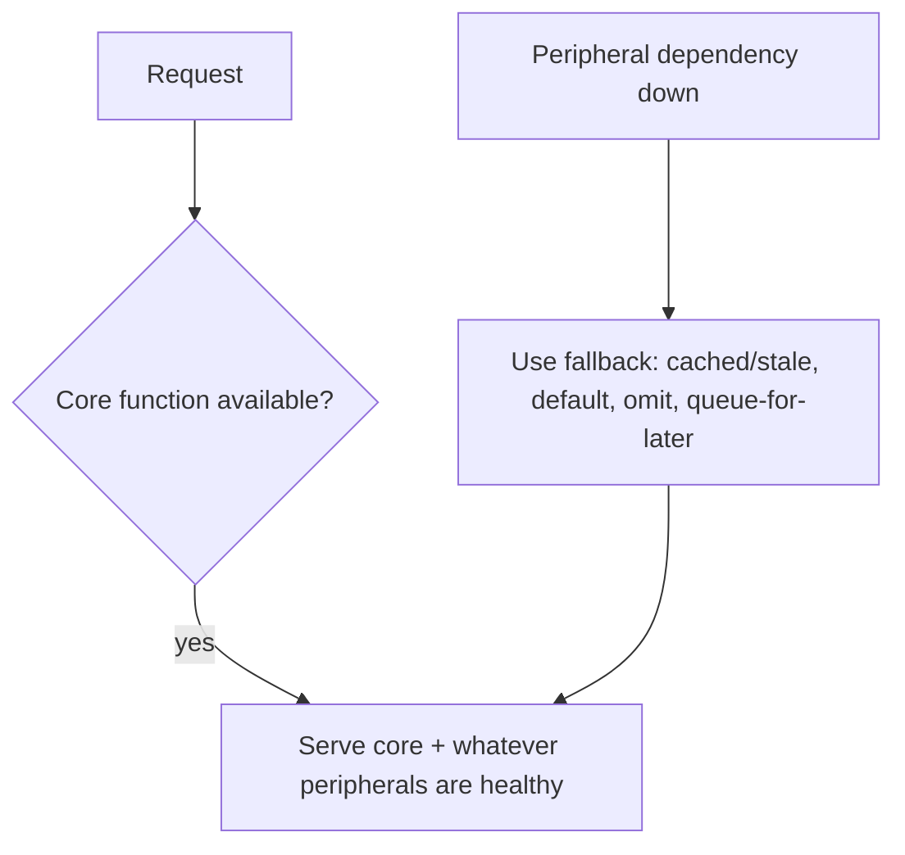

# Graceful Degradation

> Prerequisites: [circuit-breakers-and-bulkheads](./circuit-breakers-and-bulkheads.md), [partial-failures-and-timeouts](./partial-failures-and-timeouts.md)
> Related: [04-caching/redis-design-and-failure-modes](../04-caching/redis-design-and-failure-modes.md) · [07-reliability-and-resilience/availability-and-reliability](../07-reliability-and-resilience/availability-and-reliability.md)

Graceful degradation is the design philosophy that ties the resilience patterns together: when something fails, the system should *degrade* (reduced functionality) rather than *fail entirely*. It's what you serve when the circuit breaker is open.

---

## A. Problem and motivation

Failures are inevitable (dependencies go down, caches die, services slow). The question is whether a partial failure causes a *partial* loss of functionality or a *total* outage. A well-designed system keeps its core function working even when peripheral parts fail — a storefront that can't show recommendations should still let you buy; a feed that can't load the exact count should still show posts. Graceful degradation turns "the recommendation service is down → the whole site is down" into "the site works, just without recommendations."

---

## B. The principle: fail soft, protect the core

Identify the **core function** (what the system absolutely must do) and the **peripheral functions** (nice-to-haves). Under failure, sacrifice peripherals to keep the core alive.

Degradation strategies (what to do when a dependency fails):
- **Serve stale/cached data** instead of fresh (e.g., Redis down → serve last-known value; or DB down → serve cached). See [redis-design-and-failure-modes](../04-caching/redis-design-and-failure-modes.md).
- **Serve a default / omit the feature** (recommendations down → show popular items or hide the section).
- **Queue for later** (notification service down → enqueue and send when it recovers — the DMS pattern).
- **Reduce quality** (video can't transcode HD → serve SD; search engine down → fall back to basic DB search).
- **Read-only mode** (writes failing → still serve reads).

The circuit breaker's "open" state ([circuit-breakers-and-bulkheads](./circuit-breakers-and-bulkheads.md)) triggers these fallbacks.

---

## C. Load shedding — degradation under overload

A related form: under extreme load, deliberately **shed** low-priority work to protect the core. Reject/deprioritize non-critical requests (return 503 for optional features, drop low-priority queue messages) so critical requests still succeed. Better to serve 90% of users well than to collapse serving everyone. Pairs with [rate-limiting](../01-networking-and-api-design/rate-limiting.md) and [backpressure](../05-messaging-and-event-driven-systems/backpressure-and-consumer-lag.md).

---

## D. Example — DMS and e-commerce

**DMS under dependency failures:**
- Search engine down → fall back to basic DB metadata search (degraded relevance, but search works).
- Notification service down → queue notifications for later (core upload/download unaffected).
- Redis down → serve document metadata from Postgres with a concurrency limiter (slower, still works).
- OCR pipeline down → accept uploads with status PROCESSING; process when it recovers (upload still succeeds).

Core function (store/retrieve documents) stays available even as peripherals degrade.

**E-commerce:** recommendations down → show popular items; reviews service down → hide reviews but allow purchase; search down → basic category browse. The *checkout core* is protected at all costs.

---

## E. Trade-offs

| Approach | Advantages | Disadvantages | Best use | Warning signs |
|---|---|---|---|---|
| Graceful degradation | Core stays up during partial failure | Must design fallbacks per dependency; may serve stale/reduced data | Any system with non-critical dependencies | All-or-nothing (one dep down = full outage) |
| Load shedding | Protects core under overload | Rejects/degrades some requests | Overload events | Shedding critical requests |
| Fail entirely (no degradation) | Simple | One failure = total outage | Rarely acceptable | Peripheral failure causing full outage |

**Design cost:** graceful degradation requires deciding, per dependency, "what do we do if this is down?" — a deliberate design activity, not automatic. Skipping it means every dependency is a potential total-outage trigger.

---

## F. Failure scenarios (degradation IS the handling)

The pattern turns these from outages into degradations:
1. **Peripheral service down** → omit/fallback that feature, serve the core. (vs. total outage)
2. **Cache/Redis down** → serve from DB with a concurrency limiter (slower). (vs. errors)
3. **Overload spike** → shed low-priority work, protect critical. (vs. collapse)
4. **Partial data unavailable** → serve what's available with a note, not a hard error.

The anti-pattern is **no degradation**: a non-critical dependency's failure (recommendations, analytics, notifications) takes down the critical path because there's no fallback.

---

## G. Scaling implications

As systems grow more dependencies, the probability that *something* is always degraded approaches certainty — so graceful degradation isn't a nice-to-have, it's how large systems maintain high availability despite constant partial failures. It's the complement to circuit breakers/bulkheads (which *detect and isolate* failure) by defining *what to serve instead*. Combined, they let a system with many 99.9% dependencies still offer high core availability, because peripheral failures don't propagate to the core. The SDE-2 habit: for each dependency, state its criticality and its fallback.

---

## H. Interview preparation

**Basic**
- Q: What is graceful degradation? → *A: Designing so that when a part fails, the system loses that functionality (reduced service) rather than failing entirely — the core keeps working.*

**Intermediate**
- Q: Give degradation strategies. → *A: Serve stale/cached data, serve defaults/omit the feature, queue-for-later, reduce quality (HD→SD), read-only mode; and load-shed low-priority work under overload.*
- Q: What triggers the fallback? → *A: Typically a circuit breaker opening (sustained dependency failure) or a timeout — the system switches to the degraded path instead of erroring.*

**SDE-2 / scenario**
- Q: "The recommendations service is down. What should the user see?" → *A: The site should work normally minus recommendations — show popular/default items or hide the section (graceful degradation). Checkout and browsing (the core) must be unaffected; the recommendation call is bulkheaded + circuit-broken with this fallback.*
- Q: "How do you keep the DMS usable when Redis, search, and notifications are all flaky?" → *A: Degrade each: Redis down → DB with concurrency limit; search down → basic DB search; notifications down → queue for later. The core (upload/download) stays available; only peripheral quality drops.*

**Common wrong answers:** no fallbacks (any dependency down = total outage); degrading the core instead of peripherals; shedding critical requests under load.

---

## I. Hands-on exercise

For a video streaming home page (dependencies: catalog, personalized recommendations, continue-watching, thumbnails CDN, playback service), classify each as core or peripheral and define the degradation behavior when each fails. Which single dependency, if down, legitimately means the core is broken?

---

## J. Revision summary

**Key takeaways**
- Graceful degradation: on failure, lose functionality (degrade) rather than fail entirely; protect the core, sacrifice peripherals.
- Strategies: stale/cached data, defaults/omit, queue-for-later, reduced quality, read-only; load-shed under overload.
- Triggered by circuit breakers/timeouts; the complement to detection/isolation (breakers/bulkheads).
- Requires deliberate per-dependency fallback design; the anti-pattern is one peripheral failure causing a total outage.

**Must explain without notes:** core vs peripheral + fail-soft; degradation strategies; load shedding; the no-fallback anti-pattern.

**Rapid-fire**
1. Degrade means? → Reduced functionality, not total failure.
2. Recommendations down → do what? → Omit/default; keep checkout working.
3. What triggers the fallback? → Circuit breaker open / timeout.
4. Protect under overload by? → Load shedding low-priority work.
5. Anti-pattern? → No fallback → peripheral failure = total outage.

**Next:** [multi-region-architecture](./multi-region-architecture.md)
