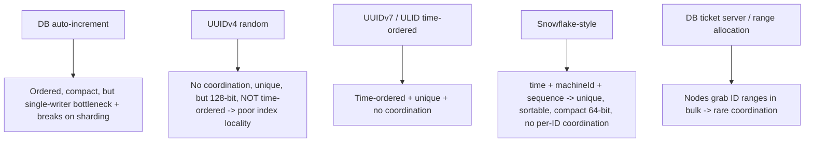

# Unique ID Generation

> Prerequisites: [clock-skew-and-logical-clocks](./clock-skew-and-logical-clocks.md), [03-databases/partitioning-and-sharding](../03-databases-and-data-modeling/partitioning-and-sharding.md)
> Related: [12-system-design-problems/url-shortener](../12-system-design-problems/url-shortener.md)

Generating unique IDs across many machines without a single bottleneck is a classic HLD sub-problem (it appears in the URL shortener, sharded tables, and distributed logs). Know the options and the Snowflake pattern.

---

## A. Problem and motivation

A single database auto-increment gives unique, ordered IDs — but it requires a single writer (the DB), which is a bottleneck and doesn't work once you shard (each shard would reissue the same numbers). Distributed systems need IDs that are **globally unique** without a central bottleneck, and often **roughly time-ordered** (so they sort chronologically, help with indexing, and enable range scans). Getting this wrong causes collisions (duplicate IDs) or a central bottleneck that defeats sharding.

---

## B. The requirements (and tensions)

| Property | Why it matters |
|---|---|
| **Unique** | No collisions, ever (non-negotiable) |
| **Scalable** (no central bottleneck) | Generate IDs on any node without coordinating per-ID |
| **Roughly sortable by time** | Chronological sort, better index locality (B-tree inserts near the end), range queries |
| **Compact / efficient** | Smaller index, less storage |

Tension: a central allocator gives order but bottlenecks; fully random gives no bottleneck but no order and is large. The art is balancing these.

---

## C. The options



- **DB auto-increment:** simple, ordered, compact — but a single writer and breaks across shards. Fine for a single unsharded DB.
- **UUIDv4 (random 128-bit):** generated anywhere, no coordination, effectively collision-free — but **not time-ordered** (random), so inserts scatter across a B-tree index (poor locality, index fragmentation) and it's large. Common but has the ordering/locality downside.
- **UUIDv7 / ULID (time-ordered UUIDs):** embed a timestamp prefix so they sort by time while staying collision-free and coordination-free — fixes UUIDv4's locality problem. A good modern default.
- **Snowflake-style (the classic interview answer):** a 64-bit ID = `timestamp bits | machine/worker id bits | per-ms sequence bits`. Time-ordered, unique (machine id avoids cross-node collision, sequence avoids same-ms collision), compact, no per-ID coordination (each node just needs a unique machine id). Used by Twitter/Instagram-style systems.
- **Ticket/range allocation:** nodes request a *block* of IDs from a central allocator occasionally (e.g., 1,000 at a time), then hand them out locally — coordination is rare (once per block), not per ID.

---

## D. The Snowflake pattern in detail

A 64-bit layout (bit counts vary):
```
| 41 bits: timestamp (ms since epoch) | 10 bits: machine id | 12 bits: per-ms sequence |
```
- **Timestamp first** → IDs sort roughly by creation time (great index locality; new rows append near the B-tree's end).
- **Machine id** → different nodes never collide (each has a unique id, assigned at startup via config/ZooKeeper/etcd).
- **Sequence** → up to 4,096 IDs per machine per millisecond without collision; if exceeded, wait for the next ms.

Caveats: machine ids must be unique (coordination at startup, not per ID); clock going backwards (NTP correction) can cause issues — handle by refusing to go back / waiting (connects to [clock-skew](./clock-skew-and-logical-clocks.md)). This is the go-to answer for "generate unique, sortable IDs at scale."

---

## E. Example — DMS and URL shortener

- **DMS document ids across shards:** Snowflake-style IDs so each app node generates globally-unique, time-sortable ids without hitting a central sequence — essential once metadata is sharded (auto-increment would collide across shards). See [partitioning-and-sharding](../03-databases-and-data-modeling/partitioning-and-sharding.md).
- **URL shortener short codes:** need unique, short, non-colliding codes. Options: base62-encode a Snowflake/counter-derived unique number (no collision, no random-retry) vs random codes with collision checks (simpler but needs retry on collision). The counter/Snowflake approach avoids collision checks entirely. See [url-shortener](../12-system-design-problems/url-shortener.md).

---

## F. Trade-offs

| Scheme | Unique | Sortable | No bottleneck | Compact | Notes |
|---|---|---|---|---|---|
| DB auto-increment | ✅ | ✅ | ❌ (single writer) | ✅ | Breaks on sharding |
| UUIDv4 | ✅ | ❌ | ✅ | ❌ (128-bit) | Poor index locality |
| UUIDv7/ULID | ✅ | ✅ | ✅ | ❌ (128-bit) | Good modern default |
| Snowflake | ✅ | ✅ | ✅ (machine id only) | ✅ (64-bit) | Needs unique machine ids + clock handling |
| Ticket/range | ✅ | ✅ (per range) | ✅ (rare coordination) | ✅ | Lose a block on crash (gaps) |

---

## G. Failure scenarios

1. **Collisions after sharding (auto-increment).** Trigger: each shard reissues 1,2,3… → duplicates. Fix: Snowflake/UUID (globally unique without a central sequence).
2. **Index fragmentation (UUIDv4).** Trigger: random IDs scatter B-tree inserts → poor locality, bloat. Users: slower writes/reads. Fix: time-ordered IDs (UUIDv7/Snowflake).
3. **Machine-id reuse (Snowflake).** Trigger: two nodes assigned the same machine id → collisions. Fix: coordinate machine-id assignment (ZK/etcd/config), validate uniqueness at startup.
4. **Clock moves backward (Snowflake).** Trigger: NTP correction. Effect: potential duplicate/out-of-order timestamps. Fix: refuse to generate until the clock catches up, or use a monotonic source.

---

## H. Scaling implications

ID generation is a quiet but real scaling concern: a central sequence is a single-writer bottleneck and a SPOF that breaks sharding, so at scale you need coordination-free generation (Snowflake/UUIDv7) that each node does locally. Time-ordering matters for index locality — random IDs degrade write performance on B-tree stores as data grows ([database-internals](../03-databases-and-data-modeling/database-internals-for-system-design.md)). The scheme ties to clocks (Snowflake embeds time, so clock-skew handling matters) and to sharding (globally-unique IDs are a prerequisite). It's a small design detail that signals maturity when handled correctly.

---

## I. Interview preparation

**Basic**
- Q: Why not use DB auto-increment at scale? → *A: It's a single-writer bottleneck and breaks across shards (each shard would reissue the same numbers).*

**Intermediate**
- Q: What's wrong with UUIDv4 for primary keys? → *A: It's random, so not time-ordered — inserts scatter across the B-tree index (poor locality, fragmentation), and it's 128-bit (large). UUIDv7/Snowflake fix the ordering.*
- Q: Describe Snowflake IDs. → *A: A 64-bit ID of timestamp + machine id + per-ms sequence — globally unique (machine id + sequence), time-sortable (timestamp first), compact, and generated locally per node without per-ID coordination.*

**SDE-2 / scenario**
- Q: "Generate unique IDs across a sharded system." → *A: Snowflake-style IDs: each node has a unique machine id (assigned via etcd/config), embeds a timestamp for sortability and a per-ms sequence for intra-ms uniqueness. No central sequence, no collisions, good index locality. Handle clock-backwards by waiting.*
- Q: "Why did switching to UUID primary keys slow down writes?" → *A: UUIDv4 is random, so B-tree inserts hit random pages (poor locality, page splits, cache misses). Use time-ordered IDs (UUIDv7/Snowflake) so inserts append near the end.*

**Common wrong answers:** auto-increment across shards; UUIDv4 as a sortable key; a central ID service as a per-ID bottleneck; ignoring Snowflake's clock/machine-id caveats.

---

## J. Hands-on exercise

Design ID generation for a sharded chat system's messages that must be unique, roughly time-ordered (for display and index locality), and generated without a central bottleneck. Choose a scheme, lay out the bits (if Snowflake), and explain how you assign machine ids and handle a clock moving backward.

---

## K. Revision summary

**Key takeaways**
- Need: unique + no central bottleneck + roughly time-ordered + compact. Auto-increment fails the bottleneck/sharding tests.
- UUIDv4: coordination-free + unique but random (poor index locality, large). UUIDv7/ULID: time-ordered fix.
- Snowflake (timestamp + machine id + sequence): the classic answer — unique, sortable, compact, local generation; needs unique machine ids + clock handling.
- Time-ordering matters for B-tree index locality; central ID services bottleneck/break sharding.

**Must explain without notes:** why auto-increment fails at scale; UUIDv4's locality problem; the Snowflake layout + its caveats.

**Rapid-fire**
1. Problem with auto-increment at scale? → Single-writer bottleneck; breaks sharding.
2. UUIDv4's downside as a key? → Random → poor B-tree locality + large.
3. Snowflake components? → Timestamp + machine id + per-ms sequence.
4. Why time-order IDs? → Index locality + chronological sort.
5. Snowflake clock-backwards fix? → Wait / refuse until the clock catches up.

**Next:** [exactly-once-processing](./exactly-once-processing.md)
