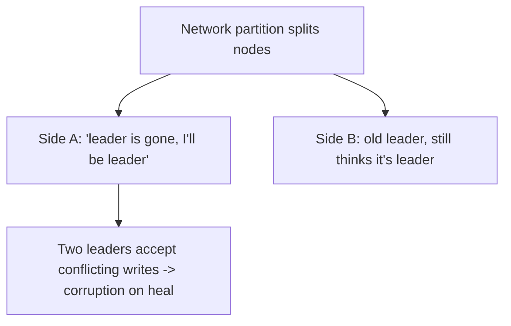
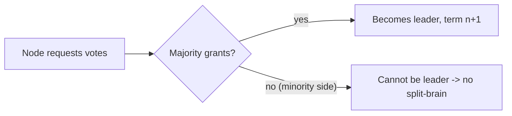

# Leader Election and Split-Brain

> Prerequisites: [consistency-and-cap-theorem](./consistency-and-cap-theorem.md), [03-databases/replication-and-read-replicas](../03-databases-and-data-modeling/replication-and-read-replicas.md)
> Related: [distributed-locks](./distributed-locks.md) · [quorum-reads-and-writes](./quorum-reads-and-writes.md)

Many systems need a single coordinator (a leader): the write primary, a scheduler, a lock holder. Electing one reliably — and preventing *two* nodes from both thinking they're leader (split-brain) — is a classic hard problem solved with consensus and quorums. (Track B depth.)

---

## A. Problem and motivation

Some responsibilities must be held by exactly one node at a time: the writable DB primary, a job scheduler that must not run jobs twice, a partition owner. If zero nodes think they're leader, nothing progresses; if *two* do (**split-brain**), they make conflicting decisions (two primaries accept divergent writes → data corruption). Leader election chooses one leader and, critically, ensures only one is active even during network partitions and failures.

---

## B. Why naive election fails — split-brain

The core danger: during a partition, each side may believe the other is dead and elect/retain its own leader. Both accept writes; when the partition heals, their states conflict — **split-brain**. A naive "if I don't hear from the leader, I'm leader now" guarantees split-brain under partitions.

---

## C. How it's solved — quorum/consensus-based election

The fix is to require a **majority (quorum)** to elect/maintain a leader. Only a side with a majority of nodes can have a leader; the minority side cannot (it steps down). Since there's only one majority, there's at most one leader.

- **Consensus algorithms (Raft, Paxos, ZAB):** nodes agree on a leader and a replicated log via majority votes. A leader needs votes from a majority; a partitioned minority can't elect one, preventing split-brain. These power ZooKeeper, etcd, Consul — the coordination services others rely on.
- **Terms/epochs:** each leadership has a monotonically increasing term number; a stale leader (from before a partition) is recognized by its old term and rejected — crucial for fencing (next chapter).
- **Odd number of nodes:** 3 or 5, so a majority is unambiguous (a 2-node cluster can't form a majority if split).

**Interview-ready:** "Leader election must be quorum-based so only a majority partition can have a leader — the minority steps down, preventing split-brain. Consensus (Raft/Paxos) provides this, with monotonic terms so a stale leader is fenced out."

---

## D. The lingering risk even with quorum election

Quorum election prevents two leaders from being *simultaneously elected*, but a **stale leader** can linger: a node that was leader, got partitioned, and hasn't yet realized it lost leadership may still try to act (write, hold a lock). This is why actions need **fencing tokens** — the term/epoch number — so downstream systems reject a stale leader's requests. See [distributed-locks](./distributed-locks.md). Without fencing, a GC pause or network blip can let an old leader cause damage after a new one is elected.

---

## E. Example — DMS and schedulers

- **DB primary failover:** if the DMS primary dies, a replica is promoted — but promotion must be quorum-coordinated (via a consensus-based manager) so a network partition doesn't promote a second primary while the old one is still alive (split-brain → divergent writes). The old primary, if it comes back, must step down (recognized by stale term). See [replication-and-read-replicas](../03-databases-and-data-modeling/replication-and-read-replicas.md).
- **A singleton scheduler** (e.g., the DMS retention/cleanup job that must run on exactly one node): elect a leader via etcd/ZooKeeper; only the leader runs the job. If the leader is partitioned, it loses leadership (can't maintain quorum) and stops; a new leader takes over. Fencing ensures the old leader doesn't also run the job.

---

## F. Trade-offs

| Approach | Advantages | Disadvantages | Best use | Warning signs |
|---|---|---|---|---|
| Naive election (no quorum) | Simple | Split-brain under partitions | Never for correctness | Two leaders on heal |
| Quorum/consensus (Raft/Paxos) | At most one leader; principled | Needs ≥3 nodes, more complex, latency | Primaries, schedulers, locks | 2-node clusters (no majority) |
| Managed coordination (etcd/ZK/Consul) | Battle-tested consensus as a service | Operate/depend on it | Most real systems | Rolling your own consensus |

**Don't roll your own consensus.** Use etcd/ZooKeeper/Consul or your platform's primitives — distributed consensus is notoriously easy to get subtly wrong.

---

## G. Failure scenarios

1. **Split-brain (two leaders).** Trigger: partition + naive election. Effect: divergent writes, corruption on heal. Fix: quorum-based election (only a majority can lead); fencing for stale leaders.
2. **Stale leader acts after losing leadership.** Trigger: a GC pause/partition makes a leader miss that it was replaced. Effect: an old leader writes/holds a lock after a new one exists. Fix: fencing tokens (monotonic terms) so downstream rejects the stale leader.
3. **No leader (election storm).** Trigger: flapping network, no stable majority → repeated elections, no progress. Fix: stable timeouts, odd node counts, backoff; managed coordination services handle this.
4. **Even-node split.** Trigger: 2-node cluster partitions 1-1 → no majority → unavailable (or split-brain if misconfigured). Fix: odd node counts (3/5).

---

## H. Scaling implications

Leader election underpins primary-based replication, singleton jobs, and partition ownership — everything that needs a single coordinator. It's a availability/consistency trade-off (CP-leaning): to avoid split-brain you accept that a minority partition goes leaderless (unavailable for that role) rather than risk divergence. At scale, you lean on managed consensus services (etcd/ZK) rather than building your own, and you combine election with fencing tokens so stale leaders can't cause damage. This connects directly to distributed locks (a lock is a form of single-holder leadership) and to failover design in replication.

---

## I. Interview preparation

**Basic**
- Q: What is split-brain? → *A: Two nodes both believe they're the leader (e.g., during a partition) and make conflicting decisions, corrupting state when they reconverge.*

**Intermediate**
- Q: How do you prevent split-brain? → *A: Quorum/consensus-based election — only a majority partition can have a leader, so the minority steps down; there's one majority, hence at most one leader. Add monotonic terms + fencing so a stale leader is rejected.*
- Q: Why odd numbers of nodes? → *A: So a majority is always unambiguous; an even split can't form a majority, preventing both split-brain and ambiguous elections.*

**SDE-2 / scenario**
- Q: "During a partition, your DB promoted a second primary. What went wrong?" → *A: Election wasn't quorum-gated, so the minority side promoted a leader → split-brain → divergent writes. Fix: quorum/consensus-coordinated failover (only a majority promotes), and fence the old primary by term so it can't accept writes after demotion.*
- Q: "A paused leader resumed and ran a job the new leader already ran." → *A: Stale-leader problem — the old leader acted after losing leadership. Fencing tokens (monotonic epoch) let downstream reject its stale actions; the job runner checks the current term.*

**Common wrong answers:** naive "no heartbeat → I'm leader"; 2-node clusters; rolling your own consensus; election without fencing.

---

## J. Hands-on exercise

Design leader election for a singleton billing-run job that must execute exactly once per day. Specify: how a leader is elected (quorum/consensus service), what happens when the leader is partitioned, how a stale leader is prevented from also running the job (fencing), and why you'd use 3 or 5 coordination nodes.

---

## K. Revision summary

**Key takeaways**
- Some roles need exactly one leader (primary, scheduler, lock holder); the danger is split-brain (two leaders) under partitions.
- Prevent split-brain with quorum/consensus-based election (Raft/Paxos/ZAB): only a majority can lead; minority steps down. Use odd node counts.
- Stale leaders can still linger → fence with monotonic terms/epochs so downstream rejects them.
- Don't roll your own consensus — use etcd/ZooKeeper/Consul.

**Must explain without notes:** split-brain + how quorum election prevents it; the stale-leader problem + fencing; odd node counts.

**Rapid-fire**
1. Two leaders at once? → Split-brain.
2. What prevents it? → Quorum/consensus election (majority only).
3. Why odd node counts? → Unambiguous majority.
4. Stale leader fix? → Fencing tokens (monotonic terms).
5. Build your own consensus? → No — use etcd/ZK/Consul.

**Next:** [distributed-locks](./distributed-locks.md)
