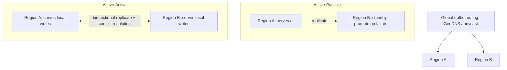

# Multi-Region Architecture

> Prerequisites: [consistency-and-cap-theorem](./consistency-and-cap-theorem.md), [03-databases/replication-and-read-replicas](../03-databases-and-data-modeling/replication-and-read-replicas.md)
> Related: [quorum-reads-and-writes](./quorum-reads-and-writes.md) · [07-reliability-and-resilience/disaster-recovery](../07-reliability-and-resilience/disaster-recovery.md)

Multi-region is the top of the scaling mountain — and the one the master prompt warns against adopting without a clear requirement. The SDE-2 skill is knowing *when* it's justified, the hard problems it brings (cross-region latency, replication lag, data residency), and when **not** to do it. (Track B depth.)

---

## A. Problem and motivation

A single-region system has two limits multi-region addresses: **latency** (users far from the region suffer ~100ms+ round trips) and **availability** (a whole region can fail — natural disaster, provider outage). Multi-region puts infrastructure in multiple geographic regions to serve users locally and survive a region loss. But it introduces the hardest distributed-systems problems — cross-region consistency, replication lag over long distances, conflict resolution, data residency — and large operational/cost overhead. Adopting it without a real latency or availability requirement is a classic over-engineering mistake.

---

## B. When multi-region is (and isn't) justified

**Justified when:**
- **Global users need low latency** — a cross-continent round trip (~100–150ms) per request is unacceptable for your UX, so you serve users from a nearby region.
- **You need to survive a full region outage** (availability requirement beyond multi-AZ) — regulatory or business continuity.
- **Data residency laws** require storing certain users' data in-country.

**NOT justified when (the master-prompt warning):**
- Users are regional (one region's latency is fine).
- Multi-AZ redundancy within one region already meets your availability target (regions rarely fail *entirely*; multi-AZ handles most failures far more cheaply).
- You just have "millions of users" — that's not a latency/availability requirement by itself (MAU ≠ geographic need).

**Interview-ready:** "I'd stay single-region with multi-AZ redundancy unless there's a concrete requirement: global low latency, surviving a full-region outage, or data residency. Multi-region's cross-region consistency and cost are only worth it then."

---

## C. The topologies

| Topology | How | Pros | Cons |
|---|---|---|---|
| **Active-passive** | One region serves; another is a warm standby (replicated) | Simpler; no write conflicts; good DR | Standby capacity idle; failover delay + possible data loss (replication lag) |
| **Active-active** | All regions serve reads+writes locally | Low latency everywhere; survives region loss seamlessly | **Write conflicts** across regions; hard consistency; complex |

Reads are easy to serve locally (replicate data to each region); **writes** are the hard part — a write in Region A must become visible in Region B, over a ~100ms+ link, and concurrent writes to the same data in different regions conflict.

---

## D. The hard problems multi-region creates

1. **Cross-region latency:** ~100ms+ per round trip. Any synchronous cross-region call (e.g., a strongly-consistent write requiring a quorum spanning regions) incurs this — so strong cross-region consistency is *slow*. See [latency](../00-foundations/latency-throughput-and-capacity.md).
2. **Replication lag over distance:** async replication across regions lags more (longer link); reads in Region B may be seconds behind Region A's writes.
3. **Write conflicts (active-active):** two regions write the same record concurrently → conflict. Resolve via last-write-wins (risky — [clock skew](./clock-skew-and-logical-clocks.md)), CRDTs, version vectors, or by **partitioning writes by region** (each record has a "home" region that owns its writes — avoids conflicts).
4. **Data residency / sovereignty:** some data must stay in-region (legal); you partition users/data by region and must prevent cross-region leakage.
5. **Cost & operational complexity:** duplicated infrastructure, cross-region data transfer costs, far more complex deploys/monitoring/failover.

**The CAP consequence:** you generally *cannot* have strong consistency + low latency + availability across regions. Most multi-region systems choose **eventual consistency** for cross-region data (AP) and keep strong consistency *within* a region, routing a record's writes to its home region. See [consistency-and-cap-theorem](./consistency-and-cap-theorem.md).

---

## E. Example — DMS going multi-region

Suppose the DMS gains EU customers with data-residency requirements and a global low-latency need. Design:
- **GeoDNS** routes users to the nearest region.
- **Data partitioned by tenant's home region** (EU tenants' data lives in the EU region — satisfies residency and avoids cross-region write conflicts since each tenant's writes go to its home region).
- **Reads** served locally (replicated metadata/cache per region); **writes** routed to the tenant's home region (strong consistency within that region, cross-region reads eventually consistent).
- **Files** in region-local object storage (+ optional cross-region replication for DR).
- **Failover:** if a region dies, promote/redirect — accepting replication-lag data loss for recent writes (bounded, documented as RPO — see [disaster-recovery](../07-reliability-and-resilience/disaster-recovery.md)).

Crucially, if the DMS *didn't* have residency/global-latency needs, this complexity would be unjustified — multi-AZ in one region would suffice.

---

## F. Trade-offs

| Approach | Advantages | Disadvantages | Best use | Warning signs |
|---|---|---|---|---|
| Single-region multi-AZ | Simple, strong consistency, cheap, handles most failures | Doesn't survive full-region loss; far-user latency | **Default** | Adding multi-region without a requirement |
| Active-passive multi-region | DR, survives region loss, no write conflicts | Idle standby, failover delay + lag data loss | DR requirement, regional users | Expecting low global write latency |
| Active-active multi-region | Low global latency, seamless region failover | Write conflicts, complex consistency, high cost | Global low-latency + HA requirement | No requirement; underestimating conflicts |

---

## G. Failure scenarios

1. **Over-adoption (no requirement).** Trigger: multi-region "for scale." Result: huge complexity/cost, cross-region consistency bugs, for no benefit. Fix: single-region multi-AZ unless a real latency/availability/residency need exists.
2. **Cross-region write conflicts (active-active).** Trigger: concurrent writes to the same record in two regions. Users: lost/merged updates. Fix: home-region ownership per record, or CRDTs/version vectors; avoid wall-clock LWW.
3. **Failover data loss.** Trigger: region dies with un-replicated recent writes (async cross-region lag). Users: lost recent data. Mitigate: document RPO; sync-replicate only the most critical data (at latency cost).
4. **Strong consistency killed by cross-region latency.** Trigger: a quorum/strong-consistency write spanning regions. Users: ~100ms+ writes. Fix: keep strong consistency within a region; eventual across regions.

---

## H. Scaling implications

Multi-region is the final scaling stage ([architecture-fundamentals](../00-foundations/architecture-fundamentals.md) Stage 6) and should be the *last* tool reached for, only with a concrete requirement. It pushes every hard distributed-systems problem to its extreme (consistency, latency, conflicts, residency) and multiplies cost/ops. The dominant real-world pattern is: multi-AZ within a region for most availability needs; multi-region (often active-passive for DR, or active-active with home-region write ownership) only when global latency, full-region survival, or residency demands it — and even then, strong consistency stays within a region while cross-region data is eventually consistent.

---

## I. Interview preparation

**Basic**
- Q: Why go multi-region? → *A: Low latency for globally-distributed users, surviving a full-region outage, or data-residency requirements — not "scale" by itself.*

**Intermediate**
- Q: Active-passive vs active-active? → *A: Active-passive: one region serves, another is a warm standby (simple, no write conflicts, failover delay/lag loss); active-active: all regions serve reads+writes (low global latency, but write conflicts and hard consistency).*
- Q: What's the hardest multi-region problem? → *A: Cross-region writes — ~100ms+ latency makes strong consistency slow, and concurrent writes in different regions conflict; typically resolved with home-region write ownership or eventual consistency + conflict resolution.*

**SDE-2 / scenario**
- Q: "We have millions of users — should we go multi-region?" → *A: Not from user count alone. I'd go multi-region only for a concrete need: global low-latency, surviving a full-region outage, or data residency. Otherwise single-region multi-AZ is simpler, cheaper, and strongly consistent, and handles most failures.*
- Q: "How do you avoid write conflicts in active-active?" → *A: Give each record a home region that owns its writes (route writes there), so concurrent cross-region writes to the same record don't happen; cross-region reads are eventually consistent. If truly multi-master, use CRDTs/version vectors, never wall-clock LWW.*

**Common wrong answers:** multi-region "for scale"/user count; expecting strong cross-region consistency cheaply; wall-clock LWW for conflicts; ignoring data residency.

---

## J. Hands-on exercise

A product has users in the US and EU, an EU data-residency law, and a requirement to survive a full-region outage. Design a multi-region architecture: traffic routing, how you partition data for residency + conflict-avoidance, read vs write routing, consistency model per path, and the failover plan (with RPO). Then state what you'd do instead if there were no residency law and users were US-only.

---

## K. Revision summary

**Key takeaways**
- Multi-region addresses global latency, full-region survival, and data residency — not "scale" alone.
- Default to single-region multi-AZ; adopt multi-region only with a concrete requirement (over-adoption is a classic mistake).
- Active-passive (simple DR, no write conflicts) vs active-active (low global latency, write conflicts, complex).
- Hard problems: cross-region latency, replication lag, write conflicts (home-region ownership / CRDTs, not LWW), residency, cost. Strong consistency stays within a region; cross-region is eventual.

**Must explain without notes:** when multi-region is justified vs not; active-passive vs active-active; the cross-region write/consistency problem.

**Rapid-fire**
1. Three valid reasons for multi-region? → Global latency, surviving region loss, data residency.
2. Does "millions of users" justify it? → No (not a latency/availability requirement by itself).
3. Hardest part of multi-region? → Cross-region writes (latency + conflicts).
4. Avoid active-active write conflicts how? → Home-region write ownership per record.
5. Default before multi-region? → Single-region multi-AZ.

**Section complete.** All 7 core-curriculum sections done. Next: [07-reliability-and-resilience](../07-reliability-and-resilience/availability-and-reliability.md)
