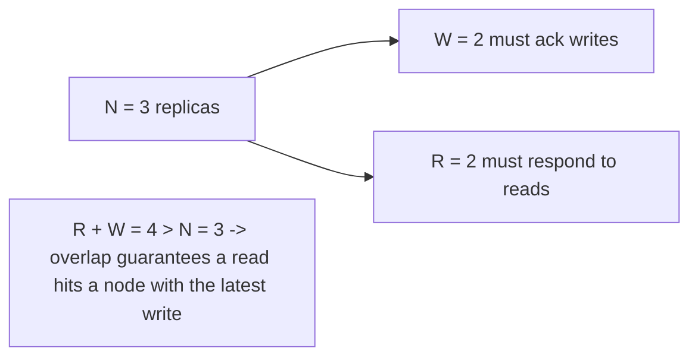

# Quorum Reads and Writes

> Prerequisites: [consistency-and-cap-theorem](./consistency-and-cap-theorem.md), [03-databases/replication-and-read-replicas](../03-databases-and-data-modeling/replication-and-read-replicas.md)
> Related: [leader-election-and-split-brain](./leader-election-and-split-brain.md) · [multi-region-architecture](./multi-region-architecture.md)

Quorums are how leaderless replicated stores (Dynamo-style, Cassandra) tune the CAP consistency/availability dial per operation. The one formula to know: **R + W > N gives strong-ish consistency.** (Track B depth.)

---

## A. Problem and motivation

With data replicated to N nodes, how many must respond for a read or write to count? If you write to one and read from another, you might read stale data. If you require all N, a single slow/down node blocks you (low availability). Quorums let you choose how many replicas must acknowledge reads (R) and writes (W), tuning the consistency/availability trade-off per operation — the practical knob behind [CAP](./consistency-and-cap-theorem.md).

---

## B. The quorum formula

Replication factor **N** (copies), write quorum **W** (replicas that must ack a write), read quorum **R** (replicas that must respond to a read).

> **If R + W > N, every read quorum overlaps every write quorum → the read sees the latest write (strong-ish consistency).**

Because the read set and write set share at least one node, the read sees the newest value (the overlapping node has it). Common config: N=3, W=2, R=2 (R+W=4>3).

**Tuning the dial:**
- **Strong consistency:** R + W > N (e.g., W=2, R=2 at N=3). Reads see latest writes.
- **Fast writes, risk stale reads:** low W (e.g., W=1) — write acked by one node; R + W ≤ N → reads may be stale (AP-leaning).
- **Fast reads:** low R (e.g., R=1) — read from one node, may be stale unless W is high.

You pick R and W per operation to lean toward consistency or availability/latency.

---

## C. Availability trade-off

Higher W/R = stronger consistency but **lower availability** (more nodes must be up/reachable). With N=3, W=3 requires all three up — one node down blocks writes. W=2 tolerates one node down. This is CAP in miniature: raising the quorum toward strong consistency reduces availability during partitions/failures. Leaderless stores let you set these per request (e.g., Cassandra's consistency levels: ONE, QUORUM, ALL).

---

## D. Handling staleness and conflicts (AP side)

With low quorums (R+W ≤ N) you get fast, available, but possibly stale/conflicting reads. Mechanisms to converge:
- **Read repair:** when a read detects replicas disagree, it writes the newest value back to the stale ones.
- **Anti-entropy / Merkle trees:** background process reconciling replicas.
- **Conflict resolution:** last-write-wins (needs synchronized clocks — risky, see [clock-skew-and-logical-clocks](./clock-skew-and-logical-clocks.md)), version vectors, or CRDTs for automatic merge.

These are how AP stores stay eventually consistent without a leader.

---

## E. Example — a Dynamo-style store for a shopping cart

Cart data on N=3 replicas. Writes use W=1 (fast, highly available — add-to-cart should never fail), reads use R=1 or 2. Since R+W ≤ N, reads can be stale/conflicting (two devices add items during a partition) → resolve by merging carts (union of items — a CRDT-like merge). This is deliberately AP for availability. Contrast: an inventory counter needing strong consistency would use QUORUM reads+writes (R+W>N), accepting lower availability during partitions. Same store, different per-operation quorum. See [consistency-models](../03-databases-and-data-modeling/consistency-models.md).

---

## F. Trade-offs

| Config | Consistency | Availability | Latency | Use |
|---|---|---|---|---|
| R+W > N (e.g., 2/2/3) | Strong-ish | Lower (more nodes needed) | Higher | Inventory, critical reads |
| W=1 | Weak (stale reads) | High writes | Low write latency | Always-accept writes (cart add) |
| R=1 | Weak (stale) | High reads | Low read latency | Tolerant reads |
| W=N or R=N | Strongest | Lowest (all nodes up) | Highest | Rarely (any node down blocks) |

---

## G. Failure scenarios

1. **Stale read from R+W ≤ N.** Trigger: low quorum config on data needing freshness. Users: see old value. Fix: raise R and/or W so R+W>N for that operation; or accept + reconcile for AP data.
2. **Write blocked by node down (high W).** Trigger: W=N and one node down. Users: writes fail. Fix: W < N (e.g., W=2 of 3) to tolerate one failure. 
3. **Conflicting concurrent writes (low W).** Trigger: two writes to different replicas during a partition. Users: divergent values. Fix: conflict resolution (version vectors/CRDTs); avoid last-write-wins with unsynced clocks.
4. **Clock-based LWW loses data.** Trigger: last-write-wins using wall clocks with skew. Users: a "later" write silently dropped. Fix: logical clocks/version vectors. See [clock-skew-and-logical-clocks](./clock-skew-and-logical-clocks.md).

---

## H. Scaling implications

Quorums are the mechanism that makes [CAP](./consistency-and-cap-theorem.md)/[PACELC](./consistency-and-cap-theorem.md) tunable per operation in leaderless replicated stores — the backbone of highly-available, horizontally-scaled NoSQL (Cassandra/Dynamo). Raising quorums buys consistency at the cost of availability and latency (more nodes must respond); lowering them buys availability/latency at the cost of staleness (handled by read repair / anti-entropy / CRDTs). At multi-region scale, quorum reads/writes across regions incur cross-region latency (~100ms+ per hop), which is why cross-region strong consistency is expensive and often avoided (see [multi-region-architecture](./multi-region-architecture.md)).

---

## I. Interview preparation

**Basic**
- Q: What's the quorum formula for strong consistency? → *A: R + W > N — the read and write quorums overlap, so a read sees the latest write.*

**Intermediate**
- Q: What does lowering W to 1 buy and cost? → *A: Fast, highly-available writes (one node acks) at the cost of possibly stale reads unless R is high enough (R+W ≤ N → staleness).*
- Q: How do you keep quorum availability if a node is down? → *A: Set W and R below N (e.g., 2 of 3) so a single node failure doesn't block operations; W=N would block on any node down.*

**SDE-2 / scenario**
- Q: "Tune a 3-replica store for a cart (always writable) vs inventory (must be accurate)." → *A: Cart: W=1 for always-accept writes, resolve conflicts by merging (AP). Inventory: QUORUM R+W>N (e.g., 2/2) for strong consistency, accepting lower availability during partitions. Same store, per-operation quorum.*
- Q: "You use last-write-wins and are losing updates." → *A: Wall-clock LWW drops the 'earlier' timestamp despite clock skew; switch to version vectors/CRDTs or logical clocks so concurrent updates merge instead of being silently dropped.*

**Common wrong answers:** W=N always (kills availability); R=W=1 for critical data (stale); last-write-wins with unsynced clocks; not knowing R+W>N.

---

## J. Hands-on exercise

For N=5 replicas, give R/W values for: (a) strong consistency tolerating 1 node down, (b) maximum write availability, (c) maximum read speed. For each, state the consistency you get and one failure it tolerates or exposes.

---

## K. Revision summary

**Key takeaways**
- Quorums tune consistency/availability per operation: R + W > N → strong-ish consistency (overlapping sets).
- Lower W/R → faster + more available but staler; higher → stronger but less available (more nodes must respond).
- AP configs rely on read repair / anti-entropy / conflict resolution (CRDTs/version vectors) to converge.
- Avoid wall-clock last-write-wins (clock skew drops data); cross-region quorums are latency-expensive.

**Rapid-fire**
1. Formula for strong consistency? → R + W > N.
2. W=1 buys/costs? → Fast available writes / possibly stale reads.
3. Why not W=N? → One node down blocks all writes.
4. How do AP replicas converge? → Read repair / anti-entropy / CRDTs.
5. Risk of wall-clock LWW? → Dropped writes from clock skew.

**Next:** [leader-election-and-split-brain](./leader-election-and-split-brain.md)
