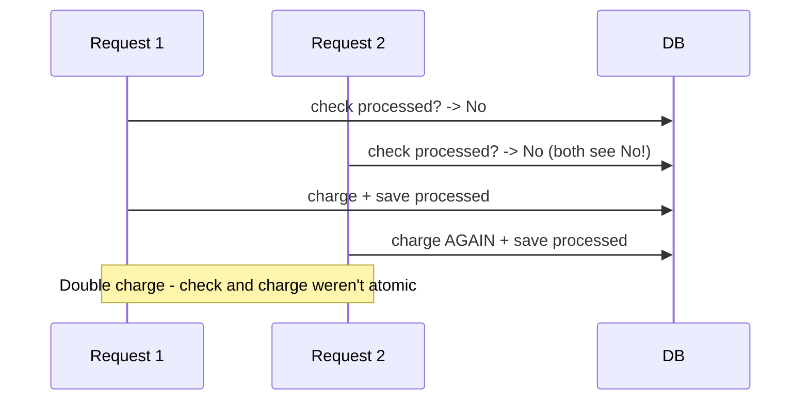
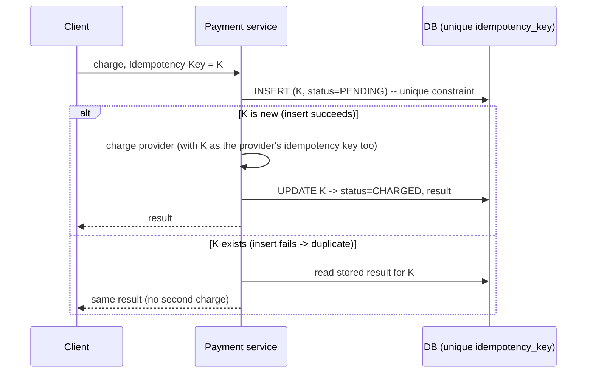

# Retries and Duplicate Execution

> Prerequisites: [partial-failures-and-timeouts](./partial-failures-and-timeouts.md)
> Related: [idempotency-and-deduplication](../05-messaging-and-event-driven-systems/idempotency-and-deduplication.md) · [exactly-once-processing](./exactly-once-processing.md) · [12-system-design-problems/payment-system](../12-system-design-problems/payment-system.md)

This chapter makes concrete the master-prompt's example: the unsafe "check-then-charge" payment sequence. It's the clearest demonstration of why retries + partial failure demand idempotency.

---

## A. Problem and motivation

From [partial-failures-and-timeouts](./partial-failures-and-timeouts.md): a timeout doesn't tell you whether the operation succeeded — the work may have completed just as you gave up. So you retry. But if the original *did* succeed, the retry executes it **again** — a duplicate. For reads this is harmless; for state-changing operations (charge a card, create an order, send money) it's a serious bug (double charge). This chapter shows the trap and the fix.

---

## B. The unsafe check-then-charge sequence (the master-prompt example)

Consider this naive "charge once" logic:

```
1. Check whether the payment has been processed.
2. If not, charge the customer.
3. Save the payment status.
```

This looks correct but fails in multiple ways:

### Failure 1 — concurrent requests (race)

Two requests both pass the check before either saves, so both charge. The check-then-act isn't atomic.

### Failure 2 — write fails after the charge
Step 2 charges the external payment provider, but step 3 (save status) fails (crash, DB error). The money moved, but your records say "not processed." The next attempt checks → "not processed" → charges **again**. The DB write failing after the external effect leaves you inconsistent and leads to a double charge.

### Failure 3 — client retry after timeout
The client's request times out (but the charge actually succeeded server-side). The client retries. If the server's dedup is weak, it charges again. The timeout ambiguity ([partial-failures](./partial-failures-and-timeouts.md)) + retry = duplicate.

---

## C. Why this is fundamental, not a bug you can "just fix carefully"

You cannot eliminate the uncertainty: networks drop responses, processes crash between steps, clients retry on timeout. **At-least-once execution is the reality** for any retried, state-changing operation. So the answer isn't "be careful" — it's to make the operation **idempotent** so that executing it twice has the same effect as once.

---

## D. The safer design — idempotency + atomicity



Key elements (from [idempotency-and-deduplication](../05-messaging-and-event-driven-systems/idempotency-and-deduplication.md)):
- **A unique idempotency key** per logical charge, inserted atomically (unique constraint) **before** the charge — this closes the concurrent-request race (the second insert fails).
- **Pass the key to the payment provider too**, so even the external charge is deduped at the provider — closing the "charged but our write failed" window (a retry re-charges with the same key → provider dedups).
- **Record the result** so a retry returns the original outcome.

Remaining limitation (be honest): there's still a window where you've charged the provider but haven't recorded success locally; on retry you must re-call the provider with the same key and rely on *its* idempotency to avoid a double charge, then reconcile. This is why payment systems add **reconciliation** jobs that compare provider records with local records and fix drift. See [idempotent-recovery-and-reconciliation](../07-reliability-and-resilience/idempotent-recovery-and-reconciliation.md).

---

## E. Example — DMS and payments

- **DMS "create document" on client retry:** idempotency key on the POST so a timed-out-then-retried upload doesn't create two documents (see [rest-and-api-design](../01-networking-and-api-design/rest-and-api-design.md)).
- **Payment charge:** the full pattern above, with the provider also keyed and a reconciliation job. See [payment-system](../12-system-design-problems/payment-system.md).
- **Message consumer:** at-least-once redelivery → dedupe on message id (see [message-delivery-semantics](../05-messaging-and-event-driven-systems/message-delivery-semantics.md)).

All three are the same lesson: **retries are inevitable → make the effect idempotent.**

---

## F. Trade-offs

| Approach | Advantages | Disadvantages | Best use | Warning signs |
|---|---|---|---|---|
| Check-then-act (no key) | Looks simple | Races + double effects on retry/crash | Never for state changes | Double charges/orders |
| Idempotency key (atomic) | Safe retries, dedup | Needs a key + atomic store + provider cooperation | Any retried state change | Non-atomic check |
| + Reconciliation | Catches residual drift | Extra job/ops | Money/critical correctness | Trusting idempotency alone for money |

---

## G. Failure scenarios

1. **Double charge (concurrent).** Trigger: two requests pass the check before either records. Fix: atomic unique-key insert before charging.
2. **Double charge (write-after-effect fails).** Trigger: charged, then local save fails; retry re-charges. Fix: pass the key to the provider (provider dedups) + reconciliation.
3. **Double charge (client retry on timeout).** Trigger: response lost; client retries. Fix: idempotency key returning the original result.
4. **Residual drift.** Trigger: edge cases slip past idempotency. Fix: reconciliation job comparing provider vs local records.

---

## H. Scaling implications

At scale, timeouts and retries are constant, so duplicate execution is a certainty, not an edge case — idempotency is mandatory for every state-changing, retried operation. The idempotency-key store and reconciliation jobs become real components (sized, monitored). This chapter is the "why" behind the heavy emphasis on idempotency throughout the repo: it's the universal defense against the partial-failure + retry reality. For money specifically, idempotency + reconciliation together provide correctness; neither alone is sufficient.

---

## I. Interview preparation

**Basic**
- Q: Why do retries cause duplicates? → *A: A timeout doesn't tell you if the operation succeeded; if it did and you retry, you execute it twice.*

**Intermediate**
- Q: Walk through why "check if charged, else charge, then save" is unsafe. → *A: (1) Concurrent requests both pass the check before either saves → double charge; (2) if the save fails after charging, the next try charges again; (3) a client retry after a timeout where the charge succeeded re-charges. The check-then-act isn't atomic and the operation isn't idempotent.*
- Q: How do you fix it? → *A: An atomic unique idempotency key inserted before the charge (closes the race), pass the key to the provider (dedups the external effect), record the result (retries return it), and add reconciliation for residual drift.*

**SDE-2 / scenario**
- Q: "How do you guarantee a customer is charged exactly once despite retries?" → *A: You can't guarantee it at the delivery layer; you make the charge idempotent (unique key, atomic record, provider also keyed) so retries don't double-charge, and reconcile against the provider to catch edge cases. It's effectively-once via idempotency + reconciliation, not a magic guarantee.*
- Q: "Two requests arrive at the same instant for the same payment." → *A: The atomic unique-key insert lets exactly one proceed; the other sees the key exists and returns the original result — no double charge. The atomicity of the key insert is what prevents the race.*

**Common wrong answers:** check-then-charge; relying on "exactly-once"; non-atomic dedup; trusting idempotency alone for money (no reconciliation).

---

## J. Hands-on exercise

Rewrite the unsafe check-then-charge into a safe design. Specify: the idempotency key source, the atomic insert, how you involve the payment provider, what a duplicate returns, the remaining failure window, and the reconciliation job that closes it.

---

## K. Revision summary

**Key takeaways**
- Timeouts can't tell success from failure → retries → duplicate execution is inevitable for state changes.
- "Check-then-charge" is unsafe: concurrent race, write-after-effect failure, and client-retry all double-charge.
- Fix: atomic unique idempotency key before the effect + pass the key to the external provider + record result; add reconciliation for residual drift.
- Idempotency is mandatory for retried state changes; money needs idempotency *and* reconciliation.

**Must explain without notes:** the three ways check-then-charge fails; the idempotent-charge design; why reconciliation is still needed.

**Rapid-fire**
1. Why do retries duplicate? → Timeout can't confirm success.
2. First flaw of check-then-charge? → Concurrent race (both pass the check).
3. What makes the key safe under concurrency? → Atomic unique insert.
4. Why pass the key to the provider? → Dedup the external charge too.
5. What catches residual drift for money? → Reconciliation.

**Next:** [consistency-and-cap-theorem](./consistency-and-cap-theorem.md)
