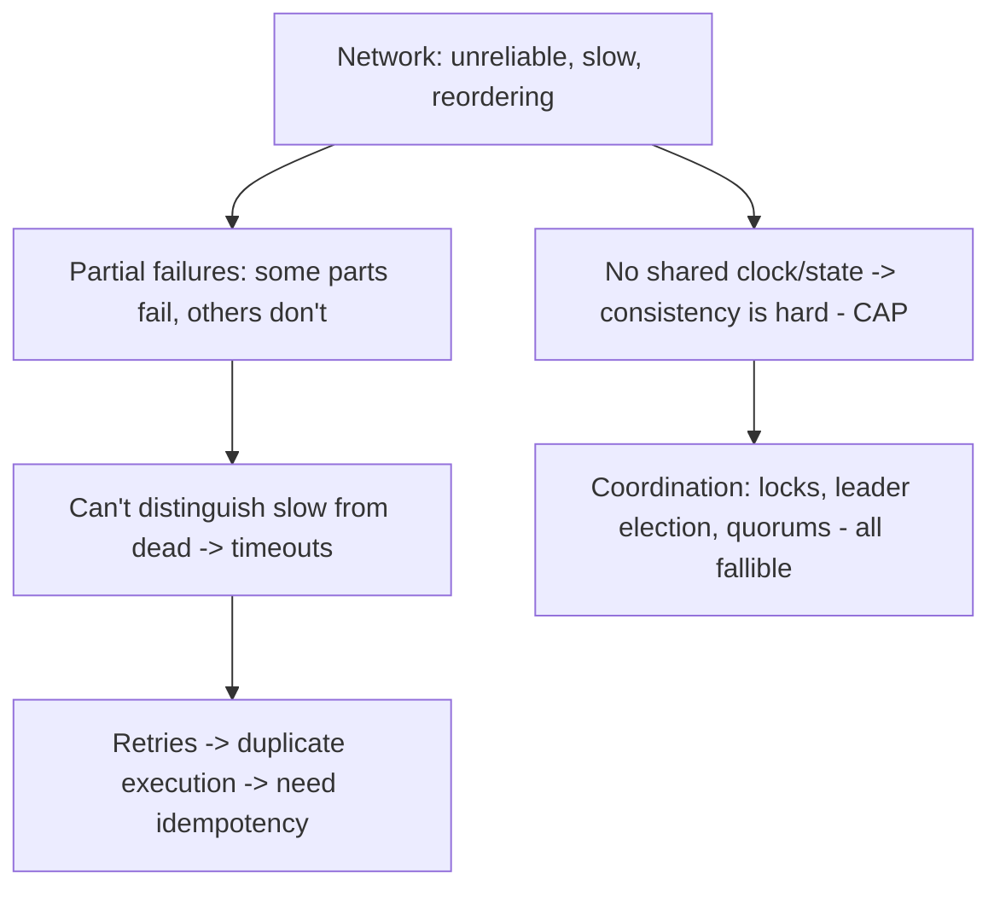

# Why Distributed Systems Are Hard

> Prerequisites: [00-foundations/architecture-fundamentals](../00-foundations/architecture-fundamentals.md)
> Related: [partial-failures-and-timeouts](./partial-failures-and-timeouts.md) · [consistency-and-cap-theorem](./consistency-and-cap-theorem.md)

This section is the one the master prompt wants especially detailed. It opens by framing *why* a system split across machines is categorically harder than one on a single machine — the foundation for everything that follows.

---

## A. Problem and motivation

A single-machine program has a comforting property: components either all work or the whole process dies, memory is shared and reliable, and there's a single clock. The moment you split across machines connected by a network, none of that holds: parts can fail independently, the network can drop/delay/reorder/duplicate messages, there's no shared memory or clock, and you can't tell "slow" from "dead." You adopt distribution for scale and availability (the [scaling journey](../00-foundations/architecture-fundamentals.md) forced it), but you inherit a new class of problems that don't exist on one machine.

---

## B. The fallacies of distributed computing

A famous list of false assumptions engineers make. Each one, when assumed true, causes a bug:

1. **The network is reliable** — it isn't; messages are lost.
2. **Latency is zero** — network calls are orders of magnitude slower than local calls.
3. **Bandwidth is infinite** — it's finite; big payloads/fan-out matter.
4. **The network is secure** — it isn't; encrypt and authenticate.
5. **Topology doesn't change** — nodes come and go (deploys, scaling, failures).
6. **There is one administrator** — many parties, many configs.
7. **Transport cost is zero** — serialization/network cost adds up.
8. **The network is homogeneous** — mixed hardware, latencies, versions.

The practical takeaway: **design assuming the network will fail, delay, and reorder** — because it will.

---

## C. The core hard problems (the rest of this section)

- **Partial failure:** one node/service fails while others keep running — the defining feature. On one machine, failure is total; distributed, it's partial and messy. See [partial-failures-and-timeouts](./partial-failures-and-timeouts.md).
- **Can't tell slow from dead:** a node that doesn't respond might be crashed, slow, or just unreachable. You use **timeouts** to decide, but a timeout can be wrong (the node was alive, just slow). See [partial-failures-and-timeouts](./partial-failures-and-timeouts.md).
- **Retries cause duplicates:** since you can't be sure a request failed, you retry — and might execute it twice. Hence **idempotency**. See [retries-and-duplicate-execution](./retries-and-duplicate-execution.md).
- **No shared clock/state → consistency is hard:** replicas disagree; CAP says you can't have consistency + availability under a partition. See [consistency-and-cap-theorem](./consistency-and-cap-theorem.md).
- **Coordination is fallible:** locks, leader election, and quorums are the tools, and each has failure modes (split-brain, stale locks). See [distributed-locks](./distributed-locks.md), [leader-election-and-split-brain](./leader-election-and-split-brain.md).

---

## D. The mental shift (what distributed systems demand of you)

On one machine you reason about the happy path and let crashes be total. In distributed systems you must reason about **every message possibly being lost, delayed, duplicated, or reordered, and every peer possibly being down or slow** — and still produce correct behavior. This is why the recurring tools in this repo are: **timeouts, retries with backoff, idempotency, circuit breakers, reconciliation, and deliberate consistency choices.** They exist specifically to tame partial failure and uncertainty.

**Interview framing:** "The hard part of distributed systems isn't the happy path — it's that failures are partial and you can't distinguish slow from dead. So I design for timeouts, idempotent retries, and graceful degradation, and I choose consistency deliberately rather than assuming it."

---

## E. Example — a single remote call in the DMS

The DMS calls the notification service. On one machine this is a method call: it returns or the process dies. As a *network* call, consider what can happen: the request is lost (notification service never got it); it's processed but the response is lost (you think it failed, but it succeeded — retrying double-sends); it times out (was it slow or dead?); the notification service is up but overloaded (slow, cascading back to you). Each possibility needs handling: timeout + retry + idempotency (so a double-send is harmless) + circuit breaker (so an overloaded notification service doesn't drag down uploads). One method call becomes a design problem — that's distributed systems.

---

## F. Trade-offs

| Choice | Advantages | Disadvantages |
|---|---|---|
| Stay single-machine (monolith, one DB) | No partial failure, shared clock/memory, simple consistency | Scale/availability ceiling |
| Go distributed | Scale + availability | Partial failure, no shared clock, consistency hard, coordination fallible |

This is *the* argument for the modular monolith and co-locating data: every distribution boundary you add imports these problems. Add them only when scale/availability requires it.

---

## G. Failure scenarios (the categories, detailed later)

1. **Partial failure** → one service down drags others via retries/timeouts → [partial-failures-and-timeouts](./partial-failures-and-timeouts.md), [circuit-breakers-and-bulkheads](./circuit-breakers-and-bulkheads.md).
2. **Duplicate execution** from retries → [retries-and-duplicate-execution](./retries-and-duplicate-execution.md), [idempotency](../05-messaging-and-event-driven-systems/idempotency-and-deduplication.md).
3. **Inconsistency** from no shared state → [consistency-and-cap-theorem](./consistency-and-cap-theorem.md).

---

## H. Scaling implications

Distribution is what the [scaling journey](../00-foundations/architecture-fundamentals.md) forces at Stage 4+ (replicas, caches, queues, services, multi-region). Each addition is a new place for partial failure, inconsistency, and coordination problems. So the entire rest of this section is really the "tax" you pay for scaling beyond one machine. The SDE-2 skill is knowing this tax is real, designing to tame it (idempotency, timeouts, degradation), and *not* paying it before you must (keep it simple until scale forces distribution).

---

## I. Interview preparation

**Basic**
- Q: Why are distributed systems hard? → *A: Partial failures (some parts fail, others run), no shared clock/memory, an unreliable network, and the inability to distinguish a slow node from a dead one.*

**Intermediate**
- Q: What's the defining difference from a single machine? → *A: Partial failure — on one machine failure is total; distributed, parts fail independently while others continue, so you must handle every message being lost/delayed/duplicated and peers being down or slow.*
- Q: Name a few fallacies of distributed computing. → *A: The network is reliable, latency is zero, bandwidth is infinite, topology is static — assuming any of these causes bugs.*

**SDE-2 / scenario**
- Q: "What changes when a method call becomes a network call?" → *A: It can be lost, time out, succeed-but-lose-the-response, or hit a slow/overloaded peer. I handle it with timeouts, idempotent retries, and a circuit breaker so a failing dependency can't cascade.*

**Common wrong answers:** assuming the network/peers are reliable; treating remote calls like local ones; ignoring the slow-vs-dead problem.

---

## J. Hands-on exercise

Take one synchronous call in a design (e.g., checkout → payment service). List every distributed failure that can happen to that single call and the mechanism you'd use to handle each. Then argue whether that call should be synchronous at all.

---

## K. Revision summary

**Key takeaways**
- Distributed = partial failure, no shared clock/memory, unreliable network, can't tell slow from dead.
- The fallacies of distributed computing are the false assumptions that cause bugs.
- Core tools to tame it: timeouts, idempotent retries, circuit breakers, reconciliation, deliberate consistency choices.
- Every distribution boundary imports these problems — add distribution only when scale/availability demands it.

**Must explain without notes:** partial failure as the defining difference; slow-vs-dead; the core taming tools.

**Rapid-fire**
1. Defining feature of distributed failure? → Partial (not total).
2. Can you distinguish slow from dead? → No (hence timeouts).
3. Why do retries need idempotency? → You can't be sure the first attempt failed.
4. First fallacy of distributed computing? → The network is reliable.
5. Why prefer a modular monolith when possible? → It avoids importing distributed-systems problems.

**Next:** [partial-failures-and-timeouts](./partial-failures-and-timeouts.md)
