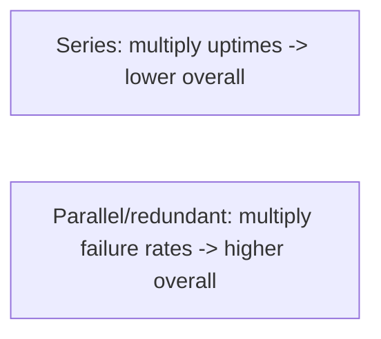

# Availability and Reliability

> Prerequisites: [00-foundations/latency-throughput-and-capacity](../00-foundations/latency-throughput-and-capacity.md)
> Related: [redundancy-and-failover](./redundancy-and-failover.md) · [slis-slos-and-slas](./slis-slos-and-slas.md)

Availability and reliability are related but distinct. The SDE-2 skill is the nines math, understanding that series dependencies multiply failure, and knowing that more nines cost exponentially more.

---

## A. Problem and motivation

Systems fail — hardware dies, networks partition, bugs ship. "Availability" and "reliability" quantify how well a system keeps working despite that. Confusing them, or quoting unrealistic targets ("100% uptime"), signals inexperience. You must reason about how dependencies compose, what a given nines target actually costs, and that perfect availability is impossible and uneconomical.

---

## B. Definitions

- **Availability:** fraction of time the system is up and correctly serving requests (uptime %). Measured in "nines."
- **Reliability:** the system performs correctly over time (often measured as MTBF — mean time between failures — and MTTR — mean time to recovery). A system can be available (up) but unreliable (frequently returning wrong results).

They're linked: `Availability ≈ MTBF / (MTBF + MTTR)`. You raise availability by failing less often (↑MTBF) *and* recovering faster (↓MTTR). Fast recovery (low MTTR) is often cheaper to improve than preventing all failures.

---

## C. The nines (and why they compound)

| Nines | Uptime | Downtime/year |
|---|---|---|
| 99% | two nines | ~3.65 days |
| 99.9% | three nines | ~8.76 hours |
| 99.99% | four nines | ~52 minutes |
| 99.999% | five nines | ~5 minutes |

**Series dependencies multiply failure** (from [latency chapter](../00-foundations/latency-throughput-and-capacity.md)): if a request needs LB (99.99%) × app (99.9%) × DB (99.9%), overall ≈ 99.79% — *lower* than any single component. Every synchronous dependency on the critical path drags availability down.

**Redundancy adds availability:** two independent components each 99% give `1 − (0.01)² = 99.99%` *if* failures are independent and you can route around a dead one. Real failures correlate (same bug, same AZ), so gains are smaller — but redundancy is still the primary lever.

---

## D. Why more nines cost exponentially more

Going 99% → 99.9% → 99.99% each removes an order of magnitude of downtime, requiring progressively more: redundancy, multi-AZ, automated failover, rigorous testing, on-call, chaos engineering. The cost curve is steep, and diminishing returns set in. **The SDE-2 move:** target the availability the requirement/SLA demands, not the maximum. "I'd target 99.9% with multi-AZ redundancy and automated failover; 99.99% would add multi-region and much higher operational cost, which I'd only do with a clear requirement."

---

## E. Example — DMS

The DMS targets 99.9% (≈8.76h/year downtime budget — generous enough for a document system). It achieves this with: multiple stateless app instances behind an LB (no single app SPOF), a DB primary + replicas with automated failover, Redis with replication, and files in durable object storage. It does *not* chase 99.99% (which would need multi-region) because the requirement doesn't justify the cost. Critical paths (upload/download) are isolated from non-critical dependencies (notifications) so the latter's failures don't erode the former's availability (see [circuit-breakers-and-bulkheads](../06-distributed-systems/circuit-breakers-and-bulkheads.md)).

---

## F. Trade-offs

| Target | Cost | When |
|---|---|---|
| 99% | Low | Internal/non-critical tools |
| 99.9% | Moderate (multi-AZ, failover, on-call) | Most business services (DMS) |
| 99.99% | High (multi-region, heavy automation) | Revenue-critical, strict SLAs |
| 99.999% | Very high | Rarely justified; telco/infra |

---

## G. Failure scenarios

1. **Availability eroded by dependency sprawl.** Trigger: adding synchronous dependencies on the hot path, each multiplying failure. Fix: minimize critical-path dependencies; make non-critical ones async/circuit-broken.
2. **Single point of failure.** Trigger: one LB/DB/instance with no redundancy. Fix: redundancy + failover for every critical component.
3. **Slow recovery (high MTTR).** Trigger: manual, slow failover/restore. Fix: automate failover and recovery; MTTR often cheaper to improve than MTBF.

---

## H. Scaling implications

Availability is a composition problem: as you add components (the scaling journey), each series dependency lowers availability unless made redundant or non-blocking. Scaling and availability therefore pull together (redundancy both scales and protects) and apart (more components = more failure surface). High availability at scale comes from redundancy, fewer critical-path dependencies, graceful degradation, and fast automated recovery — not from chasing an unrealistic nines target everywhere.

---

## I. Interview preparation

**Basic**
- Q: Availability vs reliability? → *A: Availability = fraction of time up; reliability = performing correctly over time (MTBF/MTTR). A system can be up but returning wrong results.*
- Q: What's 99.99% in downtime? → *A: ~52 minutes/year.*

**Intermediate**
- Q: Why do series dependencies lower availability? → *A: Availabilities multiply — LB×app×DB — so overall is below any single component; each critical-path dependency drags it down.*
- Q: How does redundancy help? → *A: Parallel independent components multiply *failure* rates (not uptimes), so two 99% components give ~99.99% if you can route around a dead one — assuming independent failures.*

**SDE-2 / scenario**
- Q: "What availability should your system target?" → *A: What the requirement/SLA demands, not the max. 99.9% with multi-AZ + automated failover is a sensible default; 99.99% needs multi-region and far higher cost, justified only by a clear requirement.*
- Q: "How would you improve availability without chasing nines?" → *A: Reduce critical-path dependencies, add redundancy + fast automated failover (lower MTTR), and degrade gracefully so partial failures don't become outages.*

**Common wrong answers:** "100% uptime"; ignoring series multiplication; chasing max nines without a requirement; improving MTBF while ignoring MTTR.

---

## J. Hands-on exercise

A request path is LB (99.99%) → auth (99.95%) → app (99.9%) → DB (99.9%). Compute approximate overall availability. Then propose two changes (redundancy, removing a critical-path dependency) and estimate their directional impact.

---

## K. Revision summary

**Key takeaways**
- Availability = uptime %; reliability = correct-over-time (MTBF/MTTR); `Availability ≈ MTBF/(MTBF+MTTR)`.
- Series dependencies multiply failure (lower availability); redundancy multiplies failure rates (raises it), assuming independence.
- More nines cost exponentially more; target the requirement, not the max.
- Lower MTTR (fast automated recovery) is often the cheapest availability win.

**Rapid-fire**
1. 99.9% downtime/year? → ~8.76 hours.
2. Series dependencies do what to availability? → Multiply down (lower it).
3. Cheapest availability lever often? → Lower MTTR (fast recovery).
4. Target which availability? → The requirement/SLA, not the max.
5. Availability vs reliability? → Up% vs correct-over-time.

**Next:** [redundancy-and-failover](./redundancy-and-failover.md)
