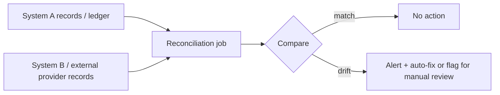

# Idempotent Recovery and Reconciliation

> Prerequisites: [06-distributed-systems/exactly-once-processing](../06-distributed-systems/exactly-once-processing.md), [05-messaging/idempotency-and-deduplication](../05-messaging-and-event-driven-systems/idempotency-and-deduplication.md)
> Related: [06-distributed-systems/retries-and-duplicate-execution](../06-distributed-systems/retries-and-duplicate-execution.md) · [12-system-design-problems/payment-system](../12-system-design-problems/payment-system.md)

Reconciliation is the operational backstop that catches the drift idempotency and transactions can't fully prevent. It's how real systems (especially payments) achieve correctness despite partial failures — and a strong SDE-2 answer to "how do you *know* it's actually correct?"

---

## A. Problem and motivation

Idempotency ([idempotency-and-deduplication](../05-messaging-and-event-driven-systems/idempotency-and-deduplication.md)) prevents most duplicates; transactions ensure local durability. But in a distributed system with external systems (payment providers, other services), gaps remain: a crash between charging the provider and recording it locally; a message lost despite retries; two services' views diverging. These produce **drift** — inconsistency between systems that neither idempotency nor a single transaction catches. Reconciliation is the periodic process that *detects and fixes* drift, giving you confidence the system is actually correct, not just probably correct.

---

## B. Recovery must be idempotent

When a system recovers from a crash/failure, it often re-runs operations (replay the queue, re-process in-flight work, re-run a job). If recovery isn't idempotent, recovery itself causes duplicates (double-charge on replay). So **recovery procedures must be idempotent** — replaying should converge to the correct state, not re-apply effects. This is why idempotency keys and dedup stores must survive crashes (persisted, retention ≥ recovery window). Recovery = re-run safely because operations are idempotent.

---

## C. Reconciliation — detect and fix drift

A reconciliation job periodically compares two (or more) sources of truth that *should* agree and resolves discrepancies:
- **Payments:** compare your ledger against the payment provider's transaction report. A charge at the provider with no local record (crash after charge) → create the missing record. A local "pending" with no provider charge → retry or cancel.
- **Inventory:** compare reserved vs actual counts; fix leaks (reservations never released).
- **Cross-service:** compare order service vs fulfillment service state; fix stuck/mismatched orders.

Reconciliation runs on a schedule (e.g., end-of-day for finance, continuous for critical paths) and either auto-fixes safe discrepancies or flags them for human review (money differences). It's the honest answer to "exactly-once" (see [exactly-once-processing](../06-distributed-systems/exactly-once-processing.md)): idempotency + reconciliation = effectively-once with verification.

---

## D. Example — DMS and payments

- **Payments (strongest need):** a nightly reconciliation compares the DMS billing ledger with the payment provider's settlement report. If the provider charged but a crash prevented recording it locally, reconciliation detects the orphan charge and creates the ledger entry (or refunds if invalid). This closes the residual gap that idempotency keys alone leave (see [retries-and-duplicate-execution](../06-distributed-systems/retries-and-duplicate-execution.md)).
- **Document processing:** a reconciliation job finds documents stuck in `PROCESSING` beyond a threshold (a worker crashed and the job was lost despite retries) and re-enqueues them (idempotently — re-processing is safe). This catches drift the queue/retry layer missed.
- **Orphaned files:** a job finds object-storage files with no metadata row (upload crashed mid-way) and cleans them up.

---

## E. Trade-offs / failure scenarios

| Without reconciliation | With it |
|---|---|
| Residual drift accumulates silently (money mismatches, stuck orders) | Drift detected and fixed on a schedule |
| "We think it's correct" (hope) | "We verify it's correct" (confidence) |
| Lost messages / crash-gap effects go unnoticed | Caught by comparison |

Failure modes: no reconciliation (undetected drift for money is a serious bug); non-idempotent recovery (recovery re-applies effects → the drift it was meant to fix); reconciliation that auto-fixes money without review (risky — flag for humans); reconciliation too infrequent (drift lives too long).

---

## F. Scaling implications

At scale, partial failures are constant, so some drift is inevitable regardless of how good idempotency and transactions are — reconciliation is the mechanism that keeps the system *provably* correct over time. It's especially essential for money, inventory, and any cross-system state. The reconciliation jobs are real components (sized to compare large datasets, often incrementally). This is the operational completion of the exactly-once story: you can't guarantee exactly-once at the delivery layer, so you make processing idempotent *and* reconcile to catch and fix what slips through.

---

## G. Interview preparation

**Basic**
- Q: What is reconciliation? → *A: A periodic process comparing two sources that should agree (e.g., your ledger vs the payment provider) to detect and fix drift that idempotency/transactions didn't prevent.*

**Intermediate**
- Q: Why must recovery be idempotent? → *A: Recovery re-runs operations (replay queue, re-process in-flight); if not idempotent, recovery itself duplicates effects. So recovery converges to the correct state only if operations are idempotent and dedup state survives crashes.*
- Q: How does reconciliation complete the exactly-once story? → *A: Exactly-once delivery is impossible; idempotency makes processing effectively-once; reconciliation detects and fixes the residual drift from the gaps idempotency can't close, giving verified correctness.*

**SDE-2 / scenario**
- Q: "How do you *know* no customer was double-charged or under-charged?" → *A: A reconciliation job compares our ledger against the payment provider's report, flagging/fixing mismatches (orphan charges from crash-after-charge, stuck pendings). Idempotency prevents most issues; reconciliation verifies and closes the residual gap, with money differences flagged for human review.*
- Q: "A worker crashed and some documents are stuck in PROCESSING despite retries." → *A: A reconciliation sweep finds documents stuck beyond a threshold and re-enqueues them; because processing is idempotent, re-processing is safe. This catches drift the queue/retry layer missed.*

**Common wrong answers:** no reconciliation for money; non-idempotent recovery; auto-fixing financial drift without review; relying on idempotency alone to *guarantee* correctness.

---

## H. Hands-on exercise

Design reconciliation for a payment system: what two sources you compare, how often, what discrepancies you auto-fix vs flag for humans, and how you ensure the recovery/fix actions are idempotent. Then design a reconciliation sweep for stuck async jobs.

---

## I. Revision summary

**Key takeaways**
- Reconciliation periodically compares sources that should agree (ledger vs provider) to detect and fix residual drift.
- Recovery must be idempotent (it re-runs operations); dedup state must survive crashes.
- Idempotency + reconciliation = effectively-once with verification — the honest completion of the exactly-once story.
- Essential for money/inventory/cross-system state; auto-fix safe drift, flag money differences for review.

**Rapid-fire**
1. What catches residual drift idempotency misses? → Reconciliation.
2. Why must recovery be idempotent? → It re-runs operations; else recovery duplicates effects.
3. Reconciliation input for payments? → Your ledger vs the provider's report.
4. Auto-fix money drift? → No — flag for human review.
5. Idempotency + reconciliation gives? → Effectively-once, verified.

**Next:** [slis-slos-and-slas](./slis-slos-and-slas.md)
