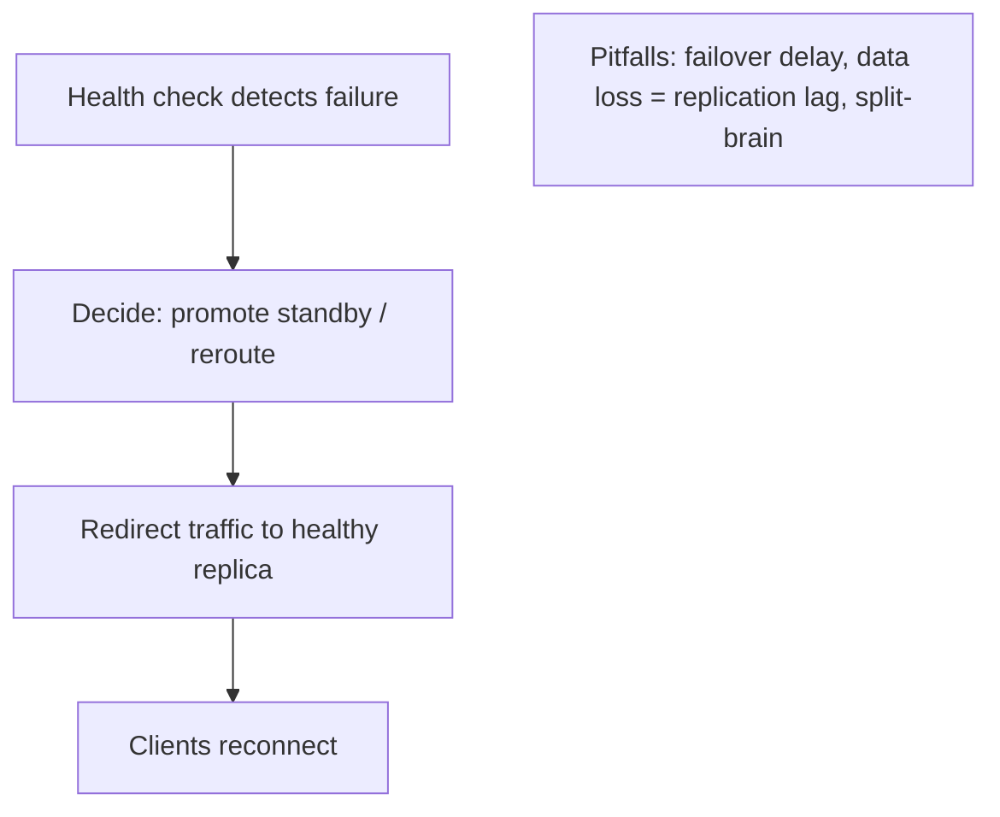

# Redundancy and Failover

> Prerequisites: [availability-and-reliability](./availability-and-reliability.md)
> Related: [06-distributed-systems/leader-election-and-split-brain](../06-distributed-systems/leader-election-and-split-brain.md) · [disaster-recovery](./disaster-recovery.md)

Redundancy (having spares) plus failover (switching to them) is the primary mechanism for availability. The nuances: active-active vs active-passive, failover data loss, and avoiding split-brain.

---

## A. Problem and motivation

Any single component will eventually fail. Redundancy means having more than one of each critical component so one failure doesn't cause an outage; failover is the (ideally automatic) switch to a healthy replica. Without redundancy, every component is a single point of failure (SPOF). Without good failover, redundancy is useless (spares that don't take over). The pitfalls: slow/manual failover, data loss during failover, and split-brain (two actives).

---

## B. Redundancy models

| Model | How | Pros | Cons |
|---|---|---|---|
| **Active-active** | All replicas serve traffic simultaneously | No idle capacity; seamless on failure (others absorb load) | Harder consistency (esp. for writes); must handle load spike when one dies |
| **Active-passive** | One active, one+ standby (warm/cold) | Simple; no write conflicts | Idle standby capacity; failover delay + possible data loss |
| **N+1 / N+2** | Provision 1–2 extra beyond peak need | Survives 1–2 failures without degradation | Extra cost |

Stateless tiers (app servers) are easy to make active-active (any instance serves any request — see [stateless-vs-stateful-services](../02-compute-and-architecture/stateless-vs-stateful-services.md)). Stateful components (DB primary) are usually active-passive (one writable primary + standby replicas) because active-active writes cause conflicts (see [replication-and-read-replicas](../03-databases-and-data-modeling/replication-and-read-replicas.md)).

---

## C. Failover mechanics and pitfalls

- **Detection:** health checks (LB for stateless; a cluster manager for the DB primary). Fast detection = lower MTTR.
- **Data loss on failover:** with async replication, a promoted standby lacks the primary's un-replicated recent writes → bounded data loss (= replication lag at failure). This is the RPO (see [disaster-recovery](./disaster-recovery.md)). Sync replication avoids it at a latency cost.
- **Split-brain:** if the old primary isn't properly fenced, you can get two primaries accepting writes → corruption. Failover must be quorum/consensus-coordinated with fencing. See [leader-election-and-split-brain](../06-distributed-systems/leader-election-and-split-brain.md).
- **Failover delay:** the window between failure and the standby taking over — users see errors during it. Automated failover minimizes it.

---

## D. Example — DMS

- **App tier:** active-active across ≥3 instances in multiple AZs; LB health checks eject a dead instance in seconds (stateless → trivial). N+1 so one AZ loss doesn't degrade.
- **DB:** active-passive — one primary + replicas across AZs; a cluster manager promotes a replica on primary failure, quorum-coordinated with fencing to avoid split-brain. Failover loses at most the replication-lag window of writes (RPO), acceptable because durability-critical data (files) is in object storage, not dependent on this.
- **Redis:** replicated with Sentinel for automated failover (see [redis-design-and-failure-modes](../04-caching/redis-design-and-failure-modes.md)).

---

## E. Trade-offs

| Choice | Advantages | Disadvantages | Best use | Warning signs |
|---|---|---|---|---|
| Active-active | No idle capacity, seamless failover | Write-consistency complexity, load-spike handling | Stateless tiers, read replicas | Active-active writes without conflict handling |
| Active-passive | Simple, no write conflicts | Idle standby, failover delay/data loss | DB primary, singletons | Expecting zero-downtime/zero-loss |
| N+1/N+2 | Survives 1–2 failures gracefully | Cost | Capacity planning for failures | Running at N with no headroom |

---

## F. Failure scenarios

1. **No redundancy (SPOF).** Trigger: single DB/LB/instance. Fix: redundancy + failover for every critical component.
2. **Split-brain on failover.** Trigger: old primary not fenced; two primaries. Fix: quorum-coordinated promotion + fencing tokens.
3. **Data loss on failover.** Trigger: async replication lag at failure. Mitigate: sync/semi-sync for critical data; document RPO; keep durability-critical data in replicated object storage.
4. **Load spike kills survivors (active-active).** Trigger: one node dies, its load shifts to others already near capacity → cascade. Fix: N+1/N+2 headroom so survivors can absorb the load.

---

## G. Scaling implications

Redundancy is both a scaling and an availability tool — more instances serve more load *and* survive failures. The hard part is the stateful tier: active-active writes need conflict handling (usually avoided via single-primary active-passive), and failover must handle data loss (RPO) and split-brain. Provisioning headroom (N+1/N+2) is essential so a failure doesn't cascade by overloading survivors. At multi-AZ scale this handles most real failures; full-region loss needs multi-region (see [multi-region-architecture](../06-distributed-systems/multi-region-architecture.md)).

---

## H. Interview preparation

**Basic**
- Q: What's active-active vs active-passive? → *A: Active-active: all replicas serve (no idle capacity, seamless failover, but write-consistency complexity). Active-passive: one active + standby (simple, no write conflicts, but failover delay/data loss).*

**Intermediate**
- Q: What can go wrong during DB failover? → *A: Data loss (async replication lag = RPO), split-brain (two primaries if not fenced), and a failover-delay error window. Mitigate with quorum-coordinated promotion + fencing + fast detection.*
- Q: Why provision N+1? → *A: So one component failing doesn't overload survivors into a cascade — the dead node's load must fit on the rest.*

**SDE-2 / scenario**
- Q: "Design the DB for high availability." → *A: Active-passive: primary + replicas across AZs, automated quorum-coordinated failover with fencing (no split-brain), accepting a bounded replication-lag data-loss window (RPO). Reads scale via replicas; writes stay single-primary.*
- Q: "An AZ failed and the survivors fell over too." → *A: No headroom — the failed AZ's load overwhelmed the rest. Provision N+1/N+2 so survivors absorb the load; spread across more AZs.*

**Common wrong answers:** redundancy without fencing (split-brain); active-active writes without conflict handling; no headroom; assuming failover is instant and lossless.

---

## I. Hands-on exercise

Design redundancy + failover for a service's app tier, SQL DB, and cache across 3 AZs. For each: active-active or active-passive, how failure is detected, the failover mechanism, the data-loss risk, and the headroom (N+?) to survive one AZ loss without degradation.

---

## J. Revision summary

**Key takeaways**
- Redundancy (spares) + failover (switch to them) is the core availability mechanism; every critical component needs it.
- Stateless tiers → active-active (easy); stateful (DB primary) → active-passive (avoid write conflicts).
- Failover pitfalls: data loss (async lag = RPO), split-brain (fence + quorum), failover delay (automate), survivor overload (N+1/N+2 headroom).
- Multi-AZ handles most failures; full-region loss needs multi-region.

**Rapid-fire**
1. App tier redundancy model? → Active-active (stateless).
2. DB primary redundancy model? → Active-passive.
3. Prevent split-brain on failover? → Quorum-coordinated promotion + fencing.
4. Data loss on async failover equals? → The replication lag (RPO).
5. Survive one AZ loss without degradation? → N+1/N+2 headroom.

**Next:** [timeouts-retries-and-deadlines](./timeouts-retries-and-deadlines.md)
