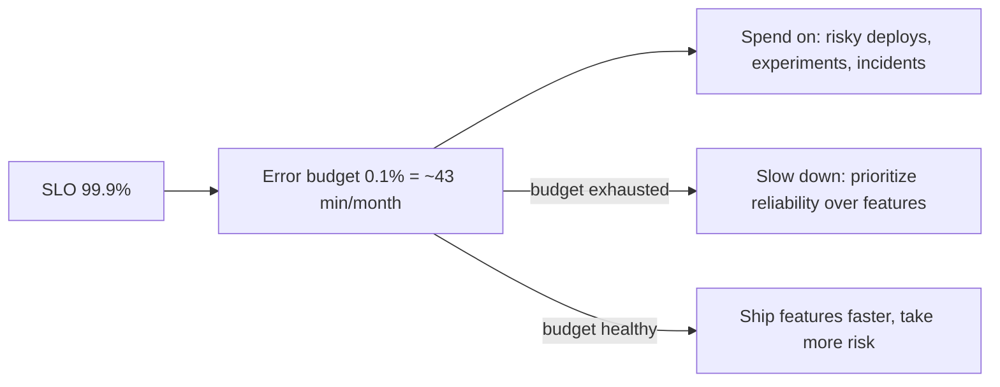

# SLIs, SLOs, and SLAs

> Prerequisites: [availability-and-reliability](./availability-and-reliability.md)
> Related: [09-observability-and-operations/alerting-and-dashboards](../09-observability-and-operations/alerting-and-dashboards.md) · [00-foundations/latency-throughput-and-capacity](../00-foundations/latency-throughput-and-capacity.md)

SLIs/SLOs/SLAs are how you *define and measure* reliability as a target, not a vibe. The error-budget concept is the standout idea: it turns "how reliable?" into a quantified, decision-making tool.

---

## A. Problem and motivation

"Make it reliable" is unmeasurable. SLIs/SLOs/SLAs turn reliability into concrete, measured targets so you can tell whether the system is meeting its goals, decide when to prioritize reliability vs features, and set customer expectations. Without them, reliability is subjective, alerting is arbitrary, and you can't make principled trade-offs. The error-budget idea in particular converts reliability into a resource you spend.

---

## B. The three terms (precisely)

| Term | What | Who | Example |
|---|---|---|---|
| **SLI** (Indicator) | A *measured* metric of service health | Internal | "% of requests served < 200ms"; "% of requests non-5xx" |
| **SLO** (Objective) | An internal *target* for an SLI | Internal | "99.9% of requests non-5xx over 30 days" |
| **SLA** (Agreement) | An external *contract* with consequences | Customer-facing | "99.9% uptime or you get a credit" |

Relationship: you **measure** SLIs, set internal **SLOs** as targets, and promise customers **SLAs** (always looser than your SLO, so you have margin before breaching the contract). **Pick good SLIs:** latency (p99), availability (success rate), error rate, durability — things that reflect user experience. SLO on p99, not average (see [latency](../00-foundations/latency-throughput-and-capacity.md)).

---

## C. The error budget (the powerful idea)

An SLO of 99.9% implies a **0.1% error budget** — you're *allowed* to be unavailable/slow 0.1% of the time (~43 min/month). This budget is a resource:

- If the budget is **healthy**, you can ship features faster and take more deploy risk (you have room to spare).
- If the budget is **exhausted** (too many incidents), you freeze risky changes and prioritize reliability until it recovers.

This turns the eternal reliability-vs-velocity tension into a data-driven decision instead of an argument. 100% reliability is explicitly *not* the goal (it's impossible and uneconomical — see [availability-and-reliability](./availability-and-reliability.md)); the SLO defines "reliable enough," and the budget is the slack.

---

## D. Example — DMS

- **SLIs:** request success rate (non-5xx), p99 latency for metadata reads, upload success rate.
- **SLOs:** 99.9% success over 30 days; p99 metadata read < 200ms for 99% of 5-min windows.
- **SLA (if offered to enterprise customers):** 99.5% uptime (looser than the 99.9% SLO, giving margin) with service credits on breach.
- **Error budget:** 0.1% (~43 min/month). When a bad month's incidents eat the budget, the team pauses risky feature deploys and invests in reliability (fix the flaky dependency) until the budget recovers. Alerts are based on **burn rate** — how fast the budget is being consumed — not just raw thresholds (see [alerting-and-dashboards](../09-observability-and-operations/alerting-and-dashboards.md)).

---

## E. Trade-offs / failure scenarios

| Issue | Effect | Fix |
|---|---|---|
| No SLOs | Reliability is subjective; arbitrary alerting; feature-vs-reliability fights | Define SLIs/SLOs; use error budgets |
| SLO = 100% | Impossible, infinite cost, no room for change | Set "reliable enough" (e.g., 99.9%) |
| SLA tighter than SLO | Breach the contract before your own alarm fires | SLA must be looser than SLO (margin) |
| Bad SLIs (e.g., average latency) | Miss the real user pain | SLI on p99, success rate — user-facing metrics |

---

## F. Scaling implications

SLOs and error budgets are how large organizations manage reliability-vs-velocity across many teams/services without constant conflict — each service has an SLO and budget, and the budget state dictates whether to ship or stabilize. They also drive *meaningful* alerting (alert on budget burn rate, not noisy raw thresholds — see [alerting-and-dashboards](../09-observability-and-operations/alerting-and-dashboards.md)). As systems scale, per-service SLOs + error budgets become the shared language for reliability decisions.

---

## G. Interview preparation

**Basic**
- Q: SLI vs SLO vs SLA? → *A: SLI = a measured metric (p99 latency, success rate); SLO = an internal target for it (99.9%); SLA = an external contract with consequences (credits on breach). SLA is looser than SLO for margin.*

**Intermediate**
- Q: What's an error budget and why is it useful? → *A: The allowed unreliability from an SLO (99.9% → 0.1% ≈ 43 min/month). It's a resource: healthy budget → ship faster/take risk; exhausted → freeze risky changes and prioritize reliability. It turns reliability-vs-velocity into a data-driven decision.*
- Q: Why not target 100%? → *A: Impossible and uneconomical; the SLO defines "reliable enough," and the error budget is the deliberate slack for change and incidents.*

**SDE-2 / scenario**
- Q: "How do you define reliability for your service and decide when to prioritize it?" → *A: Pick user-facing SLIs (p99 latency, success rate), set SLOs (e.g., 99.9%), derive an error budget, and alert on burn rate. When the budget is healthy we ship features; when it's burning/exhausted we freeze risky changes and fix reliability. The SLA to customers is looser than the SLO.*

**Common wrong answers:** conflating SLI/SLO/SLA; SLA tighter than SLO; targeting 100%; SLOs on average latency; no error-budget concept.

---

## H. Hands-on exercise

Define SLIs, SLOs, an error budget, and a customer SLA for a payment API. Explain how you'd use the error budget to decide between shipping a risky feature and investing in reliability, and what you'd alert on.

---

## I. Revision summary

**Key takeaways**
- SLI = measured metric; SLO = internal target; SLA = external contract (looser than SLO).
- Error budget = allowed unreliability (1 − SLO); a resource that gates feature velocity vs reliability work.
- Don't target 100%; define "reliable enough" and use the budget as deliberate slack.
- SLIs should be user-facing (p99, success rate); alert on budget burn rate.

**Rapid-fire**
1. SLA vs SLO relationship? → SLA looser than SLO (margin).
2. 99.9% SLO error budget? → 0.1% (~43 min/month).
3. Healthy error budget → ? → Ship faster / take more risk.
4. Exhausted budget → ? → Freeze risky changes, prioritize reliability.
5. SLI on average or p99 latency? → p99.

**Section complete.** Next section: [08-security](../08-security/authentication-authorization-and-rbac.md)
