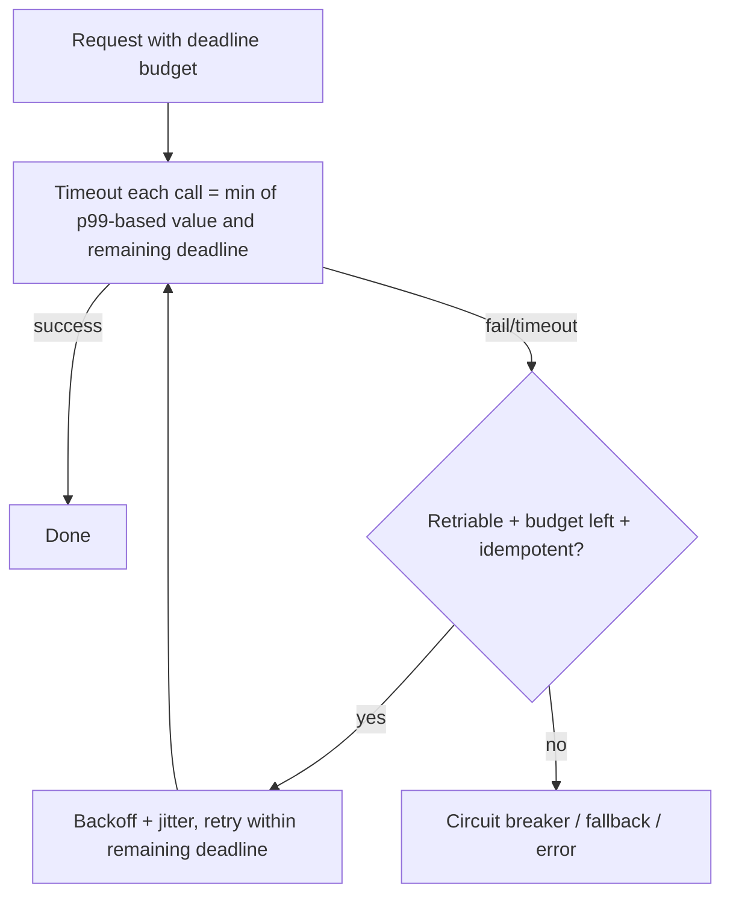

# Timeouts, Retries, and Deadlines

> Prerequisites: [06-distributed-systems/partial-failures-and-timeouts](../06-distributed-systems/partial-failures-and-timeouts.md)
> Related: [05-messaging/retries-backoff-and-jitter](../05-messaging-and-event-driven-systems/retries-backoff-and-jitter.md) · [circuit-breaker-pattern](./circuit-breaker-pattern.md)

This chapter consolidates the reliability view of timeouts, retries, and deadlines. The deep mechanics live in the distributed-systems and messaging sections; here we assemble them into a coherent reliability policy.

> Core mechanics: [partial-failures-and-timeouts](../06-distributed-systems/partial-failures-and-timeouts.md) (why timeouts, cascade, deadline propagation) and [retries-backoff-and-jitter](../05-messaging-and-event-driven-systems/retries-backoff-and-jitter.md) (backoff, jitter, retry budgets). This page is the integrated policy.

---

## A. Problem and motivation

Every network call needs a reliability policy: how long to wait (timeout), whether/how to retry, and how the whole request's time budget is enforced (deadline). Without a coherent policy, you get cascading overload (no timeouts), retry storms (bad retries), or requests that run long after the client gave up (no deadlines). The pieces are covered deeply elsewhere; the reliability skill is combining them correctly and consistently.

---

## B. The integrated policy (all three together)

The three must be set together and consistently:
- **Timeout:** per call, based on the dependency's p99 (see [partial-failures-and-timeouts](../06-distributed-systems/partial-failures-and-timeouts.md)). Never missing.
- **Retry:** only retriable errors (5xx/timeout, not 4xx) and only idempotent operations (or with an idempotency key); exponential backoff + jitter; a bounded retry budget (see [retries-backoff-and-jitter](../05-messaging-and-event-driven-systems/retries-backoff-and-jitter.md)).
- **Deadline:** the total time budget for the whole request, propagated down the call chain so each hop uses `min(its timeout, remaining deadline)`. Retries must fit within the remaining deadline — don't retry if the client already gave up.

**The key integration rule:** retries consume the deadline. A per-call timeout of 200ms with 3 retries can blow a 500ms request deadline — so retries must respect the shrinking deadline, not just a fixed count.

---

## C. Common policy mistakes

- **Timeout longer than the client's deadline:** the server keeps working on a request the client abandoned — wasted work, and the result is discarded. Fix: deadline propagation.
- **Retrying inside a request without a budget:** nested retries at each layer multiply (A retries B which retries C → combinatorial explosion of load). Fix: retry at one layer, or budget across layers.
- **Retrying non-idempotent operations:** duplicates. Fix: idempotency keys or don't retry.
- **Retrying 4xx:** wasted — the request is wrong. Fix: only retry transient (5xx/timeout) errors.

---

## D. Example — DMS request chain

Client → API (deadline 800ms) → documents service → DB. Policy: API sets an 800ms overall deadline; the documents service's DB calls use `min(50ms p99-based timeout, remaining deadline)`; on a timeout, retry once with backoff+jitter *only if* idempotent and the remaining deadline allows; otherwise fall back/error. A notification call on this path is given a short timeout + circuit breaker so it can't eat the budget or cascade. Retries don't nest: the API doesn't retry the whole chain and the service also retry the DB — retry at one level.

---

## E. Trade-offs & failure scenarios

(See the primary chapters for depth.) Key reliability failure modes: no timeout → cascade; retry storm → amplified load (backoff+jitter+budget fix it); deadline not propagated → wasted work past client patience; nested retries → combinatorial load. Each has a corresponding policy element above.

---

## F. Scaling implications

A consistent timeout/retry/deadline policy is what keeps a large service mesh from amplifying one slow dependency into a system-wide meltdown. At scale, standardize the policy (often via a shared client library / service mesh) so every call has sensible timeouts, bounded idempotent retries with backoff+jitter, and propagated deadlines — rather than each team inventing its own (and getting it wrong). This is the integrated expression of the resilience patterns in [circuit-breakers-and-bulkheads](../06-distributed-systems/circuit-breakers-and-bulkheads.md).

---

## G. Interview preparation

**Basic**
- Q: What three things make up a call's reliability policy? → *A: Timeout (per call), retry (bounded, idempotent, backoff+jitter, retriable errors only), deadline (overall budget propagated down).*

**Intermediate**
- Q: Why propagate deadlines? → *A: So each hop uses the remaining budget, retries fit within it, and the server doesn't keep working after the client gave up.*
- Q: What's wrong with retries at every layer? → *A: They multiply (A→B→C each retrying) into a combinatorial load explosion; retry at one layer or budget across layers.*

**SDE-2 / scenario**
- Q: "Set a timeout/retry/deadline policy for a 3-hop request with a 1s client deadline." → *A: Propagate the 1s deadline; each hop times out at min(its p99-based value, remaining budget); retry once with backoff+jitter only for idempotent ops and only if the remaining deadline allows; retry at a single level; circuit-break persistent failures. This bounds total time and prevents storms/cascades.*

**Common wrong answers:** no timeout; fixed retry count ignoring the deadline; nested retries; retrying non-idempotent ops / 4xx.

---

## H. Hands-on exercise

Write the full reliability policy (timeout values, retry rules, deadline propagation) for a checkout that calls inventory then payment, with a 2s client deadline. State what happens if payment is slow, and how you prevent retries from exceeding the deadline.

---

## I. Revision summary

**Key takeaways**
- Combine timeout + retry + deadline into one consistent policy per call.
- Timeout from p99; retry only idempotent + retriable errors with backoff+jitter + a budget; propagate the deadline and fit retries inside it.
- Avoid: no timeout (cascade), nested retries (load explosion), timeouts past the client deadline (wasted work).
- Standardize the policy at scale (shared library/mesh).

**Rapid-fire**
1. Base a timeout on? → Dependency p99.
2. Retry 4xx? → No.
3. What must retries fit within? → The remaining deadline.
4. Nested retries cause? → Combinatorial load explosion.
5. Retry non-idempotent ops? → Only with an idempotency key.

**Next:** [circuit-breaker-pattern](./circuit-breaker-pattern.md)
