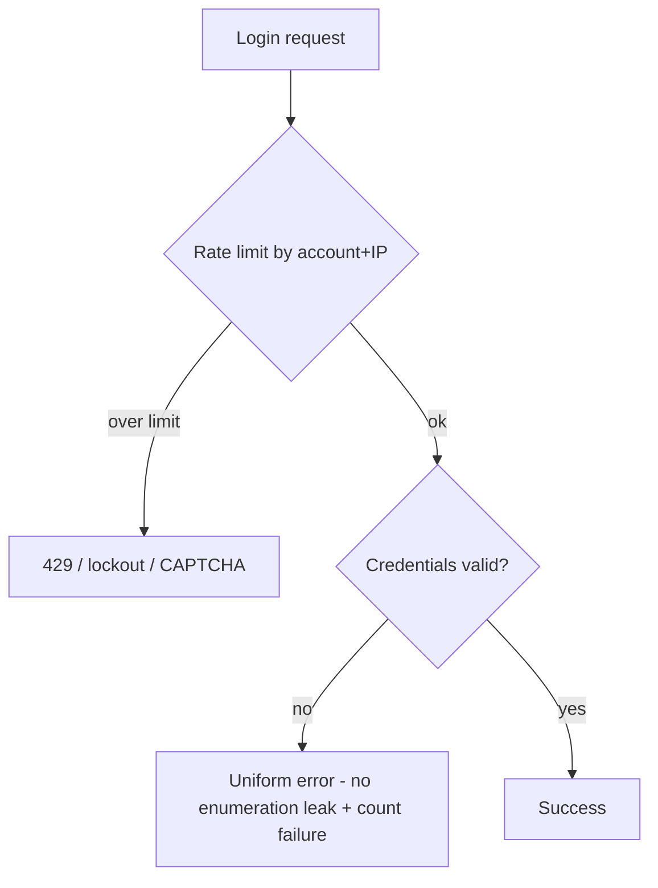

# Abuse Prevention and Rate Limiting (Security View)

> Prerequisites: [01-networking-and-api-design/rate-limiting](../01-networking-and-api-design/rate-limiting.md)
> Related: [security-threat-modeling](./security-threat-modeling.md) · [07-reliability-and-resilience/slis-slos-and-slas](../07-reliability-and-resilience/slis-slos-and-slas.md)

Rate limiting (covered mechanically earlier) is also a security control against abuse — DoS, credential stuffing, scraping, enumeration. This chapter covers the abuse-prevention angle and the broader anti-abuse toolkit.

> Rate-limiting algorithms + distributed implementation: [rate-limiting](../01-networking-and-api-design/rate-limiting.md). This page is the security/abuse angle.

---

## A. Problem and motivation

Any public endpoint attracts abuse: brute-force/credential-stuffing login attempts, scraping, resource exhaustion (DoS), signup fraud, and enumeration (probing for valid ids/accounts). Beyond protecting *capacity* (the reliability view), rate limiting and related controls protect against *malicious* behavior. A system without abuse prevention is cheap to attack — one actor can lock out users (brute force), scrape your data, or take you down.

---

## B. The abuse types and controls

| Abuse | What | Primary control |
|---|---|---|
| **Brute force / credential stuffing** | Guessing passwords / trying leaked creds | Rate-limit by account+IP; lockout/backoff; CAPTCHA; MFA |
| **DoS / resource exhaustion** | Flooding to overload | Rate limiting, load shedding, WAF, upstream DDoS protection |
| **Scraping** | Bulk-harvesting data | Rate limiting, bot detection, auth requirements |
| **Enumeration** | Probing valid ids/emails (e.g., signup telling you an email exists) | Rate limiting + uniform responses (don't reveal existence) |
| **Signup/abuse fraud** | Fake accounts, spam | CAPTCHA, email/phone verification, reputation |

**Rate limiting is the common thread**, but the *key dimension* matters: limit per account for brute force (an attacker varying IPs still hits one account's limit), per IP for anonymous DoS, per API key for fair use. Often combine dimensions.

---

## C. Abuse-prevention specifics

- **Login protection:** rate-limit failed attempts per account *and* per IP; exponential backoff/lockout after N failures; CAPTCHA on suspicious patterns; encourage/require MFA. Return a **uniform error** for "wrong password" vs "no such user" so attackers can't enumerate valid accounts (don't leak which part failed).
- **Avoid enumeration leaks:** signup/reset flows should respond identically whether or not an account exists ("if an account exists, we sent an email") — otherwise you leak the user list.
- **Progressive friction:** escalate controls based on risk signals (new IP, many failures) rather than blocking everyone — balance security vs legitimate-user friction.
- **WAF / DDoS protection:** a Web Application Firewall and upstream DDoS mitigation handle volumetric attacks before they reach your app.

---

## D. Example — DMS

- **Login:** rate-limit failed attempts per account and per IP; lockout with backoff after repeated failures; CAPTCHA after threshold; uniform error messages (no account-enumeration). Enterprise SSO (OIDC) offloads much of this to the IdP.
- **API:** per-API-key rate limits (fair use + abuse cap); per-IP limits for unauthenticated endpoints; a WAF in front for common attack patterns and volumetric floods.
- **Signup/reset:** identical responses regardless of account existence; email verification to curb fake accounts.
- Rate-limit state in Redis with an explicit fail-open/closed decision (see [rate-limiting](../01-networking-and-api-design/rate-limiting.md)).

---

## E. Trade-offs / failure scenarios

| Control | Benefit | Cost / risk |
|---|---|---|
| Account lockout | Stops brute force | Attacker can lock out legit users (DoS by lockout) → prefer backoff + CAPTCHA over hard lockout |
| Aggressive rate limits | Blocks abuse | Blocks legitimate bursts → tune + progressive friction |
| CAPTCHA everywhere | Deters bots | Hurts UX → apply only on risk signals |
| Uniform error messages | Prevents enumeration | Slightly worse UX (vague errors) — worth it |

Failure modes: no per-account limit (IP-rotating brute force succeeds); hard lockout abused to DoS legit users; enumeration leaks (different responses for exists/not); limiter-store-down with no fail-open/closed decision (see [rate-limiting](../01-networking-and-api-design/rate-limiting.md)).

---

## F. Scaling implications

At scale, you're a bigger target and abuse is constant, so anti-abuse must be layered: upstream DDoS/WAF for volumetric attacks, distributed rate limiting (Redis-backed) for application-level abuse, and risk-based progressive friction to avoid punishing legitimate users. The limiter itself must not be a bottleneck/SPOF (fail-open/closed decision, local fallback — see [rate-limiting](../01-networking-and-api-design/rate-limiting.md)). Abuse prevention ties into threat modeling (see [security-threat-modeling](./security-threat-modeling.md)) — enumerate the abuse paths and apply the matching control.

---

## G. Interview preparation

**Basic**
- Q: How does rate limiting prevent abuse? → *A: It caps request rates per dimension (account/IP/API key), limiting brute force, scraping, and DoS; the limit dimension depends on the abuse (per-account for brute force, per-IP for anonymous DoS).*

**Intermediate**
- Q: How do you protect a login endpoint? → *A: Rate-limit failed attempts per account AND per IP, backoff/CAPTCHA after failures, uniform error messages (no account enumeration), and MFA. Prefer backoff + CAPTCHA over hard lockout (lockout can be abused to DoS legit users).*
- Q: What's account enumeration and how do you prevent it? → *A: Learning which accounts exist from differing responses (e.g., 'no such user' vs 'wrong password'); prevent with uniform responses in login/signup/reset flows.*

**SDE-2 / scenario**
- Q: "An attacker is brute-forcing logins across many IPs." → *A: Per-IP limits alone won't catch IP rotation — rate-limit per *account* too (failures per account), add backoff + CAPTCHA on suspicious patterns, uniform errors to prevent enumeration, and MFA. Avoid hard lockout (DoS risk); use progressive friction.*
- Q: "How do you prevent scraping of your public API?" → *A: Per-API-key / per-IP rate limits, require auth for bulk data, bot detection, and a WAF; escalate friction on anomalous access patterns.*

**Common wrong answers:** per-IP limits only (misses IP-rotating brute force); hard lockout (DoS-able); enumeration leaks (different exists/not responses); no WAF/DDoS layer; no fail-open/closed plan.

---

## H. Hands-on exercise

Design abuse prevention for a login + signup + password-reset flow. Specify rate-limit dimensions, lockout vs backoff + CAPTCHA, how you avoid account enumeration, MFA, and the WAF/DDoS layer. Note the UX trade-off of each control and how progressive friction balances it.

---

## I. Revision summary

**Key takeaways**
- Rate limiting is a security control against brute force, DoS, scraping, enumeration — the *dimension* (account/IP/API key) must match the abuse.
- Protect logins: per-account + per-IP limits, backoff + CAPTCHA (not hard lockout), uniform errors (no enumeration), MFA.
- Layer defenses: WAF/DDoS upstream, distributed rate limiting, risk-based progressive friction.
- Balance security vs legitimate-user friction; the limiter must not be a bottleneck/SPOF.

**Rapid-fire**
1. Brute force across many IPs — limit by? → Account (not just IP).
2. Lockout vs backoff+CAPTCHA? → Prefer backoff+CAPTCHA (lockout is DoS-able).
3. Prevent account enumeration? → Uniform responses regardless of existence.
4. Volumetric DDoS handled by? → Upstream WAF/DDoS protection.
5. Balance abuse control vs UX? → Risk-based progressive friction.

**Next:** [multi-tenant-isolation](./multi-tenant-isolation.md)
