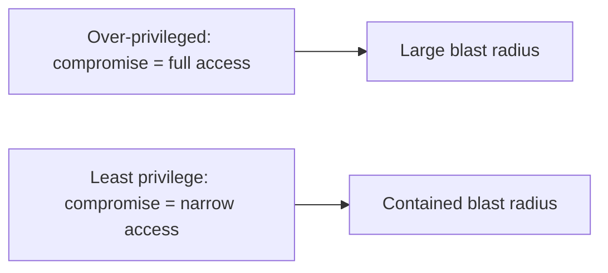

# Authentication, Authorization, and RBAC

> Prerequisites: [01-networking-and-api-design/authentication-and-authorization](../01-networking-and-api-design/authentication-and-authorization.md)
> Related: [jwt-sessions-and-oauth2](./jwt-sessions-and-oauth2.md) · [multi-tenant-isolation](./multi-tenant-isolation.md)

The API-layer chapter introduced authn/authz. This section goes deeper on the security engineering: RBAC/ABAC/ReBAC models, the principle of least privilege, and why broken access control is the #1 web vulnerability class.

> Core authn/authz, JWT-vs-session, 401-vs-403, tenant scoping: [authentication-and-authorization](../01-networking-and-api-design/authentication-and-authorization.md). This page is the security-model deep dive.

---

## A. Problem and motivation

Broken access control (users doing things they shouldn't) is consistently the most common and most damaging class of web vulnerability. The root cause is usually authorization done wrong: checks missing, done in the wrong place, or over-granting permissions. Getting the authorization *model* right — and defaulting to least privilege — is a core security skill that interviewers in security-conscious companies probe.

---

## B. Authorization models (choosing one)

| Model | Idea | Example | Fits |
|---|---|---|---|
| **RBAC** (role-based) | Users have roles; roles grant permissions | ADMIN, EDITOR, VIEWER | Most enterprise apps; coarse-grained |
| **ABAC** (attribute-based) | Policy over attributes (user dept, resource tags, time, location) | "EU employees can read EU docs during business hours" | Fine-grained, contextual rules |
| **ReBAC** (relationship-based) | Permissions flow from relationships | "editor of folder → editor of its documents" (Google Docs-style) | Hierarchical sharing / social graphs |

**RBAC is the default** for most systems (simple, auditable). Reach for ABAC when rules depend on context/attributes, and ReBAC when sharing is relationship-driven (nested folders, social connections). Many systems combine them (RBAC base + ABAC conditions).

---

## C. Principle of least privilege

Grant the **minimum** permissions needed, nothing more — for users, services, and infrastructure. This limits blast radius: a compromised account/service can only do what it was narrowly granted. Applied everywhere: user roles (don't make everyone admin), service accounts (a service that only reads shouldn't have write/delete), DB users (app connects with a limited-privilege account, not superuser), and infra IAM (scoped policies). Over-granting is how a single compromise becomes a full breach.

---

## D. Where authorization must happen (defense in depth)

From the API chapter: authn at the gateway (coarse), resource-level authz in the service (only it has the ownership data). Security adds **defense in depth** — multiple layers:
- **API/service layer:** check the user can perform the action on the specific resource (and tenant — see [multi-tenant-isolation](./multi-tenant-isolation.md)).
- **Data layer:** optionally row-level security / query scoping as a backstop, so even a buggy query can't leak cross-tenant data.
- **Deny by default:** unknown/unspecified → denied, not allowed. Explicit allow-lists, not block-lists.

**Never trust the client:** authorization is always server-side. A hidden UI button or a client-side check is not security — the server must enforce it. "Insecure direct object reference" (IDOR) — changing an ID in a request to access someone else's resource — is the classic bug from checking authn but not resource-level authz.

---

## E. Example — DMS

RBAC with roles OWNER/EDITOR/VIEWER per document, granted via shares. `DELETE /documents/{id}` checks: valid token (authn) → user's tenant matches the doc's tenant (isolation) → user has OWNER on this doc (authz). Deny by default. The app's DB account has only the privileges it needs (no DROP/superuser). A reconciliation/audit confirms no cross-tenant access. If sharing becomes folder-hierarchical ("editor of a folder edits all its docs"), that's a ReBAC extension. See [document-management-system](../12-system-design-problems/document-management-system.md).

---

## F. Trade-offs / failure scenarios

| Model/choice | Advantages | Disadvantages | Warning signs |
|---|---|---|---|
| RBAC | Simple, auditable | Coarse; role explosion for fine rules | Modeling relationships as roles |
| ABAC | Fine-grained, contextual | Complex policy, harder to audit | Over-engineering simple needs |
| ReBAC | Natural hierarchical/social sharing | Specialized; graph queries | Using it where RBAC suffices |

Failure modes: **IDOR** (missing resource-level authz); over-privilege (large blast radius); client-side-only checks (bypassed trivially); allow-by-default (unintended access); missing tenant scoping (cross-tenant leak — see [multi-tenant-isolation](./multi-tenant-isolation.md)).

---

## G. Scaling implications

Authorization is checked on nearly every request, so it's performance-sensitive (cache permission data, but invalidate promptly on changes — stale authz is a security bug, see [cache-invalidation-and-consistency](../04-caching/cache-invalidation-and-consistency.md)). At scale with many services, centralizing authz policy (a policy service / library) keeps it consistent, while enforcement stays at each service (it has the data). Least privilege scales blast-radius containment across users, services, and infra. The models grow in complexity (RBAC → ABAC → ReBAC) only as sharing requirements demand.

---

## H. Interview preparation

**Basic**
- Q: What's RBAC? → *A: Role-based access control — users get roles, roles grant permissions; the simple, auditable default for most apps.*
- Q: What's the principle of least privilege? → *A: Grant the minimum permissions needed (users, services, infra) to limit blast radius if compromised.*

**Intermediate**
- Q: RBAC vs ABAC vs ReBAC? → *A: RBAC = roles (coarse, default); ABAC = attribute/context policies (fine-grained); ReBAC = permissions via relationships (hierarchical/social sharing). Pick by how sharing is modeled.*
- Q: What's IDOR and how do you prevent it? → *A: Insecure direct object reference — accessing another user's resource by changing an ID, because the server checked authn but not resource-level authz. Prevent with resource-level authz on every endpoint + tenant scoping + deny-by-default.*

**SDE-2 / scenario**
- Q: "A user accessed another user's document by changing the URL id." → *A: Classic IDOR — the server authenticated but didn't verify this user owns/has-access-to that document. Enforce resource-level authorization server-side on every endpoint (and scope by tenant), deny by default, and consider row-level security as a backstop.*
- Q: "Design authorization for a Google-Docs-style sharing model." → *A: ReBAC — permissions flow through relationships (document shared with user; folder access cascades to contained docs). RBAC alone would explode into unmanageable roles.*

**Common wrong answers:** client-side-only checks; authn without resource-level authz (IDOR); everyone admin (over-privilege); allow-by-default; modeling hierarchical sharing as flat roles.

---

## I. Hands-on exercise

Design the authorization for a multi-tenant project-management tool: workspaces, projects, tasks, with roles and nested access (workspace admin → project access). Choose RBAC/ABAC/ReBAC (or a mix), specify where checks happen, how you prevent IDOR and cross-tenant access, and apply least privilege to the app's DB account.

---

## J. Revision summary

**Key takeaways**
- Broken access control is the #1 vulnerability class; root cause is bad authorization.
- Models: RBAC (default, roles), ABAC (attribute/context), ReBAC (relationships/hierarchy). Pick by sharing model.
- Least privilege everywhere (users, services, DB, infra) to limit blast radius.
- Enforce authz server-side at the resource level (prevent IDOR), scope by tenant, deny by default, defense in depth.

**Rapid-fire**
1. Default authz model? → RBAC.
2. Model for nested/relationship sharing? → ReBAC.
3. IDOR cause? → Missing resource-level authz.
4. Least privilege limits? → Blast radius on compromise.
5. Where is authz enforced? → Server-side, at the resource (never client-only).

**Next:** [jwt-sessions-and-oauth2](./jwt-sessions-and-oauth2.md)
