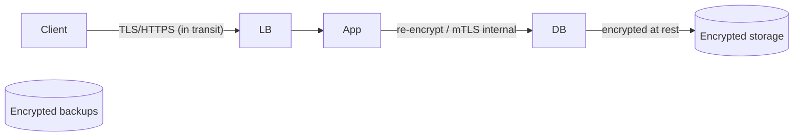

# Encryption and Data Protection

> Prerequisites: [secrets-and-key-management](./secrets-and-key-management.md), [01-networking-and-api-design/dns-tcp-tls-http](../01-networking-and-api-design/dns-tcp-tls-http.md)
> Related: [multi-tenant-isolation](./multi-tenant-isolation.md) · [03-databases/data-archival-and-retention](../03-databases-and-data-modeling/data-archival-and-retention.md)

Encryption protects data in transit and at rest so that even if intercepted or stolen, it's unreadable. Know the two kinds (in-transit vs at-rest), when each applies, and the key-management dependency.

---

## A. Problem and motivation

Data can be exposed in two ways: intercepted while moving over a network (eavesdropping), or stolen while stored (a disk/backup/database dump leaks). Encryption makes exposed data useless to an attacker without the key. Many compliance regimes (PCI, HIPAA, GDPR) mandate it. The two contexts need different handling, and both depend entirely on protecting the keys (see [secrets-and-key-management](./secrets-and-key-management.md)) — encryption without key management is theater.

---

## B. Encryption in transit

Protects data moving over networks (client↔server, service↔service, app↔DB). The mechanism is **TLS** (see [dns-tcp-tls-http](../01-networking-and-api-design/dns-tcp-tls-http.md)):
- **Always use HTTPS/TLS** for client traffic — no plaintext on the public internet.
- **Encrypt internal service-to-service traffic too** (don't assume the internal network is safe — "the network is secure" is a [fallacy](../06-distributed-systems/why-distributed-systems.md)). Use TLS internally, often **mutual TLS (mTLS)** so both sides authenticate.
- **TLS termination point** is a design decision: terminate at the LB for offload, but **re-encrypt internally** for sensitive data (don't leave the internal hop plaintext). See [dns-tcp-tls-http](../01-networking-and-api-design/dns-tcp-tls-http.md).

---

## C. Encryption at rest

Protects stored data (databases, object storage, backups, disks) so a stolen disk/dump/backup is unreadable:
- **Disk/volume encryption** (transparent, protects against physical theft) — baseline, usually "on" in cloud storage.
- **Database encryption at rest** — the DB files are encrypted.
- **Application-level / field-level encryption** — encrypt specific sensitive fields (SSNs, card data) *before* storing, so even DB admins / a DB dump can't read them. Strongest for highly sensitive data, at the cost of not being able to query/index those fields normally.
- **Backups must be encrypted too** (they contain all your data — see [backups-and-point-in-time-recovery](../07-reliability-and-resilience/backups-and-point-in-time-recovery.md)).

---

## D. The key-management dependency

Encryption is only as strong as key protection. Keys live in a KMS/secrets manager (see [secrets-and-key-management](./secrets-and-key-management.md)), are access-controlled and rotated, and are *never* stored alongside the data they protect (that defeats the purpose). **Envelope encryption** is the common pattern: a data key encrypts the data, and a master key (in KMS) encrypts the data key — so rotating the master key doesn't require re-encrypting all data. **Crypto-shredding** (from [data-archival-and-retention](../03-databases-and-data-modeling/data-archival-and-retention.md)): to "delete" encrypted data irrecoverably (e.g., GDPR, even from immutable backups), destroy its key — the data becomes permanently unreadable.

---

## E. Example — DMS

- **In transit:** HTTPS for all client traffic; mTLS between internal services; TLS re-encrypted on the internal hop from the LB to the app for document content.
- **At rest:** object storage (files) and the metadata DB encrypted at rest; backups encrypted; particularly sensitive fields (if any PII) field-encrypted at the application layer.
- **Keys:** in a KMS with envelope encryption; master key rotated; per-tenant data keys so crypto-shredding a tenant's key satisfies "delete all my data" even in backups (see [multi-tenant-isolation](./multi-tenant-isolation.md)).

---

## F. Trade-offs / failure scenarios

| Choice | Advantages | Disadvantages | Warning signs |
|---|---|---|---|
| TLS everywhere | Protects in-transit data | Slight overhead (negligible) | Plaintext internal traffic |
| Disk/DB encryption at rest | Protects stolen disks/dumps | Doesn't protect against app-level access | Unencrypted backups |
| Field-level encryption | Protects even from DB admins/dumps | Can't query/index those fields normally | Encrypting fields you must search |
| Envelope + KMS | Rotatable, keys separate from data | KMS dependency | Keys stored with the data |

Failure modes: plaintext internal traffic (assuming the network is safe); unencrypted backups (a stolen backup = full breach); keys stored with data; encrypting fields you then need to query; no key rotation.

---

## G. Scaling implications

Encryption in transit (TLS/mTLS) and at rest are baseline expectations that scale fine (overhead is minimal; TLS termination offloaded to LBs). The scaling complexity is key management: at scale you need centralized KMS, envelope encryption (so master-key rotation doesn't require re-encrypting petabytes), per-tenant keys (for isolation and crypto-shredding), and automated rotation. Field-level encryption trades queryability for protection, so it's reserved for the most sensitive fields. The compliance-driven "right to deletion" at scale is often solved by crypto-shredding rather than physically scrubbing data from every replica/backup.

---

## H. Interview preparation

**Basic**
- Q: Encryption in transit vs at rest? → *A: In transit protects data moving over the network (TLS/HTTPS/mTLS); at rest protects stored data (disk/DB/field encryption) so a stolen disk/dump/backup is unreadable.*

**Intermediate**
- Q: Why encrypt internal service-to-service traffic? → *A: Don't assume the internal network is safe ("the network is secure" is a fallacy); use TLS/mTLS internally so an attacker inside the perimeter can't eavesdrop or impersonate.*
- Q: What's envelope encryption and crypto-shredding? → *A: Envelope: a data key encrypts data, a KMS master key encrypts the data key (rotate the master without re-encrypting all data). Crypto-shredding: destroy the key to make data permanently unreadable — useful for irrecoverable deletion, even from immutable backups.*

**SDE-2 / scenario**
- Q: "A user invokes GDPR 'delete my data' but it's in encrypted backups you can't modify." → *A: Crypto-shredding — if that user's data is encrypted with a per-user/tenant key, destroying the key renders it permanently unreadable everywhere, including immutable backups, satisfying deletion without rewriting backups.*
- Q: "How do you protect sensitive fields even from DB admins?" → *A: Application/field-level encryption before storage, with keys in KMS — the DB (and its admins/dumps) only sees ciphertext. Trade-off: those fields can't be queried/indexed normally.*

**Common wrong answers:** plaintext internal traffic; unencrypted backups; keys stored with data; encrypting fields you must search; no rotation; thinking at-rest encryption protects against app-level breaches.

---

## I. Hands-on exercise

Design data protection for the DMS covering: client traffic, internal service traffic, document files at rest, the metadata DB, backups, and a per-tenant deletion requirement. Specify the encryption at each layer, the key-management approach (KMS + envelope + per-tenant keys), and how crypto-shredding satisfies deletion.

---

## J. Revision summary

**Key takeaways**
- Encrypt in transit (TLS/HTTPS/mTLS, internal too) and at rest (disk/DB/field + backups).
- Encryption is only as strong as key management (KMS, access-controlled, rotated, keys separate from data).
- Envelope encryption enables master-key rotation without re-encrypting data; crypto-shredding (destroy the key) gives irrecoverable deletion.
- Field-level encryption protects even from DB access but sacrifices queryability.

**Rapid-fire**
1. Mechanism for in-transit encryption? → TLS (mTLS internally).
2. Protect sensitive fields from DB admins? → Field-level encryption.
3. Rotate master key without re-encrypting all data? → Envelope encryption.
4. Irrecoverable deletion incl. backups? → Crypto-shredding (destroy the key).
5. Encrypt internal traffic? → Yes (network isn't trusted).

**Next:** [abuse-prevention-and-rate-limiting](./abuse-prevention-and-rate-limiting.md)
