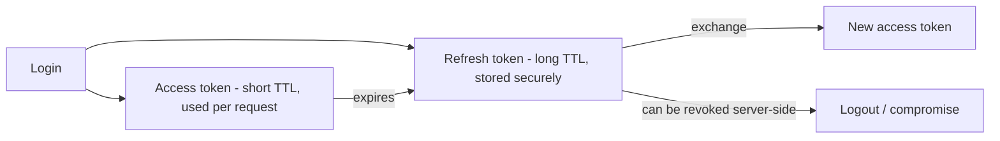
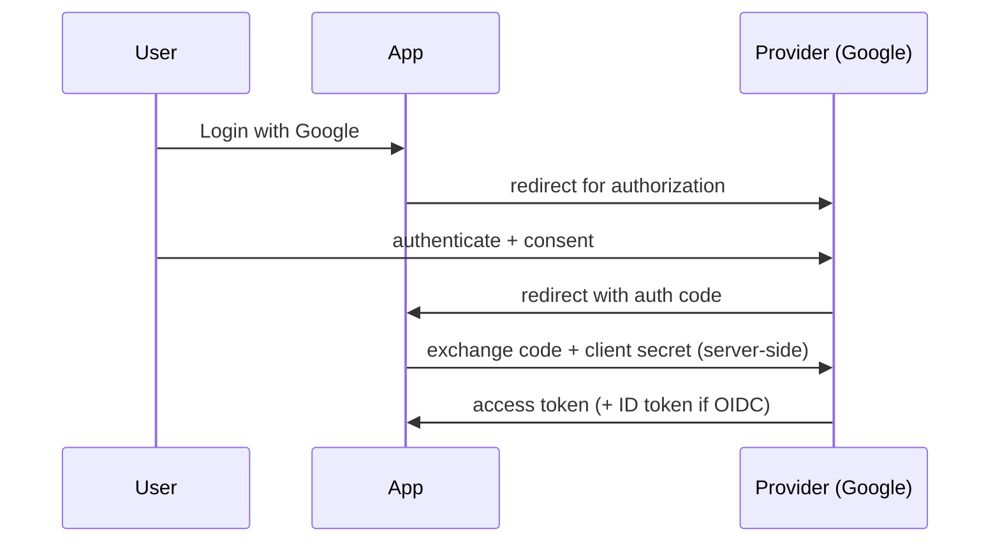

# JWT, Sessions, OAuth 2.0, and OpenID Connect

> Prerequisites: [authentication-authorization-and-rbac](./authentication-authorization-and-rbac.md)
> Related: [secrets-and-key-management](./secrets-and-key-management.md) · [01-networking-and-api-design/authentication-and-authorization](../01-networking-and-api-design/authentication-and-authorization.md)

The token/session mechanics behind authentication. Know JWT structure and its revocation problem, sessions vs tokens, and what OAuth2/OIDC actually do (delegated authorization vs authentication).

---

## A. Problem and motivation

How does a user prove who they are on each request without re-entering credentials, and how does "Login with Google" work without the app seeing your password? These are solved by sessions/tokens (ongoing authentication) and OAuth2/OIDC (delegated access/identity). Getting them wrong causes insecure auth (stolen tokens that can't be revoked, mishandled OAuth flows). Interviewers probe whether you understand the mechanisms, not just the names.

---

## B. Sessions vs JWTs (the trade-off)

Covered in [authentication-and-authorization](../01-networking-and-api-design/authentication-and-authorization.md); the essentials:

| | Server session | JWT (stateless token) |
|---|---|---|
| State | Stored server-side (Redis/DB) | Self-contained signed claims; nothing stored |
| Scaling | Needs a shared session store lookup each request | Any instance verifies via signature — fits stateless tier |
| Revocation | Instant (delete the session) | **Hard** — valid until expiry |
| Size | Small cookie id | Larger (claims sent each request) |

**JWT structure:** three base64 parts — `header.payload.signature`. The payload holds claims (user id, roles, expiry); the signature (HMAC with a secret, or RSA/ECDSA with a private key) proves integrity. The server verifies the signature to trust the claims **without a DB lookup** — that's the scaling win. But the payload is only *encoded*, not encrypted — **never put secrets in a JWT** (anyone can read it).

**The revocation problem:** a JWT is valid until its `exp`, so a stolen/deprecated token works until then. Mitigations: short access-token TTL + refresh tokens (below); a revocation/blocklist for emergencies; rotating signing keys. State this trade-off explicitly in interviews.

---

## C. Access + refresh tokens

To get JWT's statelessness *and* reasonable revocation: issue a **short-lived access token** (minutes) used on each request, plus a **long-lived refresh token** (stored more securely) used only to get a new access token. If an access token leaks, it expires quickly; the refresh token can be revoked server-side (it's checked rarely). This balances the stateless/scalability win against the revocation risk.

---

## D. OAuth 2.0 vs OpenID Connect (don't conflate)

- **OAuth 2.0 = delegated *authorization*.** It lets an app access *resources* on your behalf from another service without your password (e.g., an app accessing your Google Drive files). It issues *access tokens* scoped to permissions. OAuth2 is about **access**, not identity.
- **OpenID Connect (OIDC) = authentication built on OAuth2.** It adds an *ID token* (a JWT about *who you are*) so apps can use OAuth2 providers to **log you in** ("Sign in with Google"). OIDC is about **identity**.

A common mistake is calling OAuth2 "login" — strictly, OAuth2 is authorization/access; OIDC adds the authentication/identity layer on top.

**OAuth2 flow (authorization code, simplified):** user → app redirects to provider → user authenticates + consents → provider redirects back with a code → app exchanges the code (server-side, with its client secret) for tokens. The code-exchange happens server-side so the token isn't exposed to the browser.

---

## E. Example — DMS

The DMS uses short-lived JWT access tokens (5 min) + refresh tokens for its own API (stateless app tier verifies the signature, no session store lookup). For enterprise SSO, it supports OIDC ("Sign in with your corporate IdP") — the IdP authenticates the user and returns an ID token the DMS trusts. Secrets/signing keys are in a secrets manager (see [secrets-and-key-management](./secrets-and-key-management.md)), and keys are rotated. No secrets live in the JWT payload.

---

## F. Trade-offs / failure scenarios

| Choice | Advantages | Disadvantages | Warning signs |
|---|---|---|---|
| JWT | Stateless, scales, no per-request store lookup | Hard to revoke; larger; readable payload | Long-lived JWTs; secrets in payload |
| Session | Instant revocation, small | Shared store lookup each request | Sticky sessions |
| Access+refresh | Stateless + revocable | More moving parts | Long-lived access tokens |
| OAuth2/OIDC | Delegated access / SSO, no password sharing | Flow complexity, misuse risk | Conflating OAuth2 with login; implicit flow for sensitive apps |

Failure modes: long-lived un-revocable JWTs (stolen token works for hours/days); secrets in JWT payload (it's readable); confusing OAuth2 (access) with OIDC (identity); exposing the token exchange to the browser; weak signing keys / not rotating them.

---

## G. Scaling implications

Stateless JWTs are what make the stateless app tier (and thus horizontal scaling) clean — no session-store hit per request (see [stateless-vs-stateful-services](../02-compute-and-architecture/stateless-vs-stateful-services.md)). The cost is revocation, handled with short TTLs + refresh. OAuth2/OIDC let you offload authentication to identity providers (less credential-handling risk, enterprise SSO) at the cost of integration complexity. Signing-key management becomes a security-critical operational concern at scale (rotation, storage — see [secrets-and-key-management](./secrets-and-key-management.md)).

---

## H. Interview preparation

**Basic**
- Q: What's in a JWT and why don't you store secrets in it? → *A: header.payload.signature; the payload is base64-encoded (readable) and signed (tamper-proof), not encrypted — so anyone can read it; never put secrets there.*

**Intermediate**
- Q: JWT's revocation problem and the fix? → *A: A JWT is valid until expiry, so you can't instantly revoke it. Use short-lived access tokens + revocable refresh tokens (and a blocklist/key rotation for emergencies).*
- Q: OAuth2 vs OIDC? → *A: OAuth2 is delegated *authorization* (access to resources without sharing a password); OIDC is *authentication* built on OAuth2, adding an ID token for "who you are" (SSO/login).*

**SDE-2 / scenario**
- Q: "A JWT was stolen — how fast can you cut it off?" → *A: With plain JWTs, only at expiry — so keep access tokens short-lived; revoke the refresh token server-side; rotate signing keys for a mass compromise. This is the stateless-vs-revocation trade-off.*
- Q: "How does 'Login with Google' work?" → *A: OIDC on top of OAuth2: redirect to Google, user authenticates/consents, Google returns an auth code, the app exchanges it server-side (with its client secret) for tokens including an ID token proving identity. The app never sees the password.*

**Common wrong answers:** secrets in JWT payload; long-lived JWTs with no revocation plan; calling OAuth2 "login" (it's authorization; OIDC is login); exposing the code exchange to the browser.

---

## I. Hands-on exercise

Design authentication for an app that needs: its own login (stateless, scalable), the ability to revoke a compromised user quickly, and "Sign in with Google." Specify token types + TTLs, the refresh mechanism, revocation approach, and which protocol handles the Google login (and why).

---

## J. Revision summary

**Key takeaways**
- JWT = signed, self-contained claims (stateless, scales, no store lookup) but hard to revoke and readable (no secrets inside); sessions = revocable but need a store lookup.
- Access (short) + refresh (revocable) tokens balance statelessness and revocation.
- OAuth2 = delegated authorization (access); OIDC = authentication/identity on top (SSO). Don't conflate.
- Manage/rotate signing keys securely; code exchange is server-side.

**Rapid-fire**
1. JWT revocation problem? → Valid until expiry; mitigate with short TTL + refresh.
2. Secrets in a JWT payload? → Never (it's readable).
3. OAuth2 is about? → Authorization/access (not login).
4. OIDC adds? → Authentication/identity (ID token) — SSO/login.
5. Balance statelessness + revocation? → Short access token + revocable refresh token.

**Next:** [secrets-and-key-management](./secrets-and-key-management.md)
