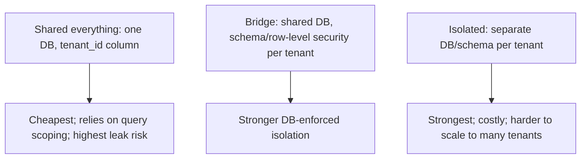

# Multi-Tenant Isolation

> Prerequisites: [authentication-authorization-and-rbac](./authentication-authorization-and-rbac.md)
> Related: [03-databases/partitioning-and-sharding](../03-databases-and-data-modeling/partitioning-and-sharding.md) · [encryption-and-data-protection](./encryption-and-data-protection.md)

Multi-tenant systems (one deployment serving many customer organizations, like the DMS) must guarantee one tenant can never access another's data. Isolation models trade off cost vs isolation strength, and cross-tenant leakage is a catastrophic security failure.

---

## A. Problem and motivation

SaaS systems serve many tenants (companies) from shared infrastructure — cheaper and simpler than per-tenant deployments. But the hard requirement is **isolation**: Tenant A must never see Tenant B's data, even through bugs, misconfigurations, or malicious probing. A single cross-tenant leak is a severe breach (customer data exposed to competitors). The design question is *how* to isolate, trading cost against isolation strength, and how to prevent leaks defensively.

---

## B. Isolation models

| Model | Isolation | Cost | Scales to many tenants | Use |
|---|---|---|---|---|
| **Shared everything** (one DB, `tenant_id` column on every row) | Weakest (app-enforced) | Lowest | Best (one DB) | Many small tenants; most SaaS |
| **Shared DB, isolated schema / row-level security** | Medium (DB-enforced) | Medium | Good | Mix; stronger DB guarantees |
| **Isolated DB per tenant** | Strongest (physical) | Highest | Poor (DB per tenant) | Few large/regulated tenants |

Most SaaS uses **shared everything with a `tenant_id`** for cost/scale, adding **row-level security (RLS)** as a DB-enforced backstop. Large/regulated tenants may get dedicated DBs. It's often a mix (pooled for small tenants, isolated for enterprise).

---

## C. Enforcing isolation (defense in depth)

The core rule: **every query and operation is scoped by `tenant_id`** — automatically, not relying on each developer to remember. Layers:
1. **Application layer:** derive `tenant_id` from the authenticated identity (never from a client-supplied value — a client could pass another tenant's id), and inject it into every query. Resource-level authz checks tenant match (see [authentication-authorization-and-rbac](./authentication-authorization-and-rbac.md)).
2. **Data layer backstop:** **row-level security (RLS)** in the DB enforces `tenant_id = current_tenant` at the database, so even a buggy query missing the filter can't leak across tenants. This defense-in-depth catches the inevitable missed-filter bug.
3. **Shared caches/queues:** namespace keys/topics by tenant so cache/queue data can't bleed across tenants (a cache key must include `tenant_id`).

**Never derive tenant from the request body/params** — always from the server-trusted session/token, or an attacker just claims another tenant.

---

## D. Example — DMS

The DMS is shared-everything with `tenant_id` on every row (documents, revisions, shares, users). Enforcement: `tenant_id` comes from the JWT (server-trusted), injected into every query; RLS in Postgres enforces it as a backstop; Redis cache keys and Kafka topics are namespaced by tenant. Enterprise customers with data-residency needs get isolated DBs in their region (see [multi-region-architecture](../06-distributed-systems/multi-region-architecture.md)) and per-tenant encryption keys (enabling crypto-shredding on offboarding — see [encryption-and-data-protection](./encryption-and-data-protection.md)). Sharding is by `tenant_id`, keeping a tenant's data together (see [partitioning-and-sharding](../03-databases-and-data-modeling/partitioning-and-sharding.md)).

---

## E. Trade-offs / failure scenarios

| Model | Advantages | Disadvantages | Warning signs |
|---|---|---|---|
| Shared everything | Cheapest, scales to many tenants | Isolation is app-enforced (leak risk) | No RLS backstop; tenant from request body |
| Shared DB + RLS | DB-enforced isolation, still pooled | Some complexity | Trusting app-only scoping |
| Isolated DB per tenant | Strongest isolation | Expensive, doesn't scale to many | Using it for thousands of small tenants |

Failure modes: **cross-tenant leak** (missed `tenant_id` filter — the catastrophic one; RLS backstops it); deriving tenant from client input (trivial impersonation); un-namespaced shared cache/queue (data bleed); noisy-neighbor (one tenant's load degrades others — needs quotas/rate limits per tenant, see [abuse-prevention-and-rate-limiting](./abuse-prevention-and-rate-limiting.md)).

---

## F. Scaling implications

Shared-everything scales to many tenants cheaply but makes isolation an application-correctness problem — hence RLS as a DB-enforced backstop is important at scale (you can't rely on every query being written perfectly). Sharding by `tenant_id` keeps tenants' data co-located (single-shard queries) and enables per-tenant isolation/residency for large tenants. Noisy-neighbor becomes a scaling concern — per-tenant rate limits/quotas prevent one tenant monopolizing shared resources. The isolation model often evolves: pooled for the long tail of small tenants, isolated DBs/regions for large/regulated ones.

---

## G. Interview preparation

**Basic**
- Q: What are the multi-tenant isolation models? → *A: Shared everything (one DB + tenant_id — cheap, scales, app-enforced), shared DB with row-level security (DB-enforced), and isolated DB per tenant (strongest, costly, doesn't scale to many).*

**Intermediate**
- Q: How do you prevent cross-tenant data leaks? → *A: Scope every query by tenant_id derived from the trusted token (never client input), add resource-level authz, and use row-level security as a DB-enforced backstop so a missed filter can't leak. Namespace shared caches/queues by tenant.*
- Q: Why not derive tenant from the request? → *A: A client could supply another tenant's id to impersonate; tenant must come from the server-trusted session/token.*

**SDE-2 / scenario**
- Q: "Design isolation for a multi-tenant SaaS." → *A: Shared-everything with tenant_id for cost/scale; tenant_id from the JWT injected into every query; RLS backstop in the DB; tenant-namespaced cache/queue keys; per-tenant rate limits (noisy-neighbor); isolated DBs/regions + per-tenant keys for large/regulated tenants. Shard by tenant_id.*
- Q: "A bug missed the tenant filter in one query — did it leak?" → *A: Not if row-level security is enforcing tenant_id at the DB — RLS is the defense-in-depth backstop precisely for inevitable missed-filter bugs. Without it, that bug is a cross-tenant breach.*

**Common wrong answers:** app-only scoping with no RLS backstop; tenant from request body; un-namespaced shared cache/queue; isolated-DB-per-tenant for thousands of small tenants; ignoring noisy-neighbor.

---

## H. Hands-on exercise

Design multi-tenant isolation for a SaaS with 10,000 small tenants and 5 large regulated ones. Choose the model(s), specify how tenant_id is enforced across app/DB/cache/queue, the RLS backstop, noisy-neighbor controls, and how you handle the regulated tenants' residency + deletion requirements.

---

## I. Revision summary

**Key takeaways**
- Models: shared-everything (tenant_id, cheap/scales, app-enforced), shared+RLS (DB-enforced), isolated DB per tenant (strongest, costly). Often a mix.
- Enforce tenant_id from the trusted token (never client input) on every query; add RLS as a DB backstop; namespace shared caches/queues.
- Cross-tenant leak is catastrophic — RLS backstops the inevitable missed-filter bug; defense in depth.
- Shard by tenant_id; add per-tenant quotas for noisy-neighbor; isolate large/regulated tenants.

**Rapid-fire**
1. Cheapest isolation model? → Shared everything (tenant_id).
2. DB-enforced backstop for a missed filter? → Row-level security (RLS).
3. Where does tenant_id come from? → The trusted token (never request body).
4. Shared cache keys must include? → tenant_id (namespacing).
5. Shard key for multi-tenant? → tenant_id.

**Next:** [security-threat-modeling](./security-threat-modeling.md)
