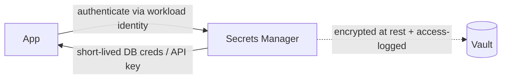

# Secrets and Key Management

> Prerequisites: [jwt-sessions-and-oauth2](./jwt-sessions-and-oauth2.md)
> Related: [encryption-and-data-protection](./encryption-and-data-protection.md) · [09-observability-and-operations/deployment-strategies](../09-observability-and-operations/deployment-strategies.md)

Secrets (DB passwords, API keys, signing keys, encryption keys) are the keys to the kingdom. Mishandling them (hardcoded, in git, in logs) is a leading breach cause. Know secret managers, rotation, and the don'ts.

---

## A. Problem and motivation

Every system has secrets: database credentials, third-party API keys, JWT signing keys, TLS private keys, encryption keys. If leaked, an attacker gets whatever those secrets protect — often everything. Secrets end up compromised through predictable mistakes: committed to git, baked into images, printed in logs, shared in chat. Proper secret management (centralized, access-controlled, rotatable, never in code) prevents the most common breach vector.

---

## B. The cardinal don'ts

- **Never hardcode secrets** in source code.
- **Never commit secrets to version control** (git history is forever; a secret in an old commit is still exposed — rotate it, don't just delete the line). Scan repos for leaked secrets.
- **Never log secrets** (they end up in log aggregation, accessible to many). Redact.
- **Never bake secrets into container images** or config files shipped with the app.
- **Never put secrets in JWTs/URLs/client-side code** (readable).

These sound obvious but are the actual cause of most leaks.

---

## C. Secret managers

Store secrets in a dedicated **secrets manager** (HashiCorp Vault, AWS Secrets Manager, cloud KMS, etc.) that provides:
- **Centralized, encrypted storage** — secrets encrypted at rest, not scattered in configs.
- **Access control + audit** — only authorized services/roles fetch a given secret (least privilege — see [authentication-authorization-and-rbac](./authentication-authorization-and-rbac.md)); every access is logged.
- **Dynamic/short-lived secrets** — some managers issue short-lived DB credentials on demand (so a leaked credential expires fast).
- **Rotation** — change secrets regularly, ideally automated.

Apps fetch secrets at startup/runtime from the manager (authenticated via a workload identity), not from files/env baked at build time.

---

## D. Rotation

Secrets should be **rotated** periodically and immediately on suspected compromise. Rotation limits the window a leaked secret is useful. The challenge: rotating without downtime — support *two valid secrets during the transition* (old + new), like the expand/migrate/contract pattern for schemas (see [schema-migrations-and-data-evolution](../03-databases-and-data-modeling/schema-migrations-and-data-evolution.md)): deploy the new secret alongside the old, switch consumers to the new, then retire the old. For signing keys (JWT), publish both old and new public keys during the overlap so tokens signed with either verify.

---

## E. Example — DMS

The DMS stores DB credentials, the Redis password, third-party API keys, and the JWT signing key in a secrets manager. App instances authenticate to it via their workload identity and fetch secrets at startup; nothing is in git, images, or logs (a log filter redacts anything matching secret patterns). The JWT signing key rotates quarterly with an overlap window (both keys' public parts published so in-flight tokens verify). DB credentials are short-lived/dynamic where supported. A git-secret scanner runs in CI to block accidental commits.

---

## F. Trade-offs / failure scenarios

| Practice | Risk if ignored |
|---|---|
| Secret manager vs env/config files | Scattered secrets, no rotation/audit, easy leaks |
| Rotation | A leaked secret stays valid indefinitely |
| Overlap during rotation | Downtime/outage when the old secret is cut off abruptly |
| Redacting logs | Secrets leak into log aggregation |
| Git scanning | Secrets committed and exposed forever (rotate, don't just delete) |

Failure modes: hardcoded/committed secrets (the classic breach); abrupt rotation causing outages (use overlap); logging secrets; over-broad access to the secret manager (least privilege applies here too).

---

## G. Scaling implications

As services multiply, centralized secret management is essential — manually distributing/rotating secrets across many services is error-prone and unauditable. Secret managers + workload identities + automated rotation scale security hygiene across a fleet. Dynamic short-lived credentials (issued per-use, auto-expiring) are the strongest approach at scale, minimizing the value of any single leaked credential. Rotation-with-overlap is the pattern that keeps rotation zero-downtime as the number of consumers grows.

---

## H. Interview preparation

**Basic**
- Q: Where should secrets live? → *A: In a secrets manager (encrypted, access-controlled, audited, rotatable) — never hardcoded, in git, in images, or in logs.*

**Intermediate**
- Q: Why rotate secrets, and how without downtime? → *A: Rotation limits a leaked secret's useful window. Do it with an overlap: both old and new valid during the transition, switch consumers, then retire the old — like expand/migrate/contract.*
- Q: A secret was committed to git and the line deleted — is it safe? → *A: No — git history retains it; the secret is exposed and must be *rotated*, not just removed.*

**SDE-2 / scenario**
- Q: "How do you manage secrets across many services?" → *A: Centralized secrets manager; each service authenticates via its workload identity and fetches only the secrets it needs (least privilege); automated rotation with overlap; dynamic short-lived credentials where possible; redact logs and scan repos for leaks.*
- Q: "You need to rotate the JWT signing key without logging everyone out." → *A: Publish both the old and new public keys during an overlap window so tokens signed with either verify; sign new tokens with the new key; retire the old key after existing tokens expire.*

**Common wrong answers:** secrets in code/git/env baked into images; no rotation; abrupt rotation (outage); logging secrets; thinking deleting a committed secret makes it safe.

---

## I. Hands-on exercise

Design secret management for the DMS: list its secrets, where they're stored, how services fetch them, the rotation strategy for the JWT signing key and DB credentials (with overlap), and the controls that prevent leaks (log redaction, git scanning, least-privilege access).

---

## J. Revision summary

**Key takeaways**
- Never hardcode/commit/log/bake secrets; a committed secret must be rotated (history is forever).
- Use a secrets manager: encrypted, access-controlled, audited, rotatable; apps fetch via workload identity.
- Rotate regularly + on compromise; do it with an overlap window for zero downtime (both old+new valid).
- Prefer dynamic short-lived credentials; apply least privilege to secret access; redact logs; scan repos.

**Rapid-fire**
1. Where do secrets belong? → A secrets manager.
2. Committed secret, line deleted — safe? → No, rotate it (history retains it).
3. Zero-downtime rotation technique? → Overlap (old + new valid).
4. Strongest credential approach at scale? → Dynamic short-lived credentials.
5. Secrets in JWTs/logs/images? → Never.

**Next:** [encryption-and-data-protection](./encryption-and-data-protection.md)
