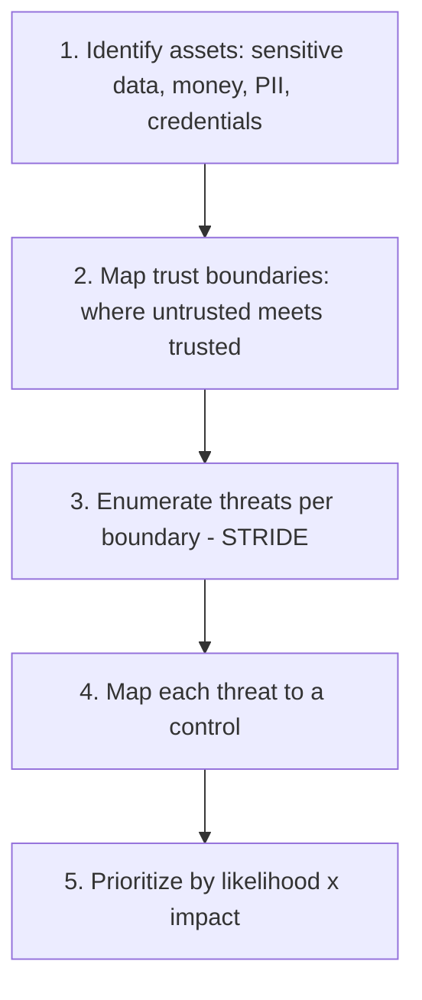

# Security Threat Modeling

> Prerequisites: all prior `08-security/` chapters
> Related: [09-observability-and-operations/incident-response-and-root-cause-analysis](../09-observability-and-operations/incident-response-and-root-cause-analysis.md)

Threat modeling is the systematic way to find security weaknesses before attackers do: "what can go wrong, and what do we do about it?" It ties together all the security controls and is how you address the "security and observability" dimension in an HLD interview.

---

## A. Problem and motivation

Security isn't a feature you bolt on; it's a property you design in by anticipating how the system can be attacked. Threat modeling is the structured process of enumerating threats (who attacks, what they target, how) and mapping each to a control. Without it, security is ad hoc — you protect what you happen to think of and miss the rest. In an HLD interview, demonstrating threat-model thinking (identifying the sensitive data, the trust boundaries, and the abuse paths) is how you earn the security dimension of the rubric.

---

## B. The STRIDE framework

A common checklist of threat categories (STRIDE) and their mitigations:

| Threat | What | Mitigation (from this section) |
|---|---|---|
| **S**poofing | Pretending to be someone else | Authentication (JWT/OIDC/mTLS) |
| **T**ampering | Modifying data/requests | Integrity (signatures, TLS, HMAC, validation) |
| **R**epudiation | Denying an action | Audit logging (immutable, see [logs](../09-observability-and-operations/logs-metrics-and-traces.md)) |
| **I**nformation disclosure | Leaking data | Encryption (transit/rest), authz, tenant isolation |
| **D**enial of service | Overloading | Rate limiting, WAF/DDoS, quotas, autoscaling |
| **E**levation of privilege | Gaining unauthorized rights | Least privilege, authz checks, input validation |

Walking STRIDE over a design surfaces threats systematically rather than relying on memory.

---

## C. The threat-modeling process

1. **Identify assets:** what's worth protecting — PII, payment data, credentials, intellectual property, availability itself.
2. **Map trust boundaries:** where untrusted input crosses into trusted systems (client→API, service→service, user-supplied URLs, file uploads). Threats concentrate at boundaries.
3. **Enumerate threats** per boundary using STRIDE.
4. **Map controls** (the earlier chapters: authn/authz, encryption, rate limiting, isolation, secrets, input validation).
5. **Prioritize** by likelihood × impact — fix the high-risk ones first.

---

## D. The always-present threats (OWASP-style)

Some threats appear in nearly every system — address them by default:
- **Broken access control** (the #1 class) → resource-level authz, tenant scoping (see [authentication-authorization-and-rbac](./authentication-authorization-and-rbac.md), [multi-tenant-isolation](./multi-tenant-isolation.md)).
- **Injection** (SQL/command injection) → parameterized queries, never string-concatenate user input into queries/commands; input validation.
- **Sensitive data exposure** → encryption in transit/at rest (see [encryption-and-data-protection](./encryption-and-data-protection.md)).
- **SSRF** (server making requests to user-supplied URLs hitting internal resources) → allowlist/validate destinations, block internal IP ranges (see [webhooks-and-callbacks](../01-networking-and-api-design/webhooks-and-callbacks.md)).
- **Secrets exposure** → secrets manager, never in code/logs (see [secrets-and-key-management](./secrets-and-key-management.md)).
- **Treat all external input as untrusted** — files, API inputs, webhook payloads, fetched content — validate and sanitize.

---

## E. Example — DMS threat model (abbreviated)

| Asset | Trust boundary | Threat (STRIDE) | Control |
|---|---|---|---|
| Documents (confidential) | Client → API | Spoofing/Elevation (access others' docs) | AuthN (JWT), resource-level authz, tenant isolation + RLS |
| Documents | Stored at rest / backups | Info disclosure (stolen disk/backup) | Encryption at rest + encrypted backups |
| Uploads | Client → storage | Tampering (malicious file / malware) | Virus scan (OCR pipeline), content-type validation, size limits |
| Webhook URLs | App → user-supplied URL | SSRF (hit internal network) | Allowlist, block private IPs |
| Login | Client → API | Spoofing (brute force) | Rate limit per account+IP, MFA, uniform errors |
| Any query | App → DB | Tampering (SQL injection) | Parameterized queries, validation |
| Credentials/keys | Config/logs | Info disclosure | Secrets manager, redact logs |

This structured pass ensures no major category is forgotten — exactly what to verbalize in the security portion of an interview.

---

## F. Trade-offs / failure scenarios

Threat modeling is about *coverage* and *prioritization*, so the "failure" is omission:
1. **No systematic model** → you protect ad hoc and miss a category (e.g., forget SSRF on webhooks, forget tenant isolation). Fix: STRIDE/boundary walk.
2. **Over-securing low-risk, under-securing high-risk** → wasted effort + exposure. Fix: prioritize by likelihood × impact.
3. **Trusting internal/boundary inputs** → injection/SSRF. Fix: treat all external input as untrusted; validate at every boundary.

---

## G. Scaling implications

As a system grows (more services, more boundaries, more data), the attack surface grows and ad-hoc security fails — threat modeling becomes a repeatable practice (per feature/design) and feeds security requirements into the design process. The controls from this section are the toolkit; threat modeling is how you decide which to apply where. At scale, automate what you can (dependency scanning, secret scanning, WAF rules, RLS) so coverage doesn't depend on each engineer remembering every threat.

---

## H. Interview preparation

**Basic**
- Q: What is threat modeling? → *A: Systematically enumerating how a system can be attacked (assets, trust boundaries, threats via STRIDE) and mapping each threat to a control, prioritized by likelihood × impact.*

**Intermediate**
- Q: What's STRIDE? → *A: Spoofing, Tampering, Repudiation, Information disclosure, Denial of service, Elevation of privilege — a checklist of threat categories, each with standard mitigations.*
- Q: Name a few always-present threats. → *A: Broken access control (resource authz + tenant isolation), injection (parameterized queries), sensitive-data exposure (encryption), SSRF (allowlist/block internal IPs), secrets exposure (secrets manager).*

**SDE-2 / scenario**
- Q: "Walk me through the security of your design." → *A: Identify assets (documents, PII, credentials), map trust boundaries (client→API, app→DB, user-supplied webhook URLs, uploads), apply STRIDE: authn/authz + tenant isolation for access control, encryption in transit/at rest, parameterized queries for injection, SSRF protection on webhooks, rate limiting for DoS/brute force, secrets manager for keys. Prioritize by likelihood × impact.*
- Q: "What's the most common vulnerability and your defense?" → *A: Broken access control — resource-level authorization on every endpoint, tenant scoping with RLS backstop, deny by default, server-side enforcement (prevent IDOR).*

**Common wrong answers:** ad-hoc security with no systematic model; trusting internal/boundary input; forgetting a whole category (SSRF, injection, tenant isolation); not prioritizing by risk.

---

## I. Hands-on exercise

Threat-model a payment system: identify assets, trust boundaries, enumerate threats via STRIDE, and map each to a control from this section. Prioritize the top 3 by likelihood × impact and justify. This is the security section you'd verbalize in a payment-system interview.

---

## J. Revision summary

**Key takeaways**
- Threat modeling = assets → trust boundaries → threats (STRIDE) → controls → prioritize by likelihood × impact.
- STRIDE categories map to the section's controls (authn, integrity, audit, encryption, rate limiting, least privilege).
- Always-present threats: broken access control, injection, data exposure, SSRF, secrets exposure — address by default.
- Treat all external input as untrusted; validate at every boundary; prioritize by risk.

**Rapid-fire**
1. STRIDE's "E"? → Elevation of privilege.
2. #1 vulnerability class? → Broken access control.
3. Injection defense? → Parameterized queries + validation.
4. Where do threats concentrate? → Trust boundaries.
5. How to prioritize threats? → Likelihood × impact.

**Section complete.** Next section: [09-observability-and-operations](../09-observability-and-operations/logs-metrics-and-traces.md)
