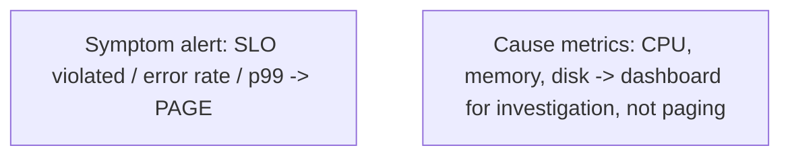

# Alerting and Dashboards

> Prerequisites: [logs-metrics-and-traces](./logs-metrics-and-traces.md), [07-reliability-and-resilience/slis-slos-and-slas](../07-reliability-and-resilience/slis-slos-and-slas.md)
> Related: [incident-response-and-root-cause-analysis](./incident-response-and-root-cause-analysis.md)

Metrics are only useful if they tell you when something's wrong (alerting) and let you understand the system at a glance (dashboards). The hard part is alerting on the *right* things — too many alerts cause fatigue; too few miss incidents.

---

## A. Problem and motivation

Observability data is useless if nobody looks at it until a customer complains. Alerting notifies you *proactively* when something's wrong; dashboards let you understand state and investigate. The common failure is bad alerting: noisy alerts (fatigue → ignored → real incidents missed) or alerting on causes instead of symptoms (page on "high CPU" when CPU is often fine; miss the actual user-facing problem). Good alerting is symptom-based, actionable, and tied to SLOs.

---

## B. Alert on symptoms, not causes

Page humans on **user-facing symptoms** (SLO violations), not internal causes:
- **Good (symptom):** "error rate > 1%", "p99 latency > SLO", "SLO error budget burning fast", "orders not completing."
- **Bad (cause):** "CPU > 80%", "disk 70% full", "a pod restarted." These may be fine (CPU spikes happen; a pod restart is normal) and page you needlessly — or you *miss* a user problem that doesn't involve high CPU.

Cause metrics are for *dashboards/investigation*, not paging. The question for a paging alert: "is a user actually suffering, and must a human act now?" If not, it shouldn't page.

---

## C. SLO-based alerting and burn rate

The best alerting ties to the **error budget** (see [slis-slos-and-slas](../07-reliability-and-resilience/slis-slos-and-slas.md)). Alert on **burn rate** — how fast you're consuming the budget:
- **Fast burn** (budget being eaten in minutes/hours) → page immediately (major incident).
- **Slow burn** (budget trending down over days) → a ticket, not a 3am page.

Burn-rate alerting avoids both noise (minor blips within budget don't page) and misses (sustained degradation does). It directly connects alerting to what matters (the reliability target), not arbitrary thresholds.

---

## D. Dashboards

Dashboards visualize system state for investigation and situational awareness:
- **RED/USE dashboards** (Rate, Errors, Duration per service; Utilization, Saturation, Errors per resource).
- **SLO dashboards** (current SLO compliance, error budget remaining, burn rate).
- **Dependency/trace views** (where latency concentrates).
Dashboards are for *humans investigating*; they complement (don't replace) alerts. During an incident, dashboards + traces + logs drive diagnosis (see [incident-response-and-root-cause-analysis](./incident-response-and-root-cause-analysis.md)).

---

## E. Example — DMS

- **Paging alerts (symptoms):** upload/download error rate > 1%; metadata-read p99 > SLO; SLO error-budget fast burn; queue consumer lag growing beyond a threshold (users' notifications delayed).
- **Non-paging (tickets/dashboard):** CPU/memory/disk trends, cache hit ratio dip, replica lag within tolerance — investigated, not paged.
- **Dashboards:** RED per service, SLO/error-budget panel, queue depth + consumer lag, DB connections + replica lag, cache hit ratio. On-call opens these first during an incident.

---

## F. Trade-offs / failure scenarios

| Issue | Effect | Fix |
|---|---|---|
| Too many alerts | Alert fatigue → ignored → real incidents missed | Alert on symptoms/SLO burn only; make every alert actionable |
| Alerting on causes | Noisy pages for non-problems; miss real symptoms | Page on symptoms; causes go to dashboards |
| Raw-threshold alerts | Noisy (blips page) or late | Burn-rate / multi-window alerting |
| No runbook per alert | On-call doesn't know what to do | Attach a runbook (see [operational-runbooks](./operational-runbooks.md)) |

Failure modes: alert fatigue (the big one — noisy alerts get ignored); cause-based paging; non-actionable alerts (page with no clear action); no SLO/burn-rate basis.

---

## G. Scaling implications

At scale with many services, alerting discipline is critical — a noisy alerting setup across hundreds of services buries real incidents. SLO/burn-rate alerting scales because it's tied to user impact, not per-component thresholds that multiply into noise. Dashboards standardized across services (RED/USE/SLO templates) give consistent situational awareness. This is the actionable layer on top of the three pillars, and the entry point to incident response. Good alerting lowers MTTR (faster detection) → higher availability.

---

## H. Interview preparation

**Basic**
- Q: What should you page on? → *A: User-facing symptoms (SLO violations, error rate, p99 latency), not internal causes (CPU/disk) — causes go to dashboards for investigation.*

**Intermediate**
- Q: Why alert on symptoms, not causes? → *A: Cause metrics (high CPU) are often fine and page needlessly, and you can miss a user problem that doesn't involve them. Symptom alerts answer "is a user suffering and must someone act now?"*
- Q: What's burn-rate alerting? → *A: Alerting on how fast the SLO error budget is consumed — fast burn pages immediately (major incident), slow burn files a ticket; avoids noise and misses.*

**SDE-2 / scenario**
- Q: "Your team ignores alerts because there are too many." → *A: Alert fatigue from noisy, cause-based alerts. Switch to symptom/SLO-burn-rate alerting, make every page actionable with a runbook, and move cause metrics to dashboards. Fewer, higher-signal alerts.*
- Q: "What do you alert on for a notification pipeline?" → *A: Symptoms: SLO burn on delivery success, and consumer lag growing (users' notifications delayed). Not raw CPU — that goes on a dashboard.*

**Common wrong answers:** paging on CPU/disk; too many alerts (fatigue); non-actionable alerts; raw thresholds instead of SLO/burn rate; no runbooks.

---

## I. Hands-on exercise

Design the alerting for the DMS: list which conditions page (symptoms/SLO burn) vs which are dashboard-only (causes), define a burn-rate paging rule, and specify the dashboards on-call opens first during an incident. Explain how this avoids alert fatigue.

---

## J. Revision summary

**Key takeaways**
- Page on symptoms (SLO violations, error rate, p99), not causes (CPU/disk — those are dashboards).
- Use SLO error-budget burn-rate alerting: fast burn pages, slow burn tickets.
- Every alert must be actionable (with a runbook); avoid alert fatigue (the top failure).
- Dashboards (RED/USE/SLO) are for investigation; they complement alerts and drive incident diagnosis.

**Rapid-fire**
1. Page on CPU or error rate? → Error rate (symptom).
2. Best alerting basis? → SLO error-budget burn rate.
3. Fast burn → ? → Page immediately.
4. Top alerting failure? → Alert fatigue (noisy alerts ignored).
5. Where do cause metrics belong? → Dashboards (not pages).

**Next:** [incident-response-and-root-cause-analysis](./incident-response-and-root-cause-analysis.md)
