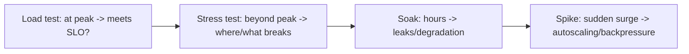

# Capacity Planning and Load Testing

> Prerequisites: [00-foundations/back-of-the-envelope-estimation](../00-foundations/back-of-the-envelope-estimation.md), [02-compute-and-architecture/autoscaling-and-capacity-planning](../02-compute-and-architecture/autoscaling-and-capacity-planning.md)
> Related: [scaling-bottleneck-diagnosis](../11-estimation-and-bottleneck-analysis/scaling-bottleneck-diagnosis.md)

Estimation (section 00) tells you what you *think* you need; load testing *verifies* it under real traffic and finds the actual bottleneck. Capacity planning combines both to provision and prepare for peaks.

---

## A. Problem and motivation

Estimates are approximations; real systems have surprises (a slow query, a connection limit, a GC cliff) that only appear under load. Load testing drives realistic traffic to find the *actual* breaking point and bottleneck before users do. Capacity planning uses estimates + load-test results to provision enough headroom and prepare for known peaks (launches, sales). Without load testing, you discover your limits during a real traffic spike — the worst time.

---

## B. Capacity planning (estimate → provision)

From [estimation](../00-foundations/back-of-the-envelope-estimation.md) and [autoscaling-and-capacity-planning](../02-compute-and-architecture/autoscaling-and-capacity-planning.md):
- Compute needed instances/connections/workers from peak RPS and per-unit capacity, with **headroom** (N+1/N+2 for failures, buffer for spikes and scale-out lag).
- The system's capacity = the **minimum across all tiers** (the bottleneck) — provisioning the app tier for 10K RPS is useless if the DB caps at 2K.
- **Pre-scale for known events** (launches, sales) rather than relying on reactive autoscaling (which lags).

Capacity planning is iterative: estimate → load test → adjust → re-test.

---

## C. Types of load testing

| Type | Goal | What it reveals |
|---|---|---|
| **Load test** | Sustain expected peak | Does it meet SLOs at target load? |
| **Stress test** | Push past the limit | The actual breaking point + what fails first (the bottleneck) |
| **Soak/endurance test** | Sustained load over hours | Slow leaks (memory, connections), degradation over time |
| **Spike test** | Sudden surge | Behavior under flash traffic; autoscaling response |

**Stress testing is especially valuable** — it reveals the *first* bottleneck (DB connections? CPU? a lock?) so you know what to fix and where the real ceiling is, not the estimated one.

---

## D. Doing it realistically

- **Realistic traffic:** mirror production patterns (read/write mix, payload sizes, hot keys) — a uniform synthetic test can miss real hot spots.
- **Test the whole stack** including the DB, cache, and downstream dependencies (or realistic stubs) — the bottleneck is often not the app.
- **Watch all tiers' metrics** during the test (the observability pillars) to see what saturates first.
- **Test in a prod-like environment** (same instance types, config) — results from a tiny staging box don't transfer.
- Some teams do **production load testing** (carefully, with safeguards) because only prod has the real data/dependencies.

---

## E. Example — DMS launch prep

Before onboarding a large customer (expected 3× traffic), the DMS team: estimates the new peak RPS/storage; runs a **load test** at the target peak (meets SLOs?); a **stress test** past it (finds the first bottleneck — DB connections saturate at ~2.5× → add a connection pooler + replica); a **soak test** overnight (catches a slow connection leak); and a **spike test** (verifies autoscaling + backpressure handle a sudden surge). They pre-scale for the onboarding day. Result: the real bottleneck was found and fixed in a test, not during the customer's first day.

---

## F. Trade-offs / failure scenarios

| Issue | Effect | Fix |
|---|---|---|
| No load testing | Discover limits during real peak (outage) | Load + stress test before peaks |
| Unrealistic test | Misses real hot spots/bottlenecks | Mirror prod traffic patterns + full stack |
| Testing on a tiny env | Results don't transfer | Prod-like environment |
| Estimate-only (no verification) | Over/under-provision; surprise bottleneck | Verify estimates with tests |
| No soak test | Slow leaks surface in prod | Endurance testing |

---

## G. Scaling implications

As you grow, capacity planning + load testing become a routine part of launch/scale readiness — you verify each scaling step (new replica, new shard, higher autoscale max) holds under realistic load before relying on it. Stress testing continually re-discovers the *current* bottleneck as the system evolves (the bottleneck moves — app → DB → cache → queue, matching the scaling journey). This feeds the diagnosis playbook (see [scaling-bottleneck-diagnosis](../11-estimation-and-bottleneck-analysis/scaling-bottleneck-diagnosis.md)) and prevents the "it worked in dev, died at scale" failure.

---

## H. Interview preparation

**Basic**
- Q: Why load test if you've estimated? → *A: Estimates are approximations; load testing finds the *actual* breaking point and bottleneck under realistic traffic before users do.*

**Intermediate**
- Q: Load vs stress vs soak vs spike test? → *A: Load = at expected peak (meets SLO?); stress = beyond the limit (where/what breaks first — the bottleneck); soak = sustained hours (leaks/degradation); spike = sudden surge (autoscaling/backpressure).*
- Q: What makes a load test realistic? → *A: Production-like traffic mix (read/write, payloads, hot keys), the full stack (DB/cache/dependencies), a prod-like environment, and watching all tiers' metrics for what saturates first.*

**SDE-2 / scenario**
- Q: "A large customer is onboarding (3× traffic). How do you prepare?" → *A: Re-estimate peak; load test at target (SLO met?); stress test past it to find the first bottleneck (likely DB connections) and fix it; soak test for leaks; spike test for autoscaling; pre-scale for the day. Find and fix the real bottleneck in a test, not in prod.*
- Q: "It worked in dev but fell over in production." → *A: Dev didn't exercise the real bottleneck (data volume, connection limits, hot keys). I'd stress test in a prod-like environment with realistic traffic to find the actual ceiling and the component that breaks first.*

**Common wrong answers:** estimate-only (no verification); unrealistic/tiny-env tests; not testing the DB/dependencies; no stress test (don't know the real limit); relying on reactive autoscaling for a known spike.

---

## I. Hands-on exercise

Plan the capacity + load-testing strategy for the DMS before a 3× traffic launch. Specify the estimate, the four test types and what each would reveal, how you'd make the traffic realistic, the metrics you'd watch, and how you'd use the stress-test result to decide what to scale.

---

## J. Revision summary

**Key takeaways**
- Capacity planning = estimate → provision with headroom (bottleneck tier, N+1/N+2, pre-scale known peaks); verify with load testing.
- Load (at peak), stress (past limit → find bottleneck), soak (leaks), spike (autoscaling) tests.
- Make it realistic: prod-like traffic + full stack + prod-like env + watch all tiers.
- Stress testing reveals the *current* real bottleneck (which moves as you scale); prevents "worked in dev, died at scale."

**Rapid-fire**
1. Which test finds the breaking point? → Stress test.
2. Which finds slow leaks? → Soak/endurance.
3. System capacity = ? → Minimum across tiers (the bottleneck).
4. Known spike — rely on autoscaling? → No, pre-scale.
5. Why realistic traffic? → To hit real hot spots/bottlenecks.

**Next:** [deployment-strategies](./deployment-strategies.md)
