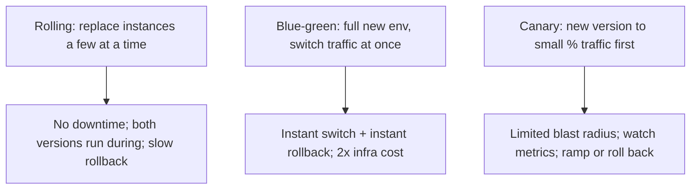

# Deployment Strategies

> Prerequisites: [02-compute-and-architecture/reverse-proxy-and-load-balancers](../02-compute-and-architecture/reverse-proxy-and-load-balancers.md), [07-reliability-and-resilience/graceful-shutdown-and-draining](../07-reliability-and-resilience/graceful-shutdown-and-draining.md)
> Related: [03-databases/schema-migrations-and-data-evolution](../03-databases-and-data-modeling/schema-migrations-and-data-evolution.md)

How you ship new versions determines whether deploys are invisible or risky. Rolling, blue-green, and canary each trade speed, risk, and cost. The common thread: deploy without downtime and with a fast rollback.

---

## A. Problem and motivation

Deploying new code is one of the riskiest routine operations — most incidents follow a deploy (see [incident-response](./incident-response-and-root-cause-analysis.md)). A bad deployment strategy means downtime during every release (users see errors) and slow/painful rollback when something breaks. Good strategies make deploys zero-downtime and give you a fast, safe way to roll back — turning deploys from scary events into routine ones.

---

## B. The three strategies

| Strategy | How | Pros | Cons |
|---|---|---|---|
| **Rolling** | Replace instances in batches (old → new gradually) | No downtime, no extra infra | Both versions run simultaneously (compat needed); rollback = roll forward slowly |
| **Blue-green** | Stand up a full new ("green") env, switch all traffic from "blue" at once | Instant cutover + instant rollback (switch back) | ~2× infra during the switch; big-bang (all traffic at once) |
| **Canary** | Route a small % to the new version, watch metrics, then ramp | Smallest blast radius; catch problems on 1% not 100% | Slower; needs good metrics + automation |

**Canary is the safest** for risky changes — a bad version affects 1% of traffic, you detect it via metrics (error rate/latency on the canary), and roll back before it hits everyone. Rolling is the common default for routine changes; blue-green when you want instant cutover/rollback and can afford the double infra.

---

## C. The requirements that make these work

All three depend on earlier building blocks:
- **Statelessness** so instances are interchangeable (see [stateless-vs-stateful-services](../02-compute-and-architecture/stateless-vs-stateful-services.md)).
- **Health/readiness checks + connection draining + graceful shutdown** so instances are added/removed without dropping requests (see [graceful-shutdown-and-draining](../07-reliability-and-resilience/graceful-shutdown-and-draining.md), [reverse-proxy-and-load-balancers](../02-compute-and-architecture/reverse-proxy-and-load-balancers.md)).
- **Backward-compatible schema changes** so old and new code can run simultaneously (rolling/canary have both versions live) — the expand/migrate/contract pattern (see [schema-migrations-and-data-evolution](../03-databases-and-data-modeling/schema-migrations-and-data-evolution.md)). **This is the common deploy footgun:** a breaking schema change + rolling deploy breaks the old instances still running.
- **Fast rollback** — the single most important safety property. Whatever strategy, you must be able to revert quickly (and the revert must be compatible with the DB — another reason for backward-compatible migrations).

---

## D. Feature flags (decoupling deploy from release)

A powerful complement: **feature flags** separate *deploying* code from *releasing* a feature. Ship the code dark (flag off), then turn it on gradually (a form of canary at the feature level) or instantly off (kill switch) without a redeploy. This lets you deploy frequently and low-risk, and roll back a *feature* instantly (flip the flag) without rolling back the whole deploy. See [feature-flag service in the final assessment](../INTERVIEW-CHECKLIST.md).

---

## E. Example — DMS

- **Routine changes:** rolling deploy across instances (readiness-gated, drained — zero downtime), with backward-compatible schema changes (expand/migrate/contract) so old + new coexist.
- **Risky change (new OCR engine):** canary — route 5% of uploads to the new version, watch error rate + processing latency on the canary; if healthy, ramp to 100%; if not, roll back (affecting only 5%). Behind a feature flag so it can be killed instantly.
- **Rollback:** always possible and fast (previous image + compatible schema).

---

## F. Trade-offs / failure scenarios

| Strategy | When | Risk if misused |
|---|---|---|
| Rolling | Routine, low-risk changes | Breaking schema change breaks old instances mid-deploy |
| Blue-green | Need instant cutover/rollback, can afford 2× infra | Big-bang: a bad version hits 100% at switch |
| Canary | Risky changes, good metrics | Needs automation + metrics; slower |

Failure modes: **breaking schema change + rolling/canary** (old instances break — use backward-compatible migrations); no fast rollback (stuck with a bad version); big-bang deploy with no canary (bad version hits everyone); contract (drop old column) too early (can't roll back).

---

## G. Scaling implications

As deploy frequency rises (continuous deployment at scale), safe deployment strategies become essential — you can't afford downtime or risky releases many times a day. Canary + feature flags + fast rollback are how large teams deploy constantly with low risk. These depend on statelessness, health checks/draining, and backward-compatible migrations (all earlier topics), so deployment safety is really the payoff of those investments. Automated canary analysis (promote/rollback based on metrics) scales this across many services.

---

## H. Interview preparation

**Basic**
- Q: Rolling vs blue-green vs canary? → *A: Rolling replaces instances in batches (no downtime, no extra infra); blue-green switches all traffic to a full new env at once (instant cutover/rollback, 2× infra); canary sends a small % to the new version first (smallest blast radius, needs metrics).*

**Intermediate**
- Q: Why must schema changes be backward-compatible for rolling/canary deploys? → *A: Both old and new code run simultaneously; a breaking change (rename/drop) breaks the old instances still serving. Use expand/migrate/contract.*
- Q: What's the most important deploy safety property? → *A: Fast rollback — you must be able to revert quickly to a known-good version, with a schema that's compatible with that version.*

**SDE-2 / scenario**
- Q: "How do you deploy a risky change safely?" → *A: Canary — route a small % of traffic to the new version, watch error rate/latency, ramp if healthy, roll back if not (affecting only the canary %). Keep schema changes backward-compatible and put the change behind a feature flag for an instant kill switch.*
- Q: "A deploy caused a brief outage." → *A: Likely abrupt instance replacement (no draining) and/or a breaking schema change hitting old instances. Fix: readiness-gated rolling deploy with graceful shutdown/draining, backward-compatible migrations, and canary for risky changes.*

**Common wrong answers:** big-bang deploy with downtime; breaking schema change with rolling deploy; no rollback plan; dropping old columns before the new code is proven.

---

## I. Hands-on exercise

Choose a deployment strategy for (a) a routine bug fix, (b) a risky new recommendation algorithm, (c) a change requiring a new DB column. For each, specify the strategy, the schema-change approach, how you'd roll back, and whether a feature flag helps.

---

## J. Revision summary

**Key takeaways**
- Rolling (batches, no downtime/extra infra), blue-green (instant switch/rollback, 2× infra), canary (small % first, smallest blast radius).
- Canary is safest for risky changes; rolling is the routine default.
- All depend on statelessness, health checks/draining, and **backward-compatible migrations** (old+new coexist); fast rollback is the key safety property.
- Feature flags decouple deploy from release (dark launch, gradual rollout, instant kill switch).

**Rapid-fire**
1. Safest strategy for a risky change? → Canary.
2. Why backward-compatible migrations? → Old + new code run together.
3. Most important safety property? → Fast rollback.
4. Blue-green's cost? → ~2× infra during the switch.
5. Feature flags separate? → Deploy from release.

**Next:** [operational-runbooks](./operational-runbooks.md)
