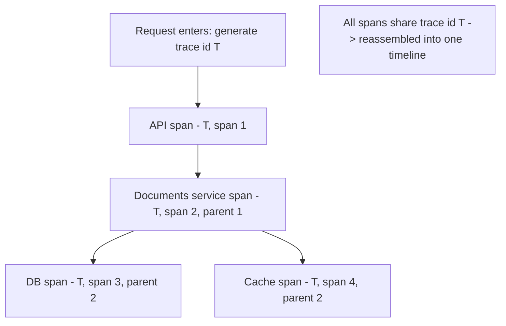

# Distributed Tracing

> Prerequisites: [logs-metrics-and-traces](./logs-metrics-and-traces.md)
> Related: [06-distributed-systems/partial-failures-and-timeouts](../06-distributed-systems/partial-failures-and-timeouts.md)

Tracing follows a single request across all the services it touches, making the invisible visible in a distributed system. It's the pillar that answers "where did the time/failure go?" and is essential once you have more than one service.

---

## A. Problem and motivation

In a monolith, a slow request's cause is in one process — a profiler finds it. In a distributed system, one request fans out across many services, each with its own logs; a slow or failing request's cause could be in any of them, and you can't see the whole path from any single service's logs. Distributed tracing stitches the request's journey back together so you can see which service/span caused the latency or error.

---

## B. How tracing works — trace id, spans, context propagation

- **Trace id:** a unique id generated at the entry point for the whole request.
- **Spans:** each unit of work (an API handler, a service call, a DB query) is a span with start/end times, a parent span, and the shared trace id. Spans nest to form a tree.
- **Context propagation:** the trace id (and span context) is passed along every call (via HTTP headers, message metadata) so downstream services attach their spans to the same trace. **This propagation is the crux** — if a service doesn't forward the context, the trace breaks there.
- Spans are collected centrally and reassembled into a **timeline** showing exactly where time was spent and where errors occurred.

OpenTelemetry (OTel) standardizes trace generation and propagation across languages/frameworks.

---

## C. What tracing reveals

- **Latency breakdown:** which span dominates the request time (the slow DB query, the slow downstream service). Directly addresses tail-latency debugging (see [latency](../00-foundations/latency-throughput-and-capacity.md)).
- **The failing hop:** which service in a chain returned the error.
- **Fan-out and N+1:** a span tree showing 100 identical DB spans reveals an N+1 (see [indexing-and-query-optimization](../03-databases-and-data-modeling/indexing-and-query-optimization.md)).
- **Dependency map:** aggregated traces show the real service dependency graph and critical paths.

---

## D. Sampling (the cost trade-off)

Tracing *every* request is expensive (storage + overhead). So traces are **sampled**:
- **Head-based sampling:** decide at the start whether to trace this request (e.g., 1%). Simple, but may miss the rare slow/error requests you care about.
- **Tail-based sampling:** buffer and decide after seeing the outcome — keep all slow/error traces, sample the fast/successful ones. Catches the interesting traces but needs buffering infrastructure.

Tail-based is better for catching problems but costlier to run. The trade-off: sample rate vs cost vs catching rare issues.

---

## E. Example — DMS

A user reports slow uploads intermittently. Tracing (tail-based, keeping slow traces) shows that for the slow ones, the `virus-scan` span takes 3s while normally 100ms — localizing the problem to the scan service's dependency, not the DMS app or DB. Without tracing, you'd see "uploads sometimes slow" in metrics but couldn't tell *which* of the 5 services on the path was responsible. The trace id also links to the logs for those specific requests (see [logs-metrics-and-traces](./logs-metrics-and-traces.md)).

---

## F. Trade-offs / failure scenarios

| Aspect | Benefit | Cost/risk |
|---|---|---|
| Tracing | Cross-service visibility (where) | Overhead + storage → sampling |
| Head sampling | Cheap, simple | Misses rare slow/error traces |
| Tail sampling | Keeps interesting traces | Buffering infra, more complex |

Failure modes: **broken propagation** (a service doesn't forward the trace context → trace stops there, blind spot); no tracing in a microservices system (can't localize cross-service problems); head-sampling missing the rare errors you need; over-tracing cost.

---

## G. Scaling implications

Tracing becomes essential exactly as you scale into microservices — the more services a request crosses, the more you need to see the whole path (and the more tail-latency amplification matters, see [latency](../00-foundations/latency-throughput-and-capacity.md)). It's a strong argument that microservices require investment in observability (part of their operational cost — see [monolith-vs-microservices](../02-compute-and-architecture/monolith-vs-modular-monolith-vs-microservices.md)). Sampling strategy (tail-based for catching problems) and consistent context propagation (via a shared library/mesh) are the scaling concerns. Combined with metrics and logs, tracing completes the diagnose-from-signals capability.

---

## H. Interview preparation

**Basic**
- Q: What does distributed tracing do? → *A: Follows one request across all services it touches, via a shared trace id and nested spans, so you can see where time was spent and which hop failed.*

**Intermediate**
- Q: How does a trace stay connected across services? → *A: Context propagation — the trace id/span context is passed in every call (HTTP headers, message metadata); each service attaches its spans to the same trace. If a service doesn't propagate it, the trace breaks there.*
- Q: Why sample traces, and head vs tail? → *A: Tracing everything is expensive. Head sampling decides upfront (cheap, misses rare slow/error traces); tail sampling decides after the outcome (keeps slow/error traces, needs buffering).*

**SDE-2 / scenario**
- Q: "A request is sometimes slow but you don't know which of 6 services is at fault." → *A: Distributed tracing with tail-based sampling (keep slow traces): the trace timeline shows which span dominates, localizing the slow service; the trace id links to that request's logs for the exact error. Metrics alone can't localize across services.*

**Common wrong answers:** no tracing in microservices; broken context propagation; head sampling that misses rare errors; thinking logs alone suffice for cross-service debugging.

---

## I. Hands-on exercise

For a request that flows API → documents → (DB + cache + virus-scan service), describe the trace: the trace id, the spans and their parent relationships, how context propagates, and how a tail-based sample would help you catch an intermittent slow virus-scan. Note where a broken propagation would blind you.

---

## J. Revision summary

**Key takeaways**
- Tracing follows one request across services via a shared trace id + nested spans; answers "where did time/failure go?"
- Context propagation (forwarding the trace id) is essential; a non-propagating service breaks the trace.
- Sample traces (head = cheap/misses rare; tail = keeps slow/error traces, costlier) to control cost.
- Essential for microservices; part of their operational cost; completes metrics+logs for diagnosis.

**Rapid-fire**
1. What connects spans across services? → The shared trace id (context propagation).
2. Tracing answers which question? → Where (which span/service).
3. Tail vs head sampling benefit? → Tail keeps the slow/error traces you care about.
4. Trace breaks when? → A service doesn't propagate the context.
5. Standard for emitting traces? → OpenTelemetry.

**Next:** [alerting-and-dashboards](./alerting-and-dashboards.md)
