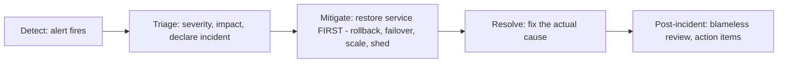

# Incident Response and Root Cause Analysis

> Prerequisites: [logs-metrics-and-traces](./logs-metrics-and-traces.md), [alerting-and-dashboards](./alerting-and-dashboards.md)
> Related: [11-estimation-and-bottleneck-analysis/scaling-bottleneck-diagnosis](../11-estimation-and-bottleneck-analysis/scaling-bottleneck-diagnosis.md) · [operational-runbooks](./operational-runbooks.md)

Incident response is how you handle things going wrong in production — detect, mitigate, resolve, then learn. The master prompt specifically wants the skill of diagnosing the failing component from signals, and blameless post-incident learning.

---

## A. Problem and motivation

Incidents happen (that's why error budgets exist — see [slis-slos-and-slas](../07-reliability-and-resilience/slis-slos-and-slas.md)). What separates a mature team is *how* they respond: fast detection, mitigation that restores service quickly (low MTTR), accurate diagnosis from signals (not guessing), and a blameless process that prevents recurrence. Poor incident response means long outages, repeated incidents, and burned-out engineers chasing symptoms.

---

## B. The incident lifecycle

- **Detect:** a symptom alert fires (see [alerting-and-dashboards](./alerting-and-dashboards.md)).
- **Triage:** assess severity/impact, assign an incident commander for big ones, communicate status.
- **Mitigate FIRST:** restore service before fully understanding the cause. **Mitigation ≠ root cause.** Roll back the recent deploy, fail over, scale the bottleneck, shed load, flip a feature flag — stop the bleeding. Users care that it works again, not why yet.
- **Resolve:** once stable, find and fix the actual root cause.
- **Post-incident review:** blameless analysis + action items.

**The key discipline: mitigate before diagnosing.** A common mistake is debugging root cause while users suffer; restore service first (rollback/failover), then investigate at leisure.

---

## C. Diagnosing from signals (not guessing)

Use the three pillars (see [logs-metrics-and-traces](./logs-metrics-and-traces.md)) to localize the failing component — this is the master-prompt skill of "identify the failing component from metrics and traces rather than randomly increasing server capacity." The playbook (full version in [scaling-bottleneck-diagnosis](../11-estimation-and-bottleneck-analysis/scaling-bottleneck-diagnosis.md)):

| Symptom | Likely signal to check | Common cause |
|---|---|---|
| p99 latency up | Traces (slow span), DB connection count | DB contention, slow dependency, GC |
| Error rate up | Logs (error type), which dependency | A dependency down, bad deploy |
| DB connections climbing | Little's Law (latency × RPS), slow queries | Slow queries, pool too small, downstream slow |
| Queue backlog growing | Consumer lag metric | Consumers slow/crashed; producer spike |
| Redis latency high | Hot key, big command | Hot key, O(N) command |

Always correlate with **recent changes** (deploys, config, traffic) — most incidents follow a change. Check "what changed?" first.

---

## D. Blameless post-incident review (postmortem)

After resolution, a **blameless** review: what happened, timeline, root cause, impact, and **action items** to prevent recurrence. "Blameless" means focusing on *systemic* causes (missing guardrail, inadequate test, bad alert) not blaming an individual — because blame hides information (people stop being honest) and the real fix is systemic. Track action items to completion. The goal: each incident makes the system more resilient.

**MTTR focus:** post-incident reviews often target *detection* and *mitigation* speed (lower MTTR) as much as prevention — fast recovery is a huge availability lever (see [availability-and-reliability](../07-reliability-and-resilience/availability-and-reliability.md)).

---

## E. Example — DMS incident

Alert: upload error rate > 5%. Triage: declare incident, SEV2. Check "what changed?" — a deploy went out 10 min ago. **Mitigate:** roll back the deploy → errors drop (service restored). *Then* diagnose: traces + logs show the deploy introduced a query missing an index, causing DB timeouts under load (see [indexing-and-query-optimization](../03-databases-and-data-modeling/indexing-and-query-optimization.md)). **Resolve:** add the index, re-deploy. **Postmortem (blameless):** root cause = no query-plan check in CI; action items = add an index-usage check to CI and a canary deploy stage. Nobody is blamed; the *process* gains a guardrail.

---

## F. Trade-offs / failure scenarios

Failure modes of incident response:
1. **Diagnosing before mitigating** → prolonged outage while debugging. Fix: mitigate first (rollback/failover), diagnose after.
2. **Guessing / "add more servers"** → wasted effort, cause persists. Fix: diagnose from metrics/traces/logs; correlate with recent changes.
3. **Blameful culture** → people hide information, same incidents recur. Fix: blameless postmortems focused on systemic fixes.
4. **No action-item follow-through** → repeat incidents. Fix: track action items to completion.

---

## G. Scaling implications

At scale, incident response is a defined practice (on-call rotations, incident commanders, runbooks, status pages) because incidents are frequent and impactful. Fast, signal-driven diagnosis (enabled by observability) keeps MTTR low — critical for availability at scale. Blameless postmortems with tracked action items create a feedback loop that hardens the system over time, turning the inevitable incidents into resilience gains. This closes the operational loop: observe → alert → respond → learn → prevent.

---

## H. Interview preparation

**Basic**
- Q: What's the first priority in an incident? → *A: Mitigate — restore service (rollback, failover, scale, shed) before fully diagnosing. Users care that it works again; find the root cause after.*

**Intermediate**
- Q: How do you diagnose which component is failing? → *A: From signals — metrics (what/how much), traces (where, which span), logs (why) — and correlate with recent changes ('what changed?'), rather than guessing or adding servers randomly.*
- Q: What's a blameless postmortem and why? → *A: A review focused on systemic causes and prevention, not blaming individuals — because blame hides information and the real fixes are systemic (guardrails, tests, alerts). Action items are tracked to completion.*

**SDE-2 / scenario**
- Q: "Error rate spiked 10 minutes after a deploy. Walk me through it." → *A: Triage/declare; 'what changed?' → the deploy; mitigate by rolling back (restore service first); then diagnose with traces/logs (e.g., a missing-index query timing out the DB); resolve (add index, re-deploy); blameless postmortem with a CI guardrail as the action item.*
- Q: "p99 is high and DB connections are maxed — what do you do?" → *A: Mitigate (scale the bottleneck / shed load / roll back a recent change); diagnose via Little's Law + slow-query logs + traces (likely slow queries or a downstream slow dependency inflating in-flight requests); fix the actual cause, not add app servers blindly.*

**Common wrong answers:** debugging before mitigating; "add servers" without diagnosis; blameful culture; not tracking action items; ignoring "what changed?"

---

## I. Hands-on exercise

Write the incident-response steps for "the notification queue backlog is growing and users aren't getting notifications." Include triage, immediate mitigation, how you'd diagnose from signals, and the blameless-postmortem action items you'd expect. Note where you mitigate before diagnosing.

---

## J. Revision summary

**Key takeaways**
- Lifecycle: detect → triage → **mitigate first** (restore service) → resolve (root cause) → blameless postmortem.
- Mitigate before diagnosing (rollback/failover/scale/shed); users care it works again.
- Diagnose from signals (metrics→traces→logs) + "what changed?" — not guessing or adding servers.
- Blameless postmortems with tracked action items turn incidents into resilience; focus on MTTR.

**Rapid-fire**
1. First priority in an incident? → Mitigate (restore service).
2. Diagnose how? → From metrics/traces/logs + "what changed?"
3. Mitigation = root cause? → No (restore first, fix cause after).
4. Why blameless postmortems? → Blame hides info; fixes are systemic.
5. Fast recovery lowers? → MTTR (→ higher availability).

**Next:** [capacity-planning-and-load-testing](./capacity-planning-and-load-testing.md)
