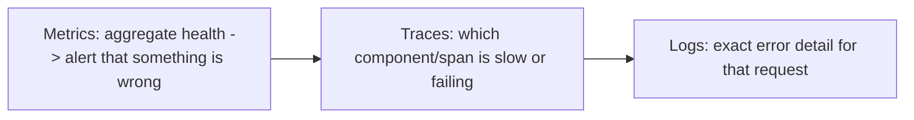

# Logs, Metrics, and Traces — The Three Pillars

> Prerequisites: [00-foundations/latency-throughput-and-capacity](../00-foundations/latency-throughput-and-capacity.md)
> Related: [distributed-tracing](./distributed-tracing.md) · [alerting-and-dashboards](./alerting-and-dashboards.md) · [incident-response-and-root-cause-analysis](./incident-response-and-root-cause-analysis.md)

Observability is how you understand a running system — and the difference between diagnosing a problem from signals vs randomly restarting things. The three pillars (logs, metrics, traces) each answer a different question.

---

## A. Problem and motivation

You can't fix what you can't see. In a distributed system, a problem (elevated latency, errors, a backlog) manifests across many components, and without observability you're blind — guessing, adding capacity randomly, unable to find the root cause. The master prompt's recurring theme ("identify the failing component from metrics and traces rather than randomly increasing server capacity") depends entirely on observability. The three pillars give you complementary views.

---

## B. The three pillars (each answers a different question)

| Pillar | Answers | What it is | Example |
|---|---|---|---|
| **Metrics** | "Is something wrong, and how much?" (aggregate) | Numeric time-series (counters, gauges, histograms) | p99 latency, error rate, RPS, queue depth, CPU |
| **Logs** | "What exactly happened?" (specific events) | Timestamped event records | "request X failed: timeout calling payment" |
| **Traces** | "Where did the time/failure go across services?" | The path of one request through all services | span timings across API→service→DB |

The typical debugging flow: **metrics** alert you (p99 spiked), **traces** localize it (the payment-service span is slow), **logs** explain it (specific error). They work together — metrics for *what/how much*, traces for *where*, logs for *why*.

---

## C. Each pillar in practice

**Metrics** — cheap, aggregate, great for alerting and dashboards. Use the **RED** method (Rate, Errors, Duration) for request-driven services and **USE** (Utilization, Saturation, Errors) for resources. Store in a TSDB (see [time-series-and-search-databases](../03-databases-and-data-modeling/time-series-and-search-databases.md)); watch cardinality (too many label combinations blow it up). SLO on p99, not average (see [latency](../00-foundations/latency-throughput-and-capacity.md)).

**Logs** — detailed but expensive at volume. Use **structured logging** (JSON key-value, not free text) so they're queryable. Include a **correlation/request id** so you can find all logs for one request across services. Set levels (don't log everything at scale — cost + noise). Never log secrets/PII (see [secrets-and-key-management](../08-security/secrets-and-key-management.md)). Shipped to a log aggregation system (search index — see [time-series-and-search-databases](../03-databases-and-data-modeling/time-series-and-search-databases.md)).

**Traces** — follow one request across services via a propagated **trace id** (see [distributed-tracing](./distributed-tracing.md)). Essential in microservices where a request spans many hops. Usually **sampled** (trace a % of requests) because tracing everything is expensive.

**OpenTelemetry (OTel)** is the standard, vendor-neutral way to emit all three.

---

## D. Example — DMS diagnosing a latency spike

An alert fires: **metric** shows DMS upload p99 jumped from 200ms to 2s. Open a **trace** for a slow upload: it shows the OCR-enqueue step is fine, but the metadata-DB write span is 1.8s. **Logs** for that request (found via the correlation id) show "lock wait timeout." Root cause: DB lock contention from a long-running migration. You fix the migration — not "add more app servers" (which wouldn't help a DB-lock problem). This is the metrics→traces→logs flow turning a vague "it's slow" into a precise root cause. See [scaling-bottleneck-diagnosis](../11-estimation-and-bottleneck-analysis/scaling-bottleneck-diagnosis.md).

---

## E. Trade-offs / failure scenarios

| Pillar | Strength | Cost/risk |
|---|---|---|
| Metrics | Cheap, aggregate, alertable | No per-request detail; cardinality blowup |
| Logs | Full detail | Expensive at volume; noisy; PII/secret risk |
| Traces | Cross-service path | Overhead → sampling; needs propagation |

Failure modes: **metrics-only** (know something's wrong, can't localize); **logs-only** (drowning in data, no aggregate view, costly); **no correlation id** (can't tie logs/traces to one request across services); averages instead of percentiles (miss tail pain); logging PII/secrets; cardinality explosion in metrics.

---

## F. Scaling implications

Observability is non-optional at scale — with many services and high traffic, you *cannot* diagnose by inspection; you need the three pillars to localize problems fast (low MTTR → higher availability, see [availability-and-reliability](../07-reliability-and-resilience/availability-and-reliability.md)). Cost becomes a real concern at scale: metrics are cheap (keep broad), logs are expensive (sample/level/retain carefully), traces are sampled. Correlation ids tie the pillars together. This is the foundation for alerting, incident response, and bottleneck diagnosis (the rest of this section).

---

## G. Interview preparation

**Basic**
- Q: What are the three pillars of observability? → *A: Metrics (aggregate numeric health — alert that something's wrong), logs (detailed event records — what/why), traces (one request's path across services — where).*

**Intermediate**
- Q: How do the pillars work together to debug? → *A: Metrics alert (p99 spiked), traces localize (which span/service), logs explain (the exact error for that request, found via a correlation id).*
- Q: Why structured logging + correlation ids? → *A: Structured logs are queryable; a correlation/request id ties all logs and traces for one request across services together, essential in distributed systems.*

**SDE-2 / scenario**
- Q: "p99 latency doubled. How do you find the cause?" → *A: Metrics confirm the spike and which endpoint; a trace of a slow request shows which span (service/DB/cache) is slow; logs for that request (via correlation id) give the exact error. Then fix the actual component — not randomly add servers.*
- Q: "Your logging bill exploded." → *A: Over-logging at scale. Reduce log levels, sample high-volume logs, keep metrics (cheap) for aggregate health and traces (sampled) for paths; retain logs with a policy. Use metrics for alerting, not logs.*

**Common wrong answers:** logs-only (no aggregate/alerting view, costly); no correlation id; alerting on averages; logging secrets/PII; "add servers" without diagnosing.

---

## H. Hands-on exercise

Define the observability for the DMS upload path: the key metrics (RED), what you'd log (structured, with correlation id, no PII), where traces help, and the step-by-step flow you'd follow when an alert says "upload p99 is high." Identify which pillar answers each debugging question.

---

## I. Revision summary

**Key takeaways**
- Three pillars: metrics (aggregate, alertable, what/how-much), logs (detailed, why), traces (cross-service, where).
- Debugging flow: metrics alert → traces localize → logs explain (tied by a correlation id).
- Metrics cheap (keep broad, watch cardinality); logs expensive (structured, leveled, sampled, no PII); traces sampled.
- Observability enables diagnosing from signals (low MTTR) instead of guessing/adding servers.

**Rapid-fire**
1. Which pillar alerts you something's wrong? → Metrics.
2. Which localizes *where* across services? → Traces.
3. Which gives the exact error detail? → Logs.
4. What ties logs/traces for one request together? → Correlation/request id.
5. RED method stands for? → Rate, Errors, Duration.

**Next:** [distributed-tracing](./distributed-tracing.md)
