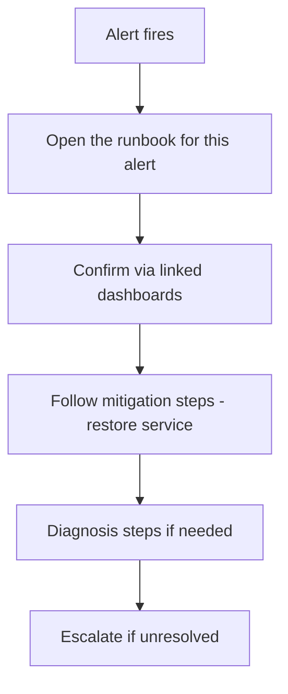

# Operational Runbooks

> Prerequisites: [incident-response-and-root-cause-analysis](./incident-response-and-root-cause-analysis.md), [alerting-and-dashboards](./alerting-and-dashboards.md)
> Related: [07-reliability-and-resilience/disaster-recovery](../07-reliability-and-resilience/disaster-recovery.md)

A runbook is a documented procedure for a known operational task or incident — so the response is fast, consistent, and doesn't depend on one expert's memory. Short topic, but a mark of operational maturity.

---

## A. Problem and motivation

When an alert fires at 3am, the on-call engineer (who may not have built the system) needs to know *what to do* — fast. If the knowledge lives only in one senior engineer's head, incidents are slow, inconsistent, and risky (that person is on vacation). Runbooks capture the "when X happens, do Y" procedures so anyone on-call can respond effectively and consistently. They turn tribal knowledge into reliable operations.

---

## B. What a good runbook contains

For a given alert or operational task:
- **What this alert/task means** (the symptom, the impact).
- **How to confirm** (which dashboards/metrics/queries to check).
- **Mitigation steps** (restore service first — rollback, failover, scale, shed), in order.
- **Diagnosis steps** (how to find the cause from signals).
- **Escalation** (when and whom to escalate to).
- **Links** to dashboards, logs, related runbooks.

Every paging alert should link to its runbook (see [alerting-and-dashboards](./alerting-and-dashboards.md)) — an alert with no runbook leaves on-call guessing.

---

## C. Keeping runbooks useful

- **Actionable, not theoretical:** concrete commands/steps, not "investigate the issue."
- **Kept current:** update after incidents (postmortem action items often include runbook updates — see [incident-response](./incident-response-and-root-cause-analysis.md)); a stale runbook is dangerous (wrong steps).
- **Tested:** periodically exercise runbooks (game days, DR drills — see [disaster-recovery](../07-reliability-and-resilience/disaster-recovery.md)) so they actually work when needed.
- **Trend toward automation:** a runbook step done the same way every time is a candidate for automation (a script, an auto-remediation). The best "runbook" is one the system executes itself; runbooks are the stepping stone to automation.

---

## D. Example — DMS runbooks

- **"Notification backlog growing" runbook:** confirm via the consumer-lag dashboard → mitigate (autoscale workers up to partition count; shed low-priority notifications) → diagnose (consumer errors? downstream provider down?) → escalate to the owning team if a dependency outage. Links to the queue dashboard and the provider's status page.
- **"DB primary failover" runbook:** how to confirm the primary is down, how to trigger/verify the (ideally automated) failover, how to check for split-brain, data-loss (RPO) expectations, and reconnection steps.
- **"Redis down" runbook:** confirm, verify the degradation path kicked in (DB fallback with concurrency limiter — see [redis-design-and-failure-modes](../04-caching/redis-design-and-failure-modes.md)), fail over to a replica, warm hot keys before resuming full cache reliance.

Each converts a potentially scary incident into a followable procedure.

---

## E. Trade-offs / failure scenarios

| Issue | Effect | Fix |
|---|---|---|
| No runbooks | Slow, inconsistent, expert-dependent response | Document procedures for known alerts/tasks |
| Stale runbook | Wrong steps during an incident | Update after incidents; test periodically |
| Vague runbook ("investigate") | On-call still stuck | Concrete, actionable steps |
| Everything manual | Repetitive toil, error-prone | Automate repeatable steps |

---

## F. Scaling implications

As the system and on-call rotation grow, runbooks are what let *anyone* on-call respond to *any* alert without being the system's author — essential for scaling operations across teams and shifts. They lower MTTR (faster, surer response) and reduce reliance on heroes. The maturity trajectory: tribal knowledge → runbooks → partial automation → full auto-remediation for well-understood issues. Runbooks also feed DR readiness (tested failover procedures) and incident response (the on-call's first reference).

---

## G. Interview preparation

**Basic**
- Q: What's a runbook? → *A: A documented, actionable procedure for a known alert/task — confirm, mitigate, diagnose, escalate — so on-call can respond fast and consistently without being the system's author.*

**Intermediate**
- Q: What should every paging alert have? → *A: A linked runbook with concrete steps (confirm via dashboards, mitigate first, diagnose, escalate) — an alert without a runbook leaves on-call guessing.*
- Q: How do runbooks relate to automation? → *A: A runbook step done the same way every time is a candidate for automation; runbooks are the stepping stone to auto-remediation. The best runbook is one the system runs itself.*

**SDE-2 / scenario**
- Q: "How do you make sure on-call can handle incidents they didn't build?" → *A: Runbooks per alert — actionable confirm/mitigate/diagnose/escalate steps with dashboard links; kept current via postmortem action items; tested in game days; and automated where repeatable. This removes dependence on the original author.*

**Common wrong answers:** no runbooks (expert-dependent); stale/vague runbooks; alerts without linked runbooks; never automating repeatable steps.

---

## H. Hands-on exercise

Write a runbook for the DMS "Redis is down" alert: what it means/impacts, how to confirm, mitigation steps (verify degradation path, fail over, warm cache), diagnosis, escalation, and dashboard links. Identify which step could be automated.

---

## I. Revision summary

**Key takeaways**
- Runbooks: documented, actionable procedures (confirm → mitigate → diagnose → escalate) for known alerts/tasks.
- Every paging alert links to a runbook; keep them current (postmortem action items), concrete, and tested.
- They remove expert-dependence, lower MTTR, and scale operations across on-call rotations.
- Automate repeatable steps — runbooks are the path to auto-remediation.

**Rapid-fire**
1. First thing a runbook helps with? → Fast, consistent incident response without the author.
2. Every paging alert needs? → A linked runbook.
3. Keep runbooks current via? → Postmortem action items + testing.
4. A repeatable runbook step is a candidate for? → Automation.
5. Vague runbook problem? → On-call still stuck ("investigate" isn't actionable).

**Section complete.** Next section: [10-storage-and-content-delivery](../10-storage-and-content-delivery/object-storage-and-file-uploads.md)
