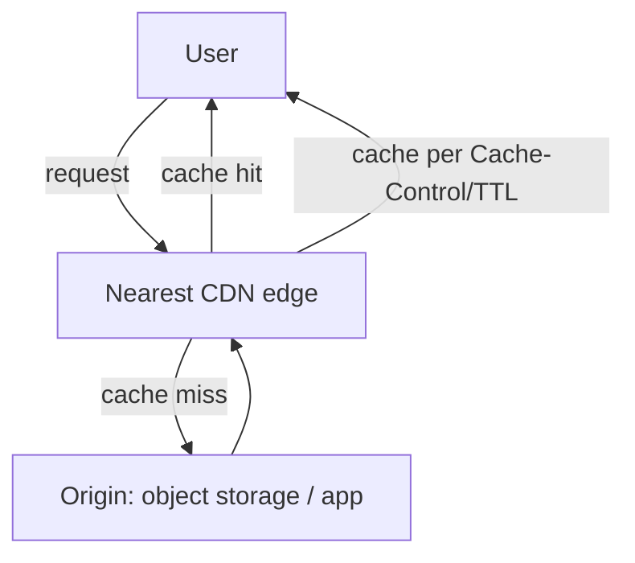

# CDN and Edge Caching

> Prerequisites: [object-storage-and-file-uploads](./object-storage-and-file-uploads.md), [04-caching/caching-fundamentals](../04-caching/caching-fundamentals.md)
> Related: [01-networking-and-api-design/dns-tcp-tls-http](../01-networking-and-api-design/dns-tcp-tls-http.md)

A CDN serves content from edge locations close to users, cutting latency and offloading your origin. It's the outermost cache layer and essential for serving static/media content globally.

---

## A. Problem and motivation

A user in Mumbai fetching a file from a US origin pays ~200ms+ per round trip (speed of light — see [latency](../00-foundations/latency-throughput-and-capacity.md)), and every such request hits your origin's bandwidth. For static/media content (images, video, JS/CSS, downloadable files), this is wasteful — the content is the same for everyone. A **CDN** caches content at edge locations worldwide, serving users from a nearby edge: low latency *and* massive origin offload. It's the cheapest, highest-leverage way to serve static content at global scale.

---

## B. How a CDN works

- Users are routed (via GeoDNS/anycast — see [dns-tcp-tls-http](../01-networking-and-api-design/dns-tcp-tls-http.md)) to the **nearest edge**.
- On a **cache hit**, the edge serves locally (fast, no origin hit). On a **miss**, the edge fetches from the origin, caches it (per `Cache-Control`/TTL), and serves — subsequent requests are hits.
- The edge is just a cache in front of your origin (object storage or app) — the same caching concepts apply (TTL, invalidation, hit ratio — see [caching-fundamentals](../04-caching/caching-fundamentals.md)), but geographically distributed.

**What to put on a CDN:** static assets (JS/CSS/images), media (video/images), downloadable files, and *cacheable* API responses (public, not user-specific). **Not:** per-user private data, highly dynamic content (unless carefully cached with short TTLs/keys).

---

## C. Cache control and invalidation

- **TTL / Cache-Control headers** tell the edge how long to cache. Long TTLs for immutable content (max offload); short for content that changes.
- **Cache invalidation** at the edge is harder than in a single cache (content is in many edges). Two main approaches:
  - **Versioned URLs (cache busting):** change the URL when the content changes (`style.v2.css`, or a content hash in the filename) → the new URL is a guaranteed miss, the old cached forever. The clean approach for static assets.
  - **Explicit purge/invalidation:** tell the CDN to evict a path — slower to propagate across edges, used when you can't version the URL.
- **Signed URLs** for private content: a time-limited signed URL lets the CDN serve otherwise-protected content (like pre-signed URLs — see [object-storage-and-file-uploads](./object-storage-and-file-uploads.md)).

---

## D. Example — DMS

- **Static web assets** (the DMS UI's JS/CSS/images): served via CDN with long TTLs + content-hash-versioned filenames (immutable, so a deploy's new assets get new URLs → no stale-asset problem).
- **Document downloads/thumbnails:** served via CDN from object storage using **signed URLs** (private, time-limited), so a frequently-downloaded document is served from the edge (fast + offloads origin) while staying access-controlled. On update, a new revision = new object key = new URL (versioning), avoiding edge invalidation.
- **API responses:** mostly not cached (user-specific); a few public ones (e.g., public document shares) cached briefly.

---

## E. Trade-offs / failure scenarios

| Aspect | Benefit | Cost/risk |
|---|---|---|
| CDN for static/media | Low global latency + huge origin offload | Edge invalidation is harder; cost |
| Versioned URLs | Clean invalidation (new URL = miss) | Must manage versioning in build |
| Explicit purge | Works without versioning | Slow propagation across edges |
| Signed URLs | Serve private content via CDN | Expiry/scope management |

Failure modes: **stale content** (long TTL + no versioning → users see old assets after a deploy — use versioned URLs); caching private/user-specific data on a shared CDN (data leak — use signed URLs / don't cache); caching uncacheable dynamic content; relying on slow explicit purges for frequently-changing content.

---

## F. Scaling implications

A CDN is the outermost and often most impactful cache: it serves the bulk of static/media traffic from the edge, so your origin (app + object storage) sees only misses — massive offload. It's the standard answer for serving media/static content at global scale and for reducing latency for far-away users (the latency floor is physics; the CDN avoids the round trip by serving locally). It also absorbs traffic spikes for cacheable content (edges handle the load). For dynamic/private content, the CDN helps less (hence the caching layers inside your system — see [caching-fundamentals](../04-caching/caching-fundamentals.md)). It complements, not replaces, multi-region for *dynamic* content (see [multi-region-architecture](../06-distributed-systems/multi-region-architecture.md)).

---

## G. Interview preparation

**Basic**
- Q: What does a CDN do? → *A: Caches content at edge locations near users, serving them locally — low latency + large origin offload. The outermost cache layer, for static/media content.*

**Intermediate**
- Q: How do you invalidate content on a CDN? → *A: Versioned URLs/cache-busting (change the URL when content changes → new URL is a guaranteed miss, old cached forever — clean for static assets) or explicit purge (slower to propagate). Prefer versioning.*
- Q: How do you serve private content via a CDN? → *A: Signed, time-limited URLs — the CDN serves access-controlled content without exposing it publicly.*

**SDE-2 / scenario**
- Q: "Users worldwide download large files slowly and your origin bandwidth is maxed." → *A: Put a CDN in front of object storage: edges serve files locally (low latency) and absorb the bandwidth (origin offload). Use signed URLs for private files and versioned keys so updates don't need edge invalidation.*
- Q: "After a deploy, users see old JS/CSS." → *A: Stale CDN cache from long TTLs without versioning. Use content-hash-versioned filenames so new assets have new URLs (guaranteed miss) while old ones stay cached — the standard cache-busting fix.*

**Common wrong answers:** no CDN for global static/media; caching private data on a shared CDN; relying on explicit purge for frequently-changing content instead of versioned URLs.

---

## H. Hands-on exercise

Design content delivery for a video platform: static UI assets, video thumbnails, and the videos themselves (large, some private). Specify what goes on the CDN, TTL/versioning strategy, how you serve private videos (signed URLs), and how you handle updating a thumbnail without stale edge caches.

---

## I. Revision summary

**Key takeaways**
- CDN = edge caches near users: low global latency + big origin offload; the outermost cache for static/media/cacheable content.
- Invalidate via versioned URLs/cache-busting (preferred — new URL = miss) or explicit purge (slow to propagate).
- Serve private content via signed, time-limited URLs; don't cache user-specific data on a shared CDN.
- Complements internal caching + object storage; for far users it avoids the round trip (latency floor is physics).

**Rapid-fire**
1. What does a CDN cache? → Static/media/cacheable content at the edge.
2. Clean CDN invalidation method? → Versioned URLs (cache busting).
3. Serve private content via CDN? → Signed, time-limited URLs.
4. Stale assets after a deploy — fix? → Content-hash-versioned filenames.
5. CDN's two wins? → Low latency (near user) + origin offload.

**Next:** [image-and-video-processing](./image-and-video-processing.md)
