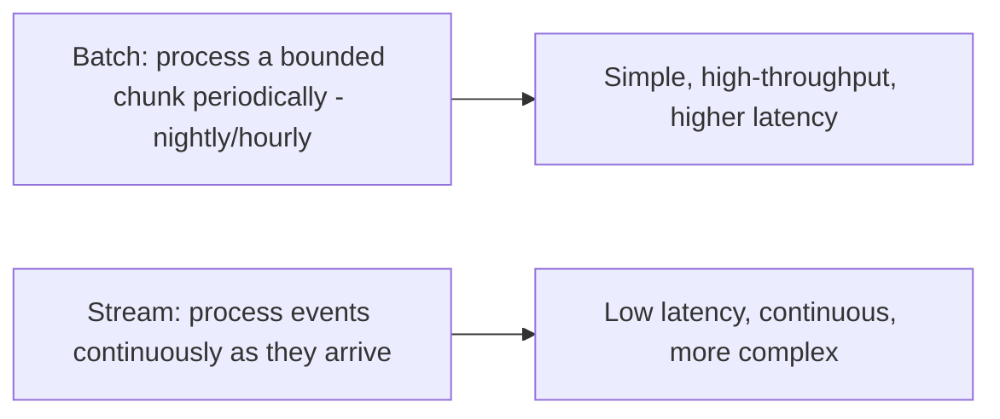

# Data Pipelines and Batch Processing

> Prerequisites: [05-messaging/queues-vs-pub-sub-vs-event-streams](../05-messaging-and-event-driven-systems/queues-vs-pub-sub-vs-event-streams.md), [03-databases/data-archival-and-retention](../03-databases-and-data-modeling/data-archival-and-retention.md)
> Related: [03-databases/time-series-and-search-databases](../03-databases-and-data-modeling/time-series-and-search-databases.md)

Data pipelines move and transform large volumes of data for analytics, reporting, ML, and derived views. Know batch vs stream processing, the ETL/ELT idea, and why analytics is separated from the operational (OLTP) store. Lighter SDE-2 topic — know the concepts.

---

## A. Problem and motivation

Beyond serving requests (OLTP — online transaction processing), systems need to *analyze* data: daily reports, metrics aggregations, ML feature computation, building derived/denormalized views. Running heavy analytical queries on the operational DB would compete with and slow down user-facing traffic (OLTP), and the operational schema isn't shaped for analytics. Data pipelines extract data, transform it, and load it into analytics-optimized stores — separating analytical (OLAP) workloads from operational ones.

---

## B. OLTP vs OLAP (why separate them)

| | OLTP (operational) | OLAP (analytical) |
|---|---|---|
| Workload | Many small reads/writes (serve requests) | Few large scans/aggregations (analyze) |
| Store | Row-oriented (Postgres/MySQL) | Column-oriented (data warehouse: BigQuery, Redshift, Snowflake) |
| Optimized for | Point lookups, transactions | Scanning/aggregating huge datasets |
| Running analytics on OLTP | Competes with user traffic → slows it | — |

**Column-oriented** warehouses store data by column, so aggregating one column over billions of rows reads only that column (fast for analytics), unlike row stores. You move operational data into the warehouse via pipelines, keeping heavy analytics off the OLTP store.

---

## C. Batch vs stream processing

| | Batch | Stream |
|---|---|---|
| Processes | A bounded dataset periodically (nightly ETL) | Unbounded events continuously (as they arrive) |
| Latency | High (results after the batch runs) | Low (near-real-time) |
| Complexity | Simpler | Harder (windowing, late/out-of-order events, state) |
| Tools | Spark, batch jobs | Kafka Streams, Flink, Spark Streaming |
| Use | Daily reports, bulk transforms, model training | Real-time dashboards, fraud detection, live aggregations |

Choose batch for periodic, latency-tolerant analytics (most reporting); stream for near-real-time needs. Many systems use both (the "Lambda/Kappa" idea — stream for fresh approximate results, batch for accurate historical).

---

## D. ETL vs ELT

- **ETL (Extract, Transform, Load):** transform data *before* loading into the warehouse. Classic; transform logic runs in the pipeline.
- **ELT (Extract, Load, Transform):** load raw data into the warehouse first, transform *there* (using the warehouse's compute). Modern cloud-warehouse approach — flexible (keep raw data, transform as needs change), leverages warehouse scale.

Data is often extracted from the OLTP store via **CDC** (see [transactional-outbox-and-cdc](../05-messaging-and-event-driven-systems/transactional-outbox-and-cdc.md)) or periodic exports — the same change-stream mechanism that feeds search indexes and caches.

---

## E. Example — DMS analytics

The DMS needs usage reports (uploads/tenant/day, storage trends, popular document types) without slowing the operational Postgres:
- **Pipeline:** CDC streams `documents` changes (and usage events) → a data warehouse (ELT: load raw, transform there).
- **Batch:** a nightly batch job aggregates per-tenant usage into report tables.
- **Stream (if needed):** a real-time dashboard of current upload rate from the event stream.
Heavy analytical queries run on the warehouse, never on the operational DB — so user-facing traffic is unaffected. Retention/archival (see [data-archival-and-retention](../03-databases-and-data-modeling/data-archival-and-retention.md)) feeds cold data to the warehouse/lake.

---

## F. Trade-offs / failure scenarios

| Choice | Advantages | Disadvantages | Warning signs |
|---|---|---|---|
| Separate OLAP warehouse | Analytics off OLTP; column-store speed | Extra system + pipeline; eventual freshness | Running analytics on the OLTP DB |
| Batch | Simple, high-throughput | Higher latency | Needing real-time from batch |
| Stream | Low latency | Complex (windowing, late events, state) | Over-engineering real-time where batch suffices |
| ELT | Flexible, keeps raw data | Warehouse compute cost | Transforming prematurely (ETL) when needs evolve |

Failure modes: running heavy analytics on the OLTP store (slows user traffic — the main mistake); choosing stream complexity when batch suffices; pipeline drift (warehouse out of sync — monitor/reconcile); unbounded warehouse cost (retention/tiering).

---

## G. Scaling implications

Separating OLAP from OLTP is itself a scaling move: it protects user-facing performance from heavy analytical queries and lets each store be optimized for its workload (row vs column). Pipelines scale via batch (high throughput, latency-tolerant) or stream (low latency, more complex); CDC provides the change feed. At scale this becomes a data platform (warehouse/lake + pipelines + stream processing). For SDE-2, the key points are: don't run analytics on the operational DB, know batch vs stream and when to use each, and recognize CDC as the common extraction mechanism (tying back to outbox/search/cache).

---

## H. Interview preparation

**Basic**
- Q: Why not run analytics on your operational DB? → *A: Heavy analytical scans compete with user-facing traffic (slowing it), and the OLTP schema/row-store isn't optimized for aggregation. Move data to an OLAP warehouse (column-store) via pipelines.*

**Intermediate**
- Q: Batch vs stream processing? → *A: Batch processes a bounded dataset periodically (simple, high-throughput, higher latency — e.g., nightly reports); stream processes events continuously (low latency, more complex — windowing/late events — e.g., real-time dashboards). Choose by latency need.*
- Q: ETL vs ELT? → *A: ETL transforms before loading; ELT loads raw then transforms in the warehouse (modern, flexible, keeps raw data). Data is often extracted via CDC.*

**SDE-2 / scenario**
- Q: "You need daily usage reports without slowing the app." → *A: Stream operational data to a column-oriented warehouse via CDC (ELT); run nightly batch aggregations there for reports. Keep heavy analytics off the OLTP DB so user traffic is unaffected. Add stream processing only if a real-time dashboard is required.*
- Q: "Your analytics queries are slowing the production DB." → *A: You're running OLAP on an OLTP store. Separate them: CDC/export to a warehouse and run analytics there; the operational DB only serves user requests.*

**Common wrong answers:** analytics on the OLTP DB; stream processing where batch suffices (over-engineering); ignoring warehouse cost/retention; not recognizing CDC as the extraction mechanism.

---

## I. Hands-on exercise

Design the analytics pipeline for an e-commerce platform: daily sales reports, a real-time orders-per-minute dashboard, and ML feature computation. Specify OLTP vs OLAP separation, which parts are batch vs stream, how data is extracted (CDC), and how you keep analytics off the operational DB.

---

## J. Revision summary

**Key takeaways**
- Separate OLAP (analytics, column-store warehouse) from OLTP (operational, row-store) so analytics doesn't slow user traffic.
- Batch (periodic, simple, high-throughput, higher latency) vs stream (continuous, low latency, complex); choose by latency need; often both.
- ETL (transform then load) vs ELT (load raw then transform in-warehouse — modern/flexible); extract via CDC.
- Don't run analytics on the operational DB; CDC is the common extraction mechanism (ties to outbox/search/cache).

**Rapid-fire**
1. Analytics on the OLTP DB — why not? → Competes with user traffic; wrong store shape.
2. Column-store is good at? → Aggregating/scanning huge datasets.
3. Batch vs stream distinguisher? → Latency (periodic vs continuous).
4. ELT means? → Load raw, transform in the warehouse.
5. Common extraction mechanism? → CDC.

**Section complete.** Next section: [11-estimation-and-bottleneck-analysis](../11-estimation-and-bottleneck-analysis/estimation-cheat-sheet.md)
