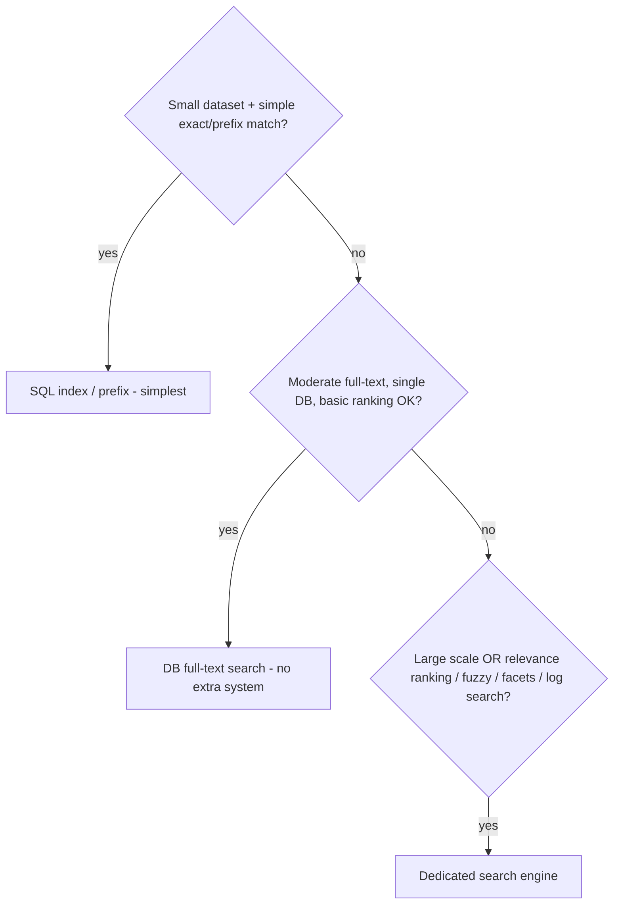

# Full-Text Search vs Database Search

> Prerequisites: [search-indexing-and-search-engines](./search-indexing-and-search-engines.md), [03-databases/indexing-and-query-optimization](../03-databases-and-data-modeling/indexing-and-query-optimization.md)
> Related: [03-databases/time-series-and-search-databases](../03-databases-and-data-modeling/time-series-and-search-databases.md)

A focused decision chapter: when is database search (SQL `LIKE`, DB full-text) enough, and when do you need a dedicated search engine? Reaching for Elasticsearch too early is over-engineering; using `LIKE` at scale is a bottleneck.

---

## A. Problem and motivation

"We need search" is ambiguous — it ranges from "find rows where name contains X" (trivial for a DB) to "rank millions of documents by relevance with typo tolerance" (needs a search engine). Choosing wrong means either over-engineering (a whole search cluster for a feature a DB index handles) or a dead end (`LIKE '%term%'` on millions of rows). The decision hinges on scale and search sophistication.

---

## B. The options, in increasing power

| Option | What | Good for | Limits |
|---|---|---|---|
| **SQL `LIKE`** | `WHERE name LIKE '%term%'` | Tiny datasets, exact/prefix on small tables | Leading `%` can't use an index → full scan; no ranking/stemming/fuzzy |
| **SQL prefix / trigram index** | `LIKE 'term%'` (index-usable) or trigram/GIN indexes | Prefix search, moderate full-text on one DB | Limited relevance; scales to the DB's limits |
| **DB full-text search** (Postgres `tsvector`, MySQL FULLTEXT) | Built-in text search with basic ranking/stemming | Moderate full-text without a separate system | Less powerful ranking/features than a search engine; tied to the DB |
| **Dedicated search engine** (Elasticsearch/OpenSearch) | Inverted index + rich relevance/fuzzy/faceting | Large scale, relevance ranking, typo tolerance, facets, log search | Separate system to run + keep in sync (see [search-indexing](./search-indexing-and-search-engines.md)) |

---

## C. The decision

**Start with the DB** (index/prefix or DB full-text) — no extra system to run or keep in sync. **Move to a search engine** when you hit: large scale (`LIKE`/DB FTS too slow), or need rich relevance ranking, typo tolerance, faceting, autocomplete, or log/text search at volume. This is the same "simplest adequate, evolve on need" principle as everywhere.

**Key SDE-2 line:** "I'd use the DB's full-text search initially — no extra system to operate or sync. I'd introduce a dedicated search engine only when the dataset or search sophistication (relevance, fuzzy, facets) outgrows the DB, accepting the sync pipeline + eventual consistency it brings."

---

## D. Why `LIKE '%term%'` fails at scale (recap)

A leading-wildcard `LIKE` can't use a B-tree index (indexes are prefix-ordered — see [indexing-and-query-optimization](../03-databases-and-data-modeling/indexing-and-query-optimization.md)), so it **full-scans** the table — fine on 1,000 rows, fatal on 10M. It also has no relevance ranking, stemming, or fuzzy matching. Prefix `LIKE 'term%'` *can* use an index (so it's fine for prefix/autocomplete), and trigram/GIN indexes help with contains-queries, but for real full-text at scale you want DB FTS or a search engine (inverted index — see [time-series-and-search-databases](../03-databases-and-data-modeling/time-series-and-search-databases.md)).

---

## E. Example — DMS

- **Early DMS (thousands of docs):** DB full-text search in Postgres (`tsvector`) over name + tags — adequate relevance, no extra system, strongly consistent with the DB. Autocomplete via a prefix index.
- **At scale (millions of docs, OCR text, relevance + typo tolerance + faceting by tenant/type):** introduce Elasticsearch fed via CDC (see [search-indexing-and-search-engines](./search-indexing-and-search-engines.md)) — accepting the sync pipeline and eventual consistency. The trigger is the measured need (DB FTS too slow / insufficient relevance), not reflexively starting with Elasticsearch.

---

## F. Trade-offs / failure scenarios

| Choice | Advantages | Disadvantages | Warning signs |
|---|---|---|---|
| SQL `LIKE '%..%'` | Trivial | Full scan at scale; no ranking | Using it on large tables |
| DB full-text | No extra system, consistent | Less powerful; DB-bound scale | Needing rich relevance/fuzzy at scale |
| Search engine | Rich, scalable search | Extra system + sync pipeline + eventual consistency | Adding it before the DB is insufficient (over-engineering) |

Failure modes: `LIKE '%term%'` on a large table (full-scan bottleneck — the classic); over-engineering (Elasticsearch for a feature a DB index handles — extra ops + sync complexity for no benefit); forgetting the sync/eventual-consistency cost when you do adopt a search engine.

---

## G. Scaling implications

Search is a progression: DB index/prefix → DB full-text → dedicated search engine, each step adding power at the cost of complexity. The DB options scale to the DB's limits with no extra system; a search engine scales further (sharded inverted index) but adds a sync pipeline and eventual consistency (see [search-indexing-and-search-engines](./search-indexing-and-search-engines.md)). The decision is a classic "don't over-engineer" case — start on the DB, measure, and move to a search engine only when scale or search sophistication demands it. Matching the tool to the actual requirement is the signal.

---

## H. Interview preparation

**Basic**
- Q: When is SQL `LIKE` fine for search? → *A: Small datasets and prefix/exact matches (`LIKE 'term%'` can use an index). `LIKE '%term%'` on large tables full-scans — avoid.*

**Intermediate**
- Q: When do you need a dedicated search engine over DB search? → *A: At large scale (DB search too slow) or when you need relevance ranking, typo tolerance, faceting, autocomplete, or log/text search — accepting the sync pipeline and eventual consistency it brings.*
- Q: Why not start with Elasticsearch? → *A: It's a separate system to operate and keep in sync; the DB's full-text search is simpler and strongly consistent and often sufficient early. Add a search engine when the DB is measurably insufficient.*

**SDE-2 / scenario**
- Q: "Your `LIKE '%term%'` search got slow as data grew." → *A: Leading-wildcard LIKE full-scans (can't use the index). For prefix/autocomplete use a prefix index; for real full-text, DB full-text search; at scale with relevance/fuzzy needs, a dedicated search engine (inverted index) fed via CDC.*
- Q: "Design search for a product catalog." → *A: Start with DB full-text if the catalog is modest; move to a search engine when I need relevance ranking, faceting (by category/price), typo tolerance, and scale — fed by CDC, eventually consistent. Match the tool to the requirement, not reflexively Elasticsearch.*

**Common wrong answers:** `LIKE '%..%'` at scale; Elasticsearch for a trivial search feature (over-engineering); ignoring the sync/eventual-consistency cost of a search engine.

---

## I. Hands-on exercise

For three systems, choose the search approach and justify: (a) an admin tool searching ~5,000 users by name, (b) a blog searching ~200K posts by content with basic ranking, (c) a marketplace searching 50M listings with relevance, filters, typo tolerance, and facets. Identify the trigger that would move each up the progression.

---

## J. Revision summary

**Key takeaways**
- Progression: SQL index/prefix → DB full-text → dedicated search engine; more power, more complexity.
- `LIKE '%term%'` full-scans at scale (no index, no ranking); prefix `LIKE 'term%'` can use an index.
- Start on the DB (simpler, consistent); adopt a search engine only when scale or search sophistication (relevance/fuzzy/facets) demands it — accepting sync + eventual consistency.
- Classic don't-over-engineer decision; match the tool to the requirement.

**Rapid-fire**
1. Why is `LIKE '%term%'` slow at scale? → Full scan (can't use the index).
2. Prefix search `LIKE 'term%'` — indexable? → Yes.
3. Default before a search engine? → DB full-text search.
4. Trigger to adopt a search engine? → Scale / relevance / fuzzy / facets.
5. Cost of a search engine? → Separate system + sync pipeline + eventual consistency.

**Next:** [data-pipelines-and-batch-processing](./data-pipelines-and-batch-processing.md)
