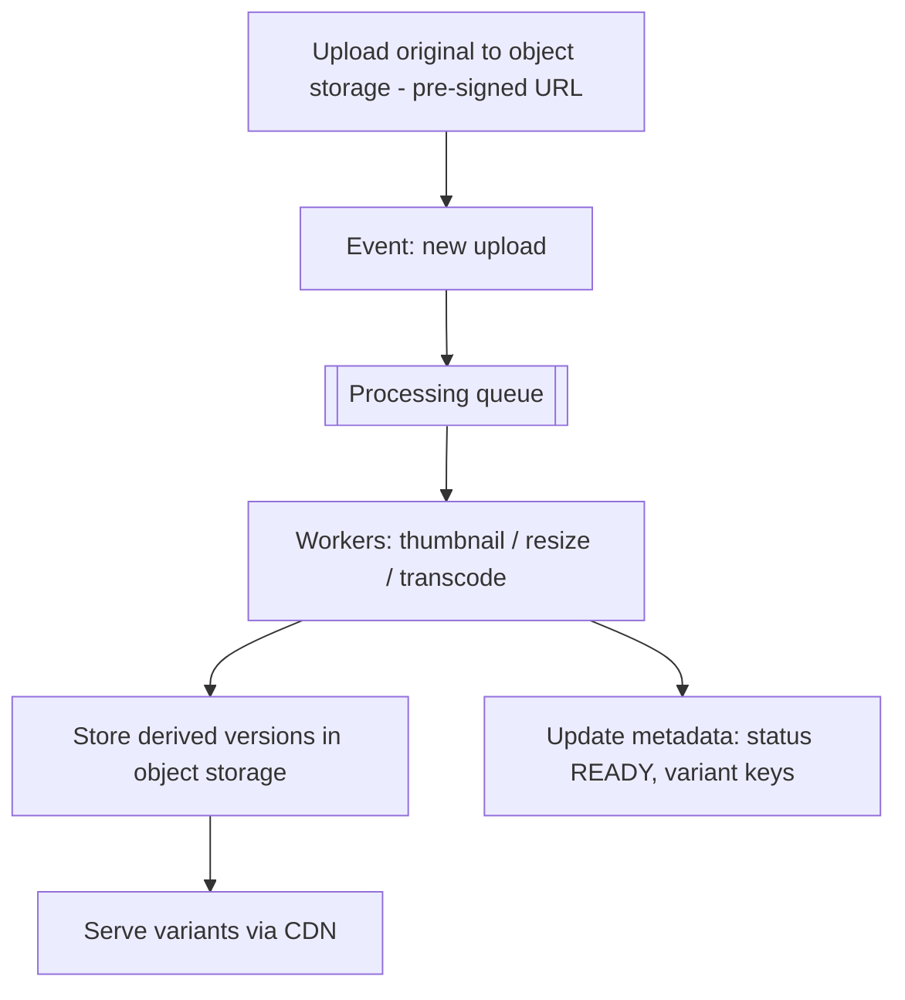

# Image and Video Processing

> Prerequisites: [object-storage-and-file-uploads](./object-storage-and-file-uploads.md), [02-compute-and-architecture/synchronous-vs-asynchronous-processing](../02-compute-and-architecture/synchronous-vs-asynchronous-processing.md)
> Related: [05-messaging/queues-vs-pub-sub-vs-event-streams](../05-messaging-and-event-driven-systems/queues-vs-pub-sub-vs-event-streams.md) · [cdn-and-edge-caching](./cdn-and-edge-caching.md)

Media processing (thumbnails, transcoding) is CPU-heavy, slow work that should never block the upload path. The pattern: accept the upload fast, process asynchronously via workers, serve the results via CDN. This generalizes the DMS OCR pattern to media.

---

## A. Problem and motivation

When a user uploads an image or video, you usually need derived versions: thumbnails, multiple resolutions, format conversions (video transcoding to adaptive bitrates). This processing is **CPU/time-intensive** (transcoding a video can take minutes). Doing it synchronously would make uploads take minutes and tie up request threads — a terrible UX and a scaling disaster. The pattern is the same async decoupling as the DMS OCR pipeline: accept fast, process in the background, deliver via CDN.

---

## B. The processing pipeline

1. **Upload the original** directly to object storage (pre-signed URL — see [object-storage-and-file-uploads](./object-storage-and-file-uploads.md)); return fast (status PROCESSING).
2. **Enqueue a processing job** (triggered by an object-storage event or an explicit enqueue).
3. **Workers** (autoscaled on queue depth — see [autoscaling-and-capacity-planning](../02-compute-and-architecture/autoscaling-and-capacity-planning.md)) do the heavy work: generate thumbnails, resize to multiple resolutions, transcode video to adaptive bitrates.
4. **Store derived versions** in object storage; update metadata (status READY, keys for each variant).
5. **Serve** the variants via CDN (see [cdn-and-edge-caching](./cdn-and-edge-caching.md)).

This is async processing ([synchronous-vs-asynchronous-processing](../02-compute-and-architecture/synchronous-vs-asynchronous-processing.md)) applied to media, with all its properties: idempotent workers (at-least-once → a job may re-run), DLQ for poison media (corrupt files), backpressure under upload spikes.

---

## C. Video specifics (adaptive bitrate)

Video adds complexity: transcode into **multiple resolutions/bitrates** and segment into small chunks (HLS/DASH) so players can **adaptively** switch quality based on the viewer's bandwidth (adaptive bitrate streaming). This is why a video platform's processing is heavy and why playback is served as many small segments via CDN (not one giant file). Live video adds real-time transcoding (even harder). See [video-streaming-platform](../12-system-design-problems/video-streaming-platform.md).

---

## D. Idempotency and the on-demand alternative

- **Idempotency:** workers are keyed by (asset id + variant) so a redelivered job overwrites the same derived object rather than creating duplicates (at-least-once — see [idempotency-and-deduplication](../05-messaging-and-event-driven-systems/idempotency-and-deduplication.md)).
- **Pre-generate vs on-demand:** generate all variants up front (fast serving, more storage/compute even for unviewed variants) vs generate on first request and cache (less upfront work, first-request latency). On-demand image resizing (resize at request time, cache the result at the CDN/edge) is common for images with many possible sizes; pre-generation suits video (too slow for on-demand). A trade-off between storage/compute and first-request latency.

---

## E. Example — DMS and an image app

- **DMS:** the OCR/scan/thumbnail pipeline is exactly this pattern — upload fast, process async in idempotent workers, store the thumbnail, serve via CDN. (Documents, not video, but same shape.)
- **Image app:** upload original → async workers generate standard sizes (or on-demand resize + CDN-cache the result) → serve via CDN. Spikes absorbed by the queue + worker autoscaling; corrupt uploads go to a DLQ.

---

## F. Trade-offs / failure scenarios

| Choice | Advantages | Disadvantages | Warning signs |
|---|---|---|---|
| Async processing | Fast uploads, decoupled, scales on queue depth | Eventual availability of variants; duplicate/poison handling | Synchronous transcoding on the upload path |
| Pre-generate variants | Fast serving | Storage/compute for unviewed variants | Generating many unused sizes |
| On-demand + cache | Less upfront work | First-request latency | On-demand for slow video transcode |

Failure modes: synchronous processing blocking uploads (slow/unscalable); non-idempotent workers (duplicate variants on redelivery); no DLQ for corrupt media (poison jobs block the pipeline — see [dead-letter-queues](../05-messaging-and-event-driven-systems/dead-letter-queues.md)); no backpressure under upload spikes (consumer lag — see [backpressure-and-consumer-lag](../05-messaging-and-event-driven-systems/backpressure-and-consumer-lag.md)).

---

## G. Scaling implications

Media processing scales as an async pipeline: the queue absorbs upload spikes, workers autoscale on queue depth, and object storage + CDN handle storage and delivery at scale. The CPU-heavy work is isolated from the request path, so uploads stay fast regardless of processing load. This is the standard media architecture (upload → queue → workers → object storage → CDN) and a direct application of the Stage-4 async scaling move. Video's adaptive-bitrate requirement makes processing the dominant cost, driving large worker fleets and often specialized/GPU compute.

---

## H. Interview preparation

**Basic**
- Q: Why process media asynchronously? → *A: Thumbnailing/transcoding is CPU-heavy and slow (minutes for video); doing it synchronously would make uploads slow and tie up request threads. Accept fast, process in background workers, serve via CDN.*

**Intermediate**
- Q: Describe the media pipeline. → *A: Upload original to object storage (pre-signed URL, return PROCESSING) → enqueue a job (object-storage event) → autoscaled idempotent workers generate variants/transcode → store in object storage + update metadata READY → serve via CDN. DLQ for corrupt media, backpressure for spikes.*
- Q: Pre-generate vs on-demand variants? → *A: Pre-generate = fast serving, more storage/compute (even unused variants); on-demand + cache = less upfront work, first-request latency. On-demand resizing suits images; pre-generation suits video (too slow for on-demand).*

**SDE-2 / scenario**
- Q: "Design image upload + thumbnails + multiple sizes." → *A: Upload original via pre-signed URL (fast); async idempotent workers (autoscaled on queue depth) generate sizes OR resize on-demand and CDN-cache; store variants in object storage; serve via CDN; DLQ for corrupt files. Uploads stay fast; processing scales independently.*
- Q: "Video uploads take minutes — users complain." → *A: Don't transcode synchronously. Accept the upload, mark PROCESSING, transcode async into adaptive-bitrate variants via a worker fleet, notify when ready, serve segmented via CDN. The user's upload returns in seconds.*

**Common wrong answers:** synchronous transcoding; non-idempotent workers; no DLQ for corrupt media; pre-generating many unused variants; serving one giant video file instead of adaptive segments.

---

## I. Hands-on exercise

Design the media pipeline for a social app: image uploads (thumbnail + 3 sizes) and short videos (transcode to 3 bitrates). Specify the upload flow, queue + worker autoscaling, idempotency keying, pre-generate vs on-demand per media type, DLQ handling, and CDN delivery.

---

## J. Revision summary

**Key takeaways**
- Media processing is CPU-heavy/slow → never on the upload path; use async workers (upload fast → queue → workers → object storage → CDN).
- Workers idempotent (keyed by asset+variant), autoscaled on queue depth, with a DLQ for corrupt media and backpressure for spikes.
- Pre-generate (fast serving, more storage) vs on-demand + cache (less upfront, first-request latency); on-demand suits images, pre-generate suits video.
- Video = adaptive-bitrate transcoding + segmentation, served via CDN.

**Rapid-fire**
1. Process media sync or async? → Async (CPU-heavy/slow).
2. Workers scale on? → Queue depth.
3. Keep variants idempotent by keying on? → Asset id + variant.
4. On-demand resizing suits? → Images (not slow video transcode).
5. Serve video as? → Adaptive-bitrate segments via CDN.

**Next:** [search-indexing-and-search-engines](./search-indexing-and-search-engines.md)
