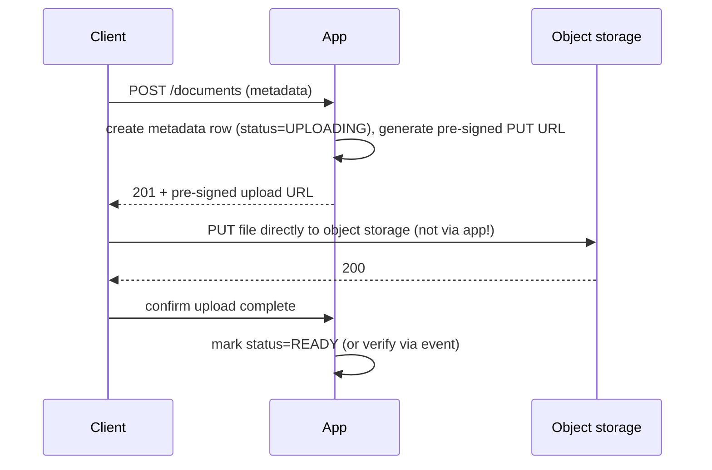

# Object Storage and File Uploads

> Prerequisites: [00-foundations/back-of-the-envelope-estimation](../00-foundations/back-of-the-envelope-estimation.md), [01-networking-and-api-design/rest-and-api-design](../01-networking-and-api-design/rest-and-api-design.md)
> Related: [cdn-and-edge-caching](./cdn-and-edge-caching.md) · [03-databases/data-archival-and-retention](../03-databases-and-data-modeling/data-archival-and-retention.md)

Files (documents, images, videos) don't belong in a database. Object storage is the standard home, and the pre-signed-URL upload pattern keeps large files off your app servers. Core for file-handling designs like the DMS.

---

## A. Problem and motivation

Where do you store a user's 2MB document, 5MB photo, or 1GB video? Putting large blobs in a relational DB is a mistake: it bloats the DB, slows backups, wastes expensive DB storage, and the DB isn't built for it (recall the [DMS estimation](../00-foundations/back-of-the-envelope-estimation.md): 180TB of files vs 90GB of metadata). Object storage (S3-like) is purpose-built for massive, durable, cheap blob storage. And streaming large uploads *through* your app servers wastes their bandwidth/memory — the pre-signed URL pattern avoids it.

---

## B. What object storage is

A service that stores **objects** (blobs) by key, accessed over HTTP, with:
- **Massive scale + high durability** (data replicated across machines/AZs; very high durability like "11 nines").
- **Cheap** (far cheaper per GB than DB storage), with **storage tiers** (hot/standard → infrequent-access → cold/archive) for cost (see [data-archival-and-retention](../03-databases-and-data-modeling/data-archival-and-retention.md)).
- **Flat key-value model** (key → object), *not* a filesystem — no efficient "list a directory" or rename; you model paths as key prefixes.
- **Metadata lives elsewhere:** store the file in object storage, store its *metadata + the object key* in your DB. The DB is the index; object storage holds the bytes.

**The pattern:** DB row = `{id, name, owner, object_key, size, content_type, ...}`; the actual bytes at `object_key` in object storage.

---

## C. The pre-signed URL upload/download pattern

Don't stream large files through your app. Instead:

- **Pre-signed URL:** a time-limited, permission-scoped URL the app generates (signed with its credentials) that lets the client upload/download *directly* to/from object storage — without the bytes passing through the app. Saves app bandwidth/memory and scales uploads to object storage's capacity.
- **Download:** similarly, hand the client a pre-signed GET URL (or serve via CDN — see [cdn-and-edge-caching](./cdn-and-edge-caching.md)).
- **Multipart upload** for very large files (split into parts, upload in parallel, resumable).

This is the [rest-and-api-design](../01-networking-and-api-design/rest-and-api-design.md) pre-signed-URL point, in depth.

---

## D. The metadata/file consistency problem

Two stores (DB metadata + object storage) means a two-step operation that can partially fail:
- **Orphaned file:** file uploaded to object storage, but the app crashed before marking metadata READY → a file with no usable metadata. Fix: reconciliation job finds orphans and cleans them (see [idempotent-recovery-and-reconciliation](../07-reliability-and-resilience/idempotent-recovery-and-reconciliation.md)); or use object-storage events to confirm uploads.
- **Dangling metadata:** metadata says a file exists but the upload never completed → status reflects UPLOADING; a timeout cleans it up.
Handle this like any dual-system operation: a clear status lifecycle + reconciliation, not an assumed atomic two-step.

---

## E. Example — DMS

Documents stored in object storage; metadata (name, owner, object_key, revisions, status) in Postgres. Upload: app creates metadata (UPLOADING) + returns a pre-signed PUT URL → client uploads 2MB directly to object storage (app never sees the bytes) → an object-storage event (or client confirm) marks it READY and triggers the OCR pipeline. Download: pre-signed GET URL, served via CDN for repeat/global access. Orphan-cleanup reconciliation runs periodically. Old documents transition to colder storage tiers per retention policy. This is why the DMS architecture separates files (object storage) from metadata (DB) — justified by the [storage estimation](../00-foundations/back-of-the-envelope-estimation.md).

---

## F. Trade-offs / failure scenarios

| Choice | Advantages | Disadvantages | Warning signs |
|---|---|---|---|
| Object storage for blobs | Massive, durable, cheap, tiered | Flat model (no dir listing/rename); eventual consistency on some ops | Storing blobs in the DB |
| Pre-signed URLs | Offloads bandwidth/memory from app | More moving parts; URL expiry; metadata/file consistency | Streaming big files through the app |
| Multipart | Resumable, parallel large uploads | More complexity | Single-shot upload of huge files |

Failure modes: blobs in the DB (bloat, slow backups, cost); streaming files through the app (bandwidth/memory exhaustion); orphaned files/dangling metadata (need reconciliation); pre-signed URL with too-long expiry or over-broad scope (security).

---

## G. Scaling implications

Object storage scales essentially infinitely and durably for blobs — it removes file storage as a scaling concern entirely (you don't shard object storage; it's managed). The DB stays small (metadata only), keeping it fast and its backups quick. Pre-signed URLs mean upload/download throughput scales with object storage, not your app tier. Storage tiering controls cost as data ages. The main scaling concern becomes the metadata/file consistency (reconciliation) and serving reads at scale/globally (CDN — next chapter). This separation (bytes in object storage, index in DB, delivery via CDN) is the standard high-scale file-handling architecture.

---

## H. Interview preparation

**Basic**
- Q: Where do you store large files, and why not the DB? → *A: Object storage — it's massive, durable, cheap, and tiered; blobs in a DB bloat it, slow backups, and waste expensive storage. Store the file in object storage and its metadata + key in the DB.*

**Intermediate**
- Q: What's the pre-signed URL pattern and why? → *A: The app generates a time-limited, scoped URL letting the client upload/download directly to/from object storage, so the bytes don't pass through the app — saving app bandwidth/memory and scaling to object storage's capacity.*
- Q: What consistency problem does splitting metadata and files create? → *A: Partial failure — orphaned files (uploaded, metadata not finalized) or dangling metadata (never uploaded). Handle with a status lifecycle + reconciliation (and object-storage upload events), not an assumed atomic two-step.*

**SDE-2 / scenario**
- Q: "Design file upload for the DMS so it scales." → *A: Metadata + object_key in the DB; pre-signed PUT URL so the client uploads the 2MB directly to object storage (app never sees the bytes); confirm via an object-storage event → mark READY + trigger processing; multipart for large files; reconciliation for orphans; CDN + pre-signed GET for downloads; tier old files for cost.*
- Q: "Uploads are exhausting your app servers' memory/bandwidth." → *A: You're streaming files through the app. Switch to pre-signed URLs so clients upload directly to object storage; the app only handles small metadata requests.*

**Common wrong answers:** blobs in the DB; streaming large files through the app; assuming the metadata+file write is atomic (no reconciliation); over-permissive/long-lived pre-signed URLs.

---

## I. Hands-on exercise

Design file handling for an image-sharing app (10M photos/day, 1.5MB avg). Specify: what's in the DB vs object storage, the upload flow (pre-signed URL, multipart?), the metadata/file consistency handling, storage tiering, and how downloads are served at scale. Estimate the object-storage growth/year.

---

## J. Revision summary

**Key takeaways**
- Store blobs in object storage (massive, durable, cheap, tiered), metadata + object key in the DB — never blobs in the DB.
- Pre-signed URLs let clients upload/download directly to object storage, offloading the app's bandwidth/memory.
- Splitting metadata/files creates partial-failure cases (orphans/dangling) → status lifecycle + reconciliation.
- Object storage removes file-storage scaling concerns; tiering controls cost; serve reads via CDN.

**Rapid-fire**
1. Where do large files go? → Object storage (metadata + key in the DB).
2. Pattern to offload uploads from the app? → Pre-signed URLs.
3. Blobs in the DB cause? → Bloat, slow backups, cost.
4. Metadata+file partial failure → ? → Orphaned files / dangling metadata (reconcile).
5. Control cost as files age? → Storage tiering (hot→cold).

**Next:** [cdn-and-edge-caching](./cdn-and-edge-caching.md)
