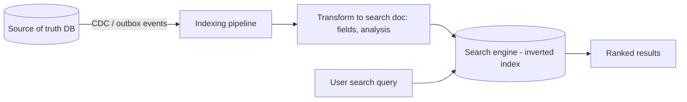

# Search Indexing and Search Engines

> Prerequisites: [03-databases/time-series-and-search-databases](../03-databases-and-data-modeling/time-series-and-search-databases.md)
> Related: [full-text-search-vs-database-search](./full-text-search-vs-database-search.md) · [05-messaging/transactional-outbox-and-cdc](../05-messaging-and-event-driven-systems/transactional-outbox-and-cdc.md)

Search engines (Elasticsearch/OpenSearch) were introduced in the databases section. This chapter focuses on the *indexing pipeline* — how data gets into the search engine and stays in sync with the source of truth — which is where the real design work (and bugs) live.

> Search-engine internals (inverted index, relevance, why not SQL LIKE): [time-series-and-search-databases](../03-databases-and-data-modeling/time-series-and-search-databases.md). This page is the indexing pipeline and operations.

---

## A. Problem and motivation

A search engine is a *secondary* store — it's not your source of truth, it's a derived index built from your primary data. The hard part isn't querying it (that's the engine's job); it's getting data *into* it reliably and keeping it *in sync* with the primary store as data changes. A broken or lagging indexing pipeline means search returns stale, missing, or deleted results — the most common search problems in production.

---

## B. The indexing pipeline

- **Source of truth:** your primary DB (metadata). The search engine indexes a *projection* of it.
- **Feed it reliably:** stream changes from the DB to the search engine. The robust way is **CDC / transactional outbox** (see [transactional-outbox-and-cdc](../05-messaging-and-event-driven-systems/transactional-outbox-and-cdc.md)) — every committed change becomes an index update event, so no change is missed (avoids the dual-write problem of "update DB and search engine separately"). 
- **Transform:** map the DB row to a search document (choose indexed fields, apply analysis/tokenization).
- **Eventual consistency:** the index lags the DB by the pipeline latency (seconds) — search results are eventually consistent (usually fine; state it).

---

## C. Keeping the index in sync (the core challenge)

- **Reliable feed (CDC/outbox):** catches every write regardless of code path; the right default (vs ad-hoc "also write to the search engine" which is a dual-write that drifts).
- **Deletes/updates:** a deleted DB row must delete the search doc; an update must reindex it. CDC captures these.
- **Reindexing:** because the index is rebuildable from the source of truth, you can **fully reindex** to recover from drift/corruption or to change the mapping. Keep the ability to rebuild (it's not the source of truth).
- **Index drift:** if the pipeline silently fails, the index diverges (stale/missing/ghost results). Detect with periodic DB↔index reconciliation (count/sample comparison — see [idempotent-recovery-and-reconciliation](../07-reliability-and-resilience/idempotent-recovery-and-reconciliation.md)) and alert on indexing lag.

---

## D. Scaling the search engine

- **Sharding:** the index is sharded across nodes (like a sharded DB) for scale; queries scatter-gather across shards and merge.
- **Replicas:** for read scaling + availability.
- **Mapping changes** (schema of the index) require reindexing — plan like a migration (see [schema-migrations-and-data-evolution](../03-databases-and-data-modeling/schema-migrations-and-data-evolution.md)); often index to a new index and alias-swap (zero-downtime reindex).

---

## E. Example — DMS search

Documents are the source of truth in Postgres. A CDC pipeline (Debezium-style) streams `documents` changes → an indexing service transforms each into a search document (name, tags, extracted OCR text, owner, tenant) → indexes into Elasticsearch. Search queries hit Elasticsearch (relevance-ranked, typo-tolerant), scoped by tenant (see [multi-tenant-isolation](../08-security/multi-tenant-isolation.md)). Deletes/updates propagate via CDC. Indexing lag (~seconds) is monitored; a periodic reconciliation compares DB vs index counts to catch drift; the index can be fully rebuilt from Postgres if corrupted. Search results are eventually consistent (a just-uploaded doc appears in search a few seconds later — acceptable, unlike the read-your-write requirement for the document itself).

---

## F. Trade-offs / failure scenarios

| Choice | Advantages | Disadvantages | Warning signs |
|---|---|---|---|
| CDC/outbox feed | Catches every write; reliable | Pipeline infra | Ad-hoc dual-write (drift) |
| Search engine (secondary) | Rich search, rebuildable | Eventual consistency, extra store to run | Treating it as source of truth |
| Full reindex capability | Recover from drift / remap | Expensive for huge indexes | No rebuild path |

Failure modes: **index drift** (silent pipeline failure → stale/missing/ghost results — reconcile + alert on lag); **dual-write** instead of CDC (DB and index diverge — use CDC/outbox); treating the index as source of truth (data loss if it's lost — it must be rebuildable); mapping changes without a reindex plan.

---

## G. Scaling implications

The indexing pipeline is the real scaling and reliability concern for search — the engine scales via sharding/replicas, but keeping a large, high-write index in sync requires a robust CDC pipeline (not ad-hoc writes) and monitoring (lag + reconciliation). Because the index is a rebuildable projection, you get powerful recovery (full reindex) and the freedom to change mappings (reindex + alias swap). Eventual consistency is inherent and must be acknowledged. This pattern (source-of-truth DB + CDC → derived search index) is the same shape as CQRS read models (see [event-sourcing-and-cqrs](../05-messaging-and-event-driven-systems/event-sourcing-and-cqrs.md)) and cache invalidation via CDC.

---

## H. Interview preparation

**Basic**
- Q: Is the search engine your source of truth? → *A: No — it's a secondary, rebuildable index derived from the primary DB; results are eventually consistent.*

**Intermediate**
- Q: How do you keep the search index in sync with the DB? → *A: Feed it via CDC / transactional outbox so every committed change (incl. deletes/updates) becomes an index update — avoiding the dual-write drift of writing to the DB and index separately. Monitor indexing lag and reconcile periodically; rebuild from the source if it drifts.*
- Q: How do you change the index mapping without downtime? → *A: Reindex into a new index and alias-swap (zero-downtime), like a schema migration — possible because the index is rebuildable from the source of truth.*

**SDE-2 / scenario**
- Q: "Search sometimes shows deleted documents or misses new ones." → *A: Index drift from an unreliable feed. Use CDC/outbox so every change (incl. deletes) propagates; monitor indexing lag; run periodic DB↔index reconciliation; and keep the ability to fully reindex from the source. Accept eventual consistency (seconds).*
- Q: "Design document search for the DMS." → *A: Postgres is source of truth; CDC streams changes to an indexing service → Elasticsearch (inverted index, tenant-scoped, relevance-ranked). Deletes/updates via CDC; monitor lag; reconcile; rebuildable index. Search is eventually consistent.*

**Common wrong answers:** search engine as source of truth; ad-hoc dual-write (DB + index) causing drift; no reconciliation/lag monitoring; no reindex path; forgetting deletes must propagate.

---

## I. Hands-on exercise

Design the search indexing pipeline for an e-commerce catalog: source of truth, how products are indexed and kept in sync (CDC), how price/stock updates and deletes propagate, how you detect/fix drift, and how you'd change the index mapping without downtime. State the consistency users experience.

---

## J. Revision summary

**Key takeaways**
- A search engine is a secondary, rebuildable index — not the source of truth; results are eventually consistent.
- Feed it via CDC/outbox (catches every change incl. deletes/updates) — not ad-hoc dual-write (which drifts).
- Monitor indexing lag; reconcile DB↔index; keep a full-reindex path (recovery + mapping changes via alias swap).
- Scale via sharding/replicas; same source-of-truth→CDC→projection pattern as CQRS/cache invalidation.

**Rapid-fire**
1. Source of truth: DB or search engine? → DB (index is derived).
2. Reliable way to keep the index in sync? → CDC/outbox.
3. Search consistency? → Eventual.
4. Recover from index drift? → Full reindex from the source.
5. Change the mapping without downtime? → Reindex + alias swap.

**Next:** [full-text-search-vs-database-search](./full-text-search-vs-database-search.md)
