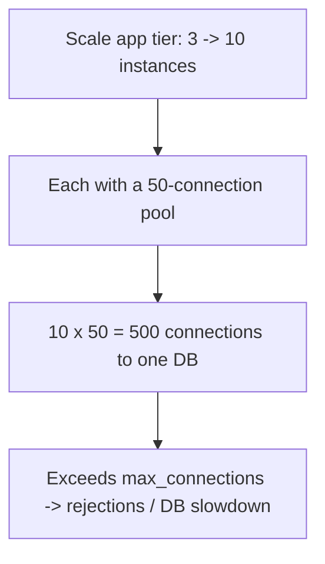

# Database Capacity and Connection Pools

> Prerequisites: [00-foundations/latency-throughput-and-capacity](../00-foundations/latency-throughput-and-capacity.md), [02-compute-and-architecture/horizontal-vs-vertical-scaling](../02-compute-and-architecture/horizontal-vs-vertical-scaling.md)
> Related: [03-databases/replication-and-read-replicas](../03-databases-and-data-modeling/replication-and-read-replicas.md)

Connections are a scarce DB resource that candidates routinely over-provision. This chapter does the connection-pool math (via Little's Law) and explains why "more app servers" exhausts the DB — the recurring lesson of the scaling journey.

---

## A. The connection-pool math (Little's Law)

Connections needed to the DB = in-flight DB operations = `DB-op RPS × DB-op latency` (Little's Law — see [latency](../00-foundations/latency-throughput-and-capacity.md)).

Example: 1,000 read RPS to the DB, each query ~10ms → `1,000 × 0.01 = 10` concurrent DB ops. So ~10 connections (plus modest headroom) suffice — **not** hundreds. Pools are routinely over-sized.

**Per-instance pool sizing:** `total needed connections / number of app instances`, with headroom. If 10 total ops across 5 instances, each needs ~2–4 (not 50). A common mistake: default pool of 50 × 20 instances = 1,000 connections hammering a DB that handles far fewer.

---

## B. Why connections are scarce

A DB connection is expensive: each consumes server memory and a backend process/thread; databases have a hard `max_connections` (often a few hundred). Beyond that, new connections are rejected — **connection exhaustion**. Too many connections also *reduce* throughput (context-switching, contention) — more connections past the optimal point make the DB *slower*, not faster. The optimal pool is small, sized to actual concurrency, not "as many as possible."

---

## C. The scaling-journey lesson (why more app servers hurt the DB)

Horizontally scaling the stateless app tier multiplies connections to the single DB (instances × pool size). This is *the* recurring lesson (see [architecture-fundamentals](../00-foundations/architecture-fundamentals.md), [horizontal-vs-vertical-scaling](../02-compute-and-architecture/horizontal-vs-vertical-scaling.md)): the app scales, the DB doesn't, and connections are the first thing to break. Fixes:
- **Smaller per-instance pools** (sized to actual concurrency, not defaults).
- **A connection pooler** (PgBouncer-style) between the app and DB — multiplexes many app connections onto few DB connections, so thousands of app-side connections map to a small DB-side pool. Essential at scale, and *the* answer to serverless connection fan-out (see [serverless-and-managed-compute](../02-compute-and-architecture/serverless-and-managed-compute.md)).
- **Read replicas** to spread read connections (writes still single-primary).

---

## D. Interview Q&A

- Q: "You scaled from 3 to 15 app instances and the DB started rejecting connections. Why?" → *Each instance's pool × 15 exceeded the DB's max_connections. Fix: shrink per-instance pools to actual concurrency, add a connection pooler (PgBouncer) so many app connections multiplex onto few DB connections, and offload reads to replicas.*
- Q: "How many DB connections do you need for 2,000 DB-op RPS at 5ms?" → *Little's Law: 2,000 × 0.005 = 10 concurrent ops → ~10–20 connections total (not hundreds).*
- Q: "Serverless functions are exhausting DB connections — why and fix?" → *Each concurrent function opens its own connection; a spike = thousands. Fix: a connection pooler/proxy between functions and the DB, or a serverless-friendly data store.*

**Common wrong answers:** huge default pools; "add app servers" to a DB-bound problem; thinking more connections = more throughput; no pooler for serverless.

---

## E. Exercise

A service runs 20 app instances, each with a default 30-connection pool, against one Postgres with `max_connections=400`. DB-op RPS is 3,000 at 8ms latency. Compute: (a) connections the app tier *wants* (20×30), (b) connections actually *needed* (Little's Law), (c) whether the DB will reject, and (d) the fix.
*(Answer: (a) 600 wanted; (b) 3,000×0.008 = 24 needed; (c) 600 > 400 max → rejections; (d) shrink pools to ~2–3/instance (≈40–60 total, > the 24 needed with headroom), add a connection pooler so app connections multiplex onto a small DB pool, and offload reads to replicas.)*

---

## F. Revision summary

**Key takeaways**
- Connections needed = DB-op RPS × DB-op latency (Little's Law) — usually small; pools are over-provisioned.
- Connections are scarce (memory + max_connections); too many *reduce* throughput and cause exhaustion.
- Scaling the app tier multiplies DB connections (instances × pool) — the recurring journey lesson; "more app servers" exhausts the DB.
- Fixes: small per-instance pools, a connection pooler (multiplex many→few), read replicas; pooler is essential for serverless fan-out.

**Rapid-fire**
1. Connections needed formula? → DB-op RPS × latency (Little's Law).
2. More connections = more throughput? → No (past optimal, it's slower).
3. 15 app instances × 50-pool → ? → 750 connections → likely DB exhaustion.
4. Fix for too many connections? → Smaller pools + connection pooler + replicas.
5. Serverless connection fan-out fix? → Connection pooler/proxy.

**Next:** [queue-capacity-and-consumer-throughput](./queue-capacity-and-consumer-throughput.md)
