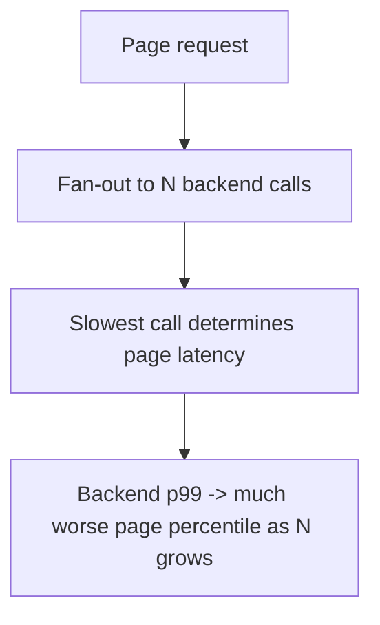

# Latency Budgets and Tail Latency

> Prerequisites: [00-foundations/latency-throughput-and-capacity](../00-foundations/latency-throughput-and-capacity.md)
> Related: [06-distributed-systems/partial-failures-and-timeouts](../06-distributed-systems/partial-failures-and-timeouts.md)

Budgeting latency across a request's components and understanding why tail latency (p99) dominates at scale. This is how you decide where latency must be spent and where you can't afford a slow dependency.

---

## A. Latency budgeting

A request has an overall latency target (e.g., p99 < 200ms). That budget is *spent* across its components: network hops, each service, DB queries, serialization. Budgeting means allocating the target across the components so the sum stays within it.

Example — DMS metadata read, budget 200ms p99:
- Client↔edge network: ~20ms
- Gateway + app processing: ~10ms
- Cache lookup (hit): ~2ms  **OR** cache miss → DB query ~10ms + populate ~2ms
- Serialization/response: ~5ms
- Headroom: the rest

The budget tells you what's affordable: a 100ms synchronous call to a slow dependency *blows* a 200ms budget, so it must be removed from the critical path (cached, precomputed, or made async). Budgeting turns "make it fast" into concrete per-component limits.

---

## B. Why tail latency (p99) dominates — the fan-out amplification

From [latency](../00-foundations/latency-throughput-and-capacity.md): a user request often fans out to many backend calls, and the request is as slow as its *slowest* call. So a backend p99 becomes a worse page percentile:

> If a request makes **N** parallel backend calls, each with probability **p** of being slow (its p99 → p=0.01), the chance the request hits ≥1 slow call = `1 − (1−p)^N`.

- N=10, p=0.01 → `1 − 0.99^10 ≈ 9.6%` → a p99 backend yields a ~p90 page.
- N=100 → `1 − 0.99^100 ≈ 63%` → the majority of requests hit a slow call!

This is why **you SLO and optimize on p99, not average** (see [slis-slos-and-slas](../07-reliability-and-resilience/slis-slos-and-slas.md)) — at scale, tail latency is what most users experience through fan-out. Reducing the tail (not the average) is the high-leverage work.

---

## C. Reducing tail latency

- **Reduce fan-out / N** (fewer backend calls per request — batch, aggregate; see [api-gateway](../02-compute-and-architecture/api-gateway.md) BFF/aggregation).
- **Cache** to turn slow calls into fast hits (removes slow calls from the path).
- **Hedged requests:** send a duplicate request after a short delay and take the first response — trades extra load for a lower tail (used by latency-sensitive systems).
- **Fix the tail causes:** GC pauses, lock contention, cold caches, a slow dependency — found via tracing (see [distributed-tracing](../09-observability-and-operations/distributed-tracing.md)).
- **Timeouts** bound the worst case (see [partial-failures-and-timeouts](../06-distributed-systems/partial-failures-and-timeouts.md)).

---

## D. Interview Q&A

- Q: "Why optimize p99, not average?" → *A page fans out to many backend calls and is as slow as the slowest; a backend p99 amplifies into a much worse page percentile (N=100 calls → ~63% of pages hit a slow call). Average hides this; p99 reflects real user experience at scale.*
- Q: "Your request budget is 150ms but a dependency call is 120ms p99. What do you do?" → *That call eats the budget. Remove it from the critical path: cache it, precompute it, or make it async; if unavoidable, it must be much faster (cache hit) or the budget must change.*
- Q: "How do you lower tail latency?" → *Reduce fan-out, cache slow calls, hedge requests, fix tail causes (GC/locks/cold cache) found via tracing, and bound with timeouts.*

**Common wrong answers:** optimizing/SLO-ing on average; ignoring fan-out amplification; keeping a slow dependency on the critical path within a tight budget.

---

## E. Exercise

A product page makes 20 parallel backend calls; each backend has a p99 of 50ms (p=0.01 of exceeding it) and the page budget is 100ms p99. Compute the chance the page hits ≥1 slow call, state whether the page meets its p99 budget, and give two ways to reduce the page's tail latency.
*(Answer: 1 − 0.99^20 ≈ ~18% chance of ≥1 slow call → the page's p99 is dominated by the slow tail (~p82 for a slow call), so it likely *misses* a 100ms p99 since ~18% exceed. Reduce: cut fan-out (batch/aggregate the 20 calls), cache slow calls, hedge, or fix the tail causes.)*

---

## F. Revision summary

**Key takeaways**
- Budget the overall latency target across components; a slow synchronous dependency that blows the budget must leave the critical path (cache/precompute/async).
- Tail latency dominates via fan-out: `1 − (1−p)^N` — more backend calls → a backend p99 becomes a much worse page percentile.
- SLO and optimize on p99, not average; reducing the tail is the high-leverage work.
- Lower the tail: reduce fan-out, cache, hedge, fix tail causes (GC/locks/cold cache), timeout the worst case.

**Rapid-fire**
1. SLO on average or p99? → p99.
2. 10 backend calls, each p99 → page percentile? → ~p90 (1−0.99^10 ≈ 9.6% slow).
3. Slow dependency blowing the budget — do what? → Remove from critical path (cache/precompute/async).
4. Technique trading load for lower tail? → Hedged requests.
5. Why does p99 matter more at scale? → Fan-out amplification.

**Next:** [scaling-bottleneck-diagnosis](./scaling-bottleneck-diagnosis.md)
